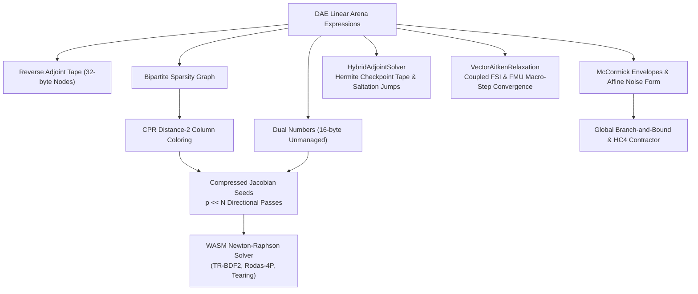

# Automatic Differentiation & Relaxations

**Implementation**:

- Forward Mode: `Dual` in [`packages/runtime/src/wasm/autodiff/dual.ts`](https://github.com/modelscript/modelscript/tree/main/packages/runtime/src/wasm/autodiff/dual.ts)
- Reverse Mode: `AdTape` in [`packages/runtime/src/wasm/autodiff/tape.ts`](https://github.com/modelscript/modelscript/tree/main/packages/runtime/src/wasm/autodiff/tape.ts)
- Sparse Jacobian Coloring: `CCSMatrix` & `ColoringEngine` in [`packages/runtime/src/wasm/autodiff/coloring.ts`](https://github.com/modelscript/modelscript/tree/main/packages/runtime/src/wasm/autodiff/coloring.ts)
- McCormick Envelopes: `McCormickTuple` in [`packages/runtime/src/wasm/autodiff/mccormick.ts`](https://github.com/modelscript/modelscript/tree/main/packages/runtime/src/wasm/autodiff/mccormick.ts)
- Affine Arithmetic: `AffineForm` in [`packages/runtime/src/wasm/autodiff/affine.ts`](https://github.com/modelscript/modelscript/tree/main/packages/runtime/src/wasm/autodiff/affine.ts)
- Hybrid Adjoint Sensitivity & Saltation Matrices: `HybridAdjointSolver` in [`packages/simulate/src/core/hybrid-adjoint.ts`](https://github.com/modelscript/modelscript/tree/main/packages/simulate/src/core/hybrid-adjoint.ts)
- Aitken Dynamic $\Delta$-Relaxation & Multi-Rate Sub-Cycling: `VectorAitkenRelaxation` & `MultiRateSubCycleScheduler` in [`packages/simulate/src/core/fsi-relaxation.ts`](https://github.com/modelscript/modelscript/tree/main/packages/simulate/src/core/fsi-relaxation.ts)

---

## Academic Citations

### Forward-Mode Dual Numbers

- **Clifford, W. K. (1873)**. _"Preliminary sketch of biquaternions."_  
  **Proceedings of the London Mathematical Society**, 4, pp. 381–395.  
  DOI: [10.1112/plms/s1-4.1.381](https://doi.org/10.1112/plms/s1-4.1.381)
- **Study, E. (1903)**. _Geometrie der Dynamen: Die Zusammensetzung von Kräften und verwandte Gegenstände der Geometrie._ B.G. Teubner.
- **Rall, L. B. (1981)**. _Automatic Differentiation: Techniques and Applications._  
  **Lecture Notes in Computer Science**, 120, Springer.  
  DOI: [10.1007/3-540-10861-0](https://doi.org/10.1007/3-540-10861-0)

### Reverse-Mode Adjoint Accumulation (Wengert List)

- **Wengert, R. E. (1964)**. _"A simple automatic derivative evaluation program."_  
  **Communications of the ACM**, 7(8), pp. 463–464.  
  DOI: [10.1145/355586.364791](https://doi.org/10.1145/355586.364791)
- **Linnainmaa, S. (1976)**. _"Taylor expansion of the accumulated rounding error."_  
  **BIT Numerical Mathematics**, 16(2), pp. 146–160.  
  DOI: [10.1007/BF01931367](https://doi.org/10.1007/BF01931367)
- **Griewank, A., & Walther, A. (2008)**. _Evaluating Derivatives: Principles and Techniques of Algorithmic Differentiation_ (2nd ed.). SIAM.  
  ISBN: [978-0-898716-59-7](https://epubs.siam.org/doi/book/10.1137/1.9780898717761)

### Distance-2 Graph Coloring for Sparse Jacobians

- **Curtis, A. R., Powell, M. J. D., & Reid, J. K. (1974)**. _"On the estimation of sparse Jacobian matrices."_  
  **Journal of the Institute of Mathematics and Its Applications**, 13(1), pp. 117–119.  
  DOI: [10.1093/imamat/13.1.117](https://doi.org/10.1093/imamat/13.1.117) _(CPR Algorithm)_
- **Coleman, T. F., & Moré, J. J. (1983)**. _"Estimation of sparse Jacobian matrices and graph coloring problems."_  
  **SIAM Journal on Numerical Analysis**, 20(1), pp. 187–209.  
  DOI: [10.1137/0720013](https://doi.org/10.1137/0720013)
- **Gebremedhin, A. H., Manne, F., & Pothen, A. (2005)**. _"What color is your Jacobian? Graph coloring for computing derivatives."_  
  **SIAM Review**, 47(4), pp. 629–705.  
  DOI: [10.1137/S0036144504446096](https://doi.org/10.1137/S0036144504446096)

### McCormick Relaxations & Affine Arithmetic

- **McCormick, G. P. (1976)**. _"Computability of global solutions to factorable nonconvex programs: Part I—Convex underestimating problems."_  
  **Mathematical Programming**, 10(1), pp. 147–175.  
  DOI: [10.1007/BF01580665](https://doi.org/10.1007/BF01580665)
- **Mitsos, A., Chachuat, B., & Barton, P. I. (2009)**. _"McCormick-based relaxations of algorithms."_  
  **SIAM Journal on Optimization**, 20(2), pp. 573–601.  
  DOI: [10.1137/080717341](https://doi.org/10.1137/080717341)
- **Tsoukalas, A., & Mitsos, A. (2014)**. _"Multivariate McCormick relaxations."_  
  **Journal of Global Optimization**, 59(2), pp. 633–662.  
  DOI: [10.1007/s10898-014-0169-z](https://doi.org/10.1007/s10898-014-0169-z)
- **de Figueiredo, L. H., & Stolfi, J. (2004)**. _"Affine arithmetic: concepts and applications."_  
  **Numerical Algorithms**, 37(1), pp. 147–158.  
  DOI: [10.1023/B:NUMA.0000049462.70970.b6](https://doi.org/10.1023/B:NUMA.0000049462.70970.b6)

### Hybrid Adjoint Sensitivity & Saltation Matrices

- **Barton, P. I., & Lee, C. K. (2002)**. _"Modeling, simulation, sensitivity analysis, and optimization of hybrid systems."_  
  **ACM Transactions on Modeling and Computer Simulation**, 12(4), pp. 256–289.  
  DOI: [10.1145/643120.643122](https://doi.org/10.1145/643120.643122)
- **Filippov, A. F. (1988)**. _Differential Equations with Discontinuous Righthand Sides._  
  **Mathematics and Its Applications**, 18, Springer.  
  DOI: [10.1007/978-94-015-7793-9](https://doi.org/10.1007/978-94-015-7793-9)
- **Corner, S., Sandu, A., & Sandu, C. (2019)**. _"Adjoint sensitivity analysis of hybrid multibody dynamical systems."_  
  **Multibody System Dynamics**, 49, pp. 395–420.  
  DOI: [10.1007/s11044-019-09725-2](https://doi.org/10.1007/s11044-019-09725-2)

### Aitken Dynamic $\Delta$-Relaxation for Partitioned Co-Simulation

- **Küttler, U., & Wall, W. A. (2008)**. _"Fixed-point fluid–structure interaction solvers with dynamic relaxation."_  
  **Computational Mechanics**, 43(1), pp. 61–72.  
  DOI: [10.1007/s00466-008-0255-5](https://doi.org/10.1007/s00466-008-0255-5)
- **Irons, B. M., & Tuck, R. C. (1969)**. _"A version of the Aitken accelerator for computer iteration."_  
  **International Journal for Numerical Methods in Engineering**, 1(3), pp. 275–277.  
  DOI: [10.1002/nme.1620010306](https://doi.org/10.1002/nme.1620010306)

---

## ModelScript Architectural Rationale

Numerical finite-difference approximations ($\frac{f(x + h) - f(x)}{h}$) suffer from a fundamental trade-off: large step sizes $h$ cause truncation errors, while small step sizes cause catastrophic floating-point cancellation.

ModelScript implements an integrated suite of **exact differentiation and continuous bounding engines** inside WebAssembly linear memory:

1. **Forward-Mode Dual Numbers**: Computes exact machine-precision directional derivatives $\nabla f(x) \cdot v$ concurrently with primal function evaluation for Newton steps in algebraic loops and stiff ODE/DAE integrators without allocating expression trees.
2. **Reverse-Mode Computational Tape**: Evaluates scalar objective gradients $\nabla f(x) \in \mathbb{R}^N$ with cost proportional to $O(1)$ evaluations of $f$, enabling gradient-based parameter estimation and surrogate neural network training.
3. **CPR Distance-2 Graph Coloring**: For large-scale DAE systems ($N = 10{,}000+$ equations), evaluating the full $N \times N$ Jacobian naively requires $N$ forward passes. CPR distance-2 coloring partitions structural columns into $p \ll N$ non-interfering groups (typically $p \le 15$ for sparse physical networks), reducing Jacobian assembly time by orders of magnitude.
4. **McCormick Envelopes & Affine Arithmetic**: Classical interval arithmetic suffers from the **dependency problem**: evaluating $x - x$ for $x \in [0, 1]$ yields $[-1, 1]$ instead of $0$, causing rapid exponential bounding blowup. Affine arithmetic tracks first-order noise symbols ($\epsilon_i \in [-1, 1]$) across state equations, while McCormick relaxations compute rigorous convex lower bounds ($f^R$) and concave upper bounds ($f^{AR}$) for non-convex global optimization.
5. **Hybrid Adjoint Sensitivity with Saltation Matrices**: Standard continuous adjoint solvers break down across Modelica `when`/`reinit` events, impact mechanics, or switching surfaces because Dirac delta impulses arise at event-crossing times $t^*$. ModelScript propagates reverse-mode adjoints across non-smooth mode transitions using exact saltation matrix jump conditions alongside optional sigmoidal equation smoothing (`DAEEventRelaxer`).
6. **Aitken Dynamic $\Delta$-Relaxation**: Partitioned co-simulation of strongly coupled multi-physics domains (such as lightweight aerodynamic structures coupled to dense fluids or algebraic FMU loops) diverges under explicit Gauss-Seidel macro-steps due to the artificial added-mass effect. Dynamic vector Aitken acceleration stabilizes fixed-point iterations without requiring monolithic cross-FMU Jacobians.

---

## ModelScript Modifications & WASM Architecture



### 1. Zero-GC Dual Number Arithmetic

Represented as a 16-byte unmanaged struct (`@unmanaged`) in WASM memory:

```typescript
@unmanaged
export class Dual {
  val: f64; // Primal evaluation f(x)
  dot: f64; // Directional derivative f'(x) * v
}
```

All elementary operators ($+, -, \times, /$) and transcendental functions ($\sin, \cos, \exp, \log, \text{pow}$) are inlined without intermediate object allocation.

### 2. Linear Memory Computational Tape

The reverse-mode tape records every elementary operation into a flat 32-byte stride unmanaged array so the backward pass can traverse the graph without heap allocations:
$$\text{Stride: } [\text{op: u32}, \text{left: u32}, \text{right: u32}, \text{aux: u32}, \text{valLo: u32}, \text{valHi: u32}, \text{gradLo: u32}, \text{gradHi: u32}]$$

| Symbol             | Meaning                                                             | Units / Domain      |
| :----------------- | :------------------------------------------------------------------ | :------------------ |
| `op`               | Opcode of the elementary arithmetic or transcendental operation     | `u32` (enum tag)    |
| `left`, `right`    | Tape indices of the left and right operand nodes                    | `u32` (tape index)  |
| `aux`              | Auxiliary metadata (e.g., constant pool index or parameter ID)      | `u32`               |
| `valLo`, `valHi`   | Lower and upper 32-bit words of the IEEE-754 `f64` primal value     | `u32` (split `f64`) |
| `gradLo`, `gradHi` | Lower and upper 32-bit words of the IEEE-754 `f64` adjoint gradient | `u32` (split `f64`) |

During the reverse pass, sensitivities (adjoints) are propagated backward from outputs to inputs in topological order directly in linear memory:
$$\bar{x}_j \leftarrow \bar{x}_j + \bar{x}_i \cdot \frac{\partial f_i}{\partial x_j}$$
where:

- $\bar{x}_i, \bar{x}_j \in \mathbb{R}$ are the adjoint sensitivities ($\partial \mathcal{L} / \partial x_i$ and $\partial \mathcal{L} / \partial x_j$) of nodes $i$ and $j$,
- $\frac{\partial f_i}{\partial x_j}$ is the local partial derivative of elementary operation $f_i$ with respect to input $x_j$.

### 3. CPR Distance-2 Coloring Algorithm

Two columns $j$ and $k$ in the Jacobian $J$ are **structurally orthogonal** if they do not share any non-zero row entry, meaning they can be perturbed simultaneously without interference:
$$\text{Row}(j) \cap \text{Row}(k) = \emptyset$$
where $\text{Row}(j)$ is the set of row indices with non-zero entries in column $j$ (and similarly for column $k$), and $\emptyset$ is the empty set.

The graph coloring algorithm:

1. Constructs the bipartite graph $B = (V_R, V_C, E)$ where edge $(i, j) \in E \iff \frac{\partial f_i}{\partial x_j} \neq 0$.
2. Colors columns $V_C$ such that any pair of columns connected by a path of length 2 receives different colors.
3. Groups columns of color $c \in \{1, \dots, p\}$ into a perturbation vector $d^{(c)} = \sum_{j \in \text{Color}(c)} e_j$.
4. Computes the entire compressed Jacobian in exactly $p$ directional forward-mode passes by summing the columns sharing each color:
   $$J \cdot d^{(c)} = \sum_{j \in \text{Color}(c)} J_{*, j}$$

| Symbol            | Meaning                                                      | Units / Domain              |
| :---------------- | :----------------------------------------------------------- | :-------------------------- |
| $J$               | Sparse Jacobian matrix of the system                         | $\mathbb{R}^{m \times n}$   |
| $d^{(c)}$         | Binary seed vector for color class $c$                       | $\{0, 1\}^n$                |
| $\text{Color}(c)$ | Set of column indices assigned color $c \in \{1, \dots, p\}$ | Subset of $\{1, \dots, n\}$ |
| $J_{*, j}$        | $j$-th column vector of the Jacobian $J$                     | $\mathbb{R}^m$              |

### 4. McCormick Relaxations

For factorable bilinear products $z = x \cdot y$ over bounds $x \in [x^L, x^U]$ and $y \in [y^L, y^U]$, the tightest linear convex underestimator $z^{cv}$ and concave overestimator $z^{cc}$ enclose the bilinear surface:
$$z^{cv} = \max\left(x^L y + x y^L - x^L y^L, \; x^U y + x y^U - x^U y^U\right)$$
$$z^{cc} = \min\left(x^U y + x y^L - x^U y^L, \; x^L y + x y^U - x^L y^U\right)$$

| Symbol           | Meaning                                                        | Units / Domain |
| :--------------- | :------------------------------------------------------------- | :------------- |
| $z^{cv}, z^{cc}$ | Convex underestimator and concave overestimator of $x \cdot y$ | $\mathbb{R}$   |
| $x, y$           | Scalar factor variables in the bilinear product                | $\mathbb{R}$   |
| $x^L, x^U$       | Lower and upper interval bounds on $x$                         | $\mathbb{R}$   |
| $y^L, y^U$       | Lower and upper interval bounds on $y$                         | $\mathbb{R}$   |

ModelScript evaluates McCormick tuples $[z^{cv}, z^{cc}, \nabla z^{cv}, \nabla z^{cc}]$ directly on WASM arrays.

### 5. Hybrid Adjoint Sensitivity with Saltation Matrices (`hybrid-adjoint.ts`)

When a hybrid DAE trajectory crosses a discrete event surface $g(x(t^*), p) = 0$ with state reset map $x(t^{*+}) = h(x(t^{*-}), p)$ (such as Modelica `when` clauses, `reinit(x, expr)` impulses, or mechanical contact restitution), the forward sensitivity transition matrix undergoes a discontinuous rank-1 update governed by the **saltation matrix**, which maps pre-event tangent perturbations to post-event perturbations across the switching surface:
$$\Xi = I + \frac{\left(f^+ - f^- - \frac{\partial h}{\partial t}\right) (\nabla_x g)^T}{(\nabla_x g)^T f^- + \frac{\partial g}{\partial t}}$$

| Symbol       | Meaning                                                          | Units / Domain            |
| :----------- | :--------------------------------------------------------------- | :------------------------ |
| $\Xi$        | Saltation (sensitivity jump) matrix at the event surface         | $\mathbb{R}^{n \times n}$ |
| $I$          | Identity matrix                                                  | $\mathbb{R}^{n \times n}$ |
| $f^-, f^+$   | Pre-event and post-event state time derivatives $\dot{x}$        | $\mathbb{R}^n$            |
| $h(x, p, t)$ | Discrete state reset map $x^+ = h(x^-, p, t)$                    | $\mathbb{R}^n$            |
| $g(x, p, t)$ | Event indicator (guard) function defining the switching surface  | $\mathbb{R}$              |
| $\nabla_x g$ | Spatial gradient of the guard function with respect to state $x$ | $\mathbb{R}^n$            |
| $t$          | Simulation time                                                  | $\text{s}$                |

`HybridAdjointSolver` (`solveHybridAdjoint` in `packages/simulate/src/core/hybrid-adjoint.ts`) implements a three-phase hybrid sensitivity pipeline:

1. **Forward Integration & Event Localization**: Integrates the primal DAE arena while streaming cubic Hermite segments into `DenseHermiteCheckpointTape`. Whenever an event indicator $h(t, x, p)$ changes sign across a step, a 20-iteration bisection root-finder isolates the exact crossing time $t_e$, records pre-event limits $(x^-, \dot{x}^-)$, applies the discrete reset map $x^+ = \Delta(x^-, p)$, and re-evaluates post-event derivatives $(x^+, \dot{x}^+)$.
2. **Adjoint Jump across Event Surfaces**: During backward Heun integration of the co-state $\lambda(t)$, crossing $t_e$ in reverse applies the transposed saltation jump condition to $\lambda(t_e^-)$ and accumulates the discrete event timing contribution into the parameter gradient $\frac{d\mathcal{L}}{dp}$:
   $$\lambda(t_e^-) = \left[\frac{\partial \Delta}{\partial x}\right]^T \lambda(t_e^+) + \frac{\left(\frac{d\Delta}{dt}\right)^- - \dot{x}^+}{\dot{h}^-} \nabla_x h(t_e^-)$$
   $$\Delta\left(\frac{d\mathcal{L}}{dp}\right) = \left[\frac{\partial \Delta}{\partial p}\right]^T \lambda(t_e^+) + \frac{\left(\frac{d\Delta}{dt}\right)^- - \dot{x}^+}{\dot{h}^-} \nabla_p h(t_e^-)$$

   | Symbol                           | Meaning                                                                  | Units / Domain                  |
   | :------------------------------- | :----------------------------------------------------------------------- | :------------------------------ |
   | $\lambda(t_e^-), \lambda(t_e^+)$ | Adjoint (co-state) vectors immediately before and after event time $t_e$ | $\mathbb{R}^n$                  |
   | $\Delta(x, p, t)$                | Discrete state reset map $x^+ = \Delta(x^-, p, t)$                       | $\mathbb{R}^n$                  |
   | $\dot{x}^+$                      | Post-event state derivative                                              | $\mathbb{R}^n$                  |
   | $h, \dot{h}^-$                   | Event indicator function and its pre-event total time derivative         | $\mathbb{R}, \; \text{s}^{-1}$  |
   | $\mathcal{L}$                    | Scalar objective functional                                              | $\mathbb{R}$                    |
   | $p$                              | Vector of model parameters                                               | $\mathbb{R}^m$                  |
   | $\nabla_x h, \nabla_p h$         | Gradients of the event indicator with respect to $x$ and $p$             | $\mathbb{R}^n, \; \mathbb{R}^m$ |

3. **Optional Sigmoidal Event Relaxation**: For models with dense chattering or non-smooth algebraic switches (`if`, `abs`, `min`, `max`), `HybridAdjointSolver` optionally invokes `DAEEventRelaxer` to smooth C0 discontinuities into $C^\infty$ sigmoidal transitions prior to adjoint integration.

### 6. Aitken Dynamic $\Delta$-Relaxation for Coupled Co-Simulation (`fsi-relaxation.ts`)

In partitioned Fluid-Structure Interaction (FSI) and multi-FMU co-simulation macro-steps, exchanging boundary loads and displacements via unrelaxed fixed-point iteration $x_{k+1} = \tilde{x}(x_k)$ often diverges due to artificial added-mass instability.

`VectorAitkenRelaxation` (`packages/simulate/src/core/fsi-relaxation.ts`) accelerates and stabilizes convergence over scalar variables, multi-DOF nodal displacement vectors, or 3D boundary traction maps (`relaxBoundaryLoads`):

1. **Fixed-Point Residual**: At macro-step sub-iteration $k$, computes the interface residual $r_k = \tilde{x}_k - x_{k-1}$ and residual difference $\Delta r_k = r_k - r_{k-1}$.
2. **Secant Aitken Factor Update**: Updates the dynamic relaxation factor $\omega_k$ via the multidimensional Aitken $\Delta^2$ projection, which minimizes the residual norm along the secant direction:
   $$\omega_k = -\omega_{k-1} \frac{r_{k-1}^T (r_k - r_{k-1})}{\|r_k - r_{k-1}\|_2^2}$$
   clamped to a safe stability interval $\omega_k \in [\omega_{\min}, \omega_{\max}]$ (default $[0.02, 1.0]$).
3. **Relaxed State Update**: Advances the interface state via under-relaxation using the updated factor:
   $$x_{k+1} = x_k + \omega_k r_k$$
   terminating when the relative residual norm $\|r_k\|_2 / (\|x_k\|_2 + \epsilon) < \text{tol}$.

   | Symbol                   | Meaning                                                         | Units / Domain                                  |
   | :----------------------- | :-------------------------------------------------------------- | :---------------------------------------------- |
   | $\omega_k, \omega_{k-1}$ | Dynamic relaxation factor at sub-iterations $k$ and $k-1$       | Dimensionless, $[\omega_{\min}, \omega_{\max}]$ |
   | $r_k, r_{k-1}$           | Interface fixed-point residual vectors ($\tilde{x}_k - x_k$)    | $\mathbb{R}^n$                                  |
   | $x_k, x_{k+1}$           | Relaxed interface state vectors at sub-iterations $k$ and $k+1$ | $\mathbb{R}^n$                                  |
   | $\|\cdot\|_2$            | Euclidean ($L_2$) vector norm                                   | $\mathbb{R}_{\ge 0}$                            |

4. **Multi-Rate Sub-Cycling (`MultiRateSubCycleScheduler`)**: Synchronizes fast acoustic CFD steps ($\Delta t_{\text{CFD}} \sim 10^{-4}\text{ s}$), intermediate elastodynamic FEA steps ($\Delta t_{\text{FEA}} \sim 10^{-3}\text{ s}$), and macro 1D DAE steps ($\Delta t_{\text{macro}} \sim 10^{-2}\text{ s}$) using linear sub-step boundary interpolation $\mathbf{u}(\tau) = (1 - \tau)\mathbf{u}_{\text{prev}} + \tau \mathbf{u}_{\text{target}}$.

---

## Upstream & Downstream Integration

| Pipeline Component         | Upstream Dependencies                              | Downstream Consumers                                               |
| :------------------------- | :------------------------------------------------- | :----------------------------------------------------------------- |
| **Dual Numbers**           | `DAEBuilder` AST, Variable seed vector             | Algebraic loop tearing, Newton solvers, sensitivity analysis       |
| **AdTape**                 | `DAEBuilder` objective expressions                 | L-BFGS-B optimizer, surrogate loss backprop                        |
| **CPR Coloring**           | Bipartite incidence matrix from `BltEngine`        | Sparse Jacobian generation, SUNDIALS/TR-BDF2 linear solves         |
| **McCormick & Affine**     | Bound intervals from `QueryEngine`                 | HC4 contractor, Nelson-Oppen theory coordinator, SOS bounds        |
| **HybridAdjointSolver**    | `DAEBuilder`, `DenseHermiteCheckpointTape`, Events | Hybrid parameter calibration, optimal control across mode switches |
| **VectorAitkenRelaxation** | Partitioned CFD/FEA boundary loads & FMU ports     | Coupled aeroelastic FSI solver, SSP co-simulation master           |
