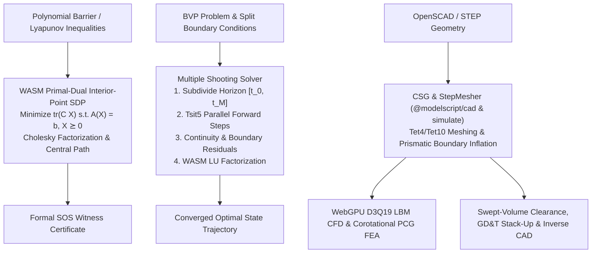

# Semidefinite Programming, BVP, Continuum Physics & CAD/ECAD

**Implementation**:

- Primal-Dual Interior-Point SDP: `SdpSolver` in [`packages/runtime/src/solvers/wasm_sdp_solver.ts`](https://github.com/modelscript/modelscript/tree/main/packages/runtime/src/solvers/wasm_sdp_solver.ts)
- Multiple Shooting & Collocation BVP: `solveBvpShooting` in [`packages/simulate/src/solvers/bvp-solver.ts`](https://github.com/modelscript/modelscript/tree/main/packages/simulate/src/solvers/bvp-solver.ts)
- Constructive Solid Geometry & CFD Patches: `evaluateScad` in [`languages/scad/src/evaluator.ts`](https://github.com/modelscript/modelscript/tree/main/languages/scad/src/evaluator.ts)
- 3D Continuum Physics & B-Rep Meshing: `WebGPULbmRunner` ([`packages/simulate/src/cfd/webgpu-lbm-runner.ts`](https://github.com/modelscript/modelscript/tree/main/packages/simulate/src/cfd/webgpu-lbm-runner.ts)), `FeaSolver` ([`packages/simulate/src/fea/fea-solver.ts`](https://github.com/modelscript/modelscript/tree/main/packages/simulate/src/fea/fea-solver.ts)), and `StepMesher` ([`packages/simulate/src/meshing/step-mesher.ts`](https://github.com/modelscript/modelscript/tree/main/packages/simulate/src/meshing/step-mesher.ts))
- Mechanical Swept-Volume, GD&T Stack-Up & Inverse CAD: `DynamicClearanceVerifier` ([`packages/cad/src/dynamic-clearance.ts`](https://github.com/modelscript/modelscript/tree/main/packages/cad/src/dynamic-clearance.ts)), `ToleranceStackVerifier` ([`packages/cad/src/tolerance-stack.ts`](https://github.com/modelscript/modelscript/tree/main/packages/cad/src/tolerance-stack.ts)), and `ParameterInversionEngine` ([`packages/cad/src/parameter-inversion.ts`](https://github.com/modelscript/modelscript/tree/main/packages/cad/src/parameter-inversion.ts))
- ECAD / PCB Geometry, Autorouting & DRC: `generateManufacturingFiles` ([`packages/cad/src/ecad/gerber.ts`](https://github.com/modelscript/modelscript/tree/main/packages/cad/src/ecad/gerber.ts)), `PCBRouter` ([`packages/cad/src/ecad/engine/router.ts`](https://github.com/modelscript/modelscript/tree/main/packages/cad/src/ecad/engine/router.ts)), and `runDRC` ([`packages/cad/src/ecad/engine/drc.ts`](https://github.com/modelscript/modelscript/tree/main/packages/cad/src/ecad/engine/drc.ts))

---

## Academic Citations

### Semidefinite Programming & Sum-of-Squares (SOS)

- **Vandenberghe, L., & Boyd, S. (1996)**. _"Semidefinite Programming."_  
  **SIAM Review**, 38(1), pp. 49–95.  
  DOI: [10.1137/1038003](https://doi.org/10.1137/1038003)
- **Helmberg, C., Rendl, F., Vanderbei, R. J., & Wolkowicz, H. (1996)**. _"An interior-point method for semidefinite programming."_  
  **SIAM Journal on Optimization**, 6(2), pp. 342–361.  
  DOI: [10.1137/0806018](https://doi.org/10.1137/0806018)
- **Alizadeh, F., Haeberly, J. P. A., & Overton, M. L. (1998)**. _"Primal-dual interior-point methods for semidefinite programming: convergence rates, stability and numerical results."_  
  **SIAM Journal on Optimization**, 8(3), pp. 746–768.  
  DOI: [10.1137/S105262349528701X](https://doi.org/10.1137/S105262349528701X)
- **Parrilo, P. A. (2003)**. _"Semidefinite programming relaxations for semialgebraic problems."_  
  **Mathematical Programming**, 96(2), pp. 293–320.  
  DOI: [10.1007/s10107-003-0387-5](https://doi.org/10.1007/s10107-003-0387-5) _(SOS Programming)_

### Boundary Value Problems (BVP) & Multiple Shooting

- **Morrison, D. D., Riley, J. D., & Zancanaro, J. F. (1962)**. _"Multiple shooting method for two-point boundary value problems."_  
  **Communications of the ACM**, 5(12), pp. 613–614.  
  DOI: [10.1145/368996.369028](https://doi.org/10.1145/368996.369028)
- **Stoer, J., & Bulirsch, R. (2002)**. _Introduction to Numerical Analysis_ (3rd ed.). Texts in Applied Mathematics 12, Springer. Section 7.3: Multiple Shooting Methods.  
  ISBN: [978-0-387-95452-3](https://link.springer.com/book/10.1007/978-0-387-21738-3)
- **Ascher, U. M., Mattheij, R. M., & Russell, R. D. (1995)**. _Numerical Solution of Boundary Value Problems for Ordinary Differential Equations._  
  SIAM Classics in Applied Mathematics 13.  
  DOI: [10.1137/1.9781611971231](https://doi.org/10.1137/1.9781611971231)
- **Betts, J. T. (2010)**. _Practical Methods for Optimal Control and Estimation Using Nonlinear Programming_ (2nd ed.).  
  SIAM Advances in Design and Control 19.  
  DOI: [10.1137/1.9780898718577](https://doi.org/10.1137/1.9780898718577)

### Constructive Solid Geometry (CSG), Continuum Physics & CAD/ECAD

- **Requicha, A. A. (1980)**. _"Representations for rigid solids: Theory, methods, and systems."_  
  **ACM Computing Surveys**, 12(4), pp. 437–464.  
  DOI: [10.1145/356827.356833](https://doi.org/10.1145/356827.356833)
- **Qian, Y. H., d'Humières, D., & Lallemand, P. (1992)**. _"Lattice BGK models for Navier-Stokes equation."_  
  **Europhysics Letters**, 17(6), pp. 479–484.  
  DOI: [10.1209/0295-5075/17/6/001](https://doi.org/10.1209/0295-5075/17/6/001)
- **Bouzidi, M., Firdaouss, M., & Lallemand, P. (2001)**. _"Momentum transfer of a Boltzmann-lattice fluid with boundaries."_  
  **Physics of Fluids**, 13(11), pp. 3452–3459.  
  DOI: [10.1063/1.1399290](https://doi.org/10.1063/1.1399290)
- **Müller, M., & Gross, M. (2004)**. _"Interactive virtual materials."_  
  **Proceedings of Graphics Interface 2004**, pp. 239–246. _(Corotational Finite Elements)_

---

## ModelScript Architectural Rationale

1. **Semidefinite Programming (SDP) for Verified Safety**: Formal continuous verification of non-linear physical models requires proving that state trajectories $\mathbf{x}(t)$ never breach unsafe operating envelopes. Synthesizing polynomial Lyapunov functions $V(\mathbf{x}) > 0$ and barrier certificates $B(\mathbf{x}) \le 0$ reduces to finding Sum-of-Squares (SOS) decompositions:
   $$p(\mathbf{x}) = \mathbf{z}(\mathbf{x})^T Q \, \mathbf{z}(\mathbf{x}) \ge 0 \iff Q \succeq 0$$
   By implementing a native primal-dual interior-point SDP solver in WebAssembly, ModelScript provides mathematically verified stability proofs directly in the browser and CLI without relying on external monolithic commercial solvers.
2. **Multiple Shooting BVP for Optimal Trajectories**: Boundary Value Problems (BVPs) govern optimal trajectory planning, model predictive control (MPC), and periodic limit cycle detection with split boundary conditions:
   $$g(\mathbf{y}(t_0), \mathbf{y}(t_{\text{end}}), \mathbf{p}) = \mathbf{0}$$
   Standard single shooting suffers from catastrophic numerical instability on stiff or chaotic dynamics. Multiple shooting subdivides the time horizon into $M$ subintervals, guaranteeing numerical stability and fast Newton-Raphson convergence.
3. **Constructive Solid Geometry (CSG) for Multi-Physics 3D Packaging**: Lumped-parameter 1D physical models (Modelica) rely on 3D geometric properties (mass, inertia tensor, aerodynamic drag area, hydraulic volume). ModelScript evaluates OpenSCAD models into normalized CSG solid trees (`@modelscript/cad`), auto-tagging boundary patches (`inlet`, `outlet`, `wall`, `symmetry`) for downstream OpenCascade B-Rep evaluation, STEP export, and SU2/OpenFOAM CFD meshing.

---

## Mathematical Formulation & Execution Architecture

### 1. Primal-Dual Interior Point SDP Solver

Solves standard primal and dual semidefinite programs:
$$\text{Primal: } \min_{X \in \mathbb{S}^n} \text{tr}(C X) \quad \text{s.t.} \quad \text{tr}(A_i X) = b_i, \; X \succeq 0$$
$$\text{Dual: } \max_{y \in \mathbb{R}^m, S \in \mathbb{S}^n} b^T y \quad \text{s.t.} \quad \sum_{i=1}^m y_i A_i + S = C, \; S \succeq 0$$

- **Central Path Following**: Enforces the perturbed complementarity condition $X S = \mu I$ with barrier parameter $\mu = \frac{\text{tr}(X S)}{n}$.
- **WASM Linear Algebra**: Predictor-corrector search directions $(\Delta X, \Delta y, \Delta S)$ are computed using fast in-memory Cholesky factorizations (`wasm_gaussian.ts`), with backtracking line search to ensure $X + \alpha \Delta X \succ 0$ and $S + \alpha \Delta S \succ 0$.

### 2. Multiple Shooting BVP Solver

Subdivides the horizon $[t_0, t_{\text{end}}]$ into $M$ subintervals with mesh points $t_0 < t_1 < \dots < t_M = t_{\text{end}}$:

- **State Trajectory Variables**: Introduces free initial conditions $\mathbf{s}_m$ at each node $t_m$.
- **Subinterval Integration**: Integrates forward from $t_m$ to $t_{m+1}$ using adaptive `tsit5`:
  $$\mathbf{y}(t_{m+1}; \mathbf{s}_m, \mathbf{p})$$
- **Matching Residual System**: Solves the $(M \cdot n + k) \times (M \cdot n + k)$ simultaneous nonlinear system:
  $$F_m(\mathbf{s}_m, \mathbf{s}_{m+1}) = \mathbf{y}(t_{m+1}; \mathbf{s}_m, \mathbf{p}) - \mathbf{s}_{m+1} = \mathbf{0}, \quad m = 0, \dots, M-1$$
  $$g(\mathbf{s}_0, \mathbf{s}_M, \mathbf{p}) = \mathbf{0}$$
- **Newton-Raphson Update**: Evaluates sensitivity Jacobians along trajectories and solves the block-banded linear system via WASM Gaussian LU elimination.

### 3. OpenSCAD CSG Engine & CFD Boundary Tagging

Transforms procedural CSG trees into boundary-tagged solid geometries:

- Evaluates transformations (`translate`, `rotate`, `scale`, `mirror`) and regularized Boolean operators (`union`, `difference`, `intersection`).
- Decorates faces with CFD boundary tags (`tagPatch`, `BoundaryPatchType`: `inlet`, `outlet`, `wall`, `symmetry`), for handoff to automated SU2 mesh generators.

### 4. 3D Continuum Physics & B-Rep Meshing (`packages/simulate`)

ModelScript embeds native 3D continuum fluid, structural, and volumetric meshing engines that couple directly to 1D DAE simulations:

1. **WebGPU D3Q19 Lattice Boltzmann Method (LBM) CFD Solver (`webgpu-lbm-runner.ts`)**:
   - Discretizes the Boltzmann transport equation over a 19-velocity 3D lattice (`D3Q19`) stored in a zero-copy Structure-of-Arrays arena (`CfdFieldArena`) with ping-pong distribution buffers (`f0`, `f1`) and WGSL compute shader execution (`LBM_D3Q19_WGSL`, workgroups $8 \times 8 \times 4$):
     $$f_i^{\text{post}}(\mathbf{x}, t) = f_i(\mathbf{x}, t) - \omega_{\text{loc}}\!\left(f_i(\mathbf{x}, t) - f_i^{\text{eq}}(\rho, \mathbf{u})\right), \qquad f_i^{\text{eq}} = w_i \rho \!\left(1 + 3(\mathbf{c}_i \cdot \mathbf{u}) + \frac{9}{2}(\mathbf{c}_i \cdot \mathbf{u})^2 - \frac{3}{2}\|\mathbf{u}\|^2\right)$$
   - **Smagorinsky Subgrid LES Turbulence**: Dynamically adapts the local relaxation frequency $\omega_{\text{loc}} = (\tau_0 + \Delta\tau_{\text{LES}})^{-1}$ from the non-equilibrium momentum flux tensor $\Pi_{\alpha\beta}^{\text{neq}} = \sum_i c_{i\alpha} c_{i\beta} (f_i - f_i^{\text{eq}})$.
   - **Bouzidi Curved Boundaries & Moving-Wall FSI**: Applies sub-cell linear interpolation for curved solid obstacles ($\delta_{\text{wall}} < 0.5$ vs. $\delta_{\text{wall}} \ge 0.5$), injects moving-wall momentum $\Delta f_i = 6 w_i \rho (\mathbf{c}_i \cdot \mathbf{u}_{\text{wall}})$ for two-way aeroelastic FSI, and integrates surface drag forces via momentum exchange.
2. **3D Tet4/Tet10 Linear/Nonlinear Corotational Elasticity & Thermal FEA Solver (`fea-solver.ts`)**:
   - Assembles global sparse stiffness $K$ and consistent mass $M$ matrices in Compressed Sparse Row (CSR) format for 4-node linear (`Tet4Element`) and 10-node quadratic (`Tet10Element`) tetrahedra.
   - **Corotational Large-Rotation Kinematics**: Extracts element rigid-body rotation $R_e \in \text{SO}(3)$ from the deformation gradient $F = e_0 E_0^{-1}$ via 6-step Higham polar decomposition iterations $R_{k+1} = \frac{1}{2}(R_k + R_k^{-T})$, rotating local element stiffness blocks $K_{\text{rot}} = R_e K_e R_e^T$ for geometric nonlinearity invariance.
   - **Jacobi-Preconditioned Conjugate Gradient (PCG) & Newmark-$\beta$ Dynamics**: Solves static equilibrium $K u = f$ and Rayleigh-damped transient elastodynamics $M \ddot{u} + (\alpha_M M + \beta_K K)\dot{u} + K u = f$ using unconditional-stability Newmark-$\beta$ ($\beta = 0.25, \gamma = 0.5$) time stepping, outputting nodal/element von Mises stresses and yield safety factors.
3. **STEP B-Rep Tetrahedral Mesher & Prismatic Boundary-Layer Extrusion (`step-mesher.ts`)**:
   - `StepMesher` converts ISO 10303-21 STEP B-Rep entities and watertight surface triangulations into volumetric `Tet4` / `Tet10` meshes (`Tet4Mesher`), classifies exterior boundary patches (`PatchClassifier`), extrudes viscous prismatic inflation layers along `WALL_BODY` surfaces (`BoundaryLayerExtruder`), evaluates Jacobian/aspect-ratio quality (`MeshQualityAnalyzer`), and exports ready-to-run CalculiX (`*.inp`) and SU2 (`*.su2`) decks.

### 5. Mechanical Swept-Volume, GD&T Stack-Up & Inverse CAD (`packages/cad`)

1. **Dynamic Swept-Volume Collision & Clearance Envelopes (`dynamic-clearance.ts`)**:
   - `DynamicClearanceVerifier` bridges continuous reachability flowpipes (`TrajectoryStepEnclosure[]`) into 3D CAD assemblies (`Assembly`). At each time step, it propagates interval state enclosures $[x_i^{\text{lo}}, x_i^{\text{hi}}]$ through translational Minkowski sums, rotational corner-envelope expansions, and soft-tissue/compliant cavity morphing (`volume_radial` $s = (V/V_0)^{1/3}$, `anisotropic`, and `modal` skinning).
   - Evaluates exact pairwise AABB separation distances (`computeAABBDistance`) and closest witness points (`computeAABBClosestPoints`), automatically synthesizing a 3D counterexample CAD assembly at the worst-case collision timestamp $t^*$ if any clearance rule is violated.
2. **Worst-Case, Statistical RSS & Coupled Thermal-Elastic GD&T Stack-Up (`tolerance-stack.ts`)**:
   - `ToleranceStackVerifier` verifies 1D/3D kinematic assembly gap loops across directional contributors ($d_i \in \{+1, -1\}$) combining bilateral manufacturing tolerances $[t_i^L, t_i^U]$, thermal expansion over $[T_{\min}, T_{\max}]$ ($\Delta L_{\text{th}} = L_0 \alpha_{\text{CTE}} \Delta T$), and axial elastic deflection under dynamic loads $[F_{\min}, F_{\max}]$ ($\Delta L_{\text{el}} = \frac{F L_0}{E A}$):
     $$g_{\text{min, WC}} = \sum_{i} d_i L_{0,i} + \sum_{i} \min(d_i t_i^L, d_i t_i^U) + \Delta g_{\text{th, min}} + \Delta g_{\text{el, min}}, \qquad \sigma_{\text{RSS}} = \sqrt{\sum_{i} \left(\frac{t_i^U - t_i^L}{6}\right)^2}$$
3. **Certified Bi-Directional CAD Parameter Inversion (`parameter-inversion.ts`)**:
   - `ParameterInversionEngine` closes the loop from 1D system optimization back to 3D MCAD source code. Given target mass/inertia constraints (`solveLengthForMass`, `scaleDimensionsForMass`) or optimized Modelica parameters, `patchMcadSourceCertified` verifies candidate dimensions against a multidisciplinary `SafeRegionGuard` ($\mathcal{P}_{\text{safe}}$ box bounds and buckling/stress/clearance predicates) before rewriting the parametric MCAD AST and regenerating STEP geometry.

### 6. ECAD / PCB Geometry, Autorouting & DRC (`packages/cad/src/ecad/`)

1. **RS-274X Gerber Aperture Evaluation & Excellon Drill Synthesis (`gerber.ts`)**:
   - `generateManufacturingFiles` compiles multi-layer `PCBLayout` models (`TopCopper`, `BottomCopper`, `InnerCopper1/2`, `Top/BottomSilkscreen`, `Top/BottomSolderMask`, `BoardOutline`) into IPC-compliant **RS-274X Gerber** (`%FSLAX46Y46*%`, $10^{-6}\text{ mm}$ integer precision) with deduplicated aperture macros (`%ADD10C,...*%`, circle/rect/oval pads, $0.1\text{ mm}$ negative-polarity solder mask expansion `%IPNEG*%`) and **Excellon** NC drill programs (`drill.xln`, `METRIC,TZ`).
2. **Multi-Layer Interactive & Constrained PCB Trace Router (`engine/router.ts`)**:
   - `PCBRouter` (`pcb-router.ts` / `engine/router.ts`) implements a multi-layer trace routing engine supporting pad snap-targeting (`snapToPad`), $90^\circ$ Manhattan (`manhattanRoute`) and $45^\circ$ octilinear (`diagonal45Route`: $\text{diag} = \min(|\Delta x|, |\Delta y|)$) segment constraints, and automatic plated through-hole via insertion (`insertVia`) on layer transitions.
3. **Euclidean Trace/Pad Clearance Design Rule Checking (`engine/drc.ts`)**:
   - `runDRC` (`pcb-drc.ts` / `engine/drc.ts`) executes non-blocking geometric verification across copper layers, checking minimum trace widths, trace-to-trace, trace-to-pad, and pad-to-pad Euclidean clearances ($d(\mathbf{p}_1, \mathbf{p}_2) - \frac{w_1 + w_2}{2} \ge c_{\min}$), via drill and annular ring minimums ($r_{\text{outer}} - r_{\text{drill}} \ge a_{\min}$), point-to-segment board-outline polygon distances (`minDistToPolygon`), and unconnected ratsnest net completeness.

---

## Upstream & Downstream Integration

| Component                             | Upstream Dependencies                                | Downstream Consumers                                           |
| :------------------------------------ | :--------------------------------------------------- | :------------------------------------------------------------- |
| **SdpSolver**                         | Polynomial constraints from `TheoryCoordinator`      | Formal Lyapunov barrier certificates, safety proofs            |
| **BvpSolver**                         | ODE dynamics from `DaeBuilder`, split boundary specs | Model predictive control (MPC), trajectory optimization        |
| **ScadEvaluator & StepMesher**        | Declarative `.scad` & `.step` B-Rep models           | `FeaSolver`, `WebGPULbmRunner`, CalculiX `.inp`, SU2 `.su2`    |
| **WebGPULbmRunner & FeaSolver**       | `StepMesher` Tet4/Tet10 meshes, FSI boundary loads   | Aeroelastic FSI co-simulation, POD reduced-order models        |
| **DynamicClearance & ToleranceStack** | Reachability flowpipes, GD&T specs, CAD `Assembly`   | `UnifiedVerifier` (`msx verify`), counterexample STEP export   |
| **ParameterInversionEngine**          | Optimized 1D Modelica parameters, `SafeRegionGuard`  | Automated MCAD source patching and AOT STEP regeneration       |
| **ECAD Gerber / PCBRouter / DRC**     | Electrical netlists, component footprints            | RS-274X `.gbr` & Excellon `.xln` manufacturing outputs, WebIDE |
