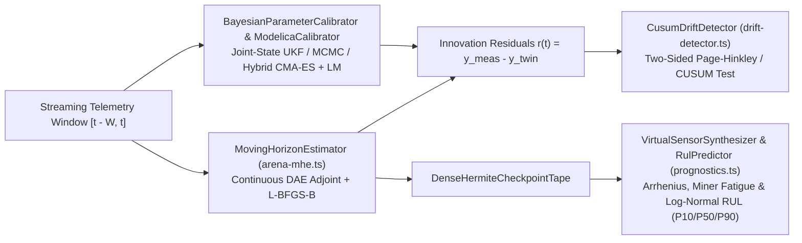

# Scientific Computing, Linear Algebra, Surrogates & Digital Twins

**Implementation**:

- Sparse Linear Algebra & Symbolic Solvers: [`packages/runtime/src/wasm/solvers/`](https://github.com/modelscript/modelscript/tree/main/packages/runtime/src/wasm/solvers/)
- Reduced-Order & Dimensional Surrogates: [`packages/simulate/src/surrogates/`](https://github.com/modelscript/modelscript/tree/main/packages/simulate/src/surrogates/)
- Operational Digital Twin Estimation & Prognostics: [`packages/simulate/src/twin/`](https://github.com/modelscript/modelscript/tree/main/packages/simulate/src/twin/), [`packages/simulate/src/calibration/bayesian_calibrator.ts`](https://github.com/modelscript/modelscript/tree/main/packages/simulate/src/calibration/bayesian_calibrator.ts), and [`packages/simulate/src/optimizer/core/calibrator.ts`](https://github.com/modelscript/modelscript/tree/main/packages/simulate/src/optimizer/core/calibrator.ts)

---

## 1. Davis SuiteSparse Left-Looking Cholesky ($LL^T$)

### Academic Citations

- **Davis, T. A. (2006)**. _Direct Methods for Sparse Linear Systems_.  
  **SIAM**. DOI: [10.1137/1.9780898718881](https://doi.org/10.1137/1.9780898718881)
- **Chen, Y., Davis, T. A., Hager, W. W., & Rajamanickam, S. (2008)**. _"Algorithm 887: CHOLMOD, supernodal sparse Cholesky factorization and update/downdate."_  
  **ACM Transactions on Mathematical Software**, 35(3), pp. 22:1–22:14. DOI: [10.1145/1462166.1462176](https://doi.org/10.1145/1462166.1462176)

### ModelScript Rationale & Modifications

Solves symmetric positive-definite sparse systems $A x = b$ arising in finite element analysis, electrical mesh equations, and quadratic programming subproblems.

- **Modifications**: Left-looking column-by-column factorization computing non-zero patterns dynamically via elimination trees; operates inside unmanaged WebAssembly linear memory with zero heap fragmentation.

---

## 2. Gilbert-Peierls Left-Looking Sparse LU ($P A Q = L U$)

### Academic Citations

- **Gilbert, J. R., & Peierls, T. (1988)**. _"An approach to sparse LU factorization based on graph coloring and topological sort."_  
  **International Conference on Supercomputing**.
- **Davis, T. A. (2006)**. _Direct Methods for Sparse Linear Systems_. **SIAM**. Chapter 5.

### ModelScript Rationale & Modifications

Factorizes unsymmetric, highly irregular sparse Jacobians generated by torn physical DAE systems.

- **Modifications**: Depth-first search (DFS) topological ordering to find the exact non-zero structure of each column in $L$ and $U$ in time proportional to arithmetic operations; threshold partial pivoting with diagonal preference to preserve physical sparsity.

---

## 3. Householder QR with Column Pivoting

### Academic Citations

- **Golub, G. H., & Van Loan, C. F. (2013)**. _Matrix Computations_ (4th ed.).  
  **Johns Hopkins University Press**.
- **Businger, P., & Golub, G. H. (1965)**. _"Linear least squares solutions by Householder transformations."_  
  **Numerische Mathematik**, 7(3), pp. 269–276. DOI: [10.1007/BF01436084](https://doi.org/10.1007/BF01436084)

### ModelScript Rationale & Modifications

Computes numerically stable orthogonal factorizations $A P = Q R$ for rank-deficient least-squares calibration and parameter sensitivity studies.

---

## 4. Buchberger's Gröbner Basis Engine with Gebauer-Möller Criteria

### Academic Citations

- **Buchberger, B. (1965)**. _An Algorithm for Finding the Basis Elements of the Residue Class Ring of a Zero Dimensional Polynomial Ideal_.  
  **PhD thesis, University of Innsbruck**.
- **Gebauer, R., & Möller, H. M. (1988)**. _"On an installation of Buchberger's algorithm."_  
  **Journal of Symbolic Computation**, 6(2-3), pp. 275–286. DOI: [10.1016/S0747-7171(88)80048-8](<https://doi.org/10.1016/S0747-7171(88)80048-8>)
- **Cox, D., Little, J., & O'Shea, D. (2015)**. _Ideals, Varieties, and Algorithms_ (4th ed.).  
  **Springer**. DOI: [10.1007/978-3-319-16721-3](https://doi.org/10.1007/978-3-319-16721-3)

### ModelScript Rationale & Modifications

Solves small non-linear algebraic loops analytically to avoid numerical Newton iterations entirely. Computes the Gröbner basis under lexicographic monomial ordering ($\text{Lex}$) to triangularize polynomial systems into univariate root problems.

- **Modifications**: Implements the Gebauer-Möller criteria ($B_{\text{new}}$ and $M_{\text{new}}$ sets) to eliminate over 90% of redundant $S$-polynomial reduction checks; operates over exact rational coefficients $\mathbb{Q}$.

---

## 5. Proper Orthogonal Decomposition (POD) / Snapshot SVD

### Academic Citations

- **Sirovich, L. (1987)**. _"Turbulence and coherence in Catherine's wheel: Method of snapshots."_  
  **Quarterly of Applied Mathematics**, 45(3), pp. 561–571. DOI: [10.1090/qam/910462](https://doi.org/10.1090/qam/910462)
- **Berkooz, G., Holmes, P., & Lumley, J. L. (1993)**. _"The proper orthogonal decomposition in the analysis of turbulent flows."_  
  **Annual Review of Fluid Mechanics**, 25, pp. 539–575. DOI: [10.1146/annurev.fl.25.010193.002543](https://doi.org/10.1146/annurev.fl.25.010193.002543)

### ModelScript Rationale & Modifications

Extracts reduced-order models (ROM) from massive 3D CFD or FEA simulation field snapshots ($N > 10^6$ nodes):
$$u(x, t) \approx \bar{u}(x) + \sum_{k=1}^r a_k(t) \phi_k(x)$$

- **Modifications**: Employs Sirovich's snapshot method to compute eigenvalues of the small $M \times M$ temporal correlation matrix ($M \ll N$ snapshots), retaining $99\%$ cumulative kinetic energy in $\le 16$ spatial modes.

---

## 6. Buckingham $\pi$ Dimensional Analysis & Similarity Engine

### Academic Citations

- **Buckingham, E. (1914)**. _"On physically similar systems; illustrations of the use of dimensional equations."_  
  **Physical Review**, 4(4), pp. 345–376. DOI: [10.1103/PhysRev.4.345](https://doi.org/10.1103/PhysRev.4.345)
- **Vaschy, A. (1892)**. _"Sur les lois de similitude en physique."_  
  **Annales Télégraphiques**, 19, pp. 25–28.
- **Barenblatt, G. I. (1996)**. _Scaling, Self-Similarity, and Intermediate Asymptotics_.  
  **Cambridge Texts in Applied Mathematics 14**. DOI: [10.1017/CBO9781107050242](https://doi.org/10.1017/CBO9781107050242)

### ModelScript Rationale & Modifications

Reduces parameter dimensionality in surrogate modeling by converting raw physical quantities ($q_1, \dots, q_n$) into dimensionless similarity groups ($\Pi_1, \dots, \Pi_{n-r}$):

- **Modifications**: Computes the null-space of the 7-dimensional SI unit exponent matrix using exact rational Gaussian elimination with coprime integer exponents; canonical fingerprint matching recognizes standard dimensionless numbers (Reynolds $Re$, Nusselt $Nu$, Mach $Ma$, Froude $Fr$).

---

## 7. Operational Digital Twin Estimation & Prognostics (`packages/simulate/src/twin/`)

### Academic Citations

- **Rao, C. V., Rawlings, J. B., & Mayne, D. Q. (2003)**. _"Constrained state estimation for nonlinear discrete-time systems: stability and moving horizon approximations."_  
  **IEEE Transactions on Automatic Control**, 48(2), pp. 246–258. DOI: [10.1109/TAC.2002.808470](https://doi.org/10.1109/TAC.2002.808470)
- **Julier, S. J., & Uhlmann, J. K. (2004)**. _"Unscented filtering and nonlinear estimation."_  
  **Proceedings of the IEEE**, 92(3), pp. 401–422. DOI: [10.1109/JPROC.2003.823141](https://doi.org/10.1109/JPROC.2003.823141)
- **Page, E. S. (1954)**. _"Continuous inspection schemes."_  
  **Biometrika**, 41(1/2), pp. 100–115. DOI: [10.2307/2333009](https://doi.org/10.2307/2333009)
- **Miner, M. A. (1945)**. _"Cumulative damage in fatigue."_  
  **Journal of Applied Mechanics**, 12(3), pp. A159–A164.

### ModelScript Architectural Overview

### 1. Moving Horizon Estimation (MHE) over the Linear-Memory DAE Arena (`arena-mhe.ts`)

`MovingHorizonEstimator` reconciles streaming physical sensor windows (`TelemetryWindow` over $[t - W, t]$) against the in-memory `DAEBuilder` arena by solving a box-constrained trajectory-tracking problem:
$$\min_{\theta, w} \; \frac{1}{2} \sum_{k=0}^{N-1} \left\| y^{\text{sim}}(t_k; \theta, w) - y^{\text{meas}}(t_k) \right\|_2^2 + \frac{1}{2} \sum_{i} \lambda_i (\theta_i - \theta_i^{\text{prior}})^2 + \frac{\lambda_w}{2} \| w - w^{\text{prior}} \|_2^2$$
$$\text{s.t.} \quad \theta_{\min} \le \theta \le \theta_{\max}, \quad F(\dot{x}, x, y, \theta, w, t) = 0$$

- **Joint Physical & Neural Hybrid Calibration**: Simultaneously estimates physical DAE parameters $\theta$ and embedded `ArenaNeuralBlock` surrogate weights $w$ inside the same optimization vector.
- **Adjoint-Driven L-BFGS-B**: Evaluates exact objective gradients via `DaeAdjointSolver` (`solveDaeAdjoint`) and converges in $\le 25$ quasi-Newton `lbfgsbSolve` iterations, automatically warm-starting initial states from window boundaries $t_0$.

### 2. Unscented Kalman Filter (UKF) & Multi-Strategy Parameter Calibration (`calibrator.ts`, `bayesian_calibrator.ts`)

ModelScript provides two complementary calibration engines for offline test-stand identification and online probabilistic tracking:

- **Joint-State Unscented Kalman Filter (`BayesianParameterCalibrator`)**: Augments the continuous state vector $x \in \mathbb{R}^{N_x}$ with unknown physical parameters $\theta \in \mathbb{R}^{N_p}$ into $z = [x^T, \theta^T]^T \in \mathbb{R}^{N_x + N_p}$. Propagates $2L + 1$ deterministic sigma points ($\alpha = 10^{-3}, \beta = 2, \kappa = 0$) through the nonlinear DAE transition $z_{k+1} = f_{\text{aug}}(z_k, u_k, \Delta t)$ and measurement model $y_k = h_{\text{aug}}(z_k)$ (`UnscentedKalmanFilter`), extracting full posterior covariance $P_{k|k}$, $95\%$ confidence intervals ($\hat{\theta}_i \pm 1.96 \sigma_i$), and automated Digital Thread hypergraph write-back suggestions.
- **Deterministic & Global Metaheuristic Calibration (`ModelicaCalibrator` in `calibrator.ts`)**: Supports Levenberg-Marquardt (`lm`) with damped normal equations $(J^T J + \lambda I)\Delta\theta = -J^T r$, Sequential Quadratic Programming (`sqp`) with BFGS Hessian updates, scalable adjoint `lbfgsb`, Bayesian MCMC / global evolutionary search (`cmaes`, `de`, `pso`), and two-stage `hybrid-cmaes-lm` global-to-local polishing.

### 3. Page-Hinkley / CUSUM Statistical Residual Drift Detection (`drift-detector.ts`)

`CusumDriftDetector` continuously monitors multi-channel innovation residuals $r_c(t) = y_{\text{meas}, c}(t) - y_{\text{twin}, c}(t)$ to detect incipient actuator degradation, sensor bias, or structural drift while rejecting zero-mean Gaussian measurement noise:

- **Two-Sided Sequential Cumulative Sum**: Normalizes each channel residual $\tilde{z}_c = (r_c - \mu_c) / \sigma_c$ with minimum detectable shift slack $k_c = \frac{\delta_c}{2 \sigma_c}$ (default $\delta_c = 1.5 \sigma_c$) and updates positive and negative CUSUM statistics:
  $$S_c^+(t) = \max\!\left(0, \; S_c^+(t-1) + \tilde{z}_c(t) - k_c\right), \qquad S_c^-(t) = \max\!\left(0, \; S_c^-(t-1) - \tilde{z}_c(t) - k_c\right)$$
- **Adaptive Burn-In & Severity Classification**: Supports empirical baseline calibration (`calibrateFromData`) and triggers structured `DriftEvent` alerts when $\max(S_c^+, S_c^-) \ge h_c$, classifying severity (`low`, `medium`, `high`, `critical`) by threshold ratio $S_c / h_c$ alongside online shift magnitude estimation.

### 4. Virtual Sensor Synthesis & Remaining Useful Life (RUL) Prognostics (`prognostics.ts`)

- **Virtual Sensor Synthesis (`VirtualSensorSynthesizer`)**: Evaluates unobservable internal physical states (e.g., rotor hotspot temperatures, internal valve spool stresses) at arbitrary timestamps $t$ directly from the continuous `DenseHermiteCheckpointTape`.
- **Physics-of-Failure Damage Accumulation (`RulPredictor`)**: Computes instantaneous degradation rates $\frac{dD}{dt}$ under three selectable damage laws:
  1. **Arrhenius Thermal Aging**: $\frac{dD}{dt} = A \exp\!\left(-\frac{E_a}{k_B T}\right)$
  2. **Miner's Power-Law / Basquin Fatigue**: $\frac{dD}{dt} = k_{\text{fat}} \, \sigma^m$
  3. **Archard Linear Mechanical Wear**: $\frac{dD}{dt} = k_{\text{wear}} \, \sigma$
- **Probabilistic RUL Quantiles**: Given current damage $D(t) \in [0, D_{\text{crit}}]$ and operational duty-cycle load variability $\sigma_{\text{load}}$, projects log-normal survival quantiles:
  $$\text{RUL}_{P50} = \frac{D_{\text{crit}} - D(t)}{\dot{D}(\sigma_{\text{duty}})}, \qquad \text{RUL}_{P10} = \text{RUL}_{P50} \exp(-1.28155 \, \sigma_{\text{load}}), \qquad \text{RUL}_{P90} = \text{RUL}_{P50} \exp(+1.28155 \, \sigma_{\text{load}})$$

---

## Upstream & Downstream Pipeline Connections

- **Upstream Inputs**:
  - Linear matrix systems from [`TornBlock`](./tearing.md) and [`TR-BDF2`](./solvers-ode-dae.md).
  - 3D CFD and FEA continuum field snapshots from [`CFD`](../languages/cfd.md) and [`FEA`](../languages/fea.md).
  - Live telemetry streams (CSV, ASAM MDF4, MCAP) and `DAEBuilder` adjoint sensitivities.
- **Downstream Consumers**:
  - Embedded into real-time Modelica plant loops via `msx surrogate` and operational digital twins.
  - Feeds calibrated posterior parameters and RUL health metrics back into the `DigitalThreadHypergraph`.
  - Accelerates linear solves across all numerical integrators and optimal control routines.
