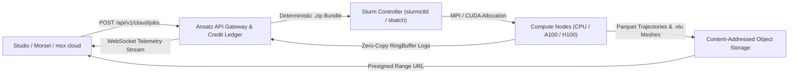

# Cloud HPC & Distributed Simulation

While interactive 1D DAE and multibody simulations execute directly in the browser via WebAssembly and WebGPU, large-scale multi-physics parameter sweeps, high-dimensional Monte Carlo uncertainty quantification, and continuum 3D finite-element (CalculiX/FEBio) or finite-volume CFD (SU2/OpenFOAM) meshes require dedicated cluster compute. Ansatz provides a unified **Cloud HPC Launcher** connecting the browser workbench and `msx cloud` CLI with remote Slurm HPC clusters and GPU worker pools.

---

## 1. Architecture: Browser & CLI to Slurm Cluster Pipeline



---

## 2. Compute Hardware Profiles & Credit Metering

Organizations and individual engineers allocate jobs against pre-configured hardware profiles. Credits are reserved atomically prior to `sbatch` submission and settled based on actual wall-clock core-seconds (`BillingService`), with unused reservations automatically refunded upon early termination or `msx cloud cancel`:

| Profile ID    | Hardware Allocation                         | Interconnect & Accelerator | Target Workloads                                                                              |
| :------------ | :------------------------------------------ | :------------------------- | :-------------------------------------------------------------------------------------------- |
| `standard`    | 8 vCPU, 32 GB ECC RAM                       | Shared NVMe scratch        | Stiff Modelica/PSCAD DAE sweeps, Sobol DoE (up to 512 runs), SPICE transient corners          |
| `high-memory` | 32 vCPU, 256 GB ECC RAM                     | High-bandwidth DDR5        | Full-grid ENTSO-E CGMES / PSS/E $N-1$ contingency screening, 3D tetrahedral FEA assembly      |
| `gpu-a100`    | 16 vCPU, 128 GB RAM, 1× NVIDIA A100 (80 GB) | NVLink / CUDA 12           | Batched ensemble DAE integration, Neural/PINN surrogate training, TOPAS Monte Carlo dose      |
| `hpc-mpi-64`  | 64 Physical Cores (2 Nodes), 512 GB RAM     | InfiniBand NDR (400 Gb/s)  | Distributed OpenMPI SU2/OpenFOAM RANS/LES aerodynamics and multi-well ECLIPSE reservoir decks |

---

## 3. Containerized Slurm Job Dispatch & Sandboxing

When a job is submitted via the **Cloud Simulation Modal** in `/morsel` or via `msx cloud dispatch`:

1. **Deterministic Workspace Packaging**: The compiler resolves `msx.lock` dependencies, verifies SHA-256 digests, and packs the model, compiled `.wasm` arena snapshot, and solver configuration into a content-addressed bundle.
2. **Rootless Apptainer / Singularity Execution**: The Slurm job script runs inside an immutable, network-isolated Apptainer image (`modelscript-hpc-runtime.sif`) containing SUNDIALS 7.x (KLU/SuperLU_MT sparse linear solvers), CalculiX, SU2, and OpenMPI.
3. **Live Checkpointing & Preemption Recovery**: Long-running transient integrations periodically flush binary DAE state checkpoints (`checkpoint_<step>.bin`) to scratch storage so preempted spot allocations resume without losing progress.

---

## 4. Headless CLI Workflows (`msx cloud`)

Engineers and CI/CD pipelines can inspect hardware profiles, check organization credit balances, dispatch jobs, stream real-time solver logs, and download completed trajectory or mesh artifacts from the terminal:

```bash
# List available CPU/GPU execution profiles and credit rates
msx cloud profiles

# Check organization compute credit wallet balance
msx cloud balance

# Dispatch a workload to the high-memory or GPU cluster profile
msx cloud dispatch ThermalGrid.mo --profile high-memory --domain modelica

# Monitor active jobs and follow live worker stdout/stderr logs
msx cloud jobs
msx cloud status job_01j9x8k2m
msx cloud logs job_01j9x8k2m --follow

# Download completed Parquet trajectories and VTK (.vtu) field meshes
msx cloud download job_01j9x8k2m --output ./results
```

---

## 5. Interactive 3D Field & Trajectory Streaming

When continuum or ensemble simulations complete, results are indexed in object storage and streamed into the browser using HTTP Range requests:

- **3D Stress, Thermal & Velocity Fields**: Visualized from binary VTK Unstructured Grid (`.vtu`) and OpenUSD (`.usdc`) files with hardware-accelerated color maps, iso-surfaces, streamtubes, and interactive cutting planes.
- **Arrow / Parquet Time-Series Overlays**: Multi-gigabyte Monte Carlo fan charts (P10 / P50 / P90 quantile bands) and Bode envelopes are decimated on the fly using Largest-Triangle-Three-Buckets (LTTB) downsampling for smooth 60 FPS zooming.
