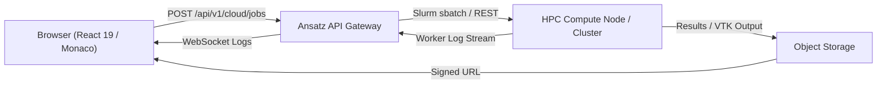

# Cloud HPC & Distributed Simulation

While client-side simulations execute directly in the browser via WebAssembly, large-scale multi-physics sweeps, high-dimensional Monte Carlo evaluations, and continuum finite-element/CFD meshes require dedicated high-performance computing resources. Ansatz provides a unified **Cloud HPC Launcher** connecting the web workbench with remote computing clusters.

---

## Architecture: Browser-to-Cluster Pipeline

### 1. Job Configuration

Engineers configure compute parameters using the **Cloud Simulation Modal** in `/playground`:

- **Solvers:** SUNDIALS CVODE, IDA stiff DAE, CalculiX FEA, or SU2 CFD.
- **Resources:** Number of CPU cores, GPU acceleration (CUDA/OpenCL), and RAM limits.
- **Parameter Sweeps:** Range definitions for Monte Carlo parameter uncertainty distributions.

### 2. Job Dispatch & Slurm Orchestration

The Ansatz API converts the workspace into a standalone execution package, validates user compute credits, and dispatches the task to the cluster via Slurm (`sbatch`) or containerized worker queues.

### 3. Live Streaming Telemetry

During execution, worker stdout and stderr logs stream back to the web client via WebSocket, displayed in the integrated **Terminal Log Viewer**.

### 4. Interactive Field Visualization

When continuum simulations finish, results are ingested and rendered directly in the browser:

- **3D Stress & Deflection Fields:** Visualized from VTK Unstructured Grid (`.vtu`) files with interactive color scales and slice planes.
- **Trajectory Overlays:** Simulation time-series comparisons plotted with interactive hover inspections.
