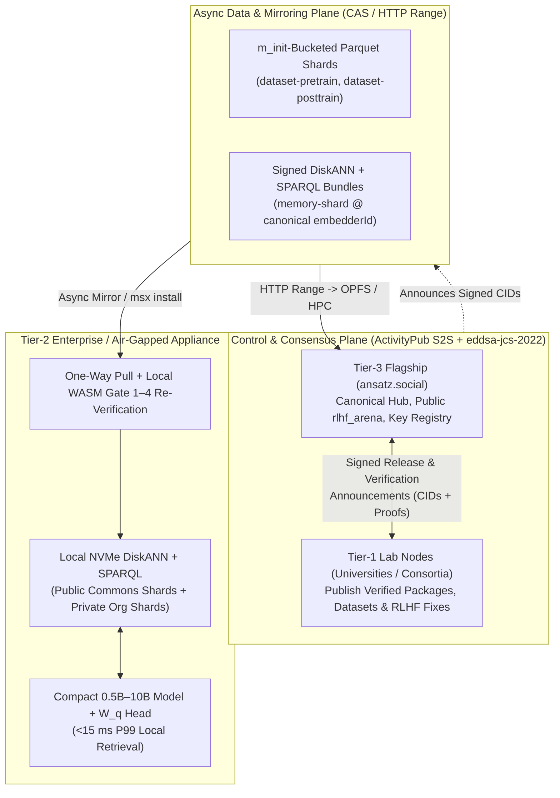

# Federated Engineering Memory & Training Commons

**Ansatz** (`ansatz.social` and self-hosted federated nodes) serves as a **federated, formally-verified engineering commons** that bridges human engineering collaboration with compact, certified engineering AI (**0.5B–10B Dynamic-$m$ reasoning cores**, **Geometric CAD LLMs**, and **World Action Models**).

---

## 1. Human-Executable First, Machine-Native by Compilation

Engineers do not contribute to Ansatz merely to feed an opaque vector store. They publish reproducible multi-physics models, 3D CAD assemblies, simulation plots, scholarly citations (`/references`), and peer-reviewed fixes. On publish or verified community consensus, Ansatz automatically compiles those human-authored artifacts into two machine-native outputs:

1. **Training Commons (`dataset-pretrain`, `dataset-posttrain`, `training-recipe`)**: 4-gate formally verified, `m_init`-bucketed 4-column Typed Relational Hypergraph Parquet shards (`token_ids`, `group_ids`, `rel_type_ids`, `rel_signs`, `m_init`).
2. **Decoupled World Memory (`memory-shard`)**: Content-addressed, Ed25519-signed **DiskANN + SPARQL** index bundles queried in real time via a lightweight Linear Query Projection Head ($q = \text{Normalize}(W_q h_t + b_q)$) whenever a small model's output zonotope spread widens ($\Delta_t > \tau$).

Unlike crowd-edited wikis that rely solely on human text consensus, Ansatz enforces **executable epistemology**: every promoted artifact passes sandboxed WASM verification (GLR syntax, QUDV SI-7 units, SMT/Octagon feasibility, DAE/BLT solvability, and CAD clearance) alongside scholarly DOI traceability and `eddsa-jcs-2022` cryptographic provenance.

---

## 2. Control Plane vs. Data Plane Architecture

Mid-decode retrieval ($\Delta_t > \tau$) requires **<15 ms P99** latency. Live federated HTTP scatter-gather across remote ActivityPub servers cannot meet this budget. Ansatz therefore splits federation into three clean planes:

- **ActivityPub Control Plane**: Federates lightweight JSON-LD announcements (`ansatz:MemoryShardRelease`, `ansatz:DatasetRelease`, `ansatz:TrainingRecipeRelease`, `ansatz:VerificationAttestation`) signed with `eddsa-jcs-2022`. Heavy Parquet and DiskANN binaries are never pushed over ActivityPub inboxes.
- **Async CAS / HTTP-Range Data Plane**: Replicates `m_init`-bucketed Parquet shards and DiskANN `memory-shard` bundles asynchronously across subscribed mirrors and OPFS browser caches.
- **Local / Regional Serving Plane**: Runtime `/api/v1/memory/query` calls always hit a local NVMe or regional flagship DiskANN replica — merging subscribed public commons shards, consortium shards, and private org shards under <15 ms P99.

---

## 3. Canonical Embedding Spaces & Trust Pinning

Raw DiskANN vectors are model-specific: a latent query $q = \text{Normalize}(W_q h_t + b_q)$ is incompatible with an index built by a different embedding model.

To make federated vector memory portable across independent nodes:

1. **Canonical `embedderId` + `embedderHash`**: Every `memory-shard` and `projection-head` package declares an immutable canonical embedding space (e.g., `ansatz-embed-v1` + SHA-256 weight digest). Any compact engineering LLM only needs **one lightweight `projection-head` (~5–20 MB)** per canonical `embedderId` to query compatible shards from any node in the network.
2. **Explicit `memoryPins` (Anti-Poisoning)**: Nodes never blindly ingest the open fediverse into model weights or vector memory. Both `training-recipe` manifests and `/api/v1/memory/query` sessions pin trusted `(originNode, packageName, version, signerPubkey)` tuples and re-verify `eddsa-jcs-2022` proofs + Gate 1–4 certificates on ingest.
3. **Granular `aiGovernance` Consent**: Every package and social post declares `allowRag`, `allowPretrain`, `allowPosttrain`, `tenantScope`, and optional `reciprocalTrainingLicense` so open communities can keep live RAG open while protecting training corpora against unreciprocated closed-weight scraping.

---

## 4. Deployment Tiers & Enterprise Sovereignty

| Tier                                          | Mode                  | How It Uses Federated Engineering Memory                                                                                                                                                                         |
| :-------------------------------------------- | :-------------------- | :--------------------------------------------------------------------------------------------------------------------------------------------------------------------------------------------------------------- |
| **Tier 0: Ansatz Local**                      | Offline Workstation   | Installs verified `memory-shard` packages locally into OPFS / NVMe for offline coding and simulation.                                                                                                            |
| **Tier 1: Ansatz Lab**                        | Federated Node        | Publishes open domain datasets, recipes, and `memory-shard` bundles; federates `rlhf_arena` bounties and peer verification attestations.                                                                         |
| **Tier 2: Ansatz Enterprise**                 | Air-Gapped / Intranet | Outbound federation disabled. Performs **one-way** pulls of signed public `memory-shard` + `model-core` bundles and overlays **private proprietary DiskANN shards + LoRAs** with strict RBAC and zero IP egress. |
| **Tier 3: Ansatz Flagship (`ansatz.social`)** | Public Commons Hub    | Hosts canonical embedder registry, public signed Parquet/DiskANN mirrors, public `rlhf_arena` leaderboards, and regional Memory API serving.                                                                     |
