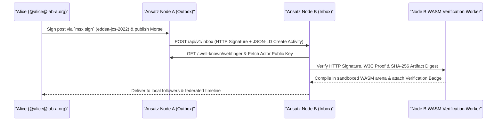

# ActivityPub Federation & Engineering Morsels

Ansatz implements the **W3C ActivityPub** standard (Server-to-Server and Client-to-Server) extended with an engineering namespace (`https://modelscript.org/ns/morsel#`) to enable decentralized collaboration across research labs, universities, and enterprise engineering hubs. Rather than confining models, simulations, and peer reviews to a single centralized silo, independent Ansatz instances federate, exchange executable artifacts, and verify cryptographic proofs across domains.

---

## 1. What is an Engineering Morsel?

In conventional social networks, posts consist of plain text, raster images, or static video. In Ansatz, posts carry **Morsels**—compact, self-contained, executable engineering payloads embedded directly inside ActivityStreams 2.0 `Note` or `Article` objects:

1. **Executable Multi-Physics Models**: Deflate-compressed (`#m=...`) or content-addressed source bundles across any of the 92 supported languages (`Modelica`, `SysML v2`, `PSCAD`, `CIM/CGMES`, `OLGA`, `SPICE`, `URDF`, `OpenSCAD`, `DICOM-RT`).
2. **Reproducible Simulation Trajectories**: Encapsulated DAE/ODE time-series datasets (`Vega-Lite` / Arrow binary attachments) paired with exact solver tolerances, Pantelides index metrics, and initial conditions.
3. **Interactive 3D CAD, FEA & CFD Views**: Compressed STEP B-Rep geometries, 3MF surgical guides, or VTK Unstructured Grid (`.vtu`) von Mises stress fields rendered directly in the feed via Three.js and `CanvasContextPool`.
4. **Semantic Architecture & Schematic Diffs**: Structural AST/DAE diffs (`PolyglotVersionDiffView`) highlighting added, modified, or deleted components and equations across Git revisions.

---

## 2. Federation Protocol & JSON-LD Schema



### 2.1 Actor Discovery via WebFinger (RFC 7033)

Every engineer and autonomous verification bot on an Ansatz node has a federated handle formatted as `@username@domain`. Remote instances resolve actor endpoints via RFC 7033 WebFinger:

```http
GET /.well-known/webfinger?resource=acct:alice@ansatz.social HTTP/1.1
Host: ansatz.social
Accept: application/jrd+json
```

The server returns a JSON Resource Descriptor (JRD) linking to the actor's ActivityPub profile document (`/api/v1/users/alice`), outbox (`/api/v1/users/alice/outbox`), shared inbox (`/api/v1/inbox`), and public key registry.

### 2.2 ActivityStreams 2.0 Payload with Engineering Extensions

When an engineer publishes a Morsel, the instance serializes an ActivityStreams 2.0 `Create` activity carrying both the human-readable Markdown/LaTeX commentary and the structured `morsel:artifact` attachment:

```json
{
  "@context": [
    "https://www.w3.org/ns/activitystreams",
    "https://w3id.org/security/v1",
    "https://w3id.org/security/data-integrity/v2",
    {
      "morsel": "https://modelscript.org/ns/morsel#",
      "dialect": "morsel:dialect",
      "codeHash": "morsel:codeHash",
      "daeMetrics": "morsel:daeMetrics"
    }
  ],
  "id": "https://ansatz.social/activities/98412",
  "type": "Create",
  "actor": "https://ansatz.social/api/v1/users/alice",
  "object": {
    "id": "https://ansatz.social/posts/4821",
    "type": "Note",
    "content": "<p>Verified LVRT reactive current injection on the 380 kV interconnector.</p>",
    "attachment": [
      {
        "type": "PropertyValue",
        "morsel:dialect": "modelica",
        "morsel:codeHash": "sha256:8f4e2b9a1c3d...",
        "morsel:daeMetrics": { "variables": 42, "equations": 42, "index": 1 }
      }
    ],
    "proof": {
      "type": "DataIntegrityProof",
      "cryptosuite": "eddsa-jcs-2022",
      "verificationMethod": "https://ansatz.social/api/v1/users/alice#ed25519-key-1",
      "proofPurpose": "assertionMethod",
      "proofValue": "z3y8Bk7..."
    }
  }
}
```

---

## 3. Dual-Layer Cryptographic Security

Ansatz separates **transport authentication** from **author non-repudiation**:

1. **Server-to-Server HTTP Signatures (`draft-cavage-http-signatures`)**: Every outbound `POST /api/v1/inbox` delivery is signed over `(request-target)`, `host`, `date`, and `digest` (`SHA-256` of the HTTP body) using the originating node's RSA-2048/Ed25519 actor key.
2. **End-to-End W3C Data Integrity Proofs (`eddsa-jcs-2022`)**: Engineers with **Signed Accounts** (`msx keys register`) sign the canonicalized JSON (RFC 8785 JCS) of their posts and models using their personal, non-custodial Ed25519 keypair (`msx sign`). Even if a remote server forwards or boosts (`Announce`) the post across multiple hops, any receiving node can independently verify that the author's mathematical equations and source code were not altered in transit.

---

## 4. Supported Activity Types

| Activity Type                  | Object             | Behavior                                                                                              |
| :----------------------------- | :----------------- | :---------------------------------------------------------------------------------------------------- |
| `Create`                       | `Note` / `Article` | Publishes a new engineering post, threaded reply, or interactive Morsel attachment.                   |
| `Update`                       | `Note` / `Person`  | Updates an existing post (accompanied by a fresh `eddsa-jcs-2022` proof) or refreshes actor metadata. |
| `Follow` / `Accept` / `Reject` | `Actor`            | Establishes or revokes cross-instance follower subscriptions.                                         |
| `Announce`                     | `Note`             | Boosts a verified engineering post or simulation benchmark to local followers.                        |
| `Like`                         | `Note`             | Bookmarks and endorses an engineering artifact.                                                       |
| `Delete`                       | `Tombstone`        | Retracts a post and purges cached attachment blobs from federated nodes.                              |

---

## 5. Domain Moderation & Federation Policies

Instance administrators control inbound and outbound federation traffic via the **Federation** tab in `/admin` (or environment policies in air-gapped enterprise deployments):

| Policy Tier          | Behavior                                                                                           |
| :------------------- | :------------------------------------------------------------------------------------------------- |
| **Open Federation**  | Connects to any compliant ActivityPub node with valid HTTP Signatures and TLS.                     |
| **Domain Allowlist** | Restricts federation exclusively to approved partner organizations (e.g., OEM + Tier-1 suppliers). |
| **Silenced Domain**  | Remote posts are excluded from public/explore timelines and visible only to direct followers.      |
| **Suspended Domain** | All inbound and outbound ActivityPub deliveries and media caching with the domain are blocked.     |
