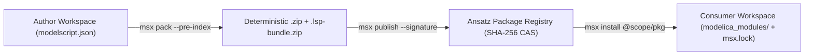

# Polyglot Package Registry

The **Ansatz Package Registry** ([ansatz.social/packages](https://ansatz.social/packages)) provides versioned dependency management, cryptographic supply-chain verification, and pre-indexed symbol distribution for multi-domain engineering libraries. It supports native ModelScript packages alongside standard Modelica 3.x libraries, SysML v2 / KerML architecture packages, STEP AP242 CAD assemblies, and FMI/SSP containers.

---

## 1. Supported Package Formats

| Format             | Scope & Manifest                    | Primary Usage                                                                 |
| :----------------- | :---------------------------------- | :---------------------------------------------------------------------------- |
| **ModelScript**    | `package.json` / `modelscript.json` | Native multi-domain models, equations, formal contracts, and simulation decks |
| **Modelica**       | `package.mo` / `package.order`      | Complete Modelica 3.x libraries (MSL, OpenIPSL, Buildings, Thermal)           |
| **SysML v2**       | `sysml.library` / `.sysmlx`         | OMG Systems Modeling Language v2 and KerML requirement and architecture packs |
| **STEP & 3D CAD**  | `step.json` / `.stp` / `.scad`      | ISO 10303 AP214/AP242 B-Rep parts, kinematic mates, and ISO 23952 QIF plans   |
| **SSP Containers** | `SystemStructure.ssd` (`.ssp`)      | System Structure and Parameterization multi-FMU co-simulation topologies      |

---

## 2. Package Lifecycle & CLI Workflows



### 2.1 Authoring & Manifest Configuration

Initialize a package manifest using `msx init` or configure `package.json` / `modelscript.json` with semantic version constraints, SPDX license identifiers, and maturity tier metadata:

```json
{
  "name": "@powergrid/entsoe-hvdc-lib",
  "version": "2.1.0",
  "license": "MPL-2.0",
  "modelscript": {
    "tier": "stable",
    "languages": ["modelica", "pscad", "cgmes", "sysml2"],
    "entry": "package.mo"
  },
  "dependencies": {
    "@modelscript/msl": "^4.0.0",
    "@powergrid/ieee2800-templates": "^1.4.0"
  }
}
```

### 2.2 Pre-Indexed Bundling & Cryptographic Publishing

Before publishing, `msx pack --pre-index` compiles the package's `SymbolIndex`, QUDV unit tables, and component SVG icons into a binary `.lsp-bundle.zip` snapshot so downstream IDE and browser consumers can load thousands of library symbols without cold-parsing every source file:

```bash
# Initialize a new package manifest
msx init

# Create an offline distribution archive with pre-indexed Salsa symbol tables
msx pack . --pre-index --out ./dist

# Publish the package to the registry with a dist-tag
msx publish . --tag latest

# Install a versioned package into modelica_modules/ and update msx.lock
msx install @powergrid/entsoe-hvdc-lib
```

---

## 3. Supply-Chain Security & Deterministic Lockfiles (`msx.lock`)

Engineering simulations for safety-critical aerospace, nuclear, and medical systems require strict provenance guarantees:

- **Content-Addressable Storage (SHA-256)**: Every published archive is indexed by its SHA-256 Merkle digest. Modifying a single byte of an equation or parameter table alters the digest and fails lockfile verification.
- **Detached Ed25519 Publisher Signatures (`--signature`)**: Publishers sign package digests using their registered Ed25519 keys (`msx keys`). During `msx install`, the CLI verifies both the SHA-256 integrity hash and the publisher's cryptographic signature.
- **SPDX License Compatibility Auditing**: During upload and installation, the registry parses SPDX license expressions (`AGPL-3.0-or-later`, `MPL-2.0`, `Apache-2.0`, `MIT`, or commercial licenses) and warns when a dependency tree mixes incompatible copyleft and proprietary terms.
- **Polyglot Standard Library Sync (`msx stdlib`)**: Built-in standard libraries across all 92 languages can be inspected and synchronized offline via `msx stdlib`.

---

## 4. Industrial Handover & Standards Export Gateways

Any package version hosted in the Ansatz Registry (or packed locally) can be cross-compiled into standardized industrial exchange containers:

- **IDTA Asset Administration Shell (`.aasx`)**: Generates an Industry 4.0 AAS v3.0 package containing `TechnicalData`, `SimulationModels` (FMI/FMU), and `HandoverDocumentation` submodels (`msx ddp to-aasx`).
- **ISO/PAS 81346 Digital Data Package (`.ddp`)**: Packages multi-aspect system reference designations (`=` function, `+` location, `-` product) and traceability graphs (`msx ddp pack`).
- **DIN SPEC 3105 Open Know-How (`okh.json`)**: Exports open-hardware bill-of-materials (BoM), CAD meshes, and manufacturing tolerances for distributed fabrication.
