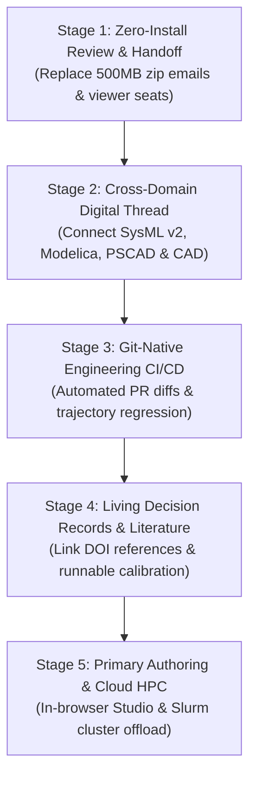
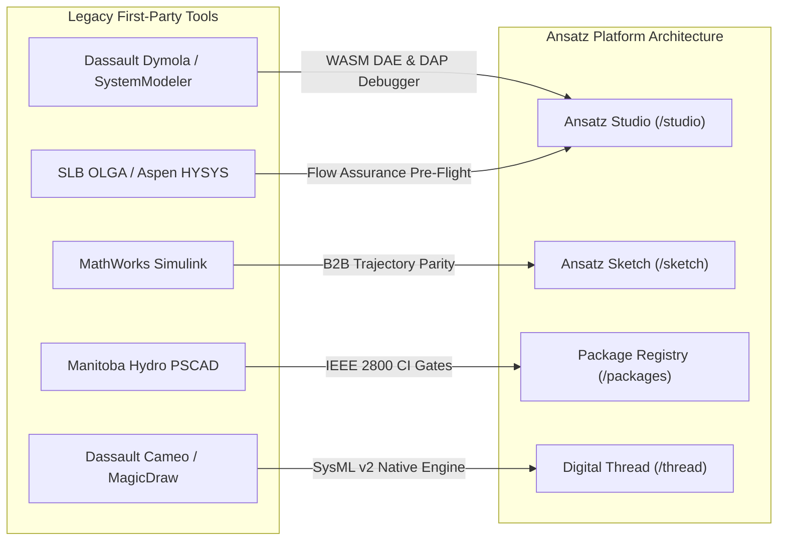

# Replacing First-Party Engineering Workflows with Ansatz

**Ansatz** (`ansatz.social`) is designed to displace the fragmented, desktop-bound workflows of legacy first-party engineering tools—including Dassault Systèmes Dymola, Cameo / MagicDraw, MathWorks MATLAB/Simulink, Manitoba Hydro PSCAD, and SLB OLGA.

Rather than functioning as a generic consumer social network, Ansatz serves as the **Collaborative Systems Engineering Cloud**: uniting the zero-install accessibility of web-native CAD/vector tools, the branching and review rigor of modern software version control, and the model distribution capabilities of contemporary package registries for 66 physical and mathematical engineering domains.

---

## The Incumbent Failure Modes

Practicing engineers in automotive, aerospace, energy, defense, and biomedical sectors frequently encounter structural bottlenecks in traditional first-party toolchains:

```
┌────────────────────────────────────────────────────────────────────────┐
│ The First-Party Workflow Bottleneck Matrix                             │
├────────────────────┬─────────────────────────────┬─────────────────────┤
│ Dimension          │ Legacy First-Party Status   │ Ansatz Architecture │
├────────────────────┼─────────────────────────────┼─────────────────────┤
│ Licensing          │ $20k–$80k/seat FlexLM node  │ Open-core engine &  │
│                    │ locks & floating starvation │ web-native access   │
├────────────────────┼─────────────────────────────┼─────────────────────┤
│ Distribution       │ 500MB proprietary zip files │ URL permalinks &    │
│                    │ emailed or stored on shared │ WebAssembly runtime │
│                    │ network folders             │ in the browser      │
├────────────────────┼─────────────────────────────┼─────────────────────┤
│ Collaboration      │ Monolithic binary files     │ Git Smart HTTP with │
│                    │ (.slx, .pscx, .mdzip) that  │ visual schematic    │
│                    │ prevent code review         │ & trajectory diffs  │
├────────────────────┼─────────────────────────────┼─────────────────────┤
│ Interoperability   │ Isolated disciplinary silos │ Cross-domain Salsa  │
│                    │ bridged only by static      │ hypergraph linking  │
│                    │ PowerPoint screenshots      │ 66 format parsers   │
└────────────────────┴─────────────────────────────┴─────────────────────┘
```

---

## The 5-Stage Replacement Wedge

Displacing an entrenched engineering monolith cannot occur through immediate, disruptive rip-and-replace mandates. Ansatz employs a phased adoption wedge that provides immediate utility before expanding into primary authoring:



### Stage 1: Zero-Install Review and Client Handoff

- **The Problem:** Non-authoring stakeholders—project managers, systems certifiers, contracting officers, and downstream integration teams—are routinely locked out of inspecting engineering models because acquiring a dedicated desktop license seat cannot be justified for read-only evaluation.
- **The Ansatz Workflow:**
  1. An author opens or imports an existing model in **Ansatz Sketch** (`/sketch`).
  2. The entire multi-domain model is encoded into a deterministic, compressed permalink or published as a versioned engineering morsel.
  3. The reviewer opens the URL in any standard web browser on Linux, macOS, Windows, or iPadOS.
  4. The model compiles and simulates directly on the client using WebAssembly, exposing interactive parameter sliders, schematic diagrams, 3D CAD viewports, and numerical time-series charts.
- **Workflows Replaced:**
  - Purchasing costly read-only or review licenses.
  - Assembling manual 60-slide PowerPoint presentations containing static trajectory captures.
  - Waiting for organizational IT clearance to install multi-gigabyte desktop client binaries.

### Stage 2: Cross-Disciplinary Digital Thread Integration

- **The Problem:** Single-domain tools are fundamentally incapable of validating multi-physics and cross-domain constraints. Systems architects define requirements in Cameo; thermal engineers model heat exchangers in Dymola; electrical teams model protection schemes in PSCAD; structural teams model casings in STEP CAD. Cross-domain inconsistencies are typically identified late during physical test-bench integration.
- **The Ansatz Workflow:**
  - Ansatz maintains a unified **Digital Thread Explorer** (`/thread`) powered by Triple Graph Grammars (TGG) and ModelScript's Salsa query engine.
  - Requirements authored in SysML v2 (`requirement def`) are bound directly to continuous differential algebraic equations (DAEs) in Modelica and electrical grid components in PSCAD.
  - Mathematical balance and constraint satisfaction are verified automatically across domain boundaries.
- **Workflows Replaced:**
  - Manual verification matrices maintained in disconnected spreadsheets.
  - Point-to-point co-simulation setups susceptible to algebraic loops and numerical divergence.
  - Unsynchronized requirements databases.

### Stage 3: Git-Native Engineering CI/CD and Pull Requests

- **The Problem:** Legacy tools treat source control as an afterthought. Binary model files cannot be inspected in traditional git diff tools, leading to blind merges, undetected regressions, and parameter drift.
- **The Ansatz Workflow:**
  - Repositories in Ansatz are backed by standard Git Smart HTTP storage.
  - Pull requests trigger automated validation pipelines:
    - **Visual Schematic Diffs:** Identifies added, removed, and modified components, connector ports, and routing coordinates.
    - **Trajectory Regression Testing:** Compares simulation trajectories against reference baselines using RMSE and Normalized Max Relative Error thresholds.
    - **Physical Rule Audits:** Evaluates unit consistency, DAE algebraic index, and domain safety standards (such as IEEE Std 2800 for power grids or EN 14363 for rail vehicles).
- **Workflows Replaced:**
  - Manual design review meetings dedicated to inspecting line-item changes.
  - Undetected parameter overwrites during multi-engineer project handoffs.
  - Unvalidated pull requests in engineering repositories.

### Stage 4: Living Engineering Decision Records (EDRs)

- **The Problem:** Organizational knowledge is commonly fragmented across internal wikis, static PDFs, and local spreadsheets. When project personnel change, the physical rationale, experimental telemetry, and bibliographic citations behind critical parameters are lost.
- **The Ansatz Workflow:**
  - Replaces static wiki entries with **Executable Engineering Decision Records (EDRs)**.
  - Each EDR incorporates:
    - Bibliographic references queried directly from OpenAlex and Crossref (`[@cite_key]`).
    - Embedded client-side simulation runners with locked or tunable parameter bands.
    - Experimental calibration datasets (CSV) paired with automated optimization routines (such as Nelder-Mead simplex or gradient descent).
- **Workflows Replaced:**
  - Internal documentation containing disconnected, outdated screenshots.
  - Static research papers whose governing equations cannot be evaluated or reproduced.
  - Spreadsheets storing untracked calibration constants.

### Stage 5: Primary Authoring and Cloud HPC Offload

- **The Problem:** High-dimension parameter sweeps, Monte Carlo reliability studies, and 3D continuum simulations monopolize local workstation CPU cores for hours, halting other engineering activities.
- **The Ansatz Workflow:**
  - Authors construct models within **Ansatz Studio** (`/studio`), utilizing Monaco code editing, language server diagnostics (`@modelscript/lsp`), and equation-level Debug Adapter Protocol (DAP) stepping.
  - Parametric sweeps and surrogate model training are dispatched directly to remote Slurm HPC clusters or batched WebGPU kernels via the Ansatz Cloud Dispatcher.
- **Workflows Replaced:**
  - Workstation lockups during large computational batch sweeps.
  - Purchasing dedicated parallel computing toolbox licenses per user workstation.

---

## Domain-Specific Displacement Playbooks



### 1. Modelica & Multi-Physics (vs. Dymola & Wolfram SystemModeler)

- **Incumbent Pain:** Dymola licenses require dedicated Windows workstations and flex license management; OpenModelica lacks collaborative web workspaces.
- **Ansatz Solution:**
  - Native in-browser GLR parsing and linear-memory DAE compilation.
  - Debug Adapter Protocol (DAP) simulation debugging: engineers step through continuous-time integration intervals ($\Delta t$), monitor Jacobian condition numbers, and inspect algebraic state iterations inside VS Code / Studio.
  - Content-Addressable Package Registry (`/packages`) with automated dependency resolution, replacing manual folder unzipping.

### 2. Systems Modeling & MBSE (vs. Cameo & IBM Rhapsody)

- **Incumbent Pain:** Cameo is constrained by legacy SysML v1 constructs and heavyweight desktop runtimes, lacking direct numerical execution of physical differential equations.
- **Ansatz Solution:**
  - Native parser and Salsa query engine for **SysML v2** and **KerML**.
  - Direct translation of SysML v2 parts into continuous DAE representations for dynamic simulation.
  - Bidirectional visual editing between textual SysML v2 source code and graphical block definition diagrams (BDD) / internal block diagrams (IBD).

### 3. Electrical Power Systems (vs. PSCAD & PSS/E)

- **Incumbent Pain:** PSCAD relies on legacy Fortran toolchains, Windows operating system constraints, and cannot be integrated into automated cloud CI/CD pipelines.
- **Ansatz Solution:**
  - Fixed-step nodal admittance electromagnetic transient (EMT) simulation directly from `.pscx` XML models.
  - Automated **IEEE Std 2800-2022** grid compliance testing (LVRT/HVRT voltage and frequency ride-through verification) executing as automated pull request checks.
  - Direct export of PSCAD schematics into standardized Modelica and FMI/SSP container topologies.

### 4. Dynamic Control Systems (vs. MATLAB / Simulink)

- **Incumbent Pain:** Massive software footprints (exceeding 40GB), proprietary binary `.slx` formats that resist version control, and costly per-toolbox pricing structures.
- **Ansatz Solution:**
  - Parsing and AST transformation of Simulink models into readable Modelica and C99 code.
  - Automated ISO 26262 Back-to-Back (B2B) trajectory equivalence testing verifying numeric output tolerances.
  - Shareable URL permalinks for instantaneous stakeholder evaluation without MATLAB installed.

### 5. Flow Assurance & Chemical Process (vs. SLB OLGA & Aspen HYSYS)

- **Incumbent Pain:** Specialized transient multiphase and chemical licenses represent substantial ongoing software expenditures ($50k+ per seat).
- **Ansatz Solution:**
  - Pre-flight automated linting for multiphase pipelines (evaluating Courant-Friedrichs-Lewy stability criteria, hydrate formation subcooling margins, and severe riser slugging risks).
  - Parsing and visualization of `.tpl` and `.ppl` trend/profile logs into interactive web charts and spatial pipeline elevation diagrams.

---

## Enterprise Trust and Security

To satisfy operational requirements in regulated and defense engineering environments, Ansatz provides specific architectural guarantees:

1. **Client-Side Sandbox Execution:** In Ansatz Sketch, compilation, Salsa dependency resolution, and numerical integration execute inside the client's WebAssembly sandbox. Model source code and equations do not need to be transmitted to remote servers.
2. **Cryptographic Data Sovereignty:** Every project repository is backed by standard Git Smart HTTP infrastructure with support for Ed25519 commit verification. Teams retain complete local data ownership and can clone or export full histories at any time.
3. **Air-Gapped On-Premises Deployment:** Organizations can deploy standalone Ansatz nodes (`ansatz-ce` or `ansatz-ee`) inside sovereign VPCs, Kubernetes clusters, or air-gapped internal intranets with LDAP, SAML/SSO, and Slurm HPC cluster federation.
