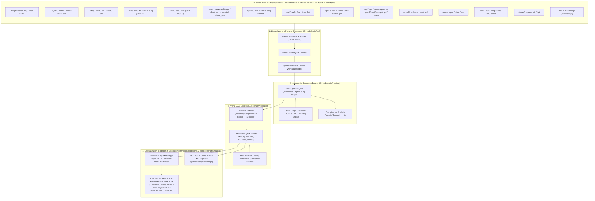

# Architecture Overview

ModelScript is built on a **data-oriented, WebAssembly-first compiler architecture**. Rather than allocating deep hierarchies of garbage-collected JavaScript AST wrapper objects, every stage of the compiler—from GLR parsing to DAE flattening, sparse linear algebra, and formal verification—operates on contiguous **Struct-of-Arrays (SoA)** arenas in WebAssembly linear memory.

---

## End-to-End Compilation Pipeline

---

## Core Architectural Pillars

### 1. Zero-Wrapper Linear Memory CST & DAE Arena

Equations, expressions, and statements are lowered directly from 32-bit linear-memory CST node pointers (`u32`) into `DAEBuilder` integer IDs (`VarId`, `ExprId`, `EqId`, `StmtId`). This eliminates garbage-collection pauses even when flattening multi-thousand-equation Modelica Standard Library (MSL) models.

### 2. Demand-Driven Incremental Compilation (Salsa)

Inspired by the Rust compiler (`rust-analyzer`), `QueryEngine` implements the **Salsa** incremental recomputation algorithm (`fetch → deep_verify → execute → backdate`). When a user edits a parameter in the IDE, only queries whose transitive input hashes actually changed are recomputed.

### 3. Polyglot Synchronization via Triple Graph Grammars (TGG)

Cross-language traceability is enforced algebraically via **Double-Pushout (DPO)** graph rewriting (`packages/dsl/src/dsl/tgg-types.ts` and `packages/dsl/src/codegen/compile_tgg.ts`) with **Critical Pair Analysis (CPA)** confluence verification (`packages/dsl/src/codegen/cpa.ts`). Changes in SysML v2 requirements, Modelica parameters, STEP CAD assemblies, or ModelScript `@unmanaged` structs propagate bidirectionally without losing comments or formatting.

### 4. Multi-Domain Theory Coordinator ($\text{CDCL}(\mathcal{T})$)

Nineteen specialized **Domain Theory Oracles**—spanning OWL2 Description Logic (`OntologyTheoryOracle`), SysML v2 intervals (`ConstraintTheoryOracle`), Zones/Octagons (`AbstractDomainOracle`), Barrier Certificates & Taylor Flowpipes (`SafetyTheoryOracle`), 3D B-Rep clearance (`SpatialPhysicsOracle`), FEA/CFD contracts (`CaeContractOracle`), DAE structural matching (`CausalizationTheoryOracle`), SI dimensional analysis (`DimensionalTheoryOracle`), Assume-Guarantee refinement (`EntailmentTheoryOracle`), Kirchhoff/stream conservation (`FlowAlgebraOracle`), AP242 GD&T stack-up (`ToleranceStackOracle`), Conformal UQ (`UqTheoryOracle`), McCarthy Arrays (`ArrayTheoryOracle`), Fixed-Width Bit-Vectors (`BitVectorTheoryOracle`), Strings & Word Equations (`StringTheoryOracle`), Power Grid & Ride-Through (`PowerGridTheoryOracle`), Marine Mooring (`MarineMooringTheoryOracle`), ASME Pressure Vessels (`PressureVesselOracle`), and Optical/RAN Telecom (`TelecomTheoryOracle`)—exchange variable bounds and Nelson-Oppen equalities until a global fixpoint or minimal unsatisfiable core (`ConflictClause`) is reached.

---

## Monorepo Package Matrix

| Package                      | Path                     | Primary Responsibility                                                                                                                                                                                  |
| :--------------------------- | :----------------------- | :------------------------------------------------------------------------------------------------------------------------------------------------------------------------------------------------------ |
| `@modelscript/dsl`           | `packages/dsl`           | Grammar combinators, Ahead-of-Time WASM GLR parser compiler (`buildParser`), TGG/DPO engine, Critical Pair Analysis, E-graphs                                                                           |
| `@modelscript/runtime`       | `packages/runtime`       | Linear-memory `DAEBuilder`, `ArenaDAEPrinter`, Salsa `QueryEngine`, `WorkspaceIndex`, BLT/Pantelides solver, Sparse Arnoldi eigensolver, 19 Formal Theory Oracles                                       |
| `@modelscript/solve`         | `packages/solve`         | Unified SciML-inspired solver, reachability, and formal verification foundation — outward-rounded intervals, typed problems/algorithms, verification certificates, WASM scratch pool                    |
| `@modelscript/simulate`      | `packages/simulate`      | Numerical integrators (SUNDIALS CVODE/IDA, Radau IIA, Rodas4P/5P, TR-BDF2, Tsit5, Verner, IMEX, QSS, DDE, SDE, PDE-MoL, Dommel EMT), Tet4/Tet10 FEA, WebGPU LBM & contingency, PALC                     |
| `@modelscript/cad`           | `packages/cad`           | OpenCascade (OCCT) B-Rep kernel, CSG evaluator, STEP AP214/AP242 serializer, swept-volume clearance, GD&T stack-up, 3D formal verification overlays, Gerber ECAD & PCB router/DRC                       |
| `@modelscript/diagram`       | `packages/diagram`       | Polyglot schematic layout engine, orthogonal Manhattan router, TCC / R-X / P-Q / Water Diff specialized builders, SVG/Canvas renderer                                                                   |
| `@modelscript/exchange`      | `packages/exchange`      | FMI 2.0/3.0 FMU import/export, SSP 1.0/2.0 container toolkit, Co-Simulation Master Orchestrator, MISRA-C / Q8.24 fixed-point firmware synthesizer, WebSerial HIL                                        |
| `@modelscript/lsp`           | `packages/lsp`           | Multi-language LSP server across all 105 documented languages, semantic tokens, hover, go-to-definition, code actions, background worker pool                                                           |
| `@modelscript/mcp`           | `packages/mcp`           | Unified Model Context Protocol server exposing 105 core and 70+ domain-specific ModelScript compilation, simulation, verification, grid/water/telecom, and KG tools                                     |
| `@modelscript/sdk`           | `packages/sdk`           | TypeScript and AssemblyScript SDK for authoring user-defined ModelScript capabilities, visual artifacts, and WASM kernels                                                                               |
| `@modelscript/editor`        | `packages/editor`        | Host-agnostic visual modeling & code editor core, LSP transport abstraction, and host context adapter for web, embed, and playground environments                                                       |
| `@modelscript/ide-client`    | `packages/ide`           | Reusable WebAssembly IDE client components, Monaco/CodeMirror language bindings, and dockable engineering viewports with 3D verification overlays                                                       |
| `@modelscript/react`         | `packages/react`         | ModelScript & Ansatz React SDK and widgets — engineering UI primitives, WebAssembly solver hooks, and IDE bridges                                                                                       |
| `@modelscript/embed`         | `packages/embed`         | ModelScript & Ansatz embed client SDK — iframe bridge, Web Component custom elements, and permalink codec                                                                                               |
| `@modelscript/design-tokens` | `packages/design-tokens` | Shared CSS design tokens and primitive component styles for the documentation site, web application, and IDE webviews                                                                                   |
| `@modelscript/examples`      | `packages/examples`      | Curated multi-domain reference workspaces (`alm-gitops`, `asme-bpvc-viii-1`, `drone-chassis`, `drone-reachability`, `emt-screening-pack`, `pscad-microgrid`, `sysml-wasm-pack`, `telecom-co-microgrid`) |
| `modelscript` (`msx`)        | `apps/cli`               | Unified command-line interface (169 commands across `flatten`, `simulate`, `verify`, `dossier`, `gatekeeper`, `ampl`, `powerfactory`, `pslf`, `fmu`, `csg`, `surrogate`, etc.)                          |
| `@modelscript/api`           | `apps/api`               | REST, GraphQL, SPARQL, Regulatory Dossier, Grid Gatekeeper, and WebSocket simulation backend server                                                                                                     |
| `@modelscript/docs`          | `apps/docs`              | Unified `modelscript.org` website and VitePress documentation portal                                                                                                                                    |
| `@modelscript/ide`           | `apps/ide`               | ModelScript VS Code Web IDE with GitHub/GitLab repository integration                                                                                                                                   |
| `@modelscript/web`           | `apps/web`               | Ansatz Web application (Ansatz browser editor, Studio, Package Registry, and social modeling platform)                                                                                                  |
| `@modelscript/ee`            | `ee`                     | Enterprise Edition (`LicenseRef-ModelScript-Enterprise`) — Ed25519 license verification, SSO/SAML, RBAC, Slurm HPC dispatcher, Digital Twin Historian, HIL                                              |
