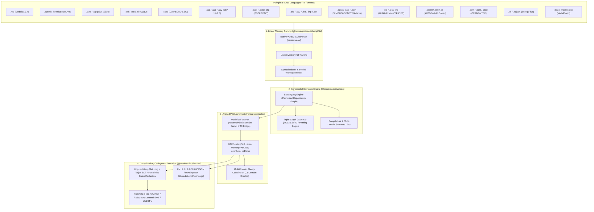

# Architecture Overview

ModelScript is built on a **data-oriented, WebAssembly-first compiler architecture**. Rather than allocating deep hierarchies of garbage-collected JavaScript AST wrapper objects, every stage of the compiler—from GLR parsing to DAE flattening, sparse linear algebra, and formal verification—operates on contiguous **Struct-of-Arrays (SoA)** arenas in WebAssembly linear memory.

---

## End-to-End Compilation Pipeline

---

## Core Architectural Pillars

### 1. Zero-Wrapper Linear Memory CST & DAE Arena

Equations, expressions, and statements are lowered directly from 32-bit linear-memory CST node pointers (`u32`) into `DAEBuilder` integer IDs (`VarId`, `ExprId`, `EqId`, `StmtId`). This eliminates garbage-collection pauses even when flattening multi-thousand-equation Modelica Standard Library (MSL) models.

### 2. Demand-Driven Incremental Compilation (Salsa)

Inspired by the Rust compiler (`rust-analyzer`), `QueryEngine` implements the **Salsa** incremental recomputation algorithm (`fetch → deep_verify → execute → backdate`). When a user edits a parameter in the IDE, only queries whose transitive input hashes actually changed are recomputed.

### 3. Polyglot Synchronization via Triple Graph Grammars (TGG)

Cross-language traceability is enforced algebraically via **Double-Pushout (DPO)** graph rewriting (`packages/dsl/src/tgg.ts`) with **Critical Pair Analysis (CPA)** confluence verification (`packages/dsl/src/cpa.ts`). Changes in SysML v2 requirements, Modelica parameters, STEP CAD assemblies, or ModelScript `@unmanaged` structs propagate bidirectionally without losing comments or formatting.

### 4. Multi-Domain Theory Coordinator ($\text{CDCL}(\mathcal{T})$)

Thirteen specialized **Domain Theory Oracles**—spanning OWL2 Description Logic (`OntologyTheoryOracle`), SysML v2 intervals (`ConstraintTheoryOracle`), Zones/Octagons (`AbstractDomainOracle`), Barrier Certificates & Taylor Flowpipes (`ContinuousSafetyOracle`), DAE trajectories (`DynamicSimulationOracle`), 3D B-Rep clearance (`SpatialPhysicsOracle`), FEA/CFD contracts (`CaeContractOracle`), DAE structural matching (`CausalizationOracle`), SI dimensional analysis (`DimensionalOracle`), Assume-Guarantee refinement (`EntailmentOracle`), Kirchhoff/stream conservation (`FlowAlgebraOracle`), AP242 GD&T stack-up (`ToleranceStackOracle`), and Conformal UQ (`UqOracle`)—exchange variable bounds and Nelson-Oppen equalities until a global fixpoint or minimal unsatisfiable core (`UnsatCore`) is reached.

---

## Monorepo Package Matrix

| Package                   | Path                | Primary Responsibility                                                                                                                |
| :------------------------ | :------------------ | :------------------------------------------------------------------------------------------------------------------------------------ |
| `@modelscript/dsl`        | `packages/dsl`      | Grammar combinators, Ahead-of-Time WASM GLR parser compiler (`buildParser`), TGG/DPO engine, Critical Pair Analysis, E-graphs         |
| `@modelscript/runtime`    | `packages/runtime`  | Linear-memory `DAEBuilder`, `ArenaDAEPrinter`, Salsa `QueryEngine`, `WorkspaceIndex`, BLT/Pantelides solver, 13 Formal Theory Oracles |
| `@modelscript/simulate`   | `packages/simulate` | Numerical integrators (SUNDIALS CVODE/IDA, Radau IIA, DOPRI5, Dommel EMT), WebGPU batched solver, FNO surrogates, Monte Carlo         |
| `@modelscript/cad`        | `packages/cad`      | OpenCascade (OCCT) B-Rep kernel, CSG evaluator, STEP AP214/AP242 serializer, 3D tetrahedral FEA solver, Gerber ECAD parser            |
| `@modelscript/diagram`    | `packages/diagram`  | Polyglot schematic layout engine, orthogonal Manhattan connection router, SVG/Canvas renderer, dark-mode color inversion              |
| `@modelscript/exchange`   | `packages/exchange` | FMI 2.0/3.0 FMU import/export, SSP 1.0/2.0 container toolkit, Co-Simulation Master Orchestrator, WebSerial/AudioWorklet HIL           |
| `@modelscript/lsp`        | `packages/lsp`      | Multi-language LSP server, semantic tokens, hover, go-to-definition, code actions, background worker pool                             |
| `@modelscript/mcp`        | `packages/mcp`      | Unified Model Context Protocol server exposing 25+ polyglot compilation, simulation, CAD, and verification tools to AI agents         |
| `@modelscript/ide-client` | `packages/ide`      | Reusable WebAssembly IDE client components, Monaco/CodeMirror language bindings, and dockable engineering viewports                   |
| `@modelscript/examples`   | `packages/examples` | Curated multi-domain reference workspaces (CubeSat, EV Battery Pack, IEEE 39-Bus Grid, Robotic Arm, Aero-Structural Wing)             |
| `modelscript` (`msx`)     | `apps/cli`          | Unified command-line interface (`flatten`, `simulate`, `verify`, `align`, `polyglot`, `fmu`, `csg`, `surrogate`, `mc`, `hil`)         |
| `@modelscript/api`        | `apps/api`          | REST, GraphQL, SPARQL, and WebSocket simulation backend server                                                                        |
| `@modelscript/web`        | `apps/web`          | Browser-native WebAssembly Polyglot Playground and visual modeling environment                                                        |
