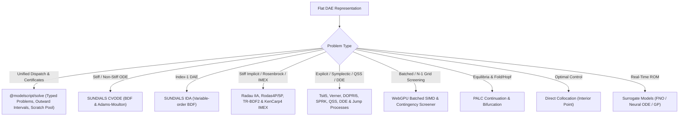

# Simulation Solvers & Numerical Integrators

ModelScript embeds a multi-tier suite of numerical solvers in `@modelscript/simulate` to support both desktop simulations and massive batched cloud/WebGPU parameter sweeps.

---

## Supported Solvers

---

## 0. Unified Solver Foundation (`@modelscript/solve`)

`packages/solve/` (`@modelscript/solve`) provides a SciML-inspired shared solver and formal verification layer consumed by both `@modelscript/runtime` and `@modelscript/simulate`:

- **Typed Problem & Algorithm Dispatch (`problems.ts`, `algorithms.ts`, `solve.ts`)**: Unified `solve(problem, algorithm)` interface covering ODE, DAE, SDE, DDE, BVP, PDE Method-of-Lines, and reachability problems.
- **Canonical Outward-Rounded Intervals (`outward-interval.ts`)**: IEEE-754 outward-rounded interval arithmetic for sound reachability enclosures and formal bounds.
- **Verification Certificates & WASM Scratch Pool (`certificate.ts`, `wasm-scratch-pool.ts`)**: Structured `VerificationCertificate` emission and zero-allocation scoped WebAssembly scratch memory arenas.

---

## 1. SUNDIALS CVODE, IDA, Stiff, Explicit & Specialized Integrators

For high-precision industrial models, ModelScript integrates Lawrence Livermore National Laboratory's **SUNDIALS** suite compiled to WebAssembly alongside native stiff, explicit, symplectic, quantized-state, delay, stochastic, and PDE integrators:

- **CVODE**: Solves Initial Value Problems (IVPs) for stiff and non-stiff systems of ordinary differential equations (ODEs). Uses Variable-Order Variable-Step-size Adams-Moulton methods for non-stiff systems and Backward Differentiation Formulas (BDF) for stiff systems.
- **IDA**: Solves Initial Value Problems for implicit systems of differential-algebraic equations (DAEs) of index up to 1:
  $$F(t, y, y') = 0$$
  where $t \in \mathbb{R}$ ($\text{s}$) is simulation time, $y \in \mathbb{R}^n$ is the combined differential-algebraic state vector, $y' = dy/dt \in \mathbb{R}^n/\text{s}$ is its time derivative, and $F(\cdot) \in \mathbb{R}^n$ is the implicit DAE residual vector. Includes dense and sparse linear solvers with adaptive step-size control.
- **Radau IIA, Rodas4P/5P, TR-BDF2 & KenCarp4 IMEX**: L-stable 5th-order implicit Runge-Kutta (`radau-iia.ts`), 4th/5th-order Rosenbrock-Wanner (`rodas4p.ts`, `rodas5p.ts`), 2nd-order Trapezoidal-BDF2 (`trbdf2.ts`), and 4th-order Additive Runge-Kutta IMEX (`imex-kencarp4.ts`) integrators for stiff power-electronic, chemical kinetics, and thermal-hydraulic transients.
- **Tsit5, Verner, DOPRI5 & SPRK**: High-order explicit Runge-Kutta pairs (`tsit5.ts`, `verner.ts`, and `wasm_dopri5.ts` in `@modelscript/runtime`) with FSAL and dense interpolation, plus Partitioned Symplectic Runge-Kutta (`sprk.ts`) for long-horizon Hamiltonian/orbital conservation.
- **QSS, DDE, Jump Processes, Stiff SDE & PDE Method-of-Lines**: Event-driven Quantized State Systems (`qss-solver.ts`), Delay Differential Equations (`dde-solver.ts`), Gillespie/Tau-Leaping stochastic jump processes (`jump-process.ts`), stabilized explicit ROCK / stiff SDEs (`stiff-sde-and-rock.ts`), and 1D/2D PDE Method-of-Lines (`pde-mol.ts`).
- **PALC Bifurcation & Continuation (`msx bifurcation`)**: Pseudo-Arclength Continuation (`analysis/bifurcation-palc.ts`) for tracing steady-state equilibrium curves and automatically detecting saddle-node (fold) and Hopf bifurcations (e.g., power grid voltage nose curves and nonlinear oscillators).

---

## 2. WebGPU Batched Parallel Solvers & N-1 Contingency Screener

When performing Monte Carlo uncertainty analysis, hyperparameter sweeps, or bulk power grid $N-1$ contingency screening, sequential simulation is a bottleneck.

ModelScript compiles linearized DAE blocks into WebGPU compute shaders (`@modelscript/simulate/webgpu`):

- Runs thousands of parameter combinations and $N-1$ transmission outage contingencies (`solvers/powerflow/webgpu-batched-contingency.ts`) in parallel on GPU hardware.
- Scales efficiently across client GPUs in browsers and headless datacenter instances.
- Returns statistical distributions, mean trajectories, voltage/thermal violation severity indices, and variance envelopes directly.

---

## 3. Direct Collocation Optimal Control

ModelScript formulates dynamic optimization and optimal control problems directly from Modelica models, minimizing a Bolza/Lagrange integral cost over a finite horizon subject to the system DAE and control bounds:

$$\min_{u(t)} \int_0^T L(x(t), u(t), t) \, dt$$
$$\text{subject to } F(t, x, \dot{x}, u) = 0, \quad u_{\min} \le u(t) \le u_{\max}$$

| Symbol                | Meaning                                         | Units / Domain                                   |
| :-------------------- | :---------------------------------------------- | :----------------------------------------------- |
| $t, T$                | Simulation time and fixed terminal horizon      | $\text{s}$ ($t \in [0, T]$)                      |
| $x(t), \dot{x}(t)$    | State trajectory and its time derivative        | $\mathbb{R}^{n_x}, \; \mathbb{R}^{n_x}/\text{s}$ |
| $u(t)$                | Time-varying control input trajectory           | $\mathbb{R}^{n_u}$                               |
| $u_{\min}, u_{\max}$  | Element-wise lower and upper control bounds     | $\mathbb{R}^{n_u}$                               |
| $L(x, u, t)$          | Instantaneous running cost (Lagrange integrand) | $\mathbb{R}/\text{s}$                            |
| $F(t, x, \dot{x}, u)$ | Implicit DAE dynamics constraint                | $\mathbb{R}^{n_x}$                               |

- **Transcription**: Transcribes the continuous system into non-linear programming (NLP) problems using Radau or Lobatto collocation points.
- **Solvers**: Solves the resulting sparse NLP using interior-point optimization techniques.

---

## 4. Surrogate Reduced Order Models (ROM)

High-fidelity 3D simulations (such as CFD or FEA) are often too computationally expensive for real-time control loops or web deployment.

ModelScript's surrogate modeling pipeline (`msx surrogate`):

1. **Sampling**: Generates experimental design samples (Latin Hypercube, Sobol sequences).
2. **Execution**: Evaluates high-fidelity runs across parameter spaces.
3. **Training**: Trains compact surrogate models using:
   - Polynomial Chaos Expansion (PCE)
   - Gaussian Process Regression (Kriging)
   - Neural Ordinary Differential Equations (Neural ODEs)
4. **Embedding**: Exports the trained surrogate as a standardized FMI Functional Mock-up Unit (FMU) or standalone WebAssembly module.
