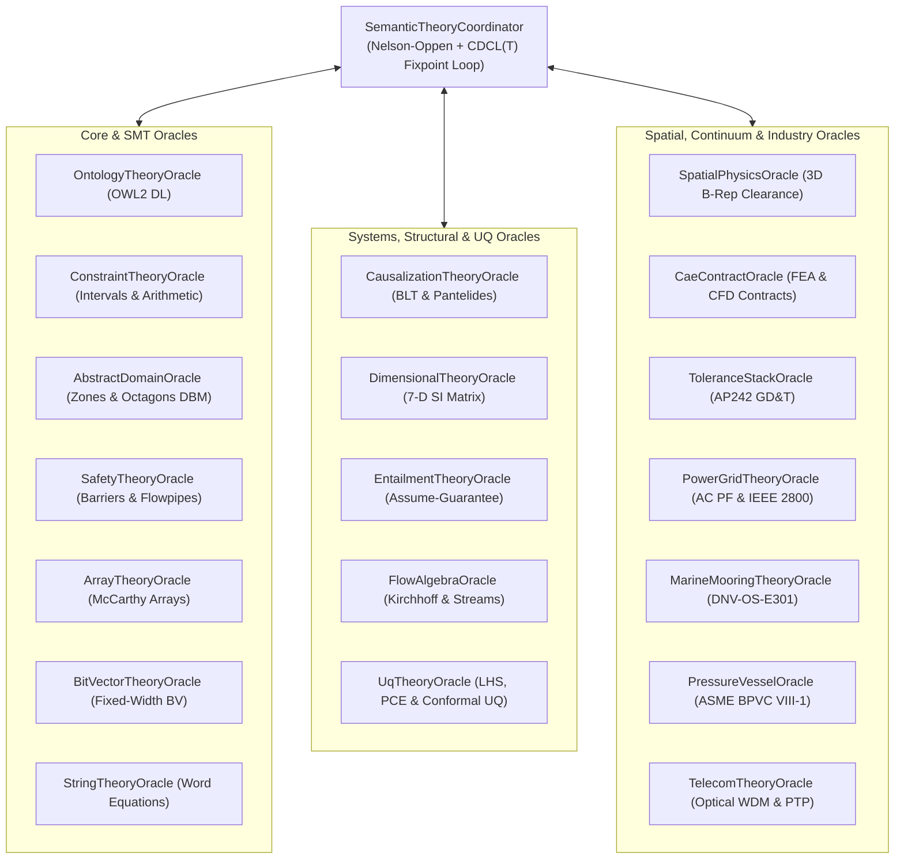

# Multi-Domain Theory Coordinator (Nelson-Oppen & CDCL(T))

The **Multi-Domain Theory Coordinator** (`SemanticTheoryCoordinator` in `packages/runtime/src/formal/theory_coordinator.ts`) is ModelScript's cross-language formal verification engine. It combines **Nelson-Oppen equality sharing** with **Conflict-Driven Clause Learning Modulo Theories ($\text{CDCL}(\mathcal{T})$)** to verify system-wide invariants across ontological, structural, geometric, physical, causal, uncertainty, and classical SMT domains simultaneously.

---

## Architectural Motivation

In traditional Model-Based Systems Engineering (MBSE), each engineering tool operates in an isolated semantic silo:

- A **SysML v2** requirement specifies `maxBatteryTemp <= 333.15 [K]`.
- A **STEP / OpenSCAD** 3D CAD enclosure defines the heat-sink surface area $A_{\text{sink}}$.
- A **CFD** configuration computes the convective heat transfer coefficient $h(v_{\infty})$.
- A **Modelica** thermal-electrical DAE integrates $C_{\text{th}} \dot{T} = I^2 R_{\text{int}} - h A_{\text{sink}} (T - T_{\text{amb}})$.

No single solver understands all four representations. The **Theory Coordinator** bridges these silos by treating each engineering domain as a decidable or semi-decidable **Theory Oracle** ($\mathcal{T}_i$) sharing a common set of interface variables ($V_{\text{shared}}$).

---

## The 19 Domain Theory Oracles

`packages/runtime/src/formal/theory_coordinator.ts` defines the canonical `TheoryDomain` union:

```ts
export type TheoryDomain =
  | "ontology"
  | "constraint"
  | "abstract_domain"
  | "continuous_safety"
  | "dynamic_simulation"
  | "spatial_physics"
  | "algebraic"
  | "custom";
```

`packages/runtime/src/formal/oracles/index.ts` exports 19 specialized domain theory oracles implementing the `TheoryOracle` interface:



| #   | Oracle Class                | `TheoryDomain`       | Decision / Propagation Procedure                                                                                                                   |
| :-- | :-------------------------- | :------------------- | :------------------------------------------------------------------------------------------------------------------------------------------------- |
| 1   | `OntologyTheoryOracle`      | `ontology`           | $\mathcal{SROIQ}(\mathcal{D})$ Tableau reasoning over OWL 2 axioms, class disjointness, and property domains                                       |
| 2   | `ConstraintTheoryOracle`    | `constraint`         | Interval arithmetic and relational constraint propagation over SysML v2 requirements                                                               |
| 3   | `AbstractDomainOracle`      | `abstract_domain`    | Floyd-Warshall Difference Bound Matrix (DBM) closure over **Zone** ($x_i - x_j \le c$) and **Octagon** ($\pm x_i \pm x_j \le c$) domains           |
| 4   | `SafetyTheoryOracle`        | `continuous_safety`  | Control Barrier Function (CBF) Lie-derivative positivity ($L_f B + L_g B \cdot u + \alpha(B) \ge 0$) and Taylor-model flowpipe safety              |
| 5   | `SpatialPhysicsOracle`      | `spatial_physics`    | 3D CAD bounding-box, B-Rep minimum clearance distance, mass budget, and interference checks                                                        |
| 6   | `CaeContractOracle`         | `spatial_physics`    | FEA structural safety factor ($\sigma_{\text{von Mises}} \le \sigma_{\text{yield}} / \text{SF}$) and CFD aerodynamic/thermal drag polar bounds     |
| 7   | `CausalizationTheoryOracle` | `constraint`         | Hopcroft-Karp maximum bipartite matching ($O(E\sqrt{V})$), Tarjan BLT decomposition, and Pantelides DAE index reduction                            |
| 8   | `DimensionalTheoryOracle`   | `constraint`         | Gaussian elimination over the 7-base SI unit exponent matrix $[\text{m}, \text{kg}, \text{s}, \text{A}, \text{K}, \text{mol}, \text{cd}]$          |
| 9   | `EntailmentTheoryOracle`    | `constraint`         | Assume-Guarantee contract compatibility ($\bigwedge A_i \neq \bot$) and compositional refinement ($A_P \Rightarrow A_C \land G_C \Rightarrow G_P$) |
| 10  | `FlowAlgebraOracle`         | `constraint`         | Acausal connection graph conservation ($\sum i_k = 0$ for flow variables, $v_1 = v_2 = \dots = v_n$ for potential variables)                       |
| 11  | `ToleranceStackOracle`      | `spatial_physics`    | STEP AP242 GD&T 1D/3D tolerance chain stack-up via Worst-Case ($\sum t_i$) and Root-Sum-Square ($\sqrt{\sum t_i^2}$)                               |
| 12  | `UqTheoryOracle`            | `dynamic_simulation` | Latin Hypercube Sampling (LHS), Polynomial Chaos Expansion (PCE) Sobol indices, and distribution-free conformal prediction bounds                  |
| 13  | `ArrayTheoryOracle`         | `custom`             | McCarthy extensional theory of arrays ($T_A$) with read-over-write (`ROW1`/`ROW2`), congruence closure, and UndoTrail backtracking                 |
| 14  | `BitVectorTheoryOracle`     | `custom`             | Arbitrary-width fixed-width bit-vector theory ($T_{BV}$) with exact `BigInt` intervals, known-bit masks, modular arithmetic, and bitwise ops       |
| 15  | `StringTheoryOracle`        | `custom`             | Theory of strings and word equations ($T_S$) with concatenation propagation, prefix/suffix/contains predicates, and length-interval coupling       |
| 16  | `PowerGridTheoryOracle`     | `constraint`         | AC power-flow bus voltage bounds, generator reactive capability, branch MVA thermal limits, and IEEE 2800 / NERC PRC-029 LVRT/HVRT ride-through    |
| 17  | `MarineMooringTheoryOracle` | `spatial_physics`    | DNV-OS-E301 and DNV-ST-0119 intact/damaged mooring line safety factors, tension limits, and drag-embedment anchor uplift angle criteria            |
| 18  | `PressureVesselOracle`      | `spatial_physics`    | ASME BPVC Section VIII Div 1 cylindrical shell (UG-27), formed head (UG-32), and hydrostatic test (UG-99) stress and thickness compliance          |
| 19  | `TelecomTheoryOracle`       | `constraint`         | Optical WDM GSNR, chromatic dispersion, Kerr non-linear launch power limits, and ITU-T G.8275.1 / 3GPP 5G TDD PTP/SyncE timing budgets             |

---

## The Verification Loop

1. **Initialization**: Shared variables ($V_{\text{shared}}$) are initialized to $[-\infty, +\infty]$ or extracted from SysML v2 requirement bounds and `.ssv` parameter sets.
2. **Domain Propagation (`propagateEqualities`)**: Each registered `TheoryOracle` inspects the current shared interval store and tightens bounds monotonically by intersecting all oracle outputs:

   $$
   I^{(k+1)}(x) = I^{(k)}(x) \cap \bigcap_{m=1}^{M} \text{Oracle}_m.\text{propagate}(I^{(k)})(x)
   $$

   | Symbol                             | Meaning                                                                      | Units / Domain                                     |
   | :--------------------------------- | :--------------------------------------------------------------------------- | :------------------------------------------------- |
   | $I^{(k)}(x)$                       | Interval bound $[l, u]$ for shared variable $x$ at fixed-point iteration $k$ | Closed interval in $\mathbb{R} \cup \{\pm\infty\}$ |
   | $M$                                | Total number of registered `TheoryOracle` instances                          | $\mathbb{N}_{\ge 1}$                               |
   | $\text{Oracle}_m.\text{propagate}$ | Monotone interval contractor for the $m$-th domain theory                    | Interval map                                       |

3. **Nelson-Oppen Equality Deduction**: Whenever $I^{(k+1)}(x) = [c, c]$ and $I^{(k+1)}(y) = [c, c]$ (or linear relational equalities $x - y \le 0 \land y - x \le 0$ hold in the Octagon DBM), the coordinator deduces the inter-theory equality $x = y$ and broadcasts it to all oracles.
4. **Conflict & Unsat Core Extraction ($\text{CDCL}(\mathcal{T})$)**: If any oracle detects $I(x) = \emptyset$ (i.e., $\text{lo} > \text{hi}$) or an axiomatic contradiction, it emits a minimal `ConflictClause` pinpointing the exact offending AST nodes across files (e.g., `battery.mo:42`, `enclosure.step:118`, `thermal_req.sysml:15`).
5. **CEGAR Counterexample Guided Refinement**: If all static/algebraic oracles return `SAT` or `UNKNOWN`, `SafetyTheoryOracle` and `UqTheoryOracle` coordinate with numerical DAE simulation (`@modelscript/simulate`) to sample worst-case corner parameters from the narrowed interval box and either confirm satisfaction or extract a concrete counterexample trajectory $\mathbf{x}(t)$.

```bash
# Run multi-domain formal verification across Modelica, SysML v2, and STEP artifacts
msx verify SystemRequirement model.mo architecture.sysml chassis.step
```
