# Multi-Domain Theory Coordinator (Nelson-Oppen & CDCL(T))

The **Multi-Domain Theory Coordinator** (`packages/runtime/src/formal/theory_coordinator.ts`) is ModelScript's cross-language formal verification engine. It combines **Nelson-Oppen equality sharing** with **Conflict-Driven Clause Learning Modulo Theories ($\text{CDCL}(\mathcal{T})$)** to verify system-wide invariants across ontological, structural, geometric, physical, causal, and dynamic simulation domains simultaneously.

---

## Architectural Motivation

In traditional Model-Based Systems Engineering (MBSE), each engineering tool operates in an isolated semantic silo:

- A **SysML v2** requirement specifies `maxBatteryTemp <= 333.15 [K]`.
- A **STEP / OpenSCAD** 3D CAD enclosure defines the heat-sink surface area $A_{\text{sink}}$.
- A **CFD** configuration computes the convective heat transfer coefficient $h(v_{\infty})$.
- A **Modelica** thermal-electrical DAE integrates $C_{\text{th}} \dot{T} = I^2 R_{\text{int}} - h A_{\text{sink}} (T - T_{\text{amb}})$.

No single solver understands all four representations. The **Theory Coordinator** bridges these silos by treating each engineering domain as a decidable or semi-decidable **Theory Oracle** ($\mathcal{T}_i$) sharing a common set of interface variables ($V_{\text{shared}}$).

---

## The 13 Domain Theory Oracles

`packages/runtime/src/formal/theory_coordinator.ts` and `packages/runtime/src/formal/oracles/index.ts` coordinate 13 specialized domain theory oracles implementing the `TheoryOracle` interface:

```mermaid
flowchart TB
    COORD["MultiDomainTheoryCoordinator<br/>(Nelson-Oppen + CDCL(T) Fixpoint Loop)"]

    T1["1. OntologyTheoryOracle<br/>(OWL2 DL Tableau & SPARQL)"]
    T2["2. ConstraintTheoryOracle<br/>(SysML v2 Interval Propagation)"]
    T3["3. AbstractDomainOracle<br/>(Zones & Octagons DBM)"]
    T4["4. ContinuousSafetyOracle<br/>(Barrier Certificates & Flowpipes)"]
    T5["5. DynamicSimulationOracle<br/>(Modelica DAE Trajectory Slicing)"]
    T6["6. SpatialPhysicsOracle<br/>(3D B-Rep Collision & Clearance)"]
    T7["7. CaeContractOracle<br/>(FEA von Mises & CFD Drag/Thermal)"]
    T8["8. CausalizationOracle<br/>(Hopcroft-Karp & Pantelides DAE)"]
    T9["9. DimensionalOracle<br/>(7-D SI Exponent Matrix Rank)"]
    T10["10. EntailmentOracle<br/>(Assume-Guarantee Refinement)"]
    T11["11. FlowAlgebraOracle<br/>(Kirchhoff & Stream Conservation)"]
    T12["12. ToleranceStackOracle<br/>(AP242 GD&T Worst-Case & RSS)"]
    T13["13. UqOracle<br/>(Latin Hypercube & Conformal UQ)"]

    COORD <--> T1
    COORD <--> T2
    COORD <--> T3
    COORD <--> T4
    COORD <--> T5
    COORD <--> T6
    COORD <--> T7
    COORD <--> T8
    COORD <--> T9
    COORD <--> T10
    COORD <--> T11
    COORD <--> T12
    COORD <--> T13
```



| #   | Oracle Class              | Domain (`TheoryDomain`)   | Decision / Propagation Procedure                                                                                                                   |
| :-- | :------------------------ | :------------------------ | :------------------------------------------------------------------------------------------------------------------------------------------------- |
| 1   | `OntologyTheoryOracle`    | `ontology`                | $\mathcal{SROIQ}(\mathcal{D})$ Tableau reasoning over OWL 2 axioms, class disjointness, and property domains                                       |
| 2   | `ConstraintTheoryOracle`  | `constraints`             | Interval arithmetic and relational constraint propagation over SysML v2 requirements                                                               |
| 3   | `AbstractDomainOracle`    | `abstract_interpretation` | Floyd-Warshall Difference Bound Matrix (DBM) closure over **Zone** ($x_i - x_j \le c$) and **Octagon** ($\pm x_i \pm x_j \le c$) domains           |
| 4   | `ContinuousSafetyOracle`  | `continuous_safety`       | Control Barrier Function (CBF) Lie-derivative positivity ($L_f B + L_g B \cdot u + \alpha(B) \ge 0$) and Taylor-model flowpipe safety              |
| 5   | `DynamicSimulationOracle` | `simulation`              | Sensitivity-guided DAE trajectory integration (CVODE/IDA) with exact zero-crossing root finding                                                    |
| 6   | `SpatialPhysicsOracle`    | `spatial`                 | 3D CAD bounding-box, B-Rep minimum clearance distance, mass budget, and interference checks                                                        |
| 7   | `CaeContractOracle`       | `cae`                     | FEA structural safety factor ($\sigma_{\text{von Mises}} \le \sigma_{\text{yield}} / \text{SF}$) and CFD aerodynamic/thermal drag polar bounds     |
| 8   | `CausalizationOracle`     | `causalization`           | Hopcroft-Karp maximum bipartite matching ($O(E\sqrt{V})$), Tarjan BLT decomposition, and Pantelides DAE index reduction                            |
| 9   | `DimensionalOracle`       | `dimensional`             | Gaussian elimination over the 7-base SI unit exponent matrix $[\text{m}, \text{kg}, \text{s}, \text{A}, \text{K}, \text{mol}, \text{cd}]$          |
| 10  | `EntailmentOracle`        | `entailment`              | Assume-Guarantee contract compatibility ($\bigwedge A_i \neq \bot$) and compositional refinement ($A_P \Rightarrow A_C \land G_C \Rightarrow G_P$) |
| 11  | `FlowAlgebraOracle`       | `flow_algebra`            | Acausal connection graph conservation ($\sum i_k = 0$ for flow variables, $v_1 = v_2 = \dots = v_n$ for potential variables)                       |
| 12  | `ToleranceStackOracle`    | `tolerance`               | STEP AP242 GD&T 1D/3D tolerance chain stack-up via Worst-Case ($\sum t_i$) and Root-Sum-Square ($\sqrt{\sum t_i^2}$)                               |
| 13  | `UqOracle`                | `uq`                      | Latin Hypercube Sampling (LHS), Polynomial Chaos Expansion (PCE) Sobol indices, and distribution-free conformal prediction bounds                  |

---

## The Verification Loop

1. **Initialization**: Shared variables ($V_{\text{shared}}$) are initialized to $[-\infty, +\infty]$ or extracted from SysML v2 requirement bounds and `.ssv` parameter sets.
2. **Domain Propagation (`propagate`)**: Each registered `TheoryOracle` inspects the current shared interval store and tightens bounds monotonically:
   $$
   I^{(k+1)}(x) = I^{(k)}(x) \cap \bigcap_{m=1}^{M} \text{Oracle}_m.\text{propagate}(I^{(k)})(x)
   $$
3. **Nelson-Oppen Equality Deduction**: Whenever $I^{(k+1)}(x) = [c, c]$ and $I^{(k+1)}(y) = [c, c]$ (or linear relational equalities $x - y \le 0 \land y - x \le 0$ hold in the Octagon DBM), the coordinator deduces the inter-theory equality $x = y$ and broadcasts it to all oracles.
4. **Conflict & Unsat Core Extraction ($\text{CDCL}(\mathcal{T})$)**: If any oracle detects $I(x) = \emptyset$ (i.e., $\text{lo} > \text{hi}$) or an axiomatic contradiction, it emits a minimal **Unsatisfiable Core (`UnsatCore`)** pinpointing the exact offending AST nodes across files (e.g., `battery.mo:42`, `enclosure.step:118`, `thermal_req.sysml:15`).
5. **CEGAR Counterexample Guided Refinement**: If all static/algebraic oracles return `SAT` or `UNKNOWN`, `DynamicSimulationOracle` synthesizes worst-case corner parameters from the narrowed interval box and executes a numerical DAE simulation to either confirm satisfaction or extract a concrete counterexample trajectory $\mathbf{x}(t)$.

```bash
# Run multi-domain formal verification across Modelica, SysML v2, and STEP artifacts
npx msx verify SystemRequirement model.mo architecture.sysml chassis.step
```
