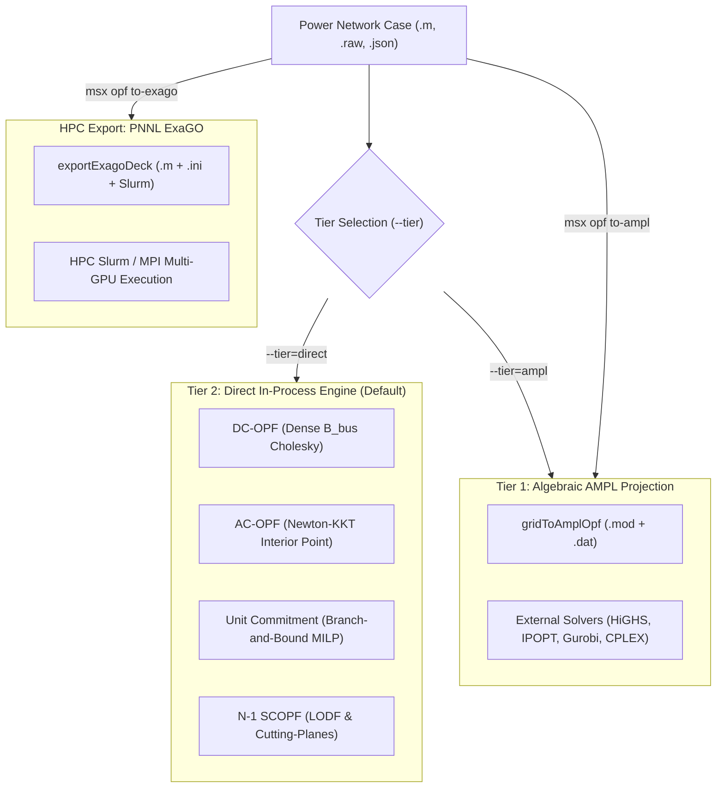

# Optimal Power Flow (OPF) CLI Manual

The `msx opf` command provides enterprise-grade, two-tier optimization operations for electrical power transmission networks. It accepts network cases in **MATPOWER (`.m`)**, **Siemens PSS/E (`.raw`)**, and ModelScript **JSON** grid formats.

---

## Two-Tier Optimization Architecture

ModelScript solves optimal power flow across two distinct tiers designed for complementary operational and research paradigms:



### Tier 2: Direct In-Process Engine (`--tier=direct`)

- **Zero GC Overhead**: Solves directly in pure TypeScript using typed linear memory arrays (`Float64Array`, `Int32Array`).
- **Sub-10ms Solve Times**: Fast Cholesky / dense matrix decomposition, ideal for real-time digital twins, interactive UI dashboards, and embedded simulation loops.
- **Integrated Unit Commitment**: Built-in Branch-and-Bound MILP solver for 24-hour generation scheduling with minimum up/down times, ramp rates, spinning reserves, and battery energy storage (BESS).
- **Automated N-1 SCOPF**: Line Outage Distribution Factor (LODF) screening with iterative cutting-plane redispatch for contingency security.

### Tier 1: Algebraic AMPL Projection (`--tier=ampl`)

- **Mathematical Transparency**: Projects the network case into formal algebraic AMPL modeling language files (`.mod` and `.dat`).
- **Solver Agnostic**: Solves through commercial and open-source solvers (IPOPT, HiGHS, CBC, Gurobi, CPLEX, Knitro).
- **Arbitrary Constraint Injection**: Allows power engineers to inject custom environmental, emission, or market constraints directly into the generated AMPL model.

---

## Command Reference

### `msx opf solve`

Solves DC or AC Optimal Power Flow and outputs dispatch results, Locational Marginal Prices (LMPs), and transmission congestion rents.

```bash
msx opf solve <file> [options]
```

#### Options:

| Flag               | Type                          | Default  | Description                                                                                            |
| :----------------- | :---------------------------- | :------- | :----------------------------------------------------------------------------------------------------- |
| `--formulation`    | `dc` \| `ac`                  | `dc`     | OPF formulation: linearized active power (`dc`) or full nonlinear polar AC (`ac`).                     |
| `--tier`           | `direct` \| `ampl`            | `direct` | Solver tier: Tier 2 direct in-process (`direct`) or Tier 1 algebraic (`ampl`).                         |
| `--solver`         | `string`                      | —        | Target optimizer name (`simplex`, `clp`, `cbc`, `ipopt`, `highs`).                                     |
| `--thermal-limits` | `boolean`                     | `true`   | Enforce branch MVA thermal limits (`rateA`). When disabled, unconstrained economic dispatch is solved. |
| `--format`         | `report` \| `table` \| `json` | `report` | Output format: formatted engineering report, ASCII summary table, or structured JSON.                  |
| `-o, --out`        | `string`                      | —        | File path to write the solution output.                                                                |

#### Example: Solving DC-OPF on IEEE 14-Bus Case

```bash
# Formatted engineering report with LMP congestion breakdown
msx opf solve case14.m --formulation=dc

# Machine-readable JSON output saved to disk
msx opf solve ieee14.raw --formulation=dc --format=json -o sol_14.json

# Console table overview
msx opf solve case14.m --format=table
```

---

### `msx opf to-ampl`

Exports a power network case into decoupled AMPL model (`.mod`) and dataset (`.dat`) files for external mathematical optimization and custom constraint experimentation.

```bash
msx opf to-ampl <file> [options]
```

#### Options:

| Flag            | Type         | Default      | Description                                  |
| :-------------- | :----------- | :----------- | :------------------------------------------- |
| `--formulation` | `dc` \| `ac` | `dc`         | Formulation type to generate (`dc` or `ac`). |
| `-o, --out`     | `string`     | `<caseName>` | Output destination directory or file prefix. |

#### Generated Model Architecture:

The generated `.mod` file encapsulates the standard AC/DC power flow formulations:

```ampl
# ModelScript AMPL OPF Formulation (DC-OPF)
set BUSES;
set GENS;
set BRANCHES;

param sbase default 100.0;
param slack_bus default 1;
param Pd {BUSES} default 0.0;
param rateA {BRANCHES} default 9999.0;

var Va {b in BUSES} >= -3.14159, <= 3.14159;
var Pg {g in GENS} >= Pmin[g], <= Pmax[g];

minimize TotalGenerationCost:
  sum {g in GENS} (c1[g] * Pg[g] + c0[g]);

subject to SlackAngleRef:
  Va[slack_bus] = 0.0;

subject to NodalPowerBalance {i in BUSES}:
  (sum {g in GENS: gen_bus[g] == i} Pg[g]) - Pd[i] =
    (sum {br in BRANCHES: fbus[br] == i} (sbase / br_x[br]) * (Va[i] - Va[tbus[br]])) +
    (sum {br in BRANCHES: tbus[br] == i} (sbase / br_x[br]) * (Va[i] - Va[fbus[br]]));

subject to ThermalLimitForward {br in BRANCHES: rateA[br] < 9000}:
  (sbase / br_x[br]) * (Va[fbus[br]] - Va[tbus[br]]) <= rateA[br];
```

---

### `msx opf to-exago`

Exports an exascale optimization bundle tailored for Pacific Northwest National Laboratory's **PNNL ExaGO** framework (`scopflow` / `opflow`) to solve massive grid cases on high-performance GPU clusters:

```bash
msx opf to-exago <file> [options]
```

#### Options:

| Flag          | Type                   | Default          | Description                                                                     |
| :------------ | :--------------------- | :--------------- | :------------------------------------------------------------------------------ |
| `--app`       | `scopflow` \| `opflow` | `scopflow`       | ExaGO application binary (`scopflow` for N-1 SCOPF, `opflow` for standard OPF). |
| `--mpi-ranks` | `number`               | `4`              | Number of MPI ranks for the generated Slurm/srun batch script.                  |
| `-o, --out`   | `string`               | `./<case>_exago` | Destination directory for the generated ExaGO deck.                             |

#### Generated Bundle Structure:

- `<caseName>.m`: Clean MATPOWER case with normalized bus numbers and base ratings.
- `<caseName>.ini`: ExaGO PETSc solver options, HiOp/IPOPT tolerance parameters, and formulation flags.
- `<caseName>.cont`: Complete line outage contingency definitions for $N-1$ analysis.
- `run_exago.sh`: Executable Slurm HPC launch script with `srun --mpi=pmix`.

---

## Formulations & Advanced Capabilities

### 1. DC Optimal Power Flow (DC-OPF)

- **Objective**: Minimize total fuel cost $\sum_{g} (c_{2,g} P_{g}^2 + c_{1,g} P_g + c_{0,g})$.
- **Nodal Power Balance**: $B_{\text{bus}} \cdot \theta = P_g - P_d$.
- **Transmission Flow Limits**: $-P_{l,\max} \le \frac{1}{x_l} (\theta_{f,l} - \theta_{t,l}) \le P_{l,\max}$.
- **Locational Marginal Prices**: Dual variables $\lambda_i = \mu_{\text{energy}} + \mu_{\text{cong}, i}$ provide explicit decomposition into reference energy and transmission congestion components.

### 2. AC Optimal Power Flow (AC-OPF)

- **Objective**: Non-linear fuel cost minimization subject to full AC physics.
- **Active & Reactive Power Injections**:
  $$P_i = V_i \sum_{j} V_j (G_{ij} \cos \theta_{ij} + B_{ij} \sin \theta_{ij})$$
  $$Q_i = V_i \sum_{j} V_j (G_{ij} \sin \theta_{ij} - B_{ij} \cos \theta_{ij})$$
- **Voltage Band Limits**: $V_{i,\min} \le V_i \le V_{i,\max}$ across all transmission and load buses.
- **Apparent Power Thermal Limits**: $S_{ij} = \sqrt{P_{ij}^2 + Q_{ij}^2} \le S_{ij,\max}$.

### 3. Direct MILP Unit Commitment (`solveDirectUnitCommitment`)

Multi-period binary generation commitment problem across $T$ hours:

- **Binary Variables**: $u_{g,t} \in \{0, 1\}$ (online status), $v_{g,t} \in \{0, 1\}$ (startup event), $w_{g,t} \in \{0, 1\}$ (shutdown event).
- **Logical Transition**: $u_{g,t} - u_{g,t-1} = v_{g,t} - w_{g,t}$.
- **Minimum Up/Down Times**: $u_{g,t} = 1$ for at least $UT_g$ hours following startup; $u_{g,t} = 0$ for $DT_g$ hours following shutdown.
- **Ramping Limits**: $|P_{g,t} - P_{g,t-1}| \le R_g \cdot \Delta t$.
- **Spinning Reserves**: System-wide headroom $\sum_g (u_{g,t} P_{g,\max} - P_{g,t}) \ge R_{\text{req}, t}$.
- **BESS Dynamics**: State-of-charge tracking $\text{SOC}_{t+1} = \text{SOC}_t + \eta_{\text{ch}} P_{\text{ch}, t} - \frac{1}{\eta_{\text{dis}}} P_{\text{dis}, t}$.

### 4. Direct N-1 Security-Constrained OPF (`solveDirectScopf`)

- **PTDF Calculation**: Inverts reduced $B_{\text{bus}}$ matrix to compute Power Transfer Distribution Factors:
  $$\text{PTDF}_{l, i} = \frac{1}{x_l} (X_{f(l), i} - X_{t(l), i})$$
- **LODF Screening**: Line Outage Distribution Factors compute post-contingency flow on line $l$ following an outage of line $k$:
  $$\text{LODF}_{l, k} = \frac{\text{PTDF}_{l, f(k)} - \text{PTDF}_{l, t(k)}}{1 - (\text{PTDF}_{k, f(k)} - \text{PTDF}_{k, t(k)})}$$
  $$P_l^{(k)} = P_l^{(0)} + \text{LODF}_{l, k} P_k^{(0)}$$
- **Iterative Redispatch**: Detects worst-case violations exceeding emergency ratings (`rateC`/`rateB`) and injects dynamic cutting-plane constraints until all $N-1$ contingencies are secure.
