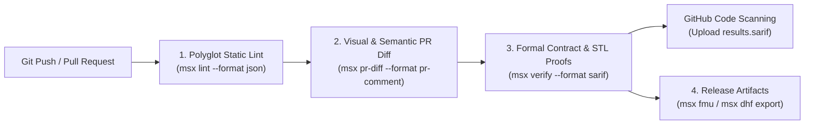

# CI/CD & GitHub Actions

Because every ModelScript artifact — from Modelica equations and SysML v2 requirements to PSCAD schematics and STEP geometry — is stored as text in Git, your entire cyber-physical digital thread can be linted, simulated, formally verified, and packaged inside standard CI/CD pipelines.

All `msx` CLI commands return strict POSIX exit codes (`0` = pass/proven safe, `1` = lint error/counterexample falsified, `2` = usage error) and respect `NO_COLOR=1` in non-interactive runners.

---

## 1. Continuous Verification Pipeline Overview



| Stage                      | Command                                        | Output Format                             | Purpose                                                                                                 |
| :------------------------- | :--------------------------------------------- | :---------------------------------------- | :------------------------------------------------------------------------------------------------------ |
| **Static Analysis**        | `msx lint ./models ./requirements`             | `json`, `text`                            | Enforces 794 static syntax, type, unit, and structural rules across 44 languages.                       |
| **Cross-Domain Alignment** | `msx polyglot verify .`                        | Terminal / Exit Code                      | Verifies `@satisfies` / `@verifies` bindings and cross-language port compatibility.                     |
| **Visual PR Review**       | `msx pr-diff --base origin/main`               | `pr-comment`, `visual-svg`, `visual-html` | Generates color-coded schematic diffs (added = green, modified = amber, deleted = red).                 |
| **Formal Verification**    | `msx verify <Class> <file> --format sarif`     | `sarif`, `junit`, `ctrf`, `html`, `dhf`   | Runs $\text{CDCL}(\mathcal{T})$ SMT, IC3/PDR, and flowpipe proofs; integrates with GitHub Security tab. |
| **STL Falsification**      | `msx falsify --modelica <file> --sysml <file>` | Counterexample trace JSON                 | Searches parameter and disturbance spaces via CMA-ES / Differential Evolution for safety violations.    |
| **Deliverables & DHF**     | `msx fmu` & `msx dhf export`                   | `.fmu`, `.md`, `.html`, `.json`           | Packages FMI 3.0 Co-Simulation FMUs and signed FDA 21 CFR Part 820 / ISO 26262 DHF dossiers.            |

---

## 2. Complete GitHub Actions Workflow (`.github/workflows/modelscript-ci.yml`)

Copy the workflow below into `.github/workflows/modelscript-ci.yml` to run polyglot linting, upload **SARIF 2.1.0** formal verification proofs to **GitHub Code Scanning**, post automated **Visual PR Diff** summaries on pull requests, and archive **FMI 3.0 FMUs** and **Regulatory DHF Dossiers**:

```yaml
name: ModelScript Digital Thread CI

on:
  push:
    branches: [main]
  pull_request:
    branches: [main]

permissions:
  contents: read
  pull-requests: write
  security-events: write

env:
  NO_COLOR: "1"

jobs:
  verify-digital-thread:
    name: Lint, Verify & Package Digital Thread
    runs-on: ubuntu-latest

    steps:
      - name: Checkout repository with full history for PR diffs
        uses: actions/checkout@v4
        with:
          fetch-depth: 0

      - name: Setup Node.js
        uses: actions/setup-node@v4
        with:
          node-version: "24"

      - name: Install @modelscript/cli and start warm compiler daemon
        run: |
          npm install -g @modelscript/cli
          msx daemon start

      - name: 1. Polyglot Static Linting
        run: |
          msx lint ./models ./architecture --daemon

      - name: 2. Verify Cross-Language Digital Thread Links
        run: |
          msx polyglot verify . --daemon

      - name: 3. Formal Contract Verification (SARIF + JUnit)
        run: |
          msx verify BrakingController models/BrakingController.mo \
            --format sarif \
            --report results.sarif \
            --daemon

      - name: Upload SARIF Proof Report to GitHub Code Scanning
        if: always()
        uses: github/codeql-action/upload-sarif@v3
        with:
          sarif_file: results.sarif
          category: modelscript-formal-verification

      - name: 4. Generate Visual & Semantic Pull Request Diff
        if: github.event_name == 'pull_request'
        run: |
          msx pr-diff \
            --base origin/${{ github.base_ref }} \
            --format pr-comment \
            -o pr-diff-comment.md
          msx pr-diff \
            --base origin/${{ github.base_ref }} \
            --format visual-svg \
            -o visual-diff.svg

      - name: 5. Build FMI 3.0 Co-Simulation FMU & Regulatory DHF Dossier
        run: |
          mkdir -p dist
          msx fmu BrakingController models/BrakingController.mo \
            --fmi-version 3 \
            --type cs \
            --wasm \
            --output dist/BrakingController.fmu
          msx dhf export ./models ./architecture \
            --format html \
            -o dist/design-history-file.html
          msx dhf audit ./models ./architecture

      - name: Upload FMU, Visual Diff & DHF Artifacts
        uses: actions/upload-artifact@v4
        with:
          name: modelscript-release-bundle
          path: |
            dist/BrakingController.fmu
            dist/design-history-file.html
            results.sarif
            visual-diff.svg
```

---

## 3. Visual & Semantic Pull Request Diffs (`msx pr-diff`)

Traditional text diffs struggle to convey the engineering impact of rewired acausal connectors or altered SysML v2 internal block diagrams. `msx pr-diff` parses both the base revision (`--base`) and head revision (`--head`) into CSTs and flattened DAEs, computing:

- **Structural & Equation Delta**: Added, removed, or re-typed components, modified parameter bindings, and changed differential equations (ignoring whitespace or comment reformatting).
- **Breaking Interface Detection (`--breaking-only`)**: Flags removed public connectors, narrowed requirement constraint intervals, or altered causal input/output signatures with exit code `1`.
- **Color-Coded Visual Schematics (`--format visual-svg` / `visual-html`)**: Renders an overlay schematic highlighting added blocks in green, modified parameters in amber, and deleted connections in red.

```bash
# Generate a Markdown summary table for GitHub / GitLab PR comments
msx pr-diff --base origin/main --format pr-comment -o pr-summary.md

# Render a standalone interactive HTML schematic comparison
msx pr-diff models/Powertrain.mo --base HEAD~1 --format visual-html -o diff.html

# Fail CI if a pull request introduces breaking port or contract changes
msx pr-diff --base origin/main --breaking-only
```

---

## 4. Domain-Specific Compliance Gates

In addition to general Modelica and SysML v2 verification, you can gate pull requests on industry-specific homologation standards:

### Power Grid Interconnection (IEEE Std 2800-2022)

```bash
# Lint PSCAD EMT schematics and verify LVRT/HVRT ride-through compliance
msx pscad lint grid/SolarPlant_250MW.pscx
msx pscad verify-ieee2800 grid/SolarPlant_250MW.pscx --tstop 3.0 --step 20us -o ieee2800.json
```

### Railway Vehicle Running Safety (EN 14363 / UIC 518)

```bash
# Lint GENSYS railway vehicle model and emit a SARIF homologation report
msx gensys lint rail/HighSpeedBogie.calc
msx gensys report rail/HighSpeedBogie.calc --format sarif --out en14363.sarif
```

### Subsea Flow Assurance (OLGA Severe Slugging & Hydrate Margins)

```bash
# Lint and verify MAOP, hydrate subcooling margin, and erosional velocity limits
msx olga lint subsea/Tieback.opi
msx olga verify subsea/Tieback.opi
```

---

## 5. Offloading Heavy Campaigns to Cloud HPC (`msx cloud`)

When a CI pipeline needs to run a 10,000-shot Monte Carlo uncertainty study or a multi-hour 3D CFD/FEA co-simulation, dispatch the job to a remote Slurm HPC cluster using `MODELSCRIPT_API_URL` and `MODELSCRIPT_TOKEN`:

```bash
# Dispatch a high-CPU simulation job to the ModelScript Cloud Slurm cluster
msx simulate ThermalGrid models/ThermalGrid.mo \
  --cloud \
  --profile high-cpu \
  --stop-time 3600 \
  --output-dir ./artifacts/thermal

# Or inspect and download artifacts from an asynchronous cloud job
msx cloud status job_01j8x9k2m
msx cloud download job_01j8x9k2m ./artifacts
```

---

## Next Steps

- **[CLI Overview](../cli/overview.md)** — Global flags (`--daemon`), environment variables, and exit code conventions.
- **[CLI Commands Reference](../cli/commands.md)** — Exhaustive flag tables for all 41 `msx` commands.
- **[Standards & Export Formats](../reference/export-formats.md)** — Details on SARIF 2.1.0, FMI 2.0/3.0, SSP, ReqIF, OSLC 3.0, and FDA/ISO DHF bundles.
