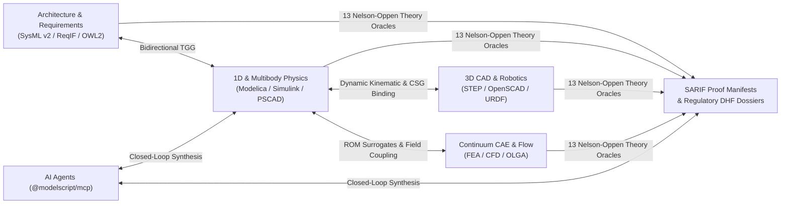

# Introduction

Welcome to **ModelScript**, the open-core **computable digital thread** platform and polyglot engineering compiler designed for multi-domain physical modeling, formal verification, and AI-assisted systems engineering.

---

## What is the Computable Digital Thread?

Modern cyber-physical systems — from electric vehicles, utility power grids, and satellites to surgical robots and subsea flowlines — require tight coordination across **44 engineering languages and file formats** spanning **12 industry verticals**:

- **System Architecture, Requirements & Ontologies** (`SysML v2`, `KerML`, `ReqIF`, `OSLC 3.0`, `OWL2`, `AAS / DDP`)
- **Multi-Domain Acausal & Block-Diagram Simulation** (`Modelica 3.x`, `ModelScript .msx`, `MATLAB Simulink`, `FMI 2.0/3.0 FMU`, `SSP 1.0/2.0`)
- **Power Grids, Electronics & Embedded Control** (`PSCAD EMT`, `Siemens PSS/E`, `SPICE`, `IBIS`, `Touchstone`, `Gerber`, `PLCopen IEC 61131-3`, `AUTOSAR ARXML`, `CAN DBC`, `ANSI C`)
- **3D CAD Geometry, Multibody & Robotics** (`STEP AP214/AP242`, `OpenSCAD CSG`, `ROS URDF / Xacro`, `SIMPACK`, `MSC Adams`, `GENSYS`)
- **Continuum CAE, Process, Thermal & Fluid Networks** (`CalculiX / Abaqus FEA`, `SU2 / OpenFOAM CFD`, `Gmsh`, `VTK`, `OLGA`, `PipelineStudio`, `Aspen Plus`, `EnergyPlus`, `EPANET`, `EPA SWMM`, `SBML`, `THERM`, `RADIANCE`)

Traditionally, these disciplines operate in disconnected silos. Enterprise "digital threads" have historically been **passive and descriptive** — composed of static document links, heavyweight PLM databases, and manual spreadsheets that drift out of sync the moment a parameter changes.

**ModelScript makes the digital thread _computable_.**

Instead of passive hyperlinks, ModelScript treats every engineering artifact as **executable, Git-versioned source code** compiled into a shared WebAssembly representation and continuously checked by graph rewriting engines and mathematical solvers:

### Traditional Passive PLM vs. Computable Digital Thread

| Dimension                    | Traditional Passive PLM / MBSE                              | ModelScript Computable Digital Thread                                                          |
| :--------------------------- | :---------------------------------------------------------- | :--------------------------------------------------------------------------------------------- |
| **Artifact Storage**         | Proprietary binary blobs in centralized SQL/PLM vaults      | Plain-text, human-readable source files versioned in Git                                       |
| **Cross-Domain Links**       | Manual, untyped hyperlinks that silently go stale           | Typed `@satisfies` / `@verifies` bindings & bidirectional Triple Graph Grammars (TGG)          |
| **Static Analysis**          | Checked manually during design reviews                      | **790 static lint rules** across **43 languages** evaluated on every keystroke and CI push     |
| **Requirement Verification** | Post-hoc spreadsheet sign-offs                              | Automated $\text{CDCL}(\mathcal{T})$ SMT, IC3/PDR, and Taylor-model reachability proofs        |
| **Code Review & Diffs**      | Opaque binary attachments or screenshot exports             | Structural AST/DAE diffs and visual schematic PR diffs (`msx pr-diff`)                         |
| **AI Copilot Integration**   | Unverified text generation prone to physical hallucinations | Closed-loop MCP server (`@modelscript/mcp`) grounded in DAE solvers and formal counterexamples |

---

## Core Pillars of ModelScript

### 1. Code-First Engineering Across 44 Languages

Every model, schematic, requirement, netlist, and mesh configuration lives as clean text in Git. Engineers diff, review, merge, and gate physical hardware designs using standard pull requests, SARIF code scanning, and reproducible CI/CD pipelines.

### 2. Zero-Allocation WebAssembly CST & DAE Arenas

Each language grammar compiles ahead-of-time via `@modelscript/dsl` (`buildParser`) into a native WebAssembly GLR parser (`parser.wasm`). Concrete syntax trees and flattened Differential-Algebraic Equations (`DAEBuilder`) reside in Struct-of-Arrays (SoA) linear memory with zero JavaScript object wrapper overhead, delivering consistent compiler performance across the CLI, VS Code, and browser WebWorkers.

### 3. Bidirectional Triple Graph Grammars (TGG) & Critical Pair Analysis

Keep system architecture, electronics, CAD, and physics in permanent synchronization. Declarative Double-Pushout (DPO) Triple Graph Grammar rules propagate architectural changes (`SysML v2`) forward into physical simulation models (`Modelica`, `SPICE`, `STEP`), while back-annotating numerical sizing results back into system requirements — verified for confluence via static Critical Pair Analysis (CPA).

### 4. Nelson-Oppen Multi-Theory Formal Verification (13 Theory Oracles)

Cross-domain verification is orchestrated by a $\text{CDCL}(\mathcal{T})$ Nelson-Oppen coordinator (`@modelscript/runtime`) that exchanges equality facts, interval contractors, and conflict clauses across **13 specialized domain theory oracles**:

1. **Ontology Theory (`OntologyTheoryOracle`)** — OWL2 Description Logic ($\mathcal{SROIQ}$) subsumption and disjointness
2. **Interval Constraint Theory (`ConstraintTheoryOracle`)** — SysML v2 / KerML HC4 revise and $\delta$-complete contractors
3. **Abstract Interpretation (`AbstractDomainOracle`)** — Relational Zone (Difference-Bound Matrix) and Octagon invariants
4. **Continuous Safety (`ContinuousSafetyOracle`)** — Sum-of-Squares (SOS) barrier certificates and Picard Taylor-model flowpipes
5. **Dynamic Simulation (`DynamicSimulationOracle`)** — DAE trajectory evaluation and Signal Temporal Logic (STL) robustness $\rho(\phi, \mathbf{x}, t)$
6. **3D Spatial Physics (`SpatialPhysicsOracle`)** — OpenCASCADE B-Rep minimum clearance, collision, and mass-property bounds
7. **CAE Contracts (`CaeContractOracle`)** — Structural FEA von Mises yield margins and CFD aerodynamic envelope contracts
8. **Causalization & Structural Matching (`CausalizationOracle`)** — Hopcroft-Karp matching, Pantelides DAE index, and algebraic loops
9. **Dimensional Analysis (`DimensionalOracle`)** — 7-base SI dimension exponent vector algebra ($\mathbb{Q}^7$) and affine unit conversions
10. **Assume-Guarantee Refinement (`EntailmentOracle`)** — Compositional contract refinement ($\mathcal{A}_2 \subseteq \mathcal{A}_1 \land \mathcal{G}_1 \subseteq \mathcal{G}_2$)
11. **Flow Conservation (`FlowAlgebraOracle`)** — Kirchhoff and fluid stream conservation ($\sum f_i = 0$) across connector graphs
12. **GD&T Tolerance Stack-Up (`ToleranceStackOracle`)** — Worst-case and RSS geometric tolerance stack-up from STEP AP242 PMI
13. **Uncertainty Quantification (`UqOracle`)** — Split conformal prediction intervals and First-Order Reliability Method (FORM) $\beta$ indices

### 5. Unified Multi-Language LSP & Incrementally Memoized Salsa Engine

A single background worker pool (`@modelscript/lsp`) indexes polyglot workspaces through an incremental Salsa query engine (`fetch → deep_verify → execute → backdate`). Engineers get cross-language go-to-definition, hover equations, unit checking, schematic rendering, and suspect-link diagnostics in VS Code, the browser IDE, and the native Tauri desktop studio.

### 6. AI-Native Closed-Loop Engineering (`@modelscript/mcp`)

Large language models struggle with physical engineering when left to guess differential equations in free text. `@modelscript/mcp` exposes **31 deterministic compiler, simulation, CAD, TGG, and formal verification tools** over the Model Context Protocol (MCP). AI agents iteratively draft code, run `modelica_lint`, integrate stiff DAEs with `modelica_simulate`, falsify requirements, and calibrate parameters via `modelica_diff_calibrate` until every formal proof passes.

---

## Ready to Get Started?

- **[Installation](./installation.md)** — Set up the zero-install Browser Playground, VS Code extension, `msx` CLI, or `@modelscript/mcp` AI agent server.
- **[Getting Started Tutorial](./getting-started.md)** — Build, verify, bind to 3D CAD, simulate, and export your first end-to-end computable digital thread.
- **[AI Agents & MCP Workflows](./ai-agents.md)** — Connect Claude Code, Cursor, or custom LLM orchestrators to the deterministic compiler and solver loop.
- **[CI/CD & GitHub Actions](./ci-cd.md)** — Gate pull requests with polyglot linting, SARIF formal verification reports, visual schematic diffs, and FDA/ISO compliance dossiers.
