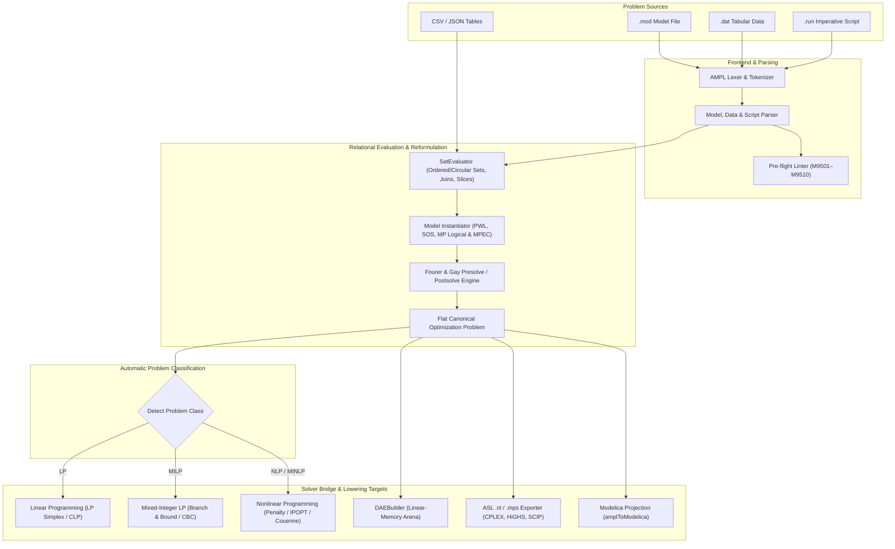

# AMPL-Compatible Mathematical Programming (`.mod`, `.dat`, `.run`, `.nl`, `.mps`)

`@modelscript/ampl` (`languages/ampl`) provides first-class support for **AMPL-compatible** (*A Mathematical Programming Language*) modeling, the industry-standard algebraic modeling language for linear, mixed-integer, nonlinear, logical, and complementarity mathematical optimization.

In ModelScript, AMPL bridges declarative operations research, supply chain planning, optimal control, and steady-state process design with the rest of the polyglot physical engineering ecosystem—connecting directly to ModelScript's in-WebAssembly COIN-OR solvers (CLP, CBC, IPOPT, Couenne), external commercial solvers (CPLEX, HiGHS, SCIP), and the linear-memory WebAssembly `DAEBuilder` arena.

---

## Supported Extensions & Document Models

| Extension | Format | Description |
| :--- | :--- | :--- |
| `.mod` | AMPL Model File | Declarative model declarations defining `set`, `param`, `var`, `minimize`/`maximize`, `subject to`, `table`, and `check` statements with relational indexing comprehensions. |
| `.dat` | AMPL Data File | Tabular parameter values, 2D matrix representations (`param (tr): ... :=`), $n$-D slices (`[*, *, k]`), and literal set membership definitions. |
| `.run` | AMPL Script File | Imperative optimization scripting (`for`, `repeat while/until`, `if-then-else`, `let`, `fix`/`unfix`, `drop`/`restore`, `objective`, `solve`, `display`, `printf`, `read table`, `write table`). |
| `.nl` | AMPL Solver Library | Universal ASCII intermediate representation with full prefix nonlinear expression opcode trees (`C<k>`, `O<k>`, `o0`–`o53`, `v<k>`, `n<c>`) for external and WASM solvers. |
| `.sol` | AMPL Solution File | Standard solution vector, objective value, status code, and dual shadow price interchange format. |
| `.mps` | MPS Format File | Industry-standard Mathematical Programming System fixed/free column-oriented format for LP, MILP, and `SOS1`/`SOS2` problems. |

---

## Compilation & Solver Pipeline



---

## Key Capabilities

### 1. Relational Set Algebra, Ordered Sets & Defined Variables

AMPL models express high-level mathematical formulations using relational set comprehensions, ordered/circular set navigation (`ordered`, `circular`, `first`, `last`, `next`, `prev`, `nextw`, `prevw`, `ord`, `card`, `member`, `symdiff`), and defined variables (`var Revenue = ...`):

```ampl
set PERIODS ordered := {"Q1", "Q2", "Q3", "Q4"};

param demand {t in PERIODS} := 10 * ord(t);
var Produce {PERIODS} >= 0, <= 50;
var Inventory {PERIODS} >= 0;
var TotalProduced = sum {t in PERIODS} Produce[t];

minimize Total_Cost:
  2 * TotalProduced + sum {t in PERIODS} Inventory[t];

subject to Init_Balance:
  Produce[first(PERIODS)] - Inventory[first(PERIODS)] = demand[first(PERIODS)];

subject to Flow_Balance {t in PERIODS: ord(t) > 1}:
  Inventory[prev(t, PERIODS)] + Produce[t] - Inventory[t] = demand[t];
```

### 2. Imperative `.run` Scripting Engine & Suffixes (`AmplSession`)

`AmplSession` and `runAmplScript` execute multi-solve algorithms including Benders decomposition, column generation, rolling-horizon MPC, and sensitivity sweeps using first-class variable suffixes (`.val`, `.rc`, `.lb`, `.ub`, `.init`, `.status`) and constraint suffixes (`.dual`, `.slack`, `.body`, `.lb`, `.ub`, `.status`):

```ampl
for {s in 1..5} {
  let AvailableHours := 20 + 10 * s;
  solve;
  printf "Scenario %d: Profit = %.2f, Dual = %.2f\n",
    s, TotalProfit, ProductionCapacity.dual;
}
```

### 3. Declarative `table` CSV & JSON I/O (`read table` / `write table`)

Declarative `table` statements bind sets, parameters, and solution suffixes directly to external CSV and JSON files:

```ampl
table FoodsIn IN "CSV" "foods.csv": [FOOD], cost, protein;
table BuyOut OUT "CSV" "solution.csv": [f in FOOD], Buy[f].val ~ buy, Buy[f].rc ~ reduced_cost;

read table FoodsIn;
solve;
write table BuyOut;
```

### 4. Piecewise-Linear (`<<...; ...>>`), Semicontinuous, Logical & MPEC Reformulations

The instantiator automatically reformulates high-level non-smooth, logical, and complementarity constructs:

- **Piecewise-Linear Expressions**: `<<b1, b2; s1, s2, s3>> x` (convex epigraph LP or non-convex incremental MILP).
- **Semicontinuous & SOS**: `semicont`, `semiint`, and Special Ordered Sets (`SOS1` / `SOS2` via `.sosno` and `.ref`).
- **MP Logical & CP Constraints**: Indicator implications (`y = 1 ==> x <= 10`), equivalences (`<==>`), disjunctions (`or`), `alldiff`, `atleast`, `atmost`, `exactly`, and `abs`/`min`/`max`.
- **MPEC Complementarity (`complements`)**: `subject to KKT: x >= 0 complements F(x) >= 0;` lowered via Fortuny-Amat & McCarl disjunctive MILP (`--mpec-mode=milp`) or smooth Fischer-Burmeister NLP (`--mpec-mode=nlp`).

### 5. Standalone Fourer & Gay Presolve & LIFO Postsolve (`--presolve`)

`presolveAmplProblem` performs iterative fixed-variable elimination, singleton row tightening, forcing-row fixing, and redundant constraint removal, with a LIFO postsolve stack that reconstructs exact primal variables and dual multipliers for all eliminated entities.

### 6. Full Nonlinear ASL `.nl` Expression Graphs & `.mps` Interchange

Optimization models serialize into standard AMPL Solver Library `.nl` files (`writeNlProblem`) with full prefix nonlinear expression opcode trees (`C<k>`, `O<k>`, `o0`–`o53`, `v<k>`, `n<c>`, cumulative column counts `k`), as well as standard `.mps` files (`writeMpsProblem`, `parseMpsProblem`) including `INTORG`/`INTEND` and `SOS` sections.

### 7. Direct Linear-Memory `DAEBuilder` Lowering & Modelica Projection

Decision variables and algebraic constraints lower directly into ModelScript's struct-of-arrays `DAEBuilder` arena (`lowerAmplToDae`) or project into acausal Modelica classes (`amplToModelica`).

---

## Reference Benchmarks & Parity

The `@modelscript/ampl` test suite includes automated benchmark verification against canonical operations research and Netlib problems:

| Benchmark ID | Problem Name | Class | Ground Truth Objective ($Z^*$) | ModelScript Status | Parity |
| :--- | :--- | :---: | :---: | :---: | :---: |
| `BM1_HITCHCOCK` | Hitchcock-Koopmans Transportation Network | LP | `1707.5000` | **PASS** | Exact ($< 10^{-4}$) |
| `BM2_LOT_SIZING` | Wagner-Whitin Dynamic Production Lot-Sizing | LP | `10570.0000` | **PASS** | Exact ($< 10^{-2}$) |
| `BM3_REFINERY_BLEND` | Petroleum Refinery Feedstock Blending | LP | `2113.6364` | **PASS** | Exact ($< 10^{-4}$) |
| `BM4_CAPITAL_BUDGET` | Capital Budgeting 0-1 Knapsack | MILP | `38.0000` | **PASS** | Exact Integer |
| `BM5_MARKOWITZ_RISK` | Markowitz Mean-Variance Portfolio Risk | NLP | `0.0355` | **PASS** | KKT Point ($< 10^{-3}$) |

---

## Pre-Flight Diagnostics (`M9501`–`M9510`)

The static compiler linter validates AMPL models before instantiation or solver execution:

<LintRules lang="ampl" />

---

## CLI Usage

The `msx` command-line interface provides complete tooling for AMPL models and scripts:

```bash
# Inspect model structure, variable counts, and set declarations
msx ampl inspect model.mod data.dat
msx ampl summary model.mod data.dat

# Start an interactive AMPL modeling and solve REPL session
msx ampl repl model.mod data.dat

# Run static pre-flight diagnostics
msx ampl lint model.mod data.dat

# Solve optimization problem with Fourer & Gay presolve enabled
msx ampl solve model.mod data.dat --presolve

# Execute an imperative .run optimization script
msx ampl run sweep.run

# Output solution (including duals, slacks, and reduced costs) in JSON format
msx ampl solve model.mod data.dat --format=json

# Export to standard AMPL Solver Library (.nl) intermediate format
msx ampl to-nl model.mod data.dat --out=problem.nl

# Export to standard MPS format
msx ampl to-mps model.mod data.dat --out=problem.mps

# Solve MPS file directly
msx ampl solve problem.mps

# Solve with specific solver engine (auto, clp, cbc, ipopt, couenne, cplex, highs, scip)
msx ampl solve model.mod data.dat --solver=cbc

# Lower directly to ModelScript WebAssembly DAE arena
msx ampl to-dae model.mod data.dat --out=problem.dae

# Project into acausal Modelica optimization class
msx ampl to-modelica model.mod --out=model.mo
```

Run automated benchmarks directly:

```bash
npm run test:bench --workspace=@modelscript/ampl
```
