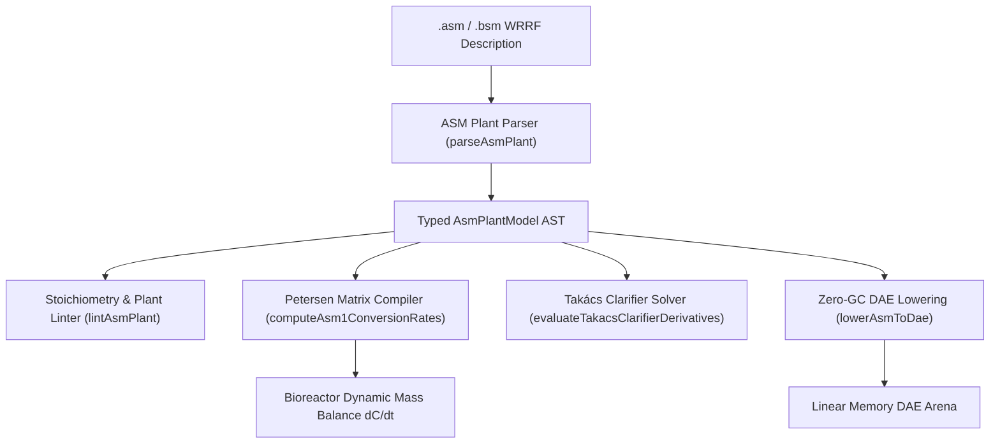

# IWA Activated Sludge Models (`.asm`, `.bsm`, `.wrrf`)

The `@modelscript/asm` package (`languages/asm`) provides native support for the **International Water Association (IWA) Activated Sludge Models (ASM1, ASM2d, ASM3, ADM1)**. The IWA ASM family is the universal benchmark for biochemical process modeling in municipal and industrial wastewater treatment plants (WWTP / WRRF).

ModelScript compiles wastewater treatment plant flowsheets into Petersen stoichiometric and kinetic matrices, solves multi-component nitrification, denitrification, carbon oxidation, and phosphorus removal biokinetics, simulates secondary clarification via the **Takács 10-layer dynamic double-exponential settling model**, and lowers biokinetic mass-balance ODEs into zero-GC WebAssembly DAE linear arenas.

---

## Supported ASM Model Families

| Model Family         | Target Processes                                  | Key State Components                                                                                                                                                                        |
| :------------------- | :------------------------------------------------ | :------------------------------------------------------------------------------------------------------------------------------------------------------------------------------------------ |
| **ASM1**             | Carbon oxidation, nitrification & denitrification | Soluble/particulate COD ($S_S, S_I, X_S, X_I$), active biomass ($X_{BH}, X_{BA}$), nitrogen fractions ($S_{NO}, S_{NH}, S_{ND}, X_{ND}$), dissolved oxygen ($S_O$), alkalinity ($S_{ALK}$). |
| **ASM2d**            | Enhanced Biological Phosphorus Removal (EBPR)     | Polyphosphate-accumulating organisms (PAOs), volatile fatty acids (VFAs), phosphate ($S_{PO4}$), stored polyhydroxyalkanoates ($X_{PHA}$).                                                  |
| **ASM3**             | Internal storage-mediated heterotrophic growth    | Decoupled aerobic/anoxic storage of organic substrate ($X_{STO}$) prior to growth.                                                                                                          |
| **Takács Clarifier** | 10-layer dynamic thickening and clarification     | Hindered and flocculant Vesilind double-exponential settling velocity $v_s(X)$, feed layer inlet, effluent TSS, and underflow RAS/WAS recycle.                                              |

---

## Architecture & Compilation Pipeline



---

## Pre-Flight Diagnostics (`ASM1001`–`ASM4001`)

The `@modelscript/asm` linter audits biological and hydraulic plant consistency:

| Code      |  Severity   | Description                                                                     |
| :-------- | :---------: | :------------------------------------------------------------------------------ |
| `ASM1001` |  **Error**  | Missing or empty wastewater plant model identifier.                             |
| `ASM2001` |  **Error**  | Bioreactor has non-positive volume ($V \le 0\text{ m}^3$).                      |
| `ASM2002` | **Warning** | Aerobic bioreactor lacks positive aeration ($k_L a \le 0$ or setpoint $\le 0$). |
| `ASM3001` |  **Error**  | Influent component concentration is negative.                                   |
| `ASM4001` |  **Error**  | Secondary clarifier surface area or height is non-positive.                     |

---

## Command-Line Interface (`msx asm`)

```bash
# Print plant summary, bioreactors, clarifiers, and influent flow rates
msx asm summary bsm1_plant.asm

# Check plant for stoichiometric consistency and hydraulic parameters
msx asm lint bsm1_plant.asm

# Simulate biokinetic reaction rates and effluent concentrations
msx asm simulate-biokinetics bsm1_plant.asm

# Lower plant flowsheet to WebAssembly DAE arena
msx asm to-dae bsm1_plant.asm
```

---

## MCP Agent Tool Integration

- **`asm_evaluate_biokinetics`**: Computes ASM1 biological process rates (aerobic growth, denitrification, autotrophic nitrification, decay, hydrolysis) and net soluble/particulate component conversion rates ($r_i$) for environmental engineering optimization.
