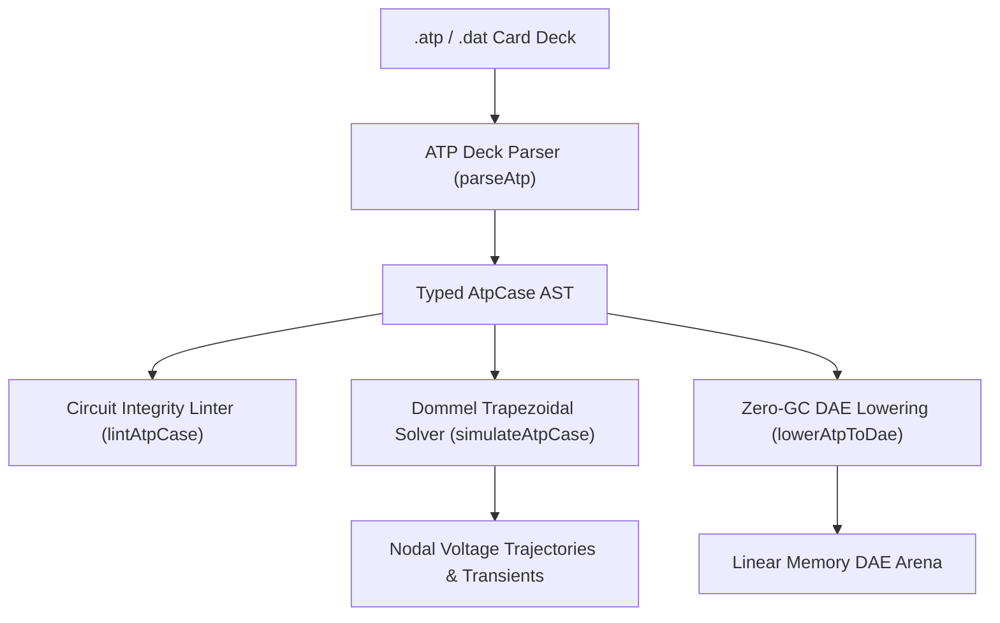

# ATP-EMTP Electromagnetic Transients (`.atp`, `.dat`)

The `@modelscript/atp` package (`languages/atp`) provides native support for **Alternative Transients Program (ATP-EMTP)** card decks. ATP-EMTP is the venerable open-source electromagnetic transient program used globally for simulating high-frequency power system phenomena, lightning surge propagation, switching overvoltages, insulation coordination, and power electronics interactions.

ModelScript compiles 80-column ATP fixed-column and free-format card decks into zero-GC WebAssembly DAE linear arenas, verifies branch connectivity and time step stability (`ATP1001`–`ATP4001`), and simulates nodal transient voltages using **Dommel's companion-matrix trapezoidal integration rule**.

---

## Supported ATP-EMTP Deck Cards

| Card Type             | Column Format                                       | Description                                                                                          |
| :-------------------- | :-------------------------------------------------- | :--------------------------------------------------------------------------------------------------- |
| **Control Card**      | `DELTA T, TMAX, XOPT, COPT`                         | Simulation time step ($\Delta t$), maximum stop time ($t_{\max}$), frequency options, plot controls. |
| **RLC Branch**        | Columns 1–2: Node 1, Node 2, $R, L, C$              | Lumped series and parallel branch impedances ($R$ in $\Omega$, $L$ in mH, $C$ in $\mu\text{F}$).     |
| **Transmission Line** | Berger/Clarke/JMarti card                           | Distributed parameter transmission lines with surge impedance ($Z_c$) and propagation speed ($v$).   |
| **Switch Card**       | Node 1, Node 2, $T_{\text{close}}, T_{\text{open}}$ | Time-controlled circuit breakers, closing resistor insertion, current-zero opening.                  |
| **Source Card**       | Type 14 / Type 11 AC/DC sources                     | Sinusoidal AC voltage and current sources with amplitude, frequency, and phase angle.                |

---

## Architecture & Compilation Pipeline



---

## Pre-Flight Diagnostics (`ATP1001`–`ATP4001`)

The `@modelscript/atp` linter audits card deck formatting and electrical topology:

| Code      |  Severity   | Description                                                                          |
| :-------- | :---------: | :----------------------------------------------------------------------------------- |
| `ATP1001` |  **Error**  | Syntax error in card formatting or missing mandatory control card.                   |
| `ATP2001` |  **Error**  | Non-positive simulation time step ($\Delta t \le 0$) or duration ($t_{\max} \le 0$). |
| `ATP3001` | **Warning** | Isolated circuit node detected with no ground reference or source path.              |
| `ATP4001` |  **Error**  | Branch parameters are invalid (negative resistance or non-physical inductance).      |

---

## Command-Line Interface (`msx atp`)

```bash
# Print summary of branches, switches, sources, and time step parameters
msx atp summary lightning_surge.atp

# Run pre-flight lint diagnostics for isolated nodes and card formatting
msx atp lint lightning_surge.atp

# Simulate electromagnetic transient response using Dommel companion matrix
msx atp simulate lightning_surge.atp

# Lower circuit deck into WebAssembly DAE arena
msx atp to-dae lightning_surge.atp
```

---

## MCP Agent Tool Integration

- **`atp_simulate_transient`**: Executes Dommel companion-matrix trapezoidal transient simulation for fast electromagnetic pulse, switching surge, and RLC oscillatory analysis directly in AI agent pipelines.
