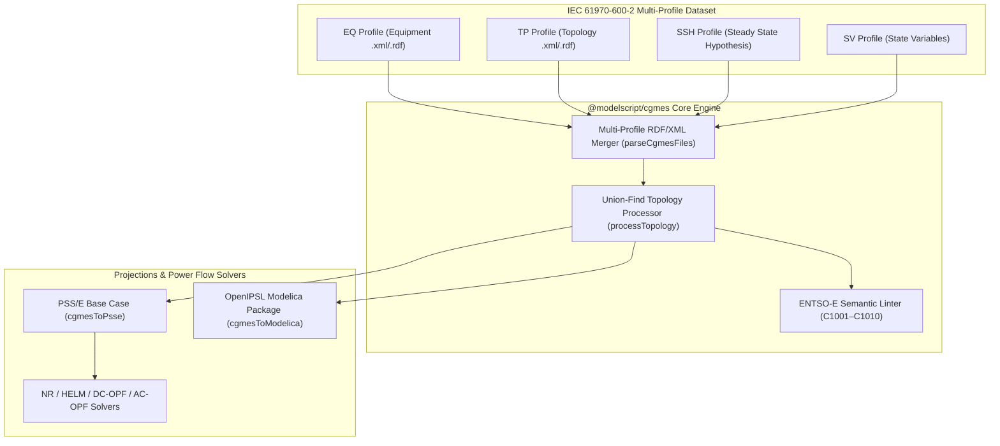

# CIM / CGMES European Grid Exchange (`.xml`, `.rdf`)

The `@modelscript/cgmes` language package (`languages/cgmes`) provides native ingestion, node-breaker topology processing, semantic validation (`C1001`–`C1010`), AC/DC Optimal Power Flow (OPF) solving, and multi-domain projection for the **ENTSO-E Common Grid Model Exchange Standard (CGMES v2.4.15 & v3.0 / IEC 61970-600-2)**. It parses multi-file CIM RDF/XML datasets across Equipment (`EQ`), Topology (`TP`), Steady State Hypothesis (`SSH`), and State Variables (`SV`) profiles, resolves ConnectivityNode/TopologicalNode graphs via disjoint-set Union-Find, and projects European transmission grids directly to **PSS/E (`.raw`)** and **OpenIPSL Modelica (`.mo`)**.

<LanguageExample lang="cgmes" />

---

## Supported CIM / CGMES Profiles

| Profile                             | IEC 61970 Namespace            | Core CIM Classes Indexed                                                                                                                                                                                  |
| :---------------------------------- | :----------------------------- | :-------------------------------------------------------------------------------------------------------------------------------------------------------------------------------------------------------- |
| **Equipment (`EQ`)**                | `EquipmentProfile`             | `Substation`, `VoltageLevel`, `BaseVoltage`, `ConnectivityNode`, `Terminal`, `ACLineSegment`, `PowerTransformer`, `PowerTransformerEnd`, `SynchronousMachine`, `EnergyConsumer`, `LinearShuntCompensator` |
| **Topology (`TP`)**                 | `TopologyProfile`              | `TopologicalNode`, `Terminal.TopologicalNode` bindings, busbar section assignments                                                                                                                        |
| **Steady State Hypothesis (`SSH`)** | `SteadyStateHypothesisProfile` | `RotatingMachine.p`, `RotatingMachine.q`, `EnergyConsumer.p`, `EnergyConsumer.q`, `LinearShuntCompensator.sections`, breaker states                                                                       |
| **State Variables (`SV`)**          | `StateVariablesProfile`        | `SvVoltage` ($V_{\text{pu}}, \theta_{\text{deg}}$), `SvPowerFlow` ($P, Q$ terminal flows)                                                                                                                 |

---

## Architecture & Compilation Pipeline



---

## 1. Disjoint-Set Topology Processing & Per-Unit Conversion

### Node-Breaker to Bus-Branch Synthesis (`processTopology`)

European TSO datasets frequently mix bus-branch (`TopologicalNode`) and node-breaker (`ConnectivityNode`) representations across voltage levels. `processTopology()` constructs a path-compressed, union-by-rank `DisjointSet` forest over all `TopologicalNode` and `ConnectivityNode` identifiers:

1. **Terminal Equivalence Unification**: For every `cim:Terminal` referencing both a `connectivityNodeId` ($c_k$) and a `topologicalNodeId` ($n_m$), the processor executes $\text{Union}(c_k, n_m)$.
2. **Synthetic Bus Synthesis**: When a connected component root $r = \text{Find}(c_k)$ lacks an explicit `TP` `TopologicalNode`, `processTopology()` synthesizes a canonical `TopologicalNode` inheriting its nominal voltage $V_{\text{base}}$ from the enclosing `cim:VoltageLevel`.
3. **Electrical Island Detection**: A second disjoint-set pass unions all nodes bridged by energized `ACLineSegment` and multi-winding `PowerTransformer` terminals to compute `islandCount` and flag isolated substations (`C1009`).

### Per-Unit Impedance & Thermal Rating Normalization

During projection to PSS/E (`cgmesToPsse`) on system MVA base $S_{\text{base}} = 100\text{ MVA}$, physical engineering quantities from `EQ` profiles are normalized using the nominal voltage $V_{\text{base}}$ ($\text{kV}$) of the terminal's `TopologicalNode`:

$$Z_{\text{base}} = \frac{V_{\text{base}}^2}{S_{\text{base}}} \quad [\Omega]$$

For an `ACLineSegment` with ohmic resistance $R_{\Omega}$, reactance $X_{\Omega}$, total charging susceptance $B_{\text{ch}}\;[\text{S}]$, and maximum current rating $I_{\max}\;[\text{A}]$:

$$r_{\text{pu}} = \frac{R_{\Omega}}{Z_{\text{base}}}, \qquad x_{\text{pu}} = \frac{X_{\Omega}}{Z_{\text{base}}}, \qquad b_{\text{pu}} = B_{\text{ch}} \cdot Z_{\text{base}}$$

$$\text{Rate A} = \frac{\sqrt{3} \, V_{\text{base}} \, I_{\max}}{1000} \quad [\text{MVA}]$$

For a `LinearShuntCompensator` with $N_{\text{sec}}$ energized sections and per-section conductance/susceptance $(g_{\text{sec}}, b_{\text{sec}})$ in Siemens, the nominal MVAr injection at $1.0\text{ pu}$ voltage is:

$$G_{\text{shunt}} + j B_{\text{shunt}} = N_{\text{sec}} \left( g_{\text{sec}} + j b_{\text{sec}} \right) V_{\text{base}}^2 \quad [\text{MW} + j\,\text{MVAr}]$$

---

## 2. Pre-Flight ENTSO-E CGMES Diagnostic Rules

`@modelscript/cgmes` validates multi-profile referential integrity, equipment physical bounds, and network connectivity before power-flow solving or Modelica code generation:

<LintRules lang="cgmes" />

---

## 3. Multi-Domain Projections (`PSS/E` & `OpenIPSL Modelica`)

### Projection to PSS/E (`cgmesToPsse`)

`cgmesToPsse()` maps every resolved `TopologicalNode` to a sequential PSS/E Revision 33 bus number ($1 \dots N$), populates initial voltage magnitudes and phase angles $(V_m, V_a)$ from `SvVoltage` records, assigns `BusType.PV` to generator-regulated buses and `BusType.Swing` to the largest synchronous resource, and assembles `PsseCase` records ready for Newton-Raphson (`nr`), Holomorphic Embedding (`helm`), DC-OPF (`dc-opf`), or nonlinear interior-point AC-OPF (`ac-opf`).

### Projection to OpenIPSL Modelica (`cgmesToModelica`)

`cgmesToModelica()` emits a complete, strongly-typed **OpenIPSL** acausal Modelica package for time-domain electromechanical transient stability studies:

```modelica
package CgmesGridPackage
  model TransmissionSystem
    "CGMES Transformed Network Model"

    // --- Topological Buses ---
    OpenIPSL.Electrical.Buses.Bus Bus_Alpha_380(V_nom = 380000.0);
    OpenIPSL.Electrical.Buses.Bus Bus_Beta_380(V_nom = 380000.0);

    // --- Generators ---
    OpenIPSL.Electrical.Machines.PSSE.GENSAL NuclearUnit_1200MW(
      P_0 = 1150000000.0, Q_0 = 220000000.0, S_nom = 1350000000.0);

    // --- Loads ---
    OpenIPSL.Electrical.Loads.PSSE.Load MetroHub_Beta_Load(
      P_0 = 820000000.0, Q_0 = 195000000.0);

    // --- AC Transmission Lines ---
    OpenIPSL.Electrical.Branches.Line TieLine_Alpha_Beta_380kV(
      R = 1.85000, X = 24.60000, B = 0.00032);

  equation
    connect(NuclearUnit_1200MW.p, Bus_Alpha_380.p);
    connect(MetroHub_Beta_Load.p, Bus_Beta_380.p);
    connect(TieLine_Alpha_Beta_380kV.p, Bus_Alpha_380.p);
    connect(TieLine_Alpha_Beta_380kV.q, Bus_Beta_380.p);
  end TransmissionSystem;
end CgmesGridPackage;
```

---

## 4. Command-Line Interface (`msx cgmes`)

### Actions

| Action        | Description                                                                                            |
| :------------ | :----------------------------------------------------------------------------------------------------- |
| `inspect`     | Parse EQ/TP/SSH/SV profiles, resolve Union-Find topology, and print element & electrical island counts |
| `lint`        | Run ENTSO-E CGMES static validation rules (`C1001`–`C1010`) across merged profiles                     |
| `to-psse`     | Project the merged CGMES dataset into a PSS/E Revision 33 transmission power-flow base case            |
| `to-modelica` | Synthesize an OpenIPSL acausal Modelica transmission grid model (`.mo`)                                |
| `solve`       | Solve steady-state power flow or Optimal Power Flow (`nr`, `helm`, `dc-opf`, `ac-opf`)                 |

### Options

| Option                       | Description                                                                                      |
| :--------------------------- | :----------------------------------------------------------------------------------------------- |
| `-o, --out, --output <path>` | Target output file path for exported Modelica models                                             |
| `--alg <name>`               | Solver algorithm for the `solve` action: `nr`, `helm`, `dc-opf`, or `ac-opf` (default: `ac-opf`) |

### Example CLI Session

```bash
# Inspect merged EQ, TP, SSH, and SV profiles and count electrical islands
msx cgmes inspect grid_EQ.xml grid_TP.xml grid_SSH.xml grid_SV.xml

# Validate multi-profile referential integrity and equipment limits (C1001–C1010)
msx cgmes lint grid_EQ.xml grid_TP.xml grid_SSH.xml grid_SV.xml

# Project CGMES network to a PSS/E base case summary
msx cgmes to-psse grid_EQ.xml grid_TP.xml grid_SSH.xml

# Export an OpenIPSL Modelica package for transient stability simulation
msx cgmes to-modelica grid_EQ.xml grid_TP.xml grid_SSH.xml --out=TransmissionGrid.mo

# Solve AC Optimal Power Flow (or Newton-Raphson / HELM / DC-OPF)
msx cgmes solve grid_EQ.xml grid_TP.xml grid_SSH.xml --alg=ac-opf
msx cgmes solve grid_EQ.xml grid_TP.xml grid_SSH.xml --alg=nr
```

---

## 5. Programmatic TypeScript SDK

```typescript
import { parseCgmesFiles, processTopology, lintCgmesModel, cgmesToPsse, cgmesToModelica } from "@modelscript/cgmes";
import { solvePowerFlow } from "@modelscript/psse";

// 1. Parse and merge EQ, TP, SSH, and SV XML/RDF profile strings
const model = parseCgmesFiles([eqXml, tpXml, sshXml, svXml]);

// 2. Run Union-Find node-breaker to bus-branch topology resolution
const topo = processTopology(model);
console.log(`Resolved ${topo.model.nodes.size} buses across ${topo.islandCount} island(s)`);

// 3. Validate against ENTSO-E CGMES rules C1001–C1010
const diagnostics = lintCgmesModel(model);

// 4. Project to PSS/E and solve AC Power Flow or export OpenIPSL Modelica
const { psseCase } = cgmesToPsse(model, { sbaseMva: 100.0 });
const solution = solvePowerFlow(psseCase, { algorithm: "newton_raphson" });
const modelicaSource = cgmesToModelica(model, { packageName: "EntsoeCorridor" });
```
