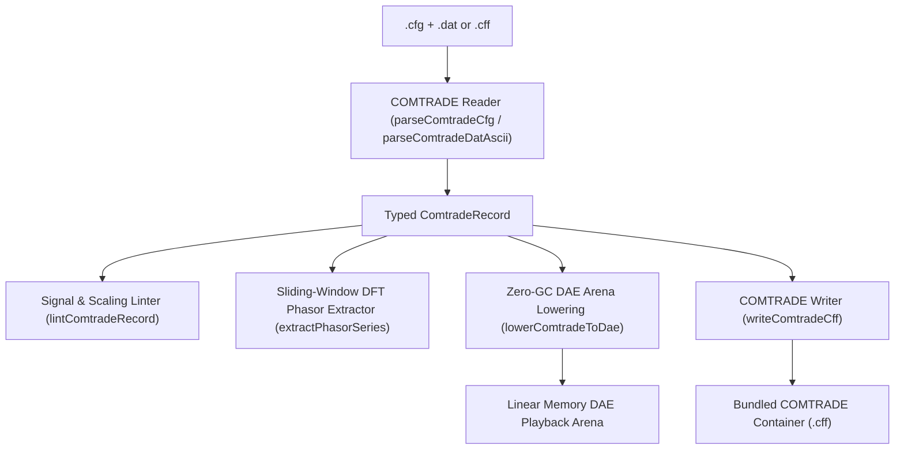

# IEEE COMTRADE Fault Transients (`.cfg`, `.dat`, `.cff`)

The `@modelscript/comtrade` package (`languages/comtrade`) provides native support for **IEEE C37.111** and **IEC 60255-24 COMTRADE (Common Format for Transient Data Exchange)** files. COMTRADE is the universal industry standard for transient fault recordings captured by digital protective relays, disturbance fault recorders (DFRs), digital fault locators, and power quality meters.

ModelScript reads and writes COMTRADE 1991, 1999, and 2013 standards across ASCII, binary 16-bit, and single-file container (`.cff`) formats, extracts sliding-window dynamic Discrete Fourier Transform (DFT) RMS phasors, and replays recorded fault trajectories in linear-memory WebAssembly DAE arenas.

---

## Supported File Formats & Schemas

| Format / Extension  | Specification                 | Description                                                                                                                                                    |
| :------------------ | :---------------------------- | :------------------------------------------------------------------------------------------------------------------------------------------------------------- |
| **`.cfg`**          | IEEE C37.111 Configuration    | Station name, recording device ID, channel roster, scaling multipliers ($a, b$), channel phase identifiers, line frequency, sampling rates, timestamp headers. |
| **`.dat` (ASCII)**  | Comma-delimited text          | Sample number, timestamp in microseconds ($t_{\mu s}$), analog values, digital boolean status words.                                                           |
| **`.dat` (Binary)** | 16-bit / 32-bit signed binary | Little-endian packed binary samples with high-density storage for high-frequency transients.                                                                   |
| **`.cff`**          | Single-file container         | Standard XML/MIME container packaging configuration, data, header (`.hdr`), and information (`.inf`) blocks into a single file.                                |

---

## Architecture & Compilation Pipeline



---

## Pre-Flight Diagnostics (`COM1001`–`COM4001`)

The `@modelscript/comtrade` linter audits signal completeness and data format integrity:

| Code      |  Severity   | Description                                                               |
| :-------- | :---------: | :------------------------------------------------------------------------ |
| `COM1001` |  **Error**  | Configuration header syntax error or missing mandatory fields.            |
| `COM1002` |  **Error**  | Channel count mismatch between `.cfg` header and `.dat` columns.          |
| `COM2001` |  **Error**  | Non-monotonic timestamps or backwards time jumps in data stream.          |
| `COM3001` | **Warning** | Analog sample clipping beyond analog channel $A_{\min} / A_{\max}$ scale. |
| `COM4001` | **Warning** | Missing or irregular sampling rate declaration in multi-rate records.     |

---

## Command-Line Interface (`msx comtrade`)

```bash
# Print recording header summary, channel roster, and sampling rates
msx comtrade summary fault_record.cfg

# Lint recording for channel mismatches and timestamp monotonicity
msx comtrade lint fault_record.cfg

# Extract dynamic DFT RMS phasor series for analog channel 0
msx comtrade extract-phasor fault_record.cfg --channel=0

# Bundle split .cfg and .dat files into single-file .cff container
msx comtrade to-cff fault_record.cfg -o bundled_fault.cff

# Lower recording into WebAssembly DAE linear arena for solver playback
msx comtrade to-dae fault_record.cfg
```

---

## MCP Agent Tool Integration

- **`comtrade_extract_phasor`**: Performs sliding-window 1-cycle Discrete Fourier Transform (DFT) phasor estimation (RMS magnitude, phase angle in degrees, nominal frequency) from COMTRADE records for protective relaying evaluation.
