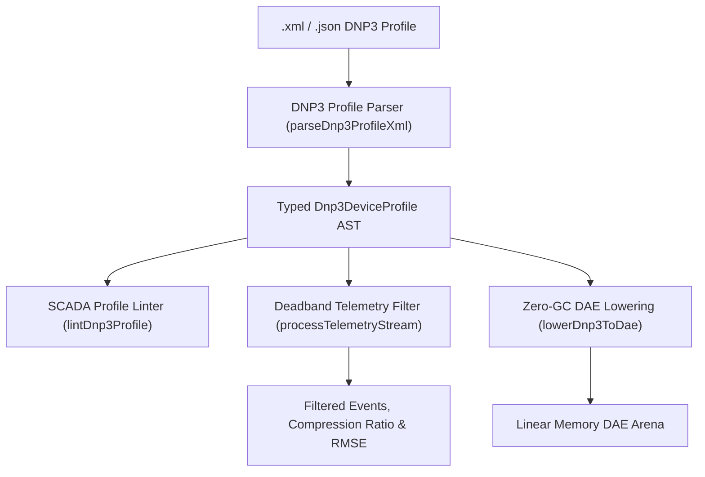

# IEEE 1815 / DNP3 SCADA Telemetry (`.xml`, `.json`, `.dnp3`)

The `@modelscript/dnp3` package (`languages/dnp3`) provides native support for the **IEEE 1815 / DNP3 (Distributed Network Protocol)** standard. DNP3 is the prevailing communications protocol for SCADA (Supervisory Control and Data Acquisition), remote terminal units (RTUs), programmable logic controllers (PLCs), and intelligent substation devices across North American and international electric and water utilities.

ModelScript parses standard DNP3 Device Profile XML and JSON documents, implements DNP3 analog deadband event filtering, engineering unit scaling transformations ($y = mx + b$), signal reconstruction verification, and lowers SCADA point databases to zero-GC WebAssembly DAE linear arenas for utility digital twins.

---

## Supported DNP3 Point Objects

| Group             | Object Type    | Representation & Parameters                                                                                                                                      |
| :---------------- | :------------- | :--------------------------------------------------------------------------------------------------------------------------------------------------------------- |
| **Group 1 / 2**   | Binary Inputs  | Digital breaker status, alarm contacts, latch flags, event class assignment (Class 1, 2, 3).                                                                     |
| **Group 10 / 12** | Binary Outputs | Remote control relays, trip/close commands, pulse/latch directives (`Select-Before-Operate`).                                                                    |
| **Group 30 / 32** | Analog Inputs  | Continuous measurements (bus voltage, MW/MVAR flow, water tank level, pipe pressure), deadband threshold, scaling multiplier ($m$), scaling offset ($b$), units. |
| **Group 40 / 41** | Analog Outputs | Generation dispatch setpoints, voltage regulator targets, valve position setpoints.                                                                              |
| **Group 20 / 22** | Counters       | Energy accumulation (MWh), totalized pumped water volume, rollover boundaries.                                                                                   |

---

## Architecture & Compilation Pipeline



---

## Pre-Flight Diagnostics (`DNP1001`–`DNP4001`)

The `@modelscript/dnp3` linter audits point mapping and scaling configuration:

| Code      |  Severity   | Description                                                          |
| :-------- | :---------: | :------------------------------------------------------------------- |
| `DNP1001` |  **Error**  | XML/JSON profile syntax error or missing device name.                |
| `DNP2001` |  **Error**  | Duplicate point index within the same point object group.            |
| `DNP3001` | **Warning** | Negative or non-physical deadband threshold on analog input.         |
| `DNP4001` | **Warning** | Zero scaling multiplier on analog channel prevents signal inversion. |

---

## Command-Line Interface (`msx dnp3`)

```bash
# Print SCADA point roster (binary inputs, analog inputs, controls, counters)
msx dnp3 summary rtu_substation_profile.xml

# Lint profile for duplicate point indices and invalid scaling
msx dnp3 lint rtu_substation_profile.xml

# Filter noisy telemetry stream using DNP3 deadband thresholding
msx dnp3 process-telemetry rtu_substation_profile.xml --deadband=0.5

# Lower SCADA device database into WebAssembly DAE arena for digital twin emulation
msx dnp3 to-dae rtu_substation_profile.xml
```

---

## MCP Agent Tool Integration

- **`dnp3_process_telemetry`**: Filters high-frequency telemetry readings via DNP3 deadband thresholding and evaluates signal reconstruction accuracy (compression ratio, residual max, and RMSE) for agent-driven SCADA compression.
