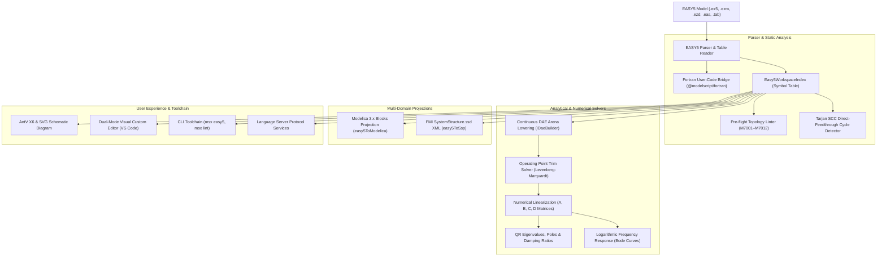

# EASY5 Dynamic Simulation & Linear Control (`.ez5`, `.ezm`, `.ezd`, `.eas`)

The `@modelscript/easy5` package (`languages/easy5`) provides native support for **Boeing / MSC Software EASY5™** dynamic system simulation models, control block diagrams, and empirical table lookups. It delivers multi-syntax parsing, embedded Fortran user block (`UG`/`UX`) compilation via `@modelscript/fortran`, pre-flight static topological linting (`M7001`–`M7012`) including Tarjan algebraic cycle detection, direct continuous DAE arena lowering (`IDaeBuilder`), linear control system analysis (trim solver, numerical $(A, B, C, D)$ Jacobian extraction, QR eigenvalue/pole analysis, Bode frequency sweeps), multi-domain projections to **Modelica 3.x** and **FMI SSP**, and interactive AntV X6 / SVG schematic diagram generation.

---

## Supported File Specifications

| Extension           | Format                   | Key Structural Features                                                                                   |
| :------------------ | :----------------------- | :-------------------------------------------------------------------------------------------------------- |
| **`.ez5` / `.ezm`** | Modern Model Definition  | Tagged `MODEL`, `COMPONENTS`, `XP`, `S0`, `CONNECTIONS`, `TABLES` blocks with graphical layout attributes |
| **`.ezd` / `.eas`** | Classical Card Deck      | Fixed-field component, parameter, and connection card images with continuation flags                      |
| **`.tab`**          | Empirical Lookup Tables  | 1D and 2D tabular lookup arrays for nonlinear characteristics ($f(x)$ or $f(x, y)$)                       |
| **`.f` / `.for`**   | User General (`UG`/`UX`) | Embedded or referenced Fortran 77/90 routines computing custom nonlinear dynamics                         |

---

## Architecture & Compilation Pipeline



---

## 1. Standard General Purpose (GP) Library Catalog

`@modelscript/easy5` includes built-in operational descriptors for standard EASY5 General Purpose library blocks:

| Block ID | Name                 | Mathematical Transfer Function / Formulation                                                          | Key Parameters (`XP`)                      | States (`S`)                      |
| :------- | :------------------- | :---------------------------------------------------------------------------------------------------- | :----------------------------------------- | :-------------------------------- | -------------------------- | ---- |
| **`GA`** | Proportional Gain    | $y(t) = K \cdot u(t)$                                                                                 | `K` (Gain factor)                          | None                              |
| **`SJ`** | Summing Junction     | $y(t) = \sum_{i=1}^m \text{SGN}_i \cdot u_i(t)$                                                       | `SGN1`, `SGN2`, `SGN3` ($\pm 1.0$)         | None                              |
| **`IN`** | Integrator           | $\dot{x}(t) = K \cdot u(t),\quad y(t) = x(t)$                                                         | `GAIN`, `S0` (Initial state), `UL`, `LL`   | 1 continuous state                |
| **`TF`** | Transfer Function    | $Y(s) = \frac{b_m s^m + \dots + b_0}{a_n s^n + \dots + a_0} U(s)$                                     | `NUM` (array), `DEN` (array)               | $n$ continuous states             |
| **`LA`** | First-Order Lead-Lag | $Y(s) = K \frac{\tau_1 s + 1}{\tau_2 s + 1} U(s)$                                                     | `GAIN`, `TAU1`, `TAU2`                     | 1 continuous state ($\tau_2 > 0$) |
| **`LM`** | Hard Limiter         | $y(t) = \max(u_{\min}, \min(u_{\max}, u(t)))$                                                         | `UL` (Upper limit), `LL` (Lower limit)     | None                              |
| **`DZ`** | Deadband             | $y(t) = \begin{cases} u - \delta & u > \delta \\ u + \delta & u < -\delta \\ 0 &                      | u                                          | \le \delta \end{cases}$           | `DB` (Deadband half-width) | None |
| **`HY`** | Hysteresis Switch    | Relay with toggle thresholds $u_{on}, u_{off}$                                                        | `U_ON`, `U_OFF`, `Y_HIGH`, `Y_LOW`         | None (Discrete memory)            |
| **`TD`** | Transport Delay      | $y(t) = u(t - \tau)$                                                                                  | `TAU` (Delay time in seconds)              | Buffer ring                       |
| **`SW`** | Controlled Switch    | $y(t) = \begin{cases} u_1(t) & u_{ctrl} \ge u_{thresh} \\ u_2(t) & u_{ctrl} < u_{thresh} \end{cases}$ | `THRESH` (Switch threshold)                | None                              |
| **`FN`** | Table Function       | $y(t) = \operatorname{interp}(u(t), X, Y)$                                                            | `TABLE_NAME`, `ORDER` (1=linear, 2=spline) | None                              |
| **`UG`** | User General         | Custom dynamics specified in Fortran 77/90                                                            | User-defined parameters                    | User-defined ($S(i), SD(i)$)      |

---

## 2. Pre-Flight Diagnostic Rules (`lintEasy5`)

ModelScript evaluates 12 formal pre-flight diagnostic rules before simulation, linearization, or projection:

<LintRules lang="easy5" />

---

## 3. Direct Continuous DAE Arena Lowering (`lowerEasy5ToDae`)

ModelScript's data-oriented WebAssembly linear-memory DAE arena compiles EASY5 models directly into struct-of-arrays without intermediate TypeScript AST objects:

- Continuous states $S(i)$ become continuous variables with derivative bindings $\text{der}(x_i) = f_i(x, u)$.
- Initial states $S_0$ become start attributes on continuous state variables.
- Summing junctions, gains, limiters, and lookup functions become lowered arena expression IDs (`ExprId`) and equality equations (`EqId`).
- Embedded Fortran blocks evaluate expressions directly mapped into DAE equation nodes.

---

## 4. Linear Control Systems Engine (`linear/`)

The linear control package provides exact numerical state-space modeling for control design and frequency domain verification:

### State-Space Extraction ($A, B, C, D$)

Linearizes the continuous non-linear system around an operating point $(x_0, u_0)$:

$$\dot{x} = A x + B u,\quad y = C x + D u$$

Where:
$$A_{ij} = \frac{\partial \dot{x}_i}{\partial x_j},\quad B_{ik} = \frac{\partial \dot{x}_i}{\partial u_k},\quad C_{pj} = \frac{\partial y_p}{\partial x_j},\quad D_{pk} = \frac{\partial y_p}{\partial u_k}$$

Computed via central finite differences:
$$\frac{\partial f_i}{\partial x_j} \approx \frac{f_i(x_0 + \varepsilon e_j, u_0) - f_i(x_0 - \varepsilon e_j, u_0)}{2\varepsilon}$$

### Equilibrium Operating Point Trim Solver

Solves $\dot{x}(x, u) = 0$ using Levenberg-Marquardt damped least-squares:

$$(J^T J + \lambda I) \Delta x = -J^T \dot{x}(x, u)$$

### Eigenvalue & Stability Analysis

Computes closed-loop poles $s_i = \sigma_i \pm j \omega_i$ using the **QR algorithm with Wilkinson shifts**:

- Natural frequency: $\omega_{n,i} = \sqrt{\sigma_i^2 + \omega_i^2}$
- Damping ratio: $\zeta_i = -\frac{\sigma_i}{\omega_{n,i}}$
- Stability criterion: $\sigma_i \le 0$ for all $i$

### Bode Frequency Response Sweeps

Solves the complex resolvent system $(j \omega I - A) X(j\omega) = B$ at logarithmically spaced frequencies:
$$G(j\omega) = C X(j\omega) + D$$

- Magnitude (dB): $20 \log_{10} |G(j\omega)|$
- Phase (degrees): $\operatorname{atan2}(\operatorname{Im} G(j\omega), \operatorname{Re} G(j\omega)) \cdot \frac{180}{\pi}$

---

## 5. Cross-Language Projections

### Projection to Modelica 3.x (`easy5ToModelica`)

Translates EASY5 continuous control blocks into canonical `Modelica.Blocks` continuous models:

```modelica
// Modelica projection generated from EASY5 model: FlightController
model FlightController
  // Component instances
  Modelica.Blocks.Math.Gain GA01(k = 5.0);
  Modelica.Blocks.Math.Add SJ01;
  Modelica.Blocks.Continuous.Integrator IN01(k = 1.0, y_start = 0.0);
  Modelica.Blocks.Continuous.TransferFunction LA01(b = {0.1, 1.0}, a = {0.02, 1.0});
  Modelica.Blocks.Nonlinear.Limiter LM01(uMax = 10.0, uMin = -10.0);
equation
  connect(GA01.y, SJ01.u1);
  connect(SJ01.y, IN01.u);
  connect(IN01.y, LA01.u);
  connect(LA01.y, LM01.u);
end FlightController;
```

### Projection to FMI SystemStructure (`easy5ToSsp`)

Exports complete multi-component topologies as FMI 2.0/3.0 `SystemStructure.ssd` XML containers for co-simulation orchestration.

---

## 6. Command-Line Interface (`msx easy5`)

```bash
# Model inspection and topological summary
msx easy5 summary controller.ez5

# Pre-flight linter (including algebraic loop check)
msx easy5 lint controller.ez5
msx lint controller.ez5 --language=easy5

# Numerical linearization to A, B, C, D state-space matrices
msx easy5 linearize controller.ez5

# Bode plot logarithmic frequency response calculation
msx easy5 bode controller.ez5 --min-freq=0.01 --max-freq=1000 --num-points=60

# Translation to Modelica 3.x
msx easy5 to-modelica controller.ez5 --out=Controller.mo

# Export to FMI SystemStructure.ssd
msx easy5 to-ssp controller.ez5 --out=SystemStructure.ssd

# Export SVG schematic diagram
msx easy5 diagram controller.ez5 --out=schematic.svg
```
