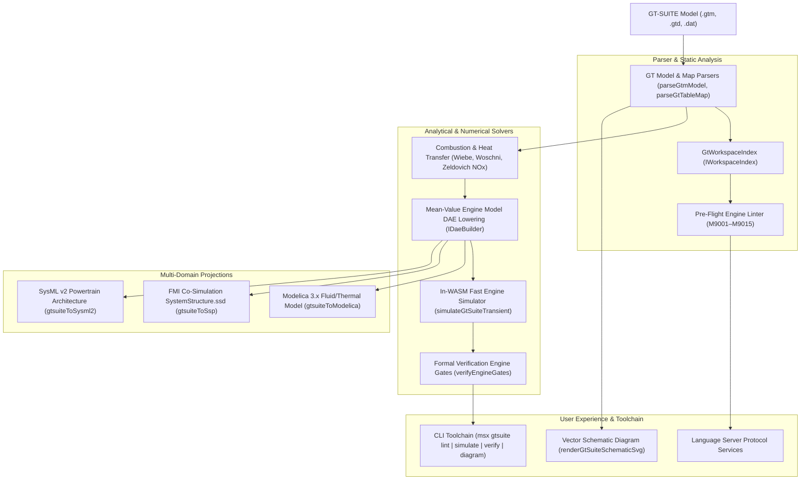

# GT-SUITE / GT-POWER Modeling (`.gtm`, `.gtd`, `.gtx`, `.gt`)

The `@modelscript/gtsuite` package (`languages/gtsuite`) provides native compilation, simulation, analysis, and multi-domain projections for **Gamma Technologies GT-SUITE and GT-POWER** 1D engine, powertrain, turbocharging, and thermo-fluid dynamic simulation models.

---

## Supported File Specifications

| Extension           | Format                 | Key Structural Features                                                                            |
| :------------------ | :--------------------- | :------------------------------------------------------------------------------------------------- |
| **`.gtm` / `.gtd`** | GT-SUITE Model Deck    | ASCII and XML representations of cylinders, plenums, runners, valves, injectors, and turbochargers |
| **`.dat` / `.map`** | Tabular Component Maps | Compressor and turbine pressure ratio vs. corrected mass flow and efficiency performance maps      |
| **`.gdx` / `.csv`** | Trajectory Results     | Crank-resolved in-cylinder pressure, temperature, burn rate, and emissions time series             |

---

## Architecture & Compilation Pipeline



---

## Pre-Flight Powertrain Linter Rules

<LintRules lang="gtsuite" />

---

## Headless CLI Operations (`msx gtsuite`)

```bash
# Print model summary
msx gtsuite summary cases/Turbo4Cyl.gtm

# Run pre-flight static analysis
msx gtsuite lint cases/Turbo4Cyl.gtm

# Run in-WASM transient thermodynamic simulation
msx gtsuite simulate cases/Turbo4Cyl.gtm --duration=0.5 --out=trajectories.csv

# Evaluate formal verification gates (BSFC, boost, emissions, knock)
msx gtsuite verify cases/Turbo4Cyl.gtm --max-bsfc=240.0 --max-boost=2.8 --max-nox=60.0

# Export vector schematic SVG diagram
msx gtsuite diagram cases/Turbo4Cyl.gtm --view=schematic --out=engine_schematic.svg

# Project to Modelica and SysML v2
msx gtsuite to-modelica cases/Turbo4Cyl.gtm --out=Engine.mo
msx gtsuite to-sysml2 cases/Turbo4Cyl.gtm --out=Engine.sysml
```
