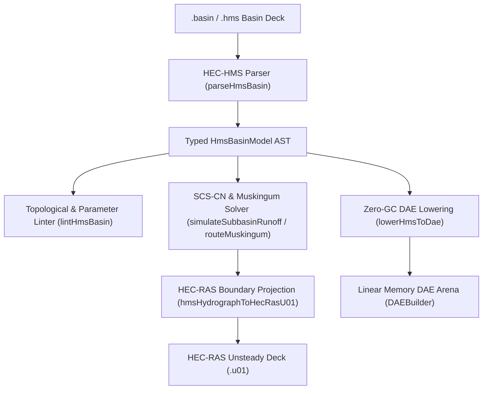

# USACE HEC-HMS Watershed Hydrology (`.basin`, `.hms`)

The `@modelscript/hec-hms` package (`languages/hec-hms`) provides native support for the **US Army Corps of Engineers Hydrologic Engineering Center's Hydrologic Modeling System (HEC-HMS)** basin and meteorological models. HEC-HMS is the global industry standard for watershed rainfall-runoff simulation, flood forecasting, urban drainage master planning, and reservoir inflow modeling.

ModelScript compiles HEC-HMS basin decks (`.basin`) into zero-GC WebAssembly DAE linear arenas, verifies topological drainage networks with pre-flight diagnostics (`HMS1001`–`HMS3003`), simulates SCS Dimensionless Unit Hydrograph convolution, routes reaches via the Muskingum method, and directly projects peak flows to **HEC-RAS unsteady flow decks (`.u01`)**.

---

## Supported Hydrologic Model Elements

| Basin Element | Representation                       | Hydrologic & Hydraulic Properties                                                                                              |
| :------------ | :----------------------------------- | :----------------------------------------------------------------------------------------------------------------------------- |
| **Subbasin**  | Watershed drainage sub-catchment     | Drainage area ($A$), SCS Curve Number ($CN$), initial abstraction ($I_a$), lag time ($T_{\text{lag}}$), impervious percentage. |
| **Reach**     | River / stream channel segment       | Routing method, Muskingum travel time parameter $K$ (hours), weighting factor $X$ ($0.0 \le X \le 0.5$), subreaches.           |
| **Junction**  | Confluence of subbasins/reaches      | Conservation of mass $\sum Q_{\text{in}} = Q_{\text{out}}$, topological routing node.                                          |
| **Reservoir** | Detention pond / storage impoundment | Elevation-storage-outflow discharge rating curves, spillways, gated orifices.                                                  |
| **Sink**      | Watershed outlet / terminal boundary | Terminal drainage point with aggregated hydrograph reporting.                                                                  |

---

## Architecture & Compilation Pipeline



---

## Pre-Flight Diagnostics (`HMS1001`–`HMS3003`)

The HEC-HMS diagnostic suite validates watershed topology and hydrologic parameters before simulation:

| Code      | Severity  | Description                                                                                |
| :-------- | :-------: | :----------------------------------------------------------------------------------------- |
| `HMS1001` | **Error** | Non-positive subbasin drainage area ($A \le 0$).                                           |
| `HMS2001` | **Error** | Element references unknown or non-existent downstream element.                             |
| `HMS2002` | **Error** | Directed cycle detected in watershed drainage connectivity graph.                          |
| `HMS3001` | **Error** | SCS Curve Number outside physically valid bounds ($CN \le 0$ or $CN > 100$).               |
| `HMS3002` | **Error** | Muskingum weighting factor $X$ outside numerical stability range ($X < 0.0$ or $X > 0.5$). |
| `HMS3003` | **Error** | Muskingum travel time parameter $K \le 0$.                                                 |

---

## Command-Line Interface (`msx hec-hms`)

```bash
# Print summary of subbasins, reaches, junctions, and drainage area
msx hec-hms summary CastroValley.basin

# Run pre-flight topological and hydrologic parameter validation
msx hec-hms lint CastroValley.basin

# Simulate 24-hour SCS-CN rainfall runoff event (50mm storm)
msx hec-hms simulate-runoff CastroValley.basin --rain=75.0

# Project simulated peak hydrograph to HEC-RAS unsteady flow boundary (.u01)
msx hec-hms to-ras CastroValley.basin -o boundary.u01

# Lower basin model into WebAssembly DAE arena
msx hec-hms to-dae CastroValley.basin
```

---

## MCP Agent Tool Integration

AI agents connect to `@modelscript/hec-hms` through dedicated MCP tools:

- **`hec_hms_simulate_runoff`**: Evaluates SCS Curve Number excess precipitation, dimensionless unit hydrograph convolution, and Muskingum channel routing directly within agent reasoning workflows.
