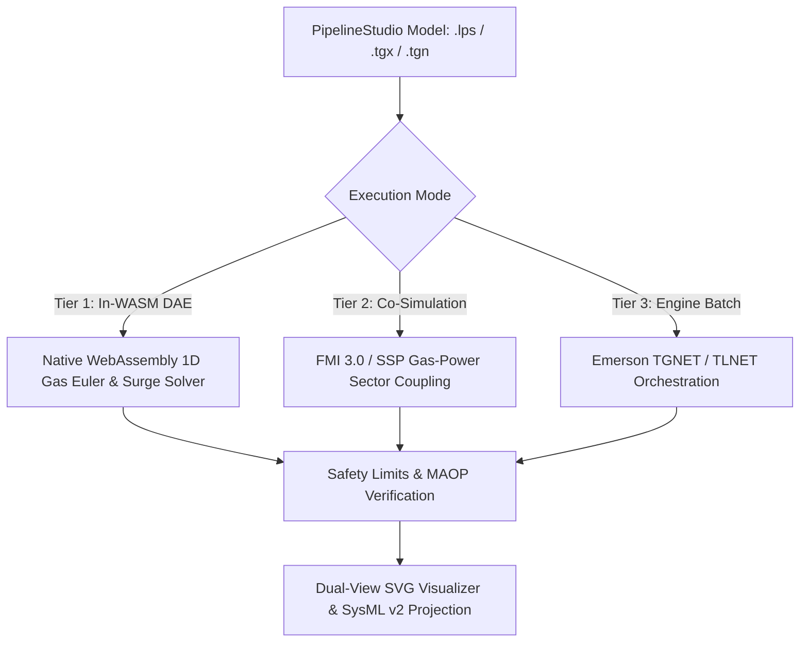

# PipelineStudio (LPS / TGNET & TLNET)

ModelScript provides first-class, polyglot support for **Emerson / Energy Solutions PipelineStudio**, including its dual simulation kernels:

- **TGNET** (_Transient Gas Network_): Compressible gas hydraulics, real-gas equations of state (AGA-8 Detailed Characterization & Peng-Robinson), line pack dynamics, compressor stations, gas heating value tracking, and hydrogen blending.
- **TLNET** (_Transient Liquid Network_): Incompressible/liquid hydraulics, multi-product batch tracking (gasoline/diesel/jet fuel interfaces), transmix dispersion, pump stations, drag-reducing agents (DRA), and water hammer / acoustic surge analysis.

---

## Supported File Formats

| Format                     | Extension      | Description                                                                                                                  |
| :------------------------- | :------------- | :--------------------------------------------------------------------------------------------------------------------------- |
| **PipelineStudio Project** | `.lps`, `.xml` | Complete graphical network model defining nodes, pipes, compressor stations, pump stations, regulators, and study scenarios. |
| **TGNET Gas Study**        | `.tgx`, `.psg` | Dedicated compressible gas transmission network studies with gas composition and line pack profiles.                         |
| **TLNET Liquid Study**     | `.tlx`, `.psl` | Dedicated liquid transmission network studies with batch injection schedules and fluid property libraries.                   |
| **Legacy Keyword Decks**   | `.tgn`, `.tln` | Standard industrial keyword decks specifying network geometry, equipment ratings, and boundary conditions.                   |

---

## 3-Tier Execution Architecture

ModelScript implements a 3-tier operational execution framework for pipeline networks:



### 1. Tier 1: In-WASM DAE Solvers

- **Zero Intermediate Allocations:** Lowers directly into ModelScript's `DAEBuilder` linear memory arena.
- **High-Accuracy Thermodynamics:**
  - **AGA-8 (ISO 20765-1)**: High-precision calculation of compressibility factor $Z(P, T, \mathbf{y})$, molar density, speed of sound, and Joule-Thomson cooling.
  - **Hydrogen Blending**: Native support for $H_2$ blending in natural gas from 0% to 100%, capturing density drop, speed of sound increases, and compressor power shifts.
  - **Peng-Robinson Cubic EOS**: General flash calculation for heavy hydrocarbons and dense-phase supercritical $CO_2$ pipeline transport.
- **Transient Compressible Gas Dynamics**:
  - Solves 1D staggered-grid continuity and momentum equations:
    $$\frac{\partial P}{\partial t} = -\frac{a^2}{A} \frac{\partial w}{\partial x}$$
    $$\frac{\partial w}{\partial t} = -A \frac{\partial P}{\partial x} - \frac{f w |w|}{2 \rho D A} - \rho g A \sin\theta$$
  - Simulates dynamic line packing, demand drafting, and decompression acoustic waves.
- **Water Hammer & Surge Analysis**:
  - Solves Joukowsky acoustic wave propagation ($\Delta P = \rho a \Delta v$) during rapid emergency shutdown (ESD) valve closures and pump trips.
  - Monitors transient pressure spikes against ASME B31.4 limits ($P \le 1.1 \times \text{MAOP}$) and screens for liquid column separation / cavitation.
- **Multi-Product Liquid Batch Tracking**:
  - Tracks discrete fuel slugs (Diesel, Regular Gasoline, Jet-A) along transmission pipelines.
  - Austin-Palfrey interface mixing length and transmix volume calculation at delivery manifold cut-points.

### 2. Tier 2: Gas-Power Sector Coupling & Co-Simulation

Enables cross-vector energy system co-simulation via FMI 2.0/3.0 and SSP:

- **Coupled with [`@modelscript/psse`](./psse):** Simulates how rapid ramp-up of gas-fired combined-cycle power plants (CCGTs) draws on pipeline line pack, ensuring minimum delivery pressures are sustained during electric grid peaks.
- **Coupled with [`@modelscript/pscad`](./pscad):** Evaluates fast sub-second electrical generator trips and their acoustic pressure waves on pipeline fuel supply manifolds.
- **Power-to-Gas:** Simulates green hydrogen injection from wind/solar electrolyzers into regional gas grids.

### 3. Tier 3: Industrial Engine Orchestration

Automates invocation of local Emerson PipelineStudio CLI engines (`tgnet.exe` / `tlnet.exe`), dynamically ingesting results into ModelScript for unified verification.

---

## Pre-Flight Pipeline Diagnostic Linter (`M8001`–`M8012`)

| Code    | Rule                          | Severity  | Description                                                                            |
| :------ | :---------------------------- | :-------- | :------------------------------------------------------------------------------------- |
| `M8001` | `maop-exceeded`               | `error`   | Steady or transient pressure exceeds Maximum Allowable Operating Pressure.             |
| `M8002` | `compressor-surge-hazard`     | `warning` | Operating point is below compressor surge limit or exceeds maximum pressure ratio.     |
| `M8003` | `compressor-stonewall-limit`  | `warning` | Throughput flow rate exceeds maximum compressor choke/stonewall capacity.              |
| `M8004` | `unconnected-pipeline-node`   | `error`   | Topological node has no connecting links or active boundary conditions.                |
| `M8005` | `delivery-pressure-deficit`   | `error`   | Delivery node is hydraulically unreachable from any supply or storage cavern.          |
| `M8006` | `erosional-velocity-hazard`   | `warning` | Gas velocity exceeds API RP 14E erosional guideline ($v > 20 \text{ m/s}$).            |
| `M8007` | `liquid-column-separation`    | `error`   | Pressure drops below liquid vapor pressure, risking cavitation & water hammer surge.   |
| `M8008` | `hydrogen-embrittlement-risk` | `warning` | Hydrogen blend fraction exceeds 10% on steel without fracture toughness verification.  |
| `M8009` | `batch-transmix-excess`       | `warning` | Liquid batch volume is below minimum threshold or excessive interface transmix volume. |
| `M8010` | `joule-thomson-freezing`      | `warning` | Pressure drop across regulator exceeds 25 bar without preheater, risking ice/hydrates. |
| `M8011` | `pump-npsh-deficit`           | `error`   | Available Net Positive Suction Head is below required NPSH ($NPSHA < NPSHR$).          |
| `M8012` | `line-pack-depletion-risk`    | `warning` | Continuous delivery demand exceeds supply; line pack storage buffer will deplete.      |

---

## Programmatic Usage

```typescript
import {
  parseLps,
  lintLpsModel,
  SteadyNetworkSolver,
  LinePackEngine,
  GasEulerDaeSolver,
  lpsToSysml2,
  PipelineVerifier,
} from "@modelscript/lps";

// 1. Ingest PipelineStudio XML or ASCII keyword deck
const model = parseLps(sourceText);

// 2. Run Pre-Flight Diagnostic Linter
const diagnostics = lintLpsModel(model);

// 3. Solve Steady-State Network Hydraulics
const steady = SteadyNetworkSolver.solve(model);

// 4. Evaluate Line Pack Storage & Deliverability Reserves
const linePack = LinePackEngine.analyze(model, steady);
console.log(`Total Line Pack: ${(linePack.totalLinePackSm3 / 1e6).toFixed(2)} MMSm3`);
console.log(`Energy Stored: ${linePack.totalEnergyStoredGWh.toFixed(1)} GWh`);

// 5. Verify Formal Safety & MAOP Compliance
const report = PipelineVerifier.verifySteady(model, steady);
console.log("Verification passed:", report.passed);

// 6. Simulate 1D Transient Dynamics
const trajectory = GasEulerDaeSolver.simulate(model, {
  durationSeconds: 7200,
  timeStep: 10,
});

// 7. Generate Formal SysML v2 Architecture
const sysmlCode = lpsToSysml2(model);
```

---

## Advanced Machinery, Thermodynamics & Physical Models

### 1. Multi-Wheel Compressor Maps & Anti-Surge Control

ModelScript supports non-dimensional head-flow parameterization ($\Psi$ vs $\Phi$) for multi-stage centrifugal compressors:

- **Affinity Scaling**: Speed governor modulates $\omega \in [\omega_{\min}, \omega_{\max}]$ to maintain target discharge pressure setpoints.
- **Surge Line & Anti-Surge Recycle Valve**: Parabolic surge locus detection with automatic recycle valve modulation maintaining a minimum $10\%$ safety buffer.
- **Stonewall (Choke)**: Detects maximum volumetric throughput beyond which sonic shock waves restrict further flow.

### 2. Centrifugal Pump Station Curves & NPSH Verification

Centrifugal pipeline booster pumps are modeled via cubic polynomial head $H(Q)$ and hydraulic efficiency $\eta(Q)$ curves with variable frequency drive (VFD) affinity scaling:
$$H(Q, \alpha) = \alpha^2 H_{\text{rated}}(Q / \alpha), \quad \alpha = \omega / \omega_{\text{rated}}$$

- Computes Net Positive Suction Head Available ($NPSHA$) against liquid vapor pressure.
- Triggers diagnostic `M8011` if $NPSHA < NPSHR(Q)$, preventing catastrophic impeller cavitation.

### 3. GERG-2008 Helmholtz Free-Energy EOS (ISO 20765-2)

Implements the multi-fluid Helmholtz free-energy formulation $\alpha(\delta, \tau) = \alpha^0(\delta, \tau) + \alpha^r(\delta, \tau)$ for 21 natural gas components:

- Covers gas, liquid, supercritical dense phase, LNG cryogenic, and hydrogen blending regimes.
- Computes speed of sound $w$, isobaric heat capacity $C_p$, isochoric heat capacity $C_v$, and Joule-Thomson coefficient $\mu_{JT}$.

### 4. Slack Line Open-Channel Gravity Flow in Steep Pipelines

For pipelines traversing mountain passes with steep downward slopes, liquid column separation occurs when pressure drops to liquid vapor pressure ($P \le P_{\text{sat}}$):

- Transitions from pressurized pipe flow to open-channel gravity flow governed by the Manning-Gauckler-Strickler equation ($Q = \frac{1}{n} A R_h^{2/3} S^{1/2}$).
- Tracks dynamic void fraction $\alpha_{\text{void}}(x, t) = 1 - A_{\text{flow}} / A_{\text{pipe}}$ and calculates slack collapse re-pressurization surge spikes upon valley impact.

### 5. 1D Radial Cylindrical Soil Thermal Conduction Mesh

Discretizes the ground surrounding buried transmission pipelines into a 10-layer concentric radial cylindrical finite-difference mesh:

- Solves $\rho_{\text{soil}} c_{\text{soil}} \frac{\partial T}{\partial t} = \frac{1}{r}\frac{\partial}{\partial r}(k_{\text{soil}} r \frac{\partial T}{\partial r})$.
- Captures ground thermal inertia, depth-dependent seasonal phase lag, and pipeline cooldown following emergency station shutdowns.

### 6. Station Supervisory Multi-Variable PID Overrides

SCADA compressor and pump station automation with min/max auctioneering selector gates:

- Arbitrates between discharge pressure control, low-suction override, driver shaft power limits, and flow dispatch.
- Integrates velocity PID controllers with anti-windup tracking, synchronizing inactive integrator loops to prevent reset overshoot during control transfer.

### 7. Hot-Start State Checkpointing (`.sav` / `.rst`)

Zero-copy state snapshot serialization with SHA-256 integrity verification:

- Saves all nodal pressures, pipe mass flows, fluid temperatures, soil thermal layers, and controller integrator states.
- Enables instantaneous resumption of multi-day transient simulations and what-if contingency branching.

---

## Command-Line Interface (`msx lps`)

```bash
# Pre-flight safety linting
msx lps lint network.lps

# Steady-state hydraulics with slack line & soil thermal analysis
msx lps solve network.lps --slack --soil --eos=GERG2008

# Line pack inventory & deliverability buffer
msx lps linepack network.lps

# Transient simulation with hot-start checkpointing
msx lps simulate network.lps --duration=7200 --step=10 --save-checkpoint=state.sav

# Resume simulation from intermediate snapshot
msx lps simulate network.lps --duration=3600 --restart=state.sav

# Export formal SysML v2 architectural model
msx lps sysml network.lps -o network.sysml
```
