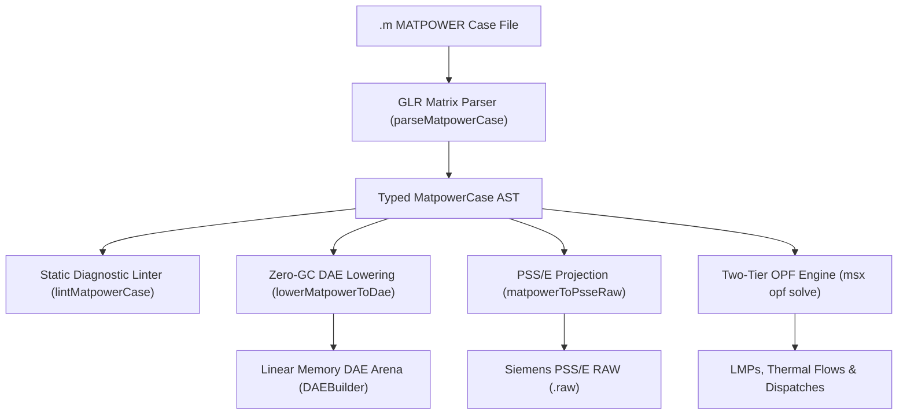

# MATPOWER Power System Simulation Cases (`.m`)

The `@modelscript/matpower` package (`languages/matpower`) provides native support for **MATPOWER** power flow and optimal power flow network definitions (`.m`). MATPOWER is the gold-standard open-source electric power system simulation package widely used in academic research, ISO market design, and industrial grid benchmarking.

ModelScript provides Ahead-of-Time WASM parsing, zero-GC linear memory DAE lowering, pre-flight topological and parameter integrity diagnostics (`MP2001`–`MP4001`), bi-directional projections with **Siemens PSS/E (`.raw`)**, and direct integration with the **Two-Tier Optimal Power Flow (OPF)** solver engine.

---

## Supported Case Structures

MATPOWER models are structured around the standard `mpc` struct containing tabular matrix data:

| Matrix / Struct   | Dimension                       | Description & Key Columns                                                                                                                                                                                                                       |
| :---------------- | :------------------------------ | :---------------------------------------------------------------------------------------------------------------------------------------------------------------------------------------------------------------------------------------------- |
| **`mpc.bus`**     | $N_{\text{bus}} \times 13+$     | Bus number, type (1: PQ, 2: PV, 3: Slack, 4: Isolated), active load ($P_d$), reactive load ($Q_d$), shunt conductance/susceptance ($G_s, B_s$), voltage magnitude ($V_m$), angle ($V_a$), base kV, and voltage limits ($V_{\min}, V_{\max}$).   |
| **`mpc.gen`**     | $N_{\text{gen}} \times 10+$     | Generator bus index, active generation ($P_g$), reactive generation ($Q_g$), reactive bounds ($Q_{\min}, Q_{\max}$), voltage setpoint ($V_g$), MVA base ($m_{\text{base}}$), in-service status, and active power bounds ($P_{\min}, P_{\max}$). |
| **`mpc.branch`**  | $N_{\text{branch}} \times 11+$  | From-bus, to-bus, series resistance ($r$), series reactance ($x$), total line charging susceptance ($b$), MVA thermal ratings (`rateA`, `rateB`, `rateC`), transformer off-nominal turns ratio, phase shift angle, and in-service status.       |
| **`mpc.gencost`** | $N_{\text{gen}} \times (4+N_c)$ | Generator fuel and operating cost functions: polynomial ($c_2 P_g^2 + c_1 P_g + c_0$) or piecewise linear, including startup and shutdown costs.                                                                                                |

---

## Architecture & Compilation Pipeline



---

## Pre-Flight Grid Diagnostics (`MP2001`–`MP4001`)

The `@modelscript/matpower` diagnostic linter validates electrical sanity, topology, and numeric consistency prior to solver dispatch:

| Error Code | Rule Name                 |  Severity   | Description                                                             |
| :--------- | :------------------------ | :---------: | :---------------------------------------------------------------------- |
| `MP2001`   | `duplicate-bus`           |  **Error**  | Duplicate bus number detected in `mpc.bus`.                             |
| `MP2002`   | `branch-unknown-bus`      |  **Error**  | Transmission branch connects to non-existent from/to bus ID.            |
| `MP2003`   | `gen-unknown-bus`         |  **Error**  | Generator attached to a bus number not defined in `mpc.bus`.            |
| `MP3001`   | `no-slack-bus`            |  **Error**  | No swing/slack bus (`type = 3`) present in network definition.          |
| `MP3002`   | `multiple-slack-buses`    | **Warning** | Multiple slack buses detected (distributed slack mode required).        |
| `MP3003`   | `zero-impedance`          |  **Error**  | Transmission branch has zero series impedance ($r = 0, x = 0$).         |
| `MP3004`   | `voltage-limits-inverted` |  **Error**  | Bus voltage minimum exceeds maximum ($V_{\min} > V_{\max}$).            |
| `MP3005`   | `gen-plimits-inverted`    |  **Error**  | Generator active capability inverted ($P_{\min} > P_{\max}$).           |
| `MP3006`   | `gen-qlimits-inverted`    |  **Error**  | Generator reactive capability inverted ($Q_{\min} > Q_{\max}$).         |
| `MP4001`   | `isolated-bus`            | **Warning** | Bus is electrically isolated without any in-service branch connections. |

---

## Bi-Directional Conversion & Projections

### MATPOWER to PSS/E (`matpowerToPsseRaw`)

Projects MATPOWER cases to standard Siemens PTI PSS/E v33 `.raw` files:

- Converts bus voltage angles from degrees to radians and back.
- Splits combined generation/load buses into distinct PSS/E generator and load records.
- Preserves transformer off-nominal turns ratio and complex phase shift angles.
- Maps branch thermal `rateA` ratings to PSS/E MVA ratings.

### Lowering to Linear WebAssembly DAE

Lowers power balance equations into ModelScript's zero-GC WebAssembly `DAEBuilder` linear arena (`lowerMatpowerToDae`):

- Voltage magnitudes $V_i$ and phase angles $\theta_i$ registered as continuous algebraic variables.
- Active and reactive nodal power injection mismatch equations:
  $$P_i(\theta, V) - P_{g,i} + P_{d,i} = 0$$
  $$Q_i(\theta, V) - Q_{g,i} + Q_{d,i} = 0$$
- Ready for Block Lower Triangular (BLT) decomposition, Newton-Raphson power flow, and continuous dynamic simulation.

---

## Command-Line Interface (`msx matpower`)

The `modelscript` / `msx` CLI includes dedicated tools for inspecting, linting, solving, and transforming MATPOWER cases:

```bash
# Print a tabular network summary (buses, lines, generators, generation & load capacity)
msx matpower summary case14.m

# Run pre-flight electrical and topological integrity lint checks
msx matpower lint case14.m

# Solve DC Optimal Power Flow using Tier 2 Direct Zero-GC solver
msx matpower solve case14.m --formulation=dc

# Solve non-linear AC Optimal Power Flow
msx matpower solve case14.m --formulation=ac

# Convert MATPOWER case to Siemens PSS/E RAW format
msx matpower to-psse case14.m --out=case14.raw

# Lower directly into zero-GC WebAssembly DAE arena text format
msx matpower to-dae case14.m --out=case14_dae.txt
```

---

## Programmatic TypeScript API

```typescript
import { parseMatpowerCase, lintMatpowerCase, matpowerToPsseRaw, lowerMatpowerToDae } from "@modelscript/matpower";
import { solveDcOpfAsync } from "@modelscript/simulate/opf";
import fs from "node:fs";

// 1. Parse MATPOWER .m case file
const mCode = fs.readFileSync("case14.m", "utf-8");
const mpc = parseMatpowerCase(mCode);

// 2. Validate topological sanity
const diagnostics = lintMatpowerCase(mpc);
if (diagnostics.length > 0) {
  console.warn("Diagnostics found:", diagnostics);
}

// 3. Lower to linear memory DAE arena
const arena = lowerMatpowerToDae(mpc);
console.log(`DAE Variables: ${arena.getVarCount()}, Equations: ${arena.getEqCount()}`);

// 4. Export to PSS/E RAW
const psseCase = matpowerToPsseRaw(mpc);
```
