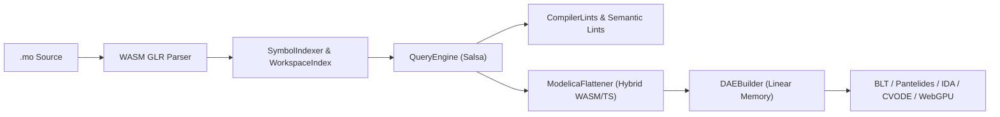

# Modelica 3.x (`.mo`)

`@modelscript/modelica` (`languages/modelica`) is the flagship physical modeling language of ModelScript. It provides a complete Modelica 3.x compiler pipeline—from a native WebAssembly GLR parser and Salsa query engine to an AssemblyScript/TypeScript arena flattener (`ModelicaFlattener`) and the full Modelica Standard Library (MSL 4.0.0).

---

## Compilation Pipeline

---

## Core Language Coverage

- **Class Specializations**: `model`, `block`, `connector`, `expandable connector`, `record`, `type`, `package`, `function`, `operator`, `operator record`, `operator function`
- **Inheritance & Redeclarations**: Multiple `extends`, `redeclare`, `replaceable`, `constrainedby`, `inner` / `outer` dynamic scoping, and deep hierarchical class modifications
- **Equations & Algorithms**: Differential equations (`der(x)`), `connect(a, b)` (both potential/flow and `stream` connectors), `if`/`for`/`when` equations, `initial equation`, and imperative `algorithm` / `initial algorithm` sections
- **Synchronous Clocks (Modelica 3.3+)**: `Clock`, `sample`, `hold`, `previous`, `subSample`, `superSample`, `shiftSample`, `backSample`

---

## Polyglot & Physical Extensions (`languages/modelica/src/extensions/`)

Beyond standard Modelica 3.x, `@modelscript/modelica` includes first-class compiler extensions for 3D CAD geometry, multiphysics FEA/CFD studies, formal verification, and localization:

1. **Embedded 3D CSG & STEP Export (`shape-flattener.ts`, `csg.ts`, `cad.ts`)**:
   - `ShapeFlattener` extracts `Modelica.Mechanics.MultiBody.Visualizers.FixedShape` components, parametric dimensions, and `Placement` transformations directly from flattened models.
   - Compiles visualizers into parametric OpenSCAD scripts (`npx msx csg ModelName file.mo`) or exports watertight ISO 10303-21 STEP B-Rep geometry via the `modelscript/exportShapeToStep` LSP command.
2. **Embedded FEA & CFD Multiphysics Studies (`study-flattener.ts`, `studies.ts`)**:
   - `StudyFlattener` (`modelscript/flattenStudy`) extracts embedded structural and fluid study annotations, material properties, and boundary conditions from Modelica components to synthesize CalculiX (`.inp`) and SU2 (`.cfg`) solver decks.
3. **Octagon Abstract Interpretation & Formal Safety Verification (`src/formal/`)**:
   - `ModelicaCfgLowerer` (`modelica-cfg-lowerer.ts`), `ModelicaAbstractEvaluator` (`modelica-abstract-evaluator.ts`), and `ModelicaStaticAnalyzer` (`modelica-analyzer.ts`) lower flattened DAE equations and `algorithm` statements into relational Control Flow Graphs evaluated over the **Octagon Abstract Domain** ($\pm x_i \pm x_j \le c$).
   - `PhysicalInvariantBridge` (`physical-invariant-bridge.ts`) proves division-by-zero freedom, square-root/logarithm domain safety, and physical state invariants (`domain.octagon()`).
4. **Gettext `.po` / `.pot` Internationalization (`po.ts`)**:
   - Extracts translatable description strings and `Dialog`/`Documentation` annotations into GNU Gettext `.pot` templates and merges localized `.po` catalogs (`npx msx i18n`).

---

## Semantic Linter (`languages/modelica/src/lints/`)

ModelScript enforces 307 OpenModelica-compatible diagnostic rules across six modular analyzers:

| Module                             | Representative Checks                                                                                             |
| :--------------------------------- | :---------------------------------------------------------------------------------------------------------------- |
| `syntax-placement.ts`              | `M1001`–`M1003`: Parse errors, missing tokens, empty array constructors                                           |
| `queries.ts`                       | `M2001`–`M2005`: Duplicate elements, unresolved variables/classes/modifiers, identifier mismatches                |
| `types-expressions.ts`             | `M3001`–`M3006`: Binding/modifier/argument type mismatches, array dimension checks                                |
| `hierarchy-variability.ts`         | `M4001`–`M4005`: Circular `extends`, duplicate modifications, `protected` access violations, variability ordering |
| `connections-streams.ts`           | `M3003`–`M3004`: Connector plug-compatibility, stream connector rules, cardinality checks                         |
| `synchronous-clocks.ts` & `cfa.ts` | Clock partitioning rules, uninitialized discrete variables, structural singularity diagnostics                    |

<LintRules lang="modelica" />

---

## Modelica MCP Server Tools (`@modelscript/mcp`)

The `@modelscript/mcp` server and `@modelscript/modelica` MCP adapter expose 9 Modelica domain tools (plus polyglot closed-loop synthesis and calibration tools) to AI agents:

| MCP Tool                  | Description                                                                                                              |
| :------------------------ | :----------------------------------------------------------------------------------------------------------------------- |
| `modelica_load`           | Loads `.mo` files or Modelica Standard Library packages into the persistent workspace session                            |
| `modelica_parse`          | Parses Modelica source code with the WASM GLR parser and returns CST nodes and syntax diagnostics                        |
| `modelica_flatten`        | Flattens a Modelica class via `ModelicaFlattener` and returns the flat Modelica DAE representation                       |
| `modelica_lint`           | Runs all 307 semantic and structural lint rules on a Modelica file or package                                            |
| `modelica_simulate`       | Flattens, runs BLT/index reduction, integrates the DAE over $[t_0, t_{\text{stop}}]$, and returns trajectory time-series |
| `hybrid_simulate`         | Executes a hybrid continuous Modelica DAE + discrete-event DEVS simulation                                               |
| `modelica_doe`            | Executes a multi-parameter Design of Experiments (Full Factorial / Latin Hypercube) batch sweep                          |
| `modelica_sensitivity`    | Computes local finite-difference or forward sensitivity matrices $\partial y_i / \partial p_j$ for target outputs        |
| `modelica_query`          | Queries the Salsa `QueryEngine` for class components, resolved types, variabilities, and modifications                   |
| `modelica_diff_calibrate` | Calibrates Modelica parameters against target CSV trajectory data via L-BFGS / Adam gradient optimization                |

---

## SysML v2 Transformer & Polyglot TGG Rules

- **Direct AST Transformer (`modelicaToSysML2` in `languages/modelica/src/transformers/sysml2.ts`)**: Converts complete Modelica packages and models into idiomatic SysML v2 textual notation (`part def`, `port def`, `attribute`, `connect`).
- **10 Bidirectional TGG Rules (`languages/modelica/src/language.ts`)**:
  - **Modelica $\leftrightarrow$ SysML v2 (6 rules)**: `ModelicaModelToSysML2PartDef`, `ModelicaConnectorToSysML2PortDef`, `ModelicaComponentToSysML2Part`, `ModelicaParameterToSysML2Attribute`, `ModelicaConnectorInstanceToSysML2Port`, `ModelicaConnectToSysML2Connection`
  - **Modelica $\leftrightarrow$ OWL2 (2 rules)**: `ModelicaModelToOWL2Class`, `ModelicaParameterToOWL2DataProperty`
  - **Modelica $\leftrightarrow$ STEP (2 rules)**: `ModelicaRevoluteToStepRevolute`, `ModelicaPrismaticToStepPrismatic`

## Diagnostic Rules

<LintRules lang="modelica" />
