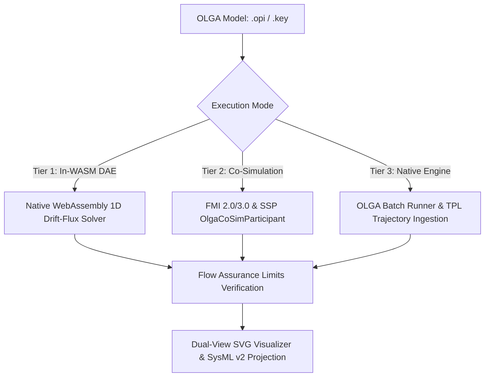
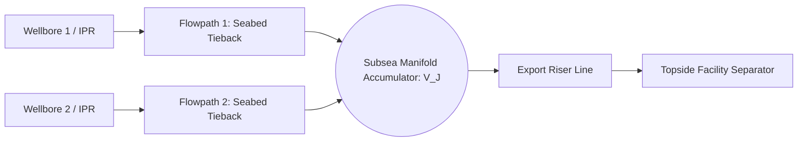

# OLGA Multiphase Flow Assurance

ModelScript provides first-class, polyglot support for **OLGA** (High-Fidelity Dynamic Multiphase Flow Simulation). Engineers can author, simulate, lint, formally verify, and co-simulate multiphase production flowlines, deepwater catenary risers, and slug catchers directly within ModelScript's unified digital thread.

---

## Supported File Formats

| Format                   | Extension         | Description                                                                                                                         |
| :----------------------- | :---------------- | :---------------------------------------------------------------------------------------------------------------------------------- |
| **OLGA XML GUI Project** | `.opi`, `.xml`    | Complete graphical network model defining wells, pipes, chokes, separator terminals, and operational controllers.                   |
| **Legacy Keyword Deck**  | `.key`, `.genkey` | Standard industrial keyword decks specifying flowpath geometry, branch connections, boundary conditions, and valve schedules.       |
| **PVT Flash Tables**     | `.tab`            | Compositional and black-oil tabular fluid files for bilinear interpolation of fluid densities, gas-liquid ratios, and viscosities.  |
| **Simulation Trends**    | `.tpl`            | High-frequency time-series trend files containing arbitrary multi-axis channel catalogs ($P$, $T$, $\alpha_L$, $Q_L$, $U_G$, etc.). |
| **Spatial Profiles**     | `.ppl`            | Spatial profile snapshots along pipeline coordinate $X$ with multi-variable channels, flow regime decoding, and time scrubbing.     |

---

## 3-Tier Execution Architecture

ModelScript implements a 3-tier operational execution framework, accommodating headless cloud workflows, system-level co-simulation, and ground-truth industrial verification:



### 1. Tier 1: Native In-WASM Drift-Flux Solver

- **Zero Intermediate Allocations:** Lowers directly into ModelScript's `DAEBuilder` linear memory arena.
- **Transient Hydrodynamics:** Solves staggered-grid mass, momentum, and energy balances coupled with Zuber-Findlay drift-flux gas-liquid slip.
- **Mechanistic Physics:**
  - **Taitel-Dukler (1976) & Barnea (1987) Flow Regime Map**: Exact geometric wetted perimeters ($S_i, S_G, S_L$) and Andritsos-Hanratty wave friction enhancement.
  - **Pal & Rhodes (1989) Emulsion Inversion**: Captures apparent viscosity peaks during water breakthrough ($WC_{\text{inv}} \approx 42\%$).
  - **Lagrangian Slug Tracker**: Propagates discrete moving slug bodies, resolving slug length distributions ($L_{s,\text{mean}}, L_{s,95}$) and riser-base severe cyclic slugging.
  - **Dynamic Pipeline Scraper Pig (`OlgaPig`)**: Solves pig motion ODEs ($M dv/dt = \Delta P \cdot A - F_{\text{friction}} - M g \sin\theta$) and liquid slug sweep volume accumulation.

### 2. Tier 2: FMI 2.0/3.0 & SSP Co-Simulation

Exposes standard FMI input and output ports via `OlgaCoSimParticipant` in `@modelscript/exchange`:

- **Input Ports:** `choke.opening`, `wellhead.mass_rate`, `separator.pressure`, `ambient.temperature`.
- **Output Ports:** `inlet.pressure`, `arrival.temperature`, `arrival.liquid_holdup`, `arrival.liquid_rate`, `slug.surge_volume`, `hydrate.subcooling`, `maop.margin`, `slug.mean_length`, `slug.frequency`, `pig.position`.

### 3. Tier 3: Industrial OLGA Engine Orchestration

Automates invocation of local Schlumberger OLGA executable engines (`olga.exe` / `olga-cli`), dynamically ingesting binary `.tpl` trajectories into ModelScript's data structures for verification.

---

## Command Line Interface (`msx olga`)

ModelScript CLI provides headless subcommands for flowline engineering:

```bash
# Run 1D transient simulation and export trajectory to CSV
msx olga simulate subsea_tieback.opi --duration=3600 --out=trajectory.csv

# Pre-flight flow assurance diagnostic check
msx olga lint deepwater_riser.key

# Verify formal flow assurance limits (MAOP, Hydrate Margin, Slug Catcher Capacity)
msx olga verify flowline.genkey --maop=250 --margin=3.0 --capacity=150.0

# Generate standalone SVG bathymetry elevation profile
msx olga diagram subsea_tieback.opi --view=profile --out=bathymetry.svg

# Convert legacy keyword deck to modern XML or SysML v2 operating procedures
msx olga convert input.key --to=opi --out=project.opi
msx olga convert input.opi --to=sysml2 --out=procedures.sysml
```

---

## Flow Assurance Verification & Lint Rules

ModelScript includes automated pre-flight linter diagnostics and limit verifications:

<LintRules lang="olga" />

---

## Dual-View SVG Visualization

ModelScript renders dual-view vector diagrams for every OLGA network:

1. **Topological P&ID Schematic:** Wells, manifolds, choke valves, flowpath pipes, and topside slug catchers.
2. **Pipeline Elevation Bathymetry $Z(X)$:**
   - High-contrast seabed-to-platform elevation profile.
   - In-situ liquid holdup ($\alpha_L$) segment color heatmaps.
   - Active discrete slug bubbles highlighted along the flowline path.
   - Real-time scraper pig marker displaying traveling velocity and differential drive pressure.
   - Hydrate subcooling margin callout ($T_{\text{fluid}} - T_{\text{hyd}}$).

---

## SysML v2 Operating Procedure Integration

OLGA models can be formally projected into SysML v2 packages (`@modelscript/olga` $\to$ SysML v2):

```sysml
package Subsea_Tieback_System {
    import ScalarValues::*;

    part def FlowlineAssembly {
        attribute totalLength: Length = 4450.0 [m];
        attribute maopRating: Pressure = 250.0 [bar];
    }

    state def SubseaFlowlineOperatingProcedure {
        entry; then SteadyProduction;

        state SteadyProduction {
            doc /* Continuous production at nominal design rates */
        }
        accept ESD_Trip_Signal then EmergencyShutIn;
        accept Turndown_Command then LowTurndown;

        state EmergencyShutIn {
            doc /* Choke closed; cooldown clock active */
        }
        accept Depressurize_Command when wallTemperature > 18.0 [degC] then ControlledBlowdown;
        accept Cooldown_Timeout when shutInDurationHours >= 8.0 [hr] then ChemicalInhibitionFlushing;

        state ControlledBlowdown;
        state ChemicalInhibitionFlushing;
    }
}
```

---

## State Checkpointing & Zero-Discontinuity Warm Restart

Long-duration or multi-stage pipeline flow assurance operations can be snapshot to disk and resumed with zero trajectory discontinuity:

```bash
# Snapshot simulation state at completion
msx olga simulate subsea_tieback.opi --duration=3600 --checkpoint-out=t3600.rst

# Resume simulation from t=3600s
msx olga simulate subsea_tieback.opi --duration=7200 --restart=t3600.rst --out=second_stage.csv
```

The `.rst` snapshot encapsulates complete distributed states across the spatial grid:

- Cell pressure $P$, temperature $T$, phase holdups ($\alpha_L, \alpha_G$), and velocities ($u_L, u_G$)
- Active Lagrangian slug states (tail/front positions, slug lengths, propagation velocities)
- Scraper pig position, speed, and accumulated swept liquid volume
- Machinery operating states and closed-loop controller integral accumulators

---

## Autonomous Field History Matching & Parameter Calibration

Calibrate flowline simulation models to match production SCADA telemetry and test separator observations using bounded Nelder-Mead simplex optimization:

```bash
msx olga tune subsea_tieback.opi field_telemetry.csv \
  --tune=roughness,choke-cd,heat-transfer \
  --max-evals=150 \
  --out=calibrated_model.opi \
  --report=tuning_report.md
```

The optimizer automatically estimates:

- Effective pipe hydraulic roughness ($\epsilon$)
- Overall ambient heat transfer coefficient ($U_{\text{ambient}}$)
- Choke discharge coefficients ($C_d$)
- Well productivity index (PI) / reservoir inflow rates

Outputs comprehensive statistical goodness-of-fit metrics ($R^2$, RMSE in bar and Kelvin) and ready-to-run calibrated `.opi` / `.genkey` models.

---

## Native In-WASM Cubic Equation of State (PR78 & SRK)

ModelScript includes a native WebAssembly cubic equation of state solver executing directly in linear memory with zero intermediate AST wrapper overhead.

### Governing Thermodynamic Formulations

The general two-parameter cubic EOS takes the form:

$$P = \frac{R T}{v - b} - \frac{a(T)}{v^2 + u b v + w b^2}$$

| EOS Model                     | $u$ | $w$  | $\Omega_a$ | $\Omega_b$ | Temperature Correction $\alpha(T_r, \omega)$                                                    |
| :---------------------------- | :-: | :--: | :--------: | :--------: | :---------------------------------------------------------------------------------------------- |
| **Peng-Robinson (1978)**      | $2$ | $-1$ | $0.45724$  | $0.07780$  | $\left[ 1 + m (1 - \sqrt{T_r}) \right]^2$, with $m = 0.37464 + 1.54226\omega - 0.26992\omega^2$ |
| **Soave-Redlich-Kwong (SRK)** | $1$ | $0$  | $0.42748$  | $0.08664$  | $\left[ 1 + m (1 - \sqrt{T_r}) \right]^2$, with $m = 0.480 + 1.574\omega - 0.176\omega^2$       |

### Van der Waals Mixing Rules with Binary Interaction ($k_{ij}$)

For multicomponent reservoir and hydrocarbon fluids:

$$a = \sum_{i=1}^N \sum_{j=1}^N z_i z_j \sqrt{a_i a_j} (1 - k_{ij}), \quad b = \sum_{i=1}^N z_i b_i$$

### Rachford-Rice Vapor-Liquid Equilibrium (VLE) Flash

Isothermal-isobaric flash equilibrium is determined by solving the objective function for vapor fraction $\beta = V/F$:

$$\sum_{i=1}^N \frac{z_i (K_i - 1)}{1 + \beta (K_i - 1)} = 0, \quad \text{where } K_i = \frac{y_i}{x_i} = \frac{\phi_i^L}{\phi_i^V}$$

Accelerated by successive substitution initialized via Wilson's heuristic $K$-value correlations and accelerated by Cardano analytical cubic root solving.

### Dense Fluid Transport Properties

- **Lohrenz-Bray-Clark (LBC) Viscosity:** Computes high-pressure gas and liquid dynamic viscosities from reduced mixture densities $\rho_r = \rho / \rho_c$:
  $$[(\mu - \mu_0)\xi + 10^{-4}]^{1/4} = a_0 + a_1 \rho_r + a_2 \rho_r^2 + a_3 \rho_r^3 + a_4 \rho_r^4$$
- **Macleod-Sugden Parachor Surface Tension:** Evaluates gas-liquid interfacial tension $\sigma$ from parachors $P_i$:
  $$\sigma = \left[ \sum_{i=1}^N P_i \left( x_i \frac{\rho_L}{M_L} - y_i \frac{\rho_G}{M_G} \right) \right]^4$$

### Command Line EOS Flash & Grid Synthesis

```bash
# Evaluate multi-component P-T flash and trace saturation envelope
msx olga flash --comp="C1:0.75,C2:0.10,C3:0.08,nC4:0.04,C7:0.03" \
  --p=55.0 --t=295.15 --model=pr --envelope --out=flash_summary.csv

# Synthesize a 2D tabular PVT file (.tab) for 1D drift-flux simulation
msx olga flash --comp="C1:0.80,C2:0.10,C3:0.06,C7:0.04" \
  --model=srk --out=reservoir_fluid.tab
```

---

## Active Topside Anti-Slug Closed-Loop Feedback Control

Topside choke throttling stabilizes severe cyclic slugging in deepwater catenary risers by dynamically manipulating backpressure using high-frequency subsea pressure transmitter measurements.

```mermaid
graph LR
    SubseaPT[Subsea PT_inlet] --> Washout[High-Pass Washout Filter: H_w]
    Washout --> Err[Error: e_f = P_sp - P_meas]
    Err --> PI[Gain-Scheduled PI Controller]
    TopsideSurge[Slug Catcher Volume] --> Override[High-Liquid Surge Override]
    PI --> Slew[Slew-Rate Limiter: |dZ/dt| <= R_max]
    Override --> Slew
    Slew --> TopsideChoke[Topside Choke Valve Z]
```

### Mathematical Architecture

1. **Subsea PT Feedback Error:** $e(t) = P_{\text{sp}} - P_{\text{inlet}}(t)$
2. **Washout High-Pass Filter:** Isolates oscillatory slug resonance from slow reservoir depletion:
   $$\tau_w \frac{d e_f}{dt} + e_f = \tau_w \frac{d e}{dt}$$
3. **Gain-Scheduled PI Control:** Compensates for non-linear choke valve flow characteristics:
   $$K_p(Z) = K_{p0} \cdot [1 + \gamma (1 - Z)]$$
   $$Z(t) = Z_{\text{baseline}} + K_p(Z) \left[ e_f(t) + \frac{1}{\tau_i} \int_0^t e_f(\tau) d\tau \right]$$
4. **Physical Actuator Slew-Rate Constraints:** Clamps valve motion rate to realistic hydraulic actuator speeds:
   $$\left| \frac{dZ}{dt} \right| \le R_{\max} \quad (\text{e.g. } 5\% / \text{s})$$
5. **Slug Catcher Surge Override:** Emergency high-liquid override closes choke if topside separator approaches liquid carryover capacity ($V_{\text{surge}} > 0.8 V_{\text{cap}}$).

### CLI Anti-Slug Simulation

```bash
msx olga simulate subsea_catenary_riser.opi \
  --duration=3600 \
  --anti-slug \
  --slug-setpoint=52.0 \
  --slug-kp=1.5e-6 \
  --slug-ti=30.0 \
  --slug-washout=20.0 \
  --slug-choke=0.50 \
  --out=stabilized_trajectory.csv
```

---

## Coupled Multi-Branch Gathering Network Transient Solver

Simultaneously models converging multi-well subsea gathering manifolds, shared export lines, and platform separators with dynamic acoustic relaxation:



### Governing Manifold Dynamic Balances

1. **Dynamic Junction Mass Continuity:**
   $$V_J \frac{d(\rho_L \alpha_L)_J}{dt} = \sum_{\text{in}} \dot{m}_{L,\text{in}} - \sum_{\text{out}} \dot{m}_{L,\text{out}}$$
   $$V_J \frac{d(\rho_G \alpha_G)_J}{dt} = \sum_{\text{in}} \dot{m}_{G,\text{in}} - \sum_{\text{out}} \dot{m}_{G,\text{out}}$$
2. **Mixture Thermal Energy Accumulation:**
   $$\frac{d(m u)_J}{dt} = \sum_{\text{in}} (\dot{m}_{\text{in}} h_{\text{in}}) - \sum_{\text{out}} (\dot{m}_{\text{out}} h_J)$$
3. **Acoustic Pressure Relaxation:**
   $$\frac{dP_J}{dt} = \frac{c_m^2}{V_J} \left( \sum \dot{m}_{\text{in}} - \sum \dot{m}_{\text{out}} \right)$$

### Well Trip & Flowline Shut-In Redistribution

```bash
# Simulate 2-well gathering network with emergency Well 1 trip at t=20s
msx olga network gathering_manifold.opi \
  --duration=120 \
  --dt=0.5 \
  --junction-vol=8.0 \
  --trip="WELL_1:20" \
  --out=network_transient.csv
```

---

## Flow Assurance CI/CD Safety Gate & 3D Bathymetry Survey

### Automated Pull Request Safety Gate (`msx olga gate`)

Integrates flow assurance validation directly into automated GitHub Actions / GitLab CI pipelines:

```bash
msx olga gate subsea_tieback.opi \
  --max-surge=85.0 \
  --min-hydrate-margin=3.0 \
  --max-wax="2mm" \
  --max-corrosion="0.1mm/yr" \
  --out-report=audit_gate_report.md
```

Generates a markdown audit report detailing compliance matrices and exits with non-zero status upon constraint violations.

### 3D Seabed Bathymetry Survey Ingestion (`msx olga survey`)

Ingests ROV/multibeam sonar seabed bathymetry CSV survey logs ($Easting, Northing, Depth$) and computes 3D pipeline curvature, span lengths, and dogleg severity:

```bash
msx olga survey bathymetry_survey.csv \
  --diameter=0.254 \
  --roughness=4.5e-5 \
  --out=flowline_model.opi
```

---

## Comprehensive CLI Subcommand Reference Matrix

| Subcommand     | Purpose                                  | Key Arguments                                                         | Generated Artifacts                          |
| :------------- | :--------------------------------------- | :-------------------------------------------------------------------- | :------------------------------------------- |
| **`simulate`** | 1D transient drift-flux simulation       | `--duration`, `--dt`, `--restart`, `--checkpoint-out`, `--anti-slug`  | Trajectory CSV/JSON, `.rst` state snapshots  |
| **`flash`**    | Native Cubic EOS (PR78/SRK) flash        | `--comp`, `--p`, `--t`, `--model`, `--envelope`, `--out`              | Terminal state summary, CSV, `.tab` 2D grid  |
| **`network`**  | Coupled multi-branch gathering solver    | `--duration`, `--dt`, `--junction-vol`, `--trip`, `--out`             | Composite multi-branch trajectory CSV        |
| **`gate`**     | Automated CI/CD safety gate audit        | `--max-surge`, `--min-hydrate-margin`, `--max-wax`, `--max-corrosion` | Markdown compliance report, CI exit codes    |
| **`survey`**   | 3D seabed bathymetry survey ingestion    | `<survey.csv>`, `--diameter`, `--roughness`, `--out`                  | Geometrically resolved `.opi` / `.genkey`    |
| **`tune`**     | History matching parameter calibration   | `<model>`, `<telemetry.csv>`, `--tune`, `--max-evals`                 | Calibrated model `.opi`, Markdown fit report |
| **`lint`**     | Pre-flight flow assurance diagnostics    | `<model>`, `--severity`                                               | Diagnostic listings (`M7001`–`M7008`)        |
| **`verify`**   | Formal design limit verification         | `--maop`, `--margin`, `--capacity`, `--min-vel`                       | Verification summary, constraint headroom    |
| **`diagram`**  | Vector SVG visualization                 | `--view=profile\|schematic\|pvt\|wellbore\|slug\|bathy`               | Standalone publication-ready SVG files       |
| **`convert`**  | Model format translation                 | `--to=genkey\|opi\|sysml2`, `--out`                                   | Translated model files, SysML v2 packages    |
| **`trend`**    | Ingest high-frequency `.tpl` trend files | `<file.tpl>`, `--channels`                                            | Channel catalogs, time-series metrics        |
| **`profile`**  | Ingest spatial `.ppl` snapshot profiles  | `<file.ppl>`, `--out`                                                 | Elevation SVG snapshots, holdup heatmaps     |
| **`cosim`**    | Multi-rate FMI/SSP co-simulation         | `<subsea.opi>`, `<topside.opi>`, `--macro-step`                       | Synchronized boundary trajectory CSV         |
| **`fmu`**      | Standalone FMI 2.0/3.0 FMU packaging     | `<model>`, `--fmi-version=2.0\|3.0\|both`, `--out`                    | Portable binary `.fmu` zip archive           |
