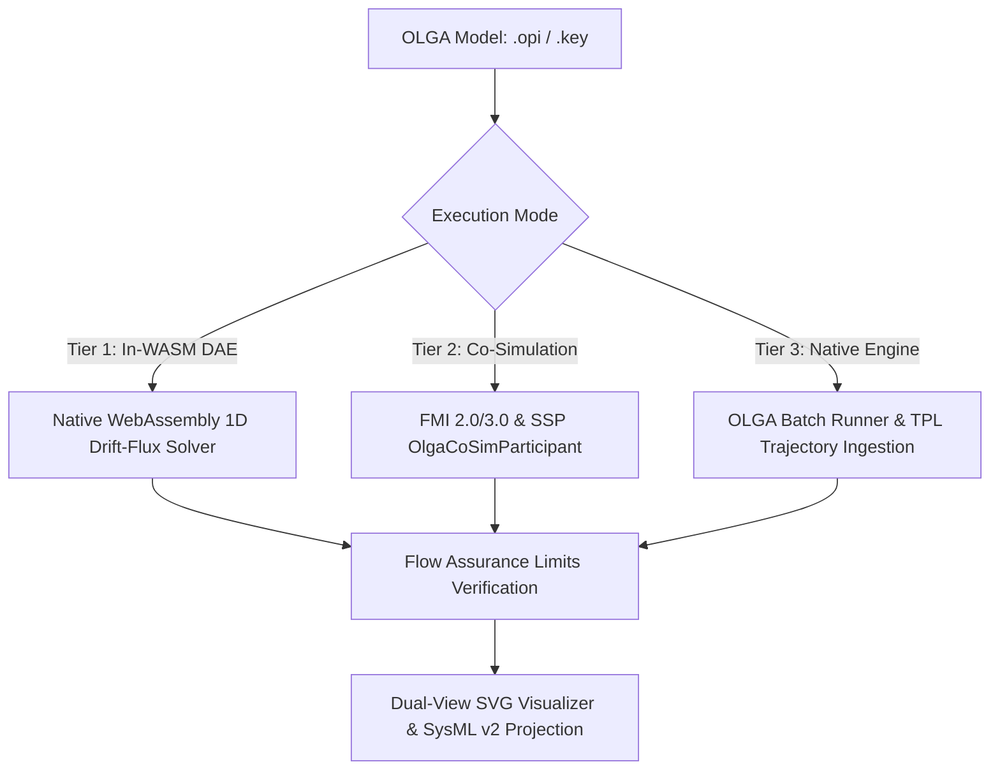

# OLGA Multiphase Flow Assurance

ModelScript provides first-class, polyglot support for **OLGA** (High-Fidelity Dynamic Multiphase Flow Simulation). Engineers can author, simulate, lint, formally verify, and co-simulate multiphase production flowlines, deepwater catenary risers, and slug catchers directly within ModelScript's unified digital thread.

---

## Supported File Formats

| Format                   | Extension         | Description                                                                                                                        |
| :----------------------- | :---------------- | :--------------------------------------------------------------------------------------------------------------------------------- |
| **OLGA XML GUI Project** | `.opi`, `.xml`    | Complete graphical network model defining wells, pipes, chokes, separator terminals, and operational controllers.                  |
| **Legacy Keyword Deck**  | `.key`, `.genkey` | Standard industrial keyword decks specifying flowpath geometry, branch connections, boundary conditions, and valve schedules.      |
| **PVT Flash Tables**     | `.tab`            | Compositional and black-oil tabular fluid files for bilinear interpolation of fluid densities, gas-liquid ratios, and viscosities. |
| **Simulation Trends**    | `.tpl`            | High-frequency time-series trend files containing spatial and temporal multiphase variables ($P$, $T$, $\alpha_L$, $Q_L$).         |

---

## 3-Tier Execution Architecture

ModelScript implements a 3-tier operational execution framework, accommodating headless cloud workflows, system-level co-simulation, and ground-truth industrial verification:



### 1. Tier 1: Native In-WASM Drift-Flux Solver

- **Zero Intermediate Allocations:** Lowers directly into ModelScript's `DAEBuilder` linear memory arena.
- **Transient Hydrodynamics:** Solves staggered-grid mass, momentum, and energy balances coupled with Zuber-Findlay drift-flux gas-liquid slip.
- **Mechanistic Physics:**
  - **Taitel-Dukler (1976) & Barnea (1987) Flow Regime Map**: Exact geometric wetted perimeters ($S_i, S_G, S_L$) and Andritsos-Hanratty wave friction enhancement.
  - **Pal & Rhodes (1989) Emulsion Inversion**: Captures apparent viscosity peaks during water breakthrough ($WC_{\text{inv}} \approx 42\%$).
  - **Lagrangian Slug Tracker**: Propagates discrete moving slug bodies, resolving slug length distributions ($L_{s,\text{mean}}, L_{s,95}$) and riser-base severe cyclic slugging.
  - **Dynamic Pipeline Scraper Pig (`OlgaPig`)**: Solves pig motion ODEs ($M dv/dt = \Delta P \cdot A - F_{\text{friction}} - M g \sin\theta$) and liquid slug sweep volume accumulation.

### 2. Tier 2: FMI 2.0/3.0 & SSP Co-Simulation

Exposes standard FMI input and output ports via `OlgaCoSimParticipant` in `@modelscript/exchange`:

- **Input Ports:** `choke.opening`, `wellhead.mass_rate`, `separator.pressure`, `ambient.temperature`.
- **Output Ports:** `inlet.pressure`, `arrival.temperature`, `arrival.liquid_holdup`, `arrival.liquid_rate`, `slug.surge_volume`, `hydrate.subcooling`, `maop.margin`, `slug.mean_length`, `slug.frequency`, `pig.position`.

### 3. Tier 3: Industrial OLGA Engine Orchestration

Automates invocation of local Schlumberger OLGA executable engines (`olga.exe` / `olga-cli`), dynamically ingesting binary `.tpl` trajectories into ModelScript's data structures for verification.

---

## Command Line Interface (`msx olga`)

ModelScript CLI provides headless subcommands for flowline engineering:

```bash
# Run 1D transient simulation and export trajectory to CSV
msx olga simulate subsea_tieback.opi --duration=3600 --out=trajectory.csv

# Pre-flight flow assurance diagnostic check
msx olga lint deepwater_riser.key

# Verify formal flow assurance limits (MAOP, Hydrate Margin, Slug Catcher Capacity)
msx olga verify flowline.genkey --maop=250 --margin=3.0 --capacity=150.0

# Generate standalone SVG bathymetry elevation profile
msx olga diagram subsea_tieback.opi --view=profile --out=bathymetry.svg

# Convert legacy keyword deck to modern XML or SysML v2 operating procedures
msx olga convert input.key --to=opi --out=project.opi
msx olga convert input.opi --to=sysml2 --out=procedures.sysml
```

---

## Flow Assurance Verification & Lint Rules

ModelScript includes automated pre-flight linter diagnostics and limit verifications:

| Rule Code   | Identifier                  | Severity | Description                                                                                                           |
| :---------- | :-------------------------- | :------- | :-------------------------------------------------------------------------------------------------------------------- |
| **`M7001`** | `cfl-condition-violation`   | Warning  | Spatial cell step $\Delta x$ violates Courant-Friedrichs-Lewy stability criteria for configured time step.            |
| **`M7002`** | `invalid-pipe-dimensions`   | Error    | Non-positive pipe inner diameter or negative hydraulic roughness.                                                     |
| **`M7003`** | `zero-pressure-boundary`    | Error    | Boundary pressure is zero or unphysical.                                                                              |
| **`M7004`** | `steep-elevation-warning`   | Info     | Pipe inclination angle exceeds 80 degrees; monitor for riser base liquid accumulation.                                |
| **`M7005`** | `fully-closed-choke-hazard` | Warning  | Choke valve is 100% closed; flowline shut-in overpressurization hazard.                                               |
| **`M7006`** | `severe-slugging-hazard`    | Warning  | Seabed elevation dip followed by a steep catenary riser without an active slug controller.                            |
| **`M7007`** | `pig-stuck-hazard`          | Error    | Mechanical scraper pig seal friction exceeds maximum available flowline drive capability ($\Delta P_{\max} \cdot A$). |

---

## Dual-View SVG Visualization

ModelScript renders dual-view vector diagrams for every OLGA network:

1. **Topological P&ID Schematic:** Wells, manifolds, choke valves, flowpath pipes, and topside slug catchers.
2. **Pipeline Elevation Bathymetry $Z(X)$:**
   - High-contrast seabed-to-platform elevation profile.
   - In-situ liquid holdup ($\alpha_L$) segment color heatmaps.
   - Active discrete slug bubbles highlighted along the flowline path.
   - Real-time scraper pig marker displaying traveling velocity and differential drive pressure.
   - Hydrate subcooling margin callout ($T_{\text{fluid}} - T_{\text{hyd}}$).

---

## SysML v2 Operating Procedure Integration

OLGA models can be formally projected into SysML v2 packages (`@modelscript/olga` $\to$ SysML v2):

```sysml
package Subsea_Tieback_System {
    import ScalarValues::*;

    part def FlowlineAssembly {
        attribute totalLength: Length = 4450.0 [m];
        attribute maopRating: Pressure = 250.0 [bar];
    }

    state def SubseaFlowlineOperatingProcedure {
        entry; then SteadyProduction;

        state SteadyProduction {
            doc /* Continuous production at nominal design rates */
        }
        accept ESD_Trip_Signal then EmergencyShutIn;
        accept Turndown_Command then LowTurndown;

        state EmergencyShutIn {
            doc /* Choke closed; cooldown clock active */
        }
        accept Depressurize_Command when wallTemperature > 18.0 [degC] then ControlledBlowdown;
        accept Cooldown_Timeout when shutInDurationHours >= 8.0 [hr] then ChemicalInhibitionFlushing;

        state ControlledBlowdown;
        state ChemicalInhibitionFlushing;
    }
}
```
