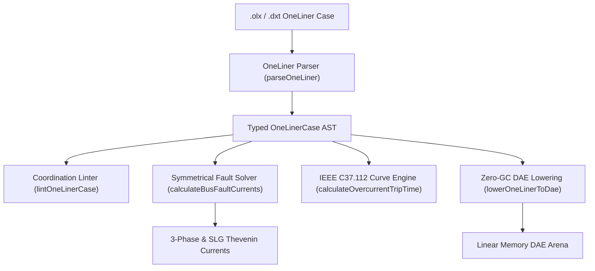

# ASPEN OneLiner / CAPE Protection (`.olx`, `.dxt`)

The `@modelscript/oneliner` package (`languages/oneliner`) provides native support for **ASPEN OneLiner** and **Siemens CAPE (Computer-Aided Protection Engineering)** short-circuit and relay coordination cases (`.olx`, `.dxt`). OneLiner and CAPE are the premier protection engineering tools used across electric utilities and ISOs for fault calculations, breaker rating evaluations, and NERC PRC-027 protection coordination studies.

ModelScript parses `.dxt` ASCII and JSON cases, compiles symmetrical component sequence networks (positive sequence $Z_1$, zero sequence $Z_0$, and mutual zero-sequence couplings $Z_{0m}$), calculates 3-phase and single line-to-ground (SLG) fault currents, evaluates **IEEE C37.112 Standard Time-Overcurrent (TOC)** trip times, and lowers protection models into zero-GC WebAssembly DAE linear arenas.

---

## Supported Protection Elements & Sequence Networks

| Network Element       | Data Fields                                                    | Description                                                                                                         |
| :-------------------- | :------------------------------------------------------------- | :------------------------------------------------------------------------------------------------------------------ |
| **Bus**               | `id`, `name`, `baseKv`, `area`, `zone`                         | Substation bus node with nominal voltage rating.                                                                    |
| **Branch / Line**     | `bus1`, `bus2`, $Z_1 (R + jX)$, $Z_0 (R_0 + jX_0)$, $B_1, B_0$ | Transmission lines and cables with positive and zero sequence series impedances and line charging.                  |
| **Mutual Coupling**   | `branch1`, `branch2`, $Z_{0m} (R_{0m} + jX_{0m})$              | Zero-sequence electromagnetic mutual coupling between parallel transmission circuits on shared rights-of-way.       |
| **Generator**         | $X''_d + jR$, $Z_0$                                            | Synchronous and inverter-based resource subtransient short-circuit contributions.                                   |
| **Overcurrent Relay** | `pickupA`, `ctRatio`, `timeDial`, `curve`                      | ANSI 50 instantaneous and ANSI 51 time-overcurrent curves (IEEE Moderately, Very, Extremely Inverse, US CO-8, IEC). |
| **Distance Relay**    | ANSI 21 Zone 1, 2, 3 reach ($\Omega$)                          | Mho and quadrilateral distance protection zones with reach impedances and directional time delays.                  |

---

## Architecture & Compilation Pipeline



---

## Pre-Flight Diagnostics (`OLX1001`–`OLX4001`)

The `@modelscript/oneliner` linter audits electrical validity and protection settings:

| Code      |  Severity   | Description                                                                                 |
| :-------- | :---------: | :------------------------------------------------------------------------------------------ |
| `OLX1001` |  **Error**  | Branch references undefined from/to bus ID.                                                 |
| `OLX2001` |  **Error**  | Mutual coupling references unknown branch identifier.                                       |
| `OLX3001` | **Warning** | Relay pickup current ($I_{\text{pickup}} \le 0$) or time dial ($TD \le 0$) is non-positive. |
| `OLX4001` | **Warning** | Zone 2 distance reach is smaller than Zone 1 reach ($Z_2 \le Z_1$).                         |

---

## Command-Line Interface (`msx oneliner`)

```bash
# Print summary of buses, lines, mutuals, generators, and protective relays
msx oneliner summary utility_transmission.dxt

# Lint case for missing bus references and invalid relay settings
msx oneliner lint utility_transmission.dxt

# Calculate 3-phase and SLG short-circuit fault currents at Bus 101
msx oneliner solve-fault utility_transmission.dxt --bus=101

# Export case to formatted OneLiner DXT text
msx oneliner to-dxt utility_transmission.dxt -o exported.dxt

# Lower short-circuit network into WebAssembly DAE arena
msx oneliner to-dae utility_transmission.dxt
```

---

## MCP Agent Tool Integration

- **`oneliner_calculate_fault`**: Computes Thevenin sequence impedances ($Z_1, Z_0$), 3-phase short-circuit current ($I_{\text{3ph}} = \frac{V_{\text{LN}}}{Z_1}$), SLG fault current ($I_{\text{slg}} = \frac{3 V_{\text{LN}}}{2 Z_1 + Z_0}$), and $X/R$ ratios directly for AI protective coordination agents.
