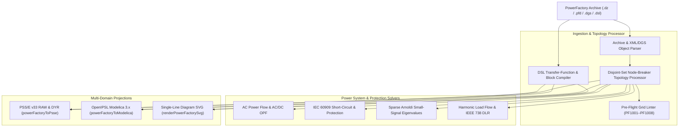

# DIgSILENT PowerFactory-Compatible Grid Modeling (`.dz`, `.pfd`, `.dgs`, `.dsl`)

The `@modelscript/powerfactory` language package (`languages/powerfactory`) provides native support for **DIgSILENT PowerFactory-compatible** project archives (`.dz`), database exports (`.pfd`, `.dgs`, `.xml`), and **DIgSILENT Simulation Language (`.dsl`)** dynamic block definitions. It delivers node-breaker to bus-branch topology reduction, pre-flight electrical validation (`PF1001`–`PF1008`), AC/DC Optimal Power Flow (`solvePowerFactoryOpf`), Quasi-Dynamic Simulation (`solvePowerFactoryQdsl`), harmonic load flow, IEC 60909 short-circuit analysis, Sparse Arnoldi small-signal modal analysis, IEEE 738 Dynamic Line Rating (DLR), Single-Line Diagram (SLD) rendering (`IntGrf` / `SetDesktop`), and cross-domain projections to **PSS/E** and **Modelica (OpenIPSL)**.

---

## Supported Object Classes & File Formats

| Format / Class                  | Specification                      | Key Structural Features                                                                                  |
| :------------------------------ | :--------------------------------- | :------------------------------------------------------------------------------------------------------- |
| **`.dz` / `.pfd` / `.dgs`**     | Project Archive & Data Exchange    | Substations (`ElmSubstat`), terminals (`ElmTerm`), switches (`StaSwitch`, `ElmCoup`), graphic netboards  |
| **`ElmLne` / `TypLne`**         | AC Transmission Lines & Cables     | Positive/zero-sequence impedance ($R_1, X_1, B_1, R_0, X_0, B_0$), thermal rating, parallel circuits     |
| **`ElmTr2` / `ElmTr3`**         | 2- & 3-Winding Power Transformers  | HV/MV/LV nominal voltages, vector groups (`YNd11`, `Dyn5`), off-nominal tap changers, short-circuit $u_k$|
| **`ElmSym` / `ElmGenstat`**     | Synchronous & Static IBR Generators| Active/reactive dispatch, voltage setpoint $u_{\text{setp}}$, capability curves, synchronous reactances  |
| **`.dsl` (`BlkDef`)**           | DIgSILENT Simulation Language      | Continuous transfer functions, PI/lag/lead-lag blocks, state derivatives, and non-linear limiters        |

---

## Architecture & Compilation Pipeline



---

## 1. Pre-Flight Electrical Diagnostic Rules

`@modelscript/powerfactory` validates terminal connectivity, line/transformer type references, and generator operating bounds prior to network reduction or simulation:

<LintRules lang="powerfactory" />

---

## 2. Node-Breaker Topology Reduction & DSL Compilation

### Disjoint-Set Bus-Branch Reduction (`processPowerFactoryTopology`)

Substations modeled at the node-breaker level with busbars (`ElmTerm`), circuit breakers (`ElmCoup`), and bay switches (`StaSwitch`) are reduced via union-find partitioning over closed switching devices (`on_off = 1`). Open switches isolate faulted or de-energized busbar sections while preserving active equipment terminal assignments.

### DIgSILENT Simulation Language (`.dsl`) to Modelica & DAE (`transpileDslToModelica`)

Continuous control definitions in `.dsl` (excitation systems, turbine governors, PSS, and wind/PV plant controllers) are parsed into state-space transfer blocks (`select`, `lim`, `lincirlo`, `pictrl`, `lag`, `der`) and lowered into OpenIPSL-compatible Modelica `block` declarations and `DAEBuilder` differential-algebraic equations.

---

## 3. Advanced Grid Analysis: OPF, QDSL, Harmonics, Modes & DLR

- **AC & DC Optimal Power Flow (`solvePowerFactoryOpf`)**: Minimizes generation dispatch cost $\sum (c_2 P_{g,i}^2 + c_1 P_{g,i} + c_0)$ subject to nodal power balance, generator capability bounds, bus voltage limits, and branch MVA thermal ratings.
- **Quasi-Dynamic Simulation (`solvePowerFactoryQdsl`)**: Executes multi-step time-series power flow profiles across diurnal load and solar/wind generation scaling curves.
- **Harmonic Power Flow & Frequency Scans**: Evaluates bus Total Harmonic Distortion ($\text{THD}_V$) against IEEE 519-2022 limits and sweeps driving-point harmonic impedance $Z(h)$ to identify parallel LC resonance peaks.
- **Small-Signal Stability (`modes`)**: Computes electromechanical oscillation modes ($\lambda = \sigma \pm j\omega$, frequency $f$, damping ratio $\zeta = -\sigma / |\lambda|$) via the Sparse Arnoldi Krylov subspace eigensolver or dense QR factorization.
- **IEEE 738 Dynamic Line Rating (`dlr`)**: Solves the steady-state and transient overhead conductor heat balance ($q_c + q_r = q_s + I^2 R(T_c)$) to determine real-time ampacity and thermal emergency ratings.

---

## 4. Command-Line Interface (`msx powerfactory` / `msx pf`)

```bash
# Inspect substation, terminal, line, transformer, and generator counts
msx powerfactory inspect grid.pfd

# Solve AC power flow on a PowerFactory network model
msx powerfactory solve grid.pfd

# Run IEC 60909 three-phase short-circuit fault calculations
msx powerfactory fault grid.pfd

# Compute small-signal stability eigenvalues using the Sparse Arnoldi solver
msx powerfactory modes grid.pfd --method=arnoldi

# Run DC or AC Optimal Power Flow (OPF)
msx powerfactory opf grid.pfd --formulation=dc

# Evaluate IEEE 738 Dynamic Line Rating, harmonic THD, QDSL, and grid-code compliance
msx powerfactory dlr grid.pfd
msx powerfactory harmonics grid.pfd
msx powerfactory qdsl grid.pfd
msx powerfactory gridcode grid.pfd

# Export Single-Line Diagram SVG, PSS/E .raw, or OpenIPSL Modelica .mo
msx powerfactory diagram grid.pfd --out=grid-sld.svg
msx powerfactory to-psse grid.pfd --out=grid.raw
msx powerfactory to-modelica grid.pfd --out=GridModel.mo
```
