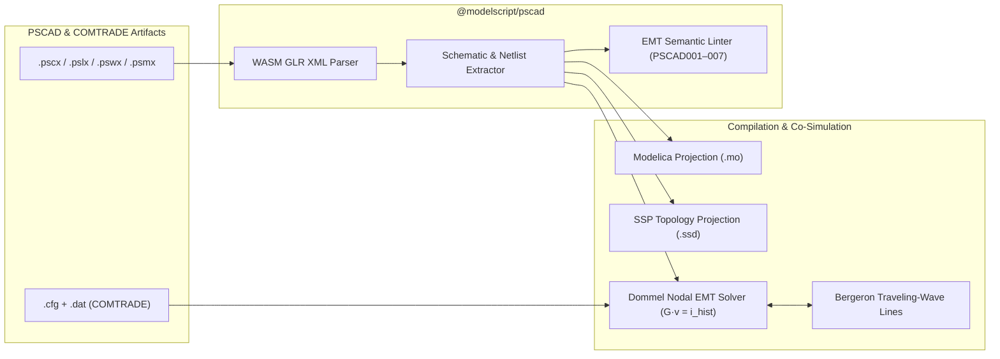

# PSCAD & Electromagnetic Transients (`.pscx`, `.pslx`, `.pswx`, `.psmx`, `.cfg`, `.dat`)

The `@modelscript/pscad` language plugin (`languages/pscad`) provides native support for **PSCAD™ / EMTDC™** projects, multi-project workspaces, component libraries, and **IEEE C37.111 COMTRADE** transient waveform recordings. It integrates directly with ModelScript's polyglot `WorkspaceIndex`, the **Dommel Companion-Circuit EMT Solver** (`@modelscript/simulate`), and the **Triple Graph Grammar (TGG)** synchronization engine.

---

## Supported File Formats

| Extension | Format                        | Description                                                                                                           |
| :-------- | :---------------------------- | :-------------------------------------------------------------------------------------------------------------------- |
| `.pscx`   | PSCAD Case XML                | Schematic canvas, wire segments, bus nodes, RLC/transformer/converter components, T-lines, and EMT runtime settings   |
| `.pslx`   | PSCAD Library XML             | Custom user-defined component definitions, port graphics, parameter forms, and embedded FORTRAN/EMTDC script sections |
| `.pswx`   | PSCAD Workspace XML           | Multi-project workspace manifest indexing `.pscx` cases and `.pslx` libraries via `PscadWorkspaceIndex`               |
| `.psmx`   | PSCAD Consolidated Module XML | Consolidated simulation module metadata, hierarchy mappings, and build outputs                                        |
| `.cfg`    | IEEE C37.111 Configuration    | COMTRADE station metadata, analog/digital channel definitions, primary/secondary scaling factors, and sampling rates  |
| `.dat`    | IEEE C37.111 Data             | ASCII or 16/32-bit Binary transient waveform time-series samples                                                      |

---

## Architecture & Pipeline



---

## 1. Schematic & Netlist Extraction (`extract.ts`)

PSCAD `.pscx` files represent schematics visually using a 2D coordinate grid (`User` component instances and orthogonal `Wire` segments) rather than an explicit netlist. `@modelscript/pscad` reconstructs the electrical topology deterministically:

1. **Component Port Resolution**: Resolves the pin offsets (`x`, `y`) and rotations (`orient`) of over 35 built-in `master:*` library definitions (e.g., `master:source3`, `master:resistor`, `master:inductor`, `master:capacitor`, `master:xfmr-3p2w`, `master:tline`, `master:igbt`, `master:breaker3`, `master:pgb`).
2. **Union-Find Spatial Wire Clustering**: Performs geometric point-on-segment intersection across all orthogonal `<Wire>` segments and component pin coordinates to synthesize equipotential electrical nodes (`PscadElectricalNode`).
3. **Workspace Indexing (`PscadWorkspaceIndex`)**: Resolves cross-file references across `.pswx` workspaces, linking custom `<Definition>` blocks in `.pslx` libraries to `<User>` instances in `.pscx` cases (`languages/pscad/src/workspace-index.ts`).

---

## 2. Semantic Linter Rules (`linter.ts`)

`@modelscript/pscad` enforces electromagnetic transient modeling best practices before simulation starts:

| Code       | Severity | Rule Description                                                                                                       |
| :--------- | :------- | :--------------------------------------------------------------------------------------------------------------------- |
| `PSCAD001` | Warning  | **Large EMT Time Step**: `time_step > 250 µs` risks numerical aliasing of switching transients                         |
| `PSCAD002` | Error    | **Invalid Simulation Duration**: `time_duration <= 0`                                                                  |
| `PSCAD003` | Error    | **Sample Step Violates Nyquist**: `sample_step < time_step`                                                            |
| `PSCAD004` | Warning  | **Floating Component Port**: Electrical component has zero connected netlist nodes                                     |
| `PSCAD005` | Error    | **Non-Positive Passive Element**: $R \le 0$, $L \le 0$, or $C \le 0$ in passive RLC branch                             |
| `PSCAD006` | Error    | **Bergeron Travel Time Violation**: Distributed line travel time $\tau = \ell / v < \Delta t$ violates wave decoupling |
| `PSCAD007` | Warning  | **Orphaned Wire Segment**: Schematic wire segment does not touch any component port                                    |

---

## 3. Polyglot Projections & TGG Synchronization

### Modelica & SSP Projections (`projections/modelica.ts`, `projections/ssp.ts`)

- **`pscadToModelica(doc)`**: Projects a `.pscx` schematic and its reconstructed Union-Find electrical nodes into a complete Modelica model using `Modelica.Electrical.Analog` (`Basic.Resistor`, `Basic.Inductor`, `Basic.Capacitor`, `Basic.Ground`, `Ideal.IdealTransformer`, `Sources.SineVoltage`, and `Lines.OLine`).
- **`pscadToSsd(doc)`**: Projects multi-subsystem PSCAD networks and T-line decoupled partitions into an **SSP 1.0 `.ssd`** System Structure Description XML document for FMI Co-Simulation.

### Bidirectional TGG Rules

`@modelscript/pscad` registers 6 bidirectional **Triple Graph Grammar (TGG)** rules for cross-domain synchronization with `@modelscript/modelica` and `@modelscript/sysml2`:

- `PscadProjectToModelicaModel`: Maps a `.pscx` project to a top-level Modelica `model`.
- `PscadResistorToModelicaResistor`: Synchronizes `master:resistor` ($R$) with `Modelica.Electrical.Analog.Basic.Resistor`.
- `PscadInductorToModelicaInductor`: Synchronizes `master:inductor` ($L$) with `Modelica.Electrical.Analog.Basic.Inductor`.
- `PscadCapacitorToModelicaCapacitor`: Synchronizes `master:capacitor` ($C$) with `Modelica.Electrical.Analog.Basic.Capacitor`.
- `PscadTLineToModelicaOLine`: Synchronizes distributed transmission lines (`master:tline`) with `Modelica.Electrical.Analog.Lines.OLine`.
- `PscadComponentToSysmlPart`: Synchronizes PSCAD power apparatus with SysML v2 `PartUsage` blocks for system architecture traceability.

---

## 4. Dommel EMT Solver & Bergeron Lines (`@modelscript/simulate`)

For high-frequency power electronics and traveling-wave studies, `@modelscript/simulate` provides a dedicated **Electromagnetic Transient (EMT)** solver (`EmtSolver` in `packages/simulate/src/solvers/emt/emt-solver.ts`):

- **Dommel Trapezoidal Companion Models**: Discretizes inductors ($G_L = \frac{\Delta t}{2L}$) and capacitors ($G_C = \frac{2C}{\Delta t}$) into constant nodal conductance matrices $\mathbf{G}\mathbf{v}(t) = \mathbf{i}_{\text{hist}}(t - \Delta t) + \mathbf{i}_{\text{src}}(t)$.
- **Critical Damping Adjustment (CDA)**: Automatically switches from Trapezoidal to Backward Euler for one half-step following any breaker/IGBT switching event ($S_k(t) \neq S_k(t-\Delta t)$) to eliminate artificial numerical chatter ($dv/dt$ ringing).
- **Bergeron Distributed-Parameter Lines**: Decouples sub-networks separated by transmission lines of length $\ell$ and wave speed $v$ whenever $\tau = \ell / v \ge \Delta t$, enabling embarrassingly parallel subsystem nodal solves.
- **Norton Equivalent FMU Co-Simulation**: Exposes `getNortonEquivalent(portNode)` ($I_{\text{eq}}, G_{\text{eq}}$) so EMT sub-grids can couple directly with FMI 2.0/3.0 FMUs without algebraic delay instability.

---

## 5. IEEE C37.111 COMTRADE Reader & Writer (`comtrade.ts`)

`@modelscript/pscad` includes a zero-dependency parser and serializer for IEEE Std C37.111-1999 / 2013 **COMTRADE** files:

```ts
import { parseComtrade, writeComtrade, EmtSolver } from "@modelscript/pscad";

// Export an EMT simulation directly to IEEE C37.111 (.cfg + .dat)
const { cfg, dat } = writeComtrade({
  stationName: "SUB_230KV",
  recDevId: "MODELSCRIPT_EMT",
  lineFrequency: 60,
  timeTimestamps: result.time,
  analogChannels: [
    { id: "VA_BUS1", unit: "V", values: result.nodeVoltages.get(1)! },
    { id: "IA_LINE1", unit: "A", values: result.branchCurrents.get("BRK1")! },
  ],
});
```
