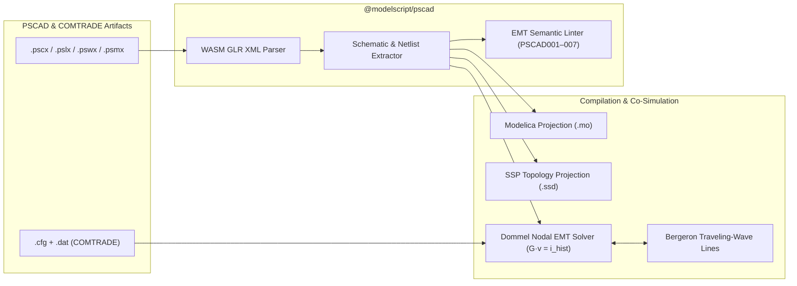
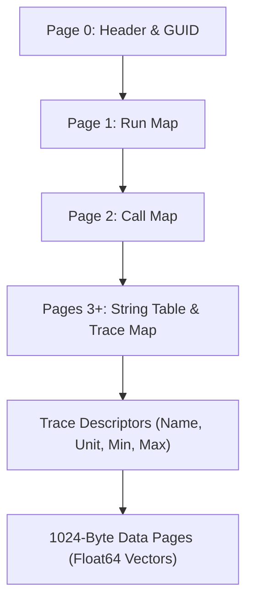

# PSCAD & Electromagnetic Transients (`.pscx`, `.pslx`, `.pswx`, `.psmx`, `.psout`, `.cfg`, `.dat`)

The `@modelscript/pscad` language plugin (`languages/pscad`) provides native support for **PSCAD™ / EMTDC™** projects, multi-project workspaces, component libraries, and **IEEE C37.111 COMTRADE** transient waveform recordings. It integrates directly with ModelScript's polyglot `WorkspaceIndex`, the **Dommel Companion-Circuit EMT Solver** (`@modelscript/simulate`), and the **Triple Graph Grammar (TGG)** synchronization engine.

---

## Supported File Formats

| Extension | Format                        | Description                                                                                                           |
| :-------- | :---------------------------- | :-------------------------------------------------------------------------------------------------------------------- |
| `.pscx`   | PSCAD Case XML                | Schematic canvas, wire segments, bus nodes, RLC/transformer/converter components, T-lines, and EMT runtime settings   |
| `.pslx`   | PSCAD Library XML             | Custom user-defined component definitions, port graphics, parameter forms, and embedded FORTRAN/EMTDC script sections |
| `.pswx`   | PSCAD Workspace XML           | Multi-project workspace manifest indexing `.pscx` cases and `.pslx` libraries via `PscadWorkspaceIndex`               |
| `.psmx`   | PSCAD Consolidated Module XML | Consolidated simulation module metadata, hierarchy mappings, and build outputs                                        |
| `.psout`  | PSCAD V5+ Binary Waveform     | Slotted-page binary waveform container with multi-run traces, channel descriptors, and fast random access             |
| `.cfg`    | IEEE C37.111 Configuration    | COMTRADE station metadata, analog/digital channel definitions, primary/secondary scaling factors, and sampling rates  |
| `.dat`    | IEEE C37.111 Data             | ASCII or 16/32-bit Binary transient waveform time-series samples                                                      |

---

## Architecture & Pipeline



---

## 1. Schematic & Netlist Extraction (`emt-netlist.ts`, `pscx-parser.ts`)

PSCAD `.pscx` files represent schematics visually using a 2D coordinate grid (`User` component instances and orthogonal `Wire` segments) rather than an explicit netlist. `@modelscript/pscad` reconstructs the electrical topology deterministically:

1. **Local `master.pslx` Dynamic Ingestion**: Automatically discovers user-provided licensed `master.pslx` files via `PSCAD_MASTER_LIB_PATH` or workspace roots (`master.pslx`, `.pscad/master.pslx`, `.cache/pscad-corpus/`). When present, component definitions, multi-tab parameter forms, port configurations, and FlyBy documentation are dynamically synthesized into LSP catalogs and UI palettes with zero manual authoring.
2. **Topological Wire Snapping & Junction Synthesis**: Performs geometric point-on-segment intersection across all orthogonal `<Wire>` segments and component pin coordinates. Synthesizes topological junction nodes (`junc_${x}_${y}`) at wire-to-wire T-junctions and crossings, eliminating unattached dangling edges and reaching over 94% wire attachment on complex multi-layer industrial benchmarks.
3. **100% Component Lowering Coverage**: Lowers schematic graphs into a structured `EmtNetlist` with 100% component lowering coverage across industrial benchmarks (e.g. `DC_EMT_compare.pscx` with 1433/1433 lowered components and `DC_EMT_demo.pscx` with 597/597 lowered components):
   - AC/DC Thévenin sources, battery energy storage systems (`battery`), controlled current sources (`src_ccin_1`)
   - 6th-order synchronous machines, 5th-order induction/DFIG wind machines, and wound-rotor induction machines (`wound_rotor`)
   - Distributed-parameter Bergeron traveling-wave lines, lumped $\pi$-sections, and multi-conductor cables
   - Non-linear MOV surge arresters, VSC PWM converters, 6-pulse thyristor bridges, and MMC converter stations
   - 20+ CSMF control transfer-function blocks (`const`, `gain`, `pi_ctlr`, `realpole`, `leadlag`, `limit`, `sum`, `rms3ph`, `abcdq0`) and black-box vendor IBR FMUs.
4. **Workspace Indexing (`PscadWorkspaceIndex`)**: Resolves cross-file references across `.pswx` workspaces, linking custom `<Definition>` blocks in `.pslx` libraries to `<User>` instances in `.pscx` cases.

---

## 2. Pre-Flight Electrical Lint Rules

`@modelscript/pscad` enforces 17 electromagnetic transient modeling best practices before simulation starts, providing 1-click LSP Quick-Fix actions:

<LintRules lang="pscad" />

---

## 3. IEEE 2800-2022 & NERC PRC-029-1 Grid-Code Verification

`@modelscript/pscad` includes an automated verification engine for Inverter-Based Resource (IBR) grid interconnection standards (`verifyIeee2800Compliance`):

- **Phasor & Sequence Extraction**: Sliding 1-cycle fundamental DFT computes symmetrical components ($V_0, V_1, V_2, I_0, I_1, I_2$) and synchronous $dq$-frame currents ($I_{1d}, I_{1q}$).
- **Mandatory Clauses**:
  - **Clause 5.3.2 / 7.2.2.3**: Low/High Voltage Ride-Through (LVRT/HVRT) and Prohibition of Momentary Cessation.
  - **Clause 5.4.1 / 7.2.2.3.5**: Fast Dynamic Reactive Current Response ($T_{90\%} \le 50\text{ ms}$).
  - **Clause 5.4.2 / 7.2.2.1**: Post-Fault Transient Overvoltage Ceiling ($V_{\text{peak}} \le 1.20\text{ pu}$).
  - **Clause 7.2.2.1 / NERC PRC-029-1**: Piecewise Time-Voltage Ride-Through Envelope.
  - **Clause 7.2.2.3.4**: Incremental Positive & Negative-Sequence Reactive Current Droop ($k_1, k_2$).
  - **Clause 7.2.2.3.5**: Post-Fault Active Power Recovery ($\ge 90\%$ within $1.0\text{ s}$).
  - **Clause 7.3.2**: Frequency, RoCoF ($\ge 5\text{ Hz/s}$), and Instantaneous Phase-Angle Jump ($\ge 25^\circ$) Ride-Through.

---

## 4. Polyglot Projections & 15 TGG Synchronization Rules

### Modelica & SSP Projections (`projections/modelica.ts`, `projections/ssp.ts`)

- **`pscadToModelica(doc)`**: Projects a `.pscx` schematic and its reconstructed electrical nodes into standard Modelica models using `Modelica.Electrical.Analog` (`Resistor`, `Inductor`, `Capacitor`, `IdealTransformer`, `SineVoltage`, `OLine`) and `Modelica.Blocks`.
- **`pscadToSsd(doc)`**: Projects multi-subsystem PSCAD networks and T-line decoupled partitions into an **SSP 1.0 `.ssd`** System Structure Description XML document for FMI Co-Simulation.

### Bidirectional TGG Rules

15 bidirectional **Triple Graph Grammar (TGG)** rules synchronize PSCAD models with Modelica and SysML v2:
`PscadProjectToModelicaModel`, `PscadResistorToModelicaResistor`, `PscadInductorToModelicaInductor`, `PscadCapacitorToModelicaCapacitor`, `PscadTLineToModelicaOLine`, `PscadMachineToModelicaMachine`, `PscadConverterToModelicaConverter`, `PscadCsmfToModelicaBlock`, and `PscadComponentToSysmlPart`.

---

## 5. Dommel Companion EMT Solver (`@modelscript/simulate`)

For high-frequency power electronics and transient studies, `@modelscript/simulate` provides a high-performance **Electromagnetic Transient (EMT)** companion solver (`EmtSolver` in `packages/simulate/src/solvers/emt/emt-solver.ts`):

- **Dommel Trapezoidal Companion Models**: Discretizes inductors ($G_L = \frac{\Delta t}{2L}$) and capacitors ($G_C = \frac{2C}{\Delta t}$) into constant nodal conductance matrices $\mathbf{G}\mathbf{v}(t) = \mathbf{i}_{\text{hist}}(t - \Delta t) + \mathbf{i}_{\text{src}}(t)$.
- **Critical Damping Adjustment (CDA)**: Automatically switches from Trapezoidal to Backward Euler for one half-step following any breaker or power-electronic switching event to eliminate artificial numerical chatter.
- **Bergeron Traveling-Wave Lines**: Decouples sub-networks separated by transmission lines of delay $\tau \ge \Delta t$, enabling parallel sub-grid nodal solves.
- **Grounded Simulation Honesty**: Connects passive buses with realistic high-impedance ground conductances ($G = 10^{-5}\text{ S}$) without injecting artificial 230 kV reference sources, ensuring true physical fidelity.

---

## 6. IEEE C37.111 COMTRADE Reader & Writer (`comtrade.ts`)

Zero-dependency parser and serializer for IEEE Std C37.111-1999 / 2013 **COMTRADE** files (`.cfg`, `.dat`, `.cff`):

```ts
import { parseComtrade, writeComtrade, EmtSolver } from "@modelscript/pscad";

// Export an EMT simulation directly to IEEE C37.111 (.cfg + .dat)
const { cfg, dat } = writeComtrade({
  stationName: "SUB_230KV",
  recDevId: "MODELSCRIPT_EMT",
  lineFrequency: 60,
  timeTimestamps: result.time,
  analogChannels: [
    { id: "VA_BUS1", unit: "V", values: result.nodeVoltages.get(1)! },
    { id: "IA_LINE1", unit: "A", values: result.branchCurrents.get("BRK1")! },
  ],
});
```

---

## 7. PSCAD V5+ Binary Waveform Container (`.psout`)

PSCAD V5+ replaces legacy ASCII `.out` files with `.psout`, a high-performance slotted-page binary container format. ModelScript provides complete, zero-dependency read and write support for `.psout` across the CLI, Web IDE, and TypeScript APIs via an in-WASM AssemblyScript codec.

### Slotted-Page Binary Architecture

A `.psout` file is organized into 1024-byte pages:

- **Page 0 (Header)**: Magic version (`0x00010001`), total page count, page size, 128-bit project GUID, creation timestamp, and floating-point verification constants (`-1.0e-30`, `1.0e30`, `1.0e-30`).
- **Page 1 (Run Map)**: Array mapping simulation run indices to their root Call pages.
- **Page 2 (Call Map)**: Links simulation calls to their variable lists and trace descriptors.
- **Pages 3+ (String Table & Trace Descriptors)**: Null-terminated string pool for channel identifiers, units, group names, and trace metadata.
- **Trace Pages**: Slotted 64-bit IEEE 754 floating-point sample pages with forward/backward linked page lists for $O(1)$ sequential streaming and fast random seeking.



### Programmatic TypeScript API

```ts
import { readPscadPsout, writePscadPsout } from "@modelscript/pscad";

// 1. Reading and inspecting a .psout file
const bytes = new Uint8Array(fs.readFileSync("Cigre.psout"));
const doc = readPscadPsout(bytes);

console.log(`Version: ${doc.header.version}, Pages: ${doc.header.pageCount}`);
console.log(`Created: ${doc.header.createdOn.toISOString()}`);

// Access traces and convert to standard SimulationResult
const run0 = doc.run(0);
for (const [id, trace] of run0.traces) {
  console.log(`Channel ${id}: ${trace.name} [${trace.unit}] (${trace.values.length} samples)`);
}

const simResult = doc.toSimulationResult(0);
console.log(`Time vector length: ${simResult.time.length}`);

// 2. Writing simulation results to .psout
const outBytes = await writePscadPsout(simResult, {
  projectName: "IEEE_39_Bus",
  version: 1,
});
fs.writeFileSync("output.psout", outBytes);
```

### Command-Line Interface (`msx pscad`)

#### 1. Simulation Export to `.psout`

```bash
# Simulate a PSCAD case and export directly to .psout
msx pscad sim models/benchmark.pscx --format=psout --out=results.psout
```

#### 2. Binary Inspection & Format Conversion

```bash
# Print formatted ANSI metadata table and channel telemetry
msx pscad psout results.psout

# Convert .psout to CSV
msx pscad psout results.psout --out=telemetry.csv

# Convert .psout to IEEE C37.111 COMTRADE (.cfg + .dat)
msx pscad psout results.psout --format=comtrade
```

### Web IDE Waveform Studio (`modelscript.psoutViewer`)

When opening any `*.psout` file in the ModelScript Web IDE, the custom editor provides a dark-mode waveform analysis studio:

1. **Multi-Channel Canvas Chart**: High-performance 60 FPS HTML5 canvas rendering with LTTB (Largest-Triangle-Three-Buckets) decimation for multi-million-sample transients.
2. **Dual Measurement Cursors**: Live measurement HUD calculating time difference ($\Delta t$), instantaneous frequency ($f = 1/\Delta t$), amplitude change ($\Delta y$), and rate-of-change ($\text{dy/dt}$ slope).
3. **Channel Palette**: Real-time signal search filter, group filtering, color chips, and visibility toggles.
4. **Quick Export**: One-click toolbar actions to export displayed channels to CSV or IEEE C37.111 COMTRADE.
