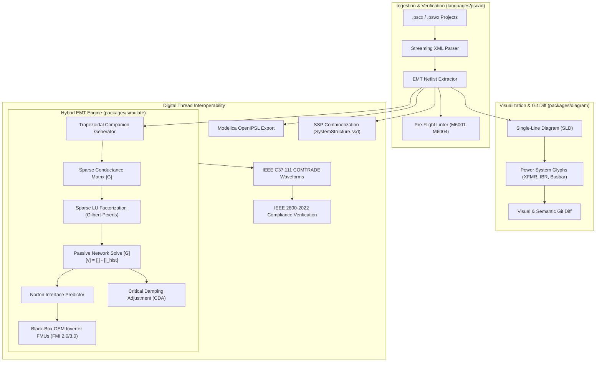

# PSCAD™ Power Systems & EMT Simulation

ModelScript provides native, production-grade support for **PSCAD™ v4.6 and v5.x projects (`.pscx`, `.pswx`, `.psmx`)** under `languages/pscad/`, coupled with a high-performance **WebAssembly Electromagnetic Transient (EMT) companion-circuit backend solver** in `packages/simulate/src/solvers/emt/`.

> [!NOTE]
> **Trademark Notice**: PSCAD™ and EMTDC™ are registered trademarks of Manitoba Hydro International Ltd. (MHI). ModelScript is an independent open-source engineering compiler; references to PSCAD file formats and models are used strictly for compatibility and interoperability under nominative fair use.

---

## Architecture Overview

Power system simulation has historically been fragmented: open utility grids and proprietary vendor inverter controllers (wind, solar, battery storage) were locked inside Windows-only Fortran DLL runtimes. ModelScript solves this by unifying:

1. **A White-Box Passive Grid Network Solver**: Open RLC branches, multi-winding power transformers, circuit breakers, and Bergeron transmission lines running Dommel's trapezoidal companion-circuit formulation.
2. **A Black-Box OEM Inverter-Based Resource (IBR) Subsystem**: Vendor-proprietary wind and solar controllers packaged as **FMI 2.0/3.0 Co-Simulation FMUs**, stabilized by a dynamic Norton equivalent interface predictor.



---

## Numerical Formulation: The Dommel Companion Circuit

For a fixed discrete time step $\Delta t \in [10\,\mu\text{s}, 50\,\mu\text{s}]$, linear reactive elements are converted into Norton companion circuits:

### 1. Inductors and Capacitors (Trapezoidal Rule)

- **Inductor**:
  $$i(t) = G_L \cdot v(t) + I_{\text{hist}, L}(t-\Delta t), \quad G_L = \frac{\Delta t}{2L}, \quad I_{\text{hist}, L}(t-\Delta t) = i(t-\Delta t) + G_L \cdot v(t-\Delta t)$$
- **Capacitor**:
  $$i(t) = G_C \cdot v(t) + I_{\text{hist}, C}(t-\Delta t), \quad G_C = \frac{2C}{\Delta t}, \quad I_{\text{hist}, C}(t-\Delta t) = -i(t-\Delta t) - G_C \cdot v(t-\Delta t)$$

### 2. Nodal Admittance Linear System

All companion conductances are stamped into a global sparse matrix:
$$[G] \cdot [v(t)] = [i_{\text{inj}}(t)] - [I_{\text{hist}}(t-\Delta t)]$$

- $[G]$ is factorized once using **Gilbert-Peierls Sparse LU Decomposition**.
- Each time step requires only $O(\text{nnz})$ forward/backward substitutions.

### 3. Critical Damping Adjustment (CDA)

During circuit breaker switching or diode commutations, the trapezoidal rule produces high-frequency numerical oscillations (chatter at $z = -1$). ModelScript executes **two half-steps of Backward Euler** ($\Delta t / 2$) at the switching instant to quench oscillations without artificial numerical damping during continuous steps.

### 4. Traveling-Wave Transmission Lines (Bergeron Model)

For transmission lines with wave travel time $\tau = \text{length} \cdot \sqrt{LC} > \Delta t$:

- Sending terminal $k$ and receiving terminal $m$ decouple into historical delay queues:
  $$i_{km}(t) = \frac{v_k(t)}{Z_c} + I_{\text{hist}, km}(t - \tau)$$
  $$i_{mk}(t) = \frac{v_m(t)}{Z_c} + I_{\text{hist}, mk}(t - \tau)$$
- Circular history buffers store modal traveling waves, splitting large power grids into independent sparse matrix blocks.

---

## Black-Box OEM FMU Co-Simulation & Stability

Standard FMI 2.0 Co-Simulation introduces an explicit 1-step communication delay:
$$i_{\text{FMU}}(t) \approx \text{fmi2DoStep}(v_{\text{terminal}}(t-\Delta t))$$

In stiff electrical networks, this delay causes severe numerical instability. ModelScript resolves this by treating the FMU as a dynamic **Norton Equivalent**:

1. The solver estimates the high-frequency admittance $G_{\text{eq}} \approx \frac{\partial i}{\partial v}$ at the Point of Interconnection (POI).
2. $G_{\text{eq}}$ is stamped directly onto the diagonal of the grid $[G]$ matrix.
3. Injected currents are predicted:
   $$i_{\text{inj}}^{\text{pred}}(t) = i_{\text{FMU}}(t-\Delta t) + G_{\text{eq}} \cdot (v(t) - v(t-\Delta t))$$
4. This converts unstable explicit delay into a stable, semi-implicit boundary coupling.

---

## Automated IEEE 2800-2022 Verification Pipeline

ModelScript automates compliance checking against the **IEEE 2800-2022 Standard for Interconnection and Interoperability of Inverter-Based Resources**:

| Clause         | Verification Test               | Pass/Fail Criteria                                                                     |
| :------------- | :------------------------------ | :------------------------------------------------------------------------------------- |
| **Clause 5.2** | Low-Voltage Ride-Through (LVRT) | No momentary cessation during voltage sags down to $0.05\,\text{pu}$.                  |
| **Clause 5.3** | Fast Reactive Current Injection | Positive-sequence reactive current $I_q$ injected within $T_{90\%} \le 50\,\text{ms}$. |
| **Clause 7.2** | Transient Overvoltage (TOV)     | Post-fault voltage recovery overshoot does not exceed $1.20\,\text{pu}$.               |

Waveforms are evaluated using moving cycle peak envelopes ($\approx 16.6\,\text{ms}$ at $60\,\text{Hz}$) to eliminate zero-crossing artifacts.

---

## Digital Thread Interoperability

PSCAD models in ModelScript interoperate across multiple standards:

- **Modelica Export (`.mo`)**: Generates clean, standards-compliant `Modelica.Electrical.Analog` and OpenIPSL models.
- **System Structure & Parameterization (`.ssd`)**: Auto-generates SSP 1.0 container descriptions packaging multiple vendor inverter FMUs.
- **IEEE COMTRADE (`.cfg`, `.dat`)**: Native reader and writer for IEEE C37.111 / IEC 60255-24 transient waveform interchange.

---

## Pre-flight Linter Rules

The compiler validates PSCAD models before running simulations:

| Code    | Rule                           | Severity | Description                                                              |
| :------ | :----------------------------- | :------- | :----------------------------------------------------------------------- |
| `M6001` | `floating-electrical-node`     | Error    | Electrical bus or node has no closed branch connections.                 |
| `M6002` | `transformer-winding-mismatch` | Warning  | Transformer primary/secondary rating mismatches connected bus base kV.   |
| `M6003` | `invalid-parameter-bounds`     | Error    | Unphysical parameter values ($L \le 0$, $C \le 0$, negative resistance). |
| `M6004` | `weak-grid-warning`            | Warning  | Point of Interconnection has Short-Circuit Ratio ($\text{SCR} < 1.5$).   |

---

## Model Context Protocol (MCP) Tools

AI agents and MCP clients can interact directly with PSCAD models:

```typescript
// 1. Lint project
await mcp.callTool("pscad_lint", { path: "IEEE9Bus.pscx" });

// 2. Run EMT simulation and get COMTRADE
await mcp.callTool("pscad_simulate", {
  path: "IEEE9Bus.pscx",
  dt: 20e-6,
  tstop: 0.1,
  format: "comtrade",
});

// 3. Automated IEEE 2800 compliance report
await mcp.callTool("pscad_verify_ieee2800", {
  path: "IEEE9Bus.pscx",
  poiBus: "Bus1",
  faultDurationMs: 150,
});

// 4. Export to Modelica or SSP
await mcp.callTool("pscad_export", {
  path: "IEEE9Bus.pscx",
  target: "modelica",
  outputPath: "IEEE9Bus.mo",
});
```
