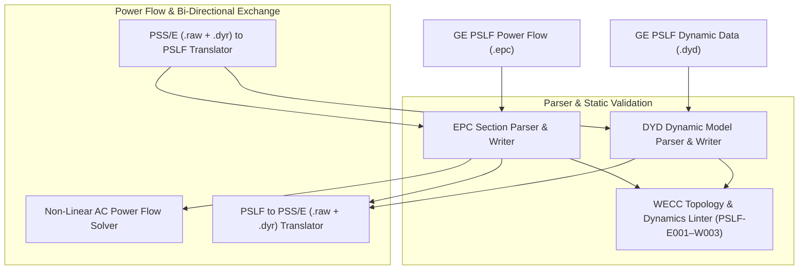

# GE Vernova PSLF-Compatible WECC Transmission (`.epc`, `.dyd`)

The `@modelscript/pslf` language package (`languages/pslf`) provides native support for **GE Vernova PSLF-compatible** Positive Sequence Load Flow (`.epc`) and Dynamic Simulation Data (`.dyd`) models used across the Western Electricity Coordinating Council (WECC). It delivers `.epc` and `.dyd` parsing and round-trip serialization, pre-flight WECC topological and dynamic parameter linting (`PSLF-E001`–`PSLF-W003`), non-linear AC power flow solving, and bi-directional conversion between **GE PSLF (`.epc`/`.dyd`)** and **Siemens PTI PSS/E (`.raw`/`.dyr`)** including second-generation WECC renewable energy models (`regca1`, `reeca1`, `repca1`).

---

## Supported File Specifications & Dynamic Models

| Section / Model                      | Format          | Key Structural Features                                                                                      |
| :----------------------------------- | :-------------- | :----------------------------------------------------------------------------------------------------------- |
| **`bus` / `branch` / `transformer`** | `.epc` Deck     | Extended bus names, kV base voltages, area/zone/owner numbers, multi-section AC lines, and phase shifters    |
| **`generator` / `load` / `shunt`**   | `.epc` Deck     | Synchronous & IBR dispatch ($P_g, Q_g, Q_{\min}, Q_{\max}, M_{\text{base}}$), ZIP loads, switched SVD shunts |
| **`gencls` / `gentpf` / `gensal`**   | `.dyd` Dynamics | Classical and subtransient salient/round-rotor synchronous machines with saturation and inertia $H$          |
| **`exst1` / `ieeego` / `tgov1`**     | `.dyd` Dynamics | IEEE Type ST1 excitation systems and steam/hydro speed-governing turbine models                              |
| **`regca1` / `reeca1` / `repca1`**   | `.dyd` Dynamics | WECC 2nd-generation renewable generator/converter, electrical control, and plant controller models           |

---

## Architecture & Compilation Pipeline



---

## 1. Pre-Flight WECC Grid & Dynamic Diagnostic Rules

`@modelscript/pslf` checks `.epc` and `.dyd` decks for missing swing buses, dangling branch/transformer/generator references, inverted reactive capability limits, isolated buses, and invalid machine inertia constants:

<LintRules lang="pslf" />

---

## 2. Bi-Directional PSLF $\leftrightarrow$ PSS/E Translation

### Power Flow Mapping (`pslfEpcToPsseRaw` / `psseRawToPslfEpc`)

Maps PSLF `.epc` bus, branch, two-winding transformer, generator, load, switched shunt, and area records to PSS/E v33 `.raw` data blocks while preserving per-unit impedances on system $S_{\text{base}}$, transformer complex tap ratios, and reactive power capability bounds.

### WECC Dynamic Model Mapping (`pslfDydToPsseDyr` / `psseDyrToPslfDyd`)

Translates `.dyd` dynamic model records (`gencls`, `gentpf`, `exst1`, `ieeego`, `regca1`, `reeca1`, `repca1`, `wndt`) to and from PSS/E `.dyr` `CON` parameter arrays, aligning generator bus numbers, machine IDs, and MVA base ratings.

---

## 3. Command-Line Interface (`msx pslf`)

```bash
# Inspect bus, generator, load, line, transformer, and dynamic model counts
msx pslf inspect wecc_case.epc
msx pslf summary wecc_case.epc

# Run pre-flight topological and dynamic parameter lint checks
msx pslf lint wecc_case.epc wecc_case.dyd

# Solve AC power flow on a GE PSLF .epc case
msx pslf solve wecc_case.epc

# Convert GE PSLF (.epc / .dyd) to PSS/E (.raw / .dyr)
msx pslf to-psse wecc_case.epc --dyr=wecc_case.dyd --out=wecc_case.raw

# Convert PSS/E (.raw / .dyr) to GE PSLF (.epc / .dyd)
msx pslf from-psse wecc_case.raw --dyr=wecc_case.dyr --out=wecc_case.epc
```
