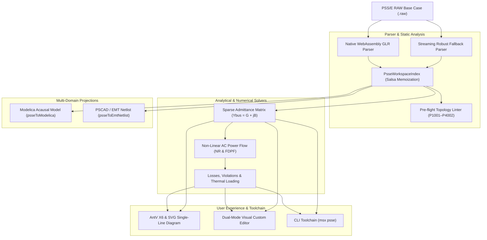

# PSS/E Transmission Power Flow (`.raw`)

The `@modelscript/psse` language package (`languages/psse`) provides native support for **Siemens PSS®E RAW (`.raw`)** transmission grid power flow base cases (Revisions 30 through 35). It delivers streaming parsing, round-trip serialization, pre-flight topological linting (`P1001`–`P4002`), sparse nodal admittance matrix ($Y_{bus} = G + jB$) assembly, in-engine non-linear AC power flow solving (Newton-Raphson & Fast Decoupled), multi-domain projections to **Modelica** and **PSCAD/EMT**, interactive Single-Line Diagrams (SLD) via AntV X6, and a dual-mode VS Code custom webview editor.

---

## Supported File Specifications

| Revision     | Specification        | Key Structural Features                                                                          |
| :----------- | :------------------- | :----------------------------------------------------------------------------------------------- |
| **PSS/E-30** | Legacy Planning Deck | 6-character bus names, integer area/zone codes, fixed branch thermal rating blocks               |
| **PSS/E-32** | Extended Format      | 12-character alphanumeric bus names, expanded DC line modeling, switched shunt blocks            |
| **PSS/E-33** | Modern Standard      | Canonical 12-character names, multi-section lines, 2-terminal & VSC DC transmission, GIC records |
| **PSS/E-34** | Substation-Oriented  | Node-breaker topologies, explicit substation IDs, multi-terminal DC grids                        |
| **PSS/E-35** | High-Density Matrix  | Extended branch identifiers, expanded transformer winding data, flexible rating vectors          |

---

## Architecture & Compilation Pipeline



---

## 1. Pre-Flight Electrical Diagnostic Rules (`lints/`)

`@modelscript/psse` runs pre-flight static checks across electrical topology, connection consistency, and equipment parameter bounds before simulation or projection:

| Code    | Severity    | Rule Description                                                                                    | Engineering Remediation                                                       |
| :------ | :---------- | :-------------------------------------------------------------------------------------------------- | :---------------------------------------------------------------------------- | ----------------------------------------- | ----------------------------------------------------------------- |
| `P1001` | **Error**   | **Missing Bus Reference**: Generator, Load, or Branch references a non-existent bus number          | Add the missing bus declaration or correct the bus index                      |
| `P1002` | **Error**   | **Duplicate Bus Number**: Two or more buses declare identical bus IDs                               | Ensure all bus numbers are strictly unique across the network                 |
| `P1003` | **Error**   | **No Swing/Slack Bus**: Case does not contain an active type 3 (Swing) generator bus                | Designate at least one generator bus with code `IDE = 3`                      |
| `P1004` | **Warning** | **Multiple Swing Buses**: More than one bus is designated as Swing without distributed slack        | Consolidate slack designation or configure island area slack                  |
| `P2001` | **Error**   | **Inverted Reactive Limits**: Generator $Q_{min} > Q_{max}$                                         | Correct generator capability curve bounds ($Q_b \le Q_t$)                     |
| `P2002` | **Warning** | **Voltage Setpoint Out of Range**: Generator scheduled voltage $V_s < 0.8$ or $V_s > 1.2\text{ pu}$ | Re-center voltage setpoint to standard operating band ($0.95 \le V \le 1.05$) |
| `P3001` | **Error**   | **Zero Series Impedance**: Branch series impedance $Z = \sqrt{R^2 + X^2} \le 10^{-6}\text{ pu}$     | Add minimal series reactance or model as zero-impedance breaker               |
| `P3002` | **Warning** | **Negative Resistance**: Branch $R < 0$ without series capacitor compensation flag                  | Verify line parameters or confirm series compensation rating                  |
| `P3003` | **Warning** | **High R/X Ratio**: Transmission line $R/X > 1.0$ at high voltage ($\ge 115\text{ kV}$)             | Check conductor sizing; high $R/X$ degrades AC power flow convergence         |
| `P4001` | **Warning** | **Extreme Transformer Tap**: Off-nominal turns ratio $a < 0.8$ or $a > 1.2$                         | Verify transformer nominal tap and voltage base ratings                       |
| `P4002` | **Warning** | **Large Phase Shift**: Phase shift angle $                                                          | \phi                                                                          | > 45^\circ$ on phase-shifting transformer | Check transformer angle configuration or phase-shift winding code |

---

## 2. Sparse Nodal Admittance Matrix ($Y_{bus}$)

The network admittance matrix $\mathbf{Y}_{\text{bus}} \in \mathbb{C}^{N \times N}$ is extracted via `extractPowerFlowNetlist()` in `languages/psse/src/netlist/powerflow-netlist.ts`:

### Transmission Lines ($\pi$-Equivalent)

For a branch connecting buses $i$ and $j$ with series impedance $z = r + jx$ and total charging susceptance $b$:
$$y_s = \frac{1}{r + jx} = \frac{r - jx}{r^2 + x^2} = g_s + j b_s$$
$$Y_{ij} = -y_s,\quad Y_{ji} = -y_s$$
$$Y_{ii} \mathrel{+}= y_s + j\frac{b}{2},\quad Y_{jj} \mathrel{+}= y_s + j\frac{b}{2}$$

### Transformers with Complex Tap Ratio

For a transformer with off-nominal turns ratio magnitude $a$ and phase shift $\phi$, the complex tap is $\bar{a} = a e^{j\phi} = a_{\text{re}} + j a_{\text{im}}$:
$$Y_{ii} \mathrel{+}= \frac{y_s}{|\bar{a}|^2},\quad Y_{jj} \mathrel{+}= y_s$$
$$Y_{ij} = -\frac{y_s}{\bar{a}^*},\quad Y_{ji} = -\frac{y_s}{\bar{a}}$$

---

## 3. In-Engine Non-Linear AC Power Flow Solver

`@modelscript/psse` includes an exact, non-linear AC Power Flow engine (`solvePowerFlow()` in `languages/psse/src/solver/ac-powerflow.ts`) supporting both **Newton-Raphson** and **Fast Decoupled Power Flow (FDPF)**:

### Mismatch Formulation

For each bus $i \in \{1, \dots, N\}$ with voltage $\bar{V}_i = V_i e^{j\theta_i}$:
$$P_i(V, \theta) = V_i \sum_{k=1}^N V_k \left( G_{ik} \cos\theta_{ik} + B_{ik} \sin\theta_{ik} \right)$$
$$Q_i(V, \theta) = V_i \sum_{k=1}^N V_k \left( G_{ik} \sin\theta_{ik} - B_{ik} \cos\theta_{ik} \right)$$
where $\theta_{ik} = \theta_i - \theta_k$. Active and reactive mismatches are:
$$\Delta P_i = P_i^{\text{spec}} - P_i(V, \theta),\quad \Delta Q_i = Q_i^{\text{spec}} - Q_i(V, \theta)$$

### Analytical Jacobian & Adaptive Damping

The linearized Newton system at each iteration $k$ is:
$$\begin{bmatrix} \Delta P \\ \Delta Q \end{bmatrix} = \begin{bmatrix} H & N \\ M & L \end{bmatrix} \begin{bmatrix} \Delta \theta \\ \Delta V / V \end{bmatrix}$$

- **$H_{ik} = \frac{\partial P_i}{\partial \theta_k} = V_i V_k (G_{ik} \sin\theta_{ik} - B_{ik} \cos\theta_{ik})$** ($k \ne i$), and $H_{ii} = -Q_i - B_{ii} V_i^2$.
- **$N_{ik} = V_k \frac{\partial P_i}{\partial V_k} = V_i V_k (G_{ik} \cos\theta_{ik} + B_{ik} \sin\theta_{ik})$** ($k \ne i$), and $N_{ii} = P_i + G_{ii} V_i^2$.
- **$M_{ik} = \frac{\partial Q_i}{\partial \theta_k} = -V_i V_k (G_{ik} \cos\theta_{ik} + B_{ik} \sin\theta_{ik})$** ($k \ne i$), and $M_{ii} = P_i - G_{ii} V_i^2$.
- **$L_{ik} = V_k \frac{\partial Q_i}{\partial V_k} = V_i V_k (G_{ik} \sin\theta_{ik} - B_{ik} \cos\theta_{ik})$** ($k \ne i$), and $L_{ii} = Q_i - B_{ii} V_i^2$.

### Generator $Q$-Limit Clamping & PV-to-PQ Switching

When $Q_g > Q_{\max}$ or $Q_g < Q_{\min}$, the generator bus is clamped at its reactive limit and dynamically converted to a PQ bus for remaining iterations, preventing unrealistic voltage regulation.

---

## 4. Multi-Domain Interoperability Projections

### Projection to Modelica (`psseToModelica`)

Projects a `.raw` case into a clean, strongly-typed Modelica physical system model:

- **Buses** mapped to equipotential AC pins.
- **Generators** mapped to sinusoidal voltage sources (`Modelica.Electrical.Analog.Sources.SineVoltage`).
- **Branches** mapped to series R-L models (`Modelica.Electrical.Analog.Basic.Resistor` + `Inductor`).
- **Loads** mapped to constant active and reactive impedance networks.

```modelica
model Ieee14Test
  Modelica.Electrical.Analog.Basic.Ground ground;
  Modelica.Electrical.Analog.Sources.SineVoltage gen_1_1(V = 106.0, f = 60.0);
  Modelica.Electrical.Analog.Basic.Resistor line_1_2_r(R = 0.01938);
  Modelica.Electrical.Analog.Basic.Inductor line_1_2_l(L = 0.0001569);
equation
  connect(gen_1_1.n, ground.p);
  connect(gen_1_1.p, line_1_2_r.p);
  connect(line_1_2_r.n, line_1_2_l.p);
end Ieee14Test;
```

### Projection to PSCAD / EMT Netlist (`psseToEmtNetlist`)

Generates multi-bus companion-circuit netlists compatible with ModelScript's Dommel EMT solver (`@modelscript/simulate`) for transient stability and electromagnetic switching studies.

---

## 5. Command-Line Interface (`msx psse`)

ModelScript's CLI provides headless inspection, linting, diagram rendering, and power flow solving:

```bash
# Display summary of buses, generators, loads, branches, and MW totals
msx psse summary case.raw

# Run pre-flight electrical topology and bounds linter
msx psse lint case.raw

# Solve non-linear AC power flow with Newton-Raphson (default)
msx psse solve case.raw

# Solve with Fast Decoupled algorithm and custom tolerance
msx psse solve case.raw --algorithm=fdpf --tol=1e-5 --max-iter=30

# Export publication-quality Single-Line Diagram SVG
msx psse diagram case.raw --out=grid.svg

# Inspect sparse Ybus non-zero entry metrics
msx psse netlist case.raw
```

---

## 6. Custom Visual Webview Editor (`modelscript.rawEditor`)

Opening any `.raw` file in the ModelScript IDE or VS Code launches the custom dual-mode editor:

- **Single-Line Diagram View**: Interactive pan/zoom SVG canvas with voltage-tier color coding (345 kV red, 138 kV blue, 69 kV green), power flow overlays, and generator/transformer glyphs.
- **High-Density Tabular Grid**: Live-filterable tables for Buses, Generators, Branches, Transformers, and Loads with instant search.
- **Overload & Violation Badges**: Automatic highlight of under-voltage ($V < 0.95\text{ pu}$), over-voltage ($V > 1.05\text{ pu}$), and thermal line overloads ($S_{ij} > \text{Rate A}$).
- **Export Toolbar**: Instant export to SVG diagrams, Modelica `.mo` packages, and PSCAD/EMT netlists.
