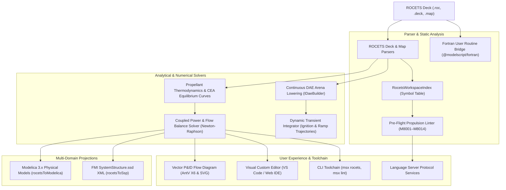

# NASA ROCETS Liquid Propulsion Modeling (`.roc`, `.deck`)

The `@modelscript/rocets` package (`languages/rocets`) provides native compilation, simulation, and analysis for **NASA ROCETS (Rocket Engine Transient Simulator)** liquid propellant rocket engine decks and turbomachinery maps. It delivers multi-syntax parsing, embedded Fortran user routine bridge via `@modelscript/fortran`, pre-flight static propulsion diagnostics (`M8001`–`M8014`), direct continuous DAE arena lowering into `@modelscript/runtime` (`IDaeBuilder`), a coupled steady-state power and flow balance solver, dynamic start/shutdown transient integration, multi-domain projections to **Modelica 3.x** and **FMI SSP**, and interactive Piping & Instrumentation Diagram (P&ID) vector schematic generation.

---

## Supported File Specifications

| Extension            | Format              | Key Structural Features                                                                         |
| :------------------- | :------------------ | :---------------------------------------------------------------------------------------------- |
| **`.roc` / `.deck`** | Engine Model Deck   | Tagged `DECK`, `COMPONENTS`, `PARAMS`, `S0`, `PORTS`, `CONNECTIONS`, `BALANCE` blocks           |
| **`.map` / `.dat`**  | Turbomachinery Maps | Multidimensional speed-flow-head and efficiency performance tables for pumps and turbines       |
| **`.f` / `.for`**    | User Subroutines    | Embedded or external Fortran routines for custom fluid properties and component characteristics |

---

## Architecture & Compilation Pipeline



---

## Propulsion Component Library

NASA ROCETS provides specialized thermodynamic and turbomachinery modules for rocket engine architectures:

| Module                  | Category       | Description                                                       | Primary Parameters & States                                                     |
| :---------------------- | :------------- | :---------------------------------------------------------------- | :------------------------------------------------------------------------------ |
| **`CHAMBER` / `TC`**    | Combustion     | Thrust chamber & convergent-divergent supersonic nozzle expansion | $P_c, A_t, \varepsilon, V_c, c^*, O/F$                                          |
| **`PUMP`**              | Turbomachinery | Centrifugal / axial propellant pump                               | $\Delta P, \eta, \rho, \dot{m}, P_{\text{shaft}}$                               |
| **`TURBINE`**           | Turbomachinery | Gas-driven drive turbine                                          | $PR, \eta, T_{\text{in}}, c_p, P_{\text{shaft}}$                                |
| **`SHAFT`**             | Mechanical     | Turbopump rotating assembly                                       | $J, \omega, N_{\text{rpm}}, \tau_{\text{turb}}, \tau_{\text{pump}}$             |
| **`COOLING_JACKET`**    | Thermal        | Regenerative nozzle cooling jacket                                | $T_{\text{wall}}, Q_{\text{gas}}, Q_{\text{cool}}, h_g, \Delta P_{\text{cool}}$ |
| **`VALVE` / `ORIFICE`** | Fluid          | Throttle, cavitating venturi, or shutoff valve                    | $C_v, \text{position}, \Delta P$                                                |
| **`JUNCTION`**          | Fluid          | Propellant flow splitter or mixing manifold                       | $\sum \dot{m} = 0, P_{\text{node}}$                                             |

---

## Propellants & Thermodynamics

The `@modelscript/rocets` thermo engine provides:

- **Cryogenic & Hydrocarbon Propellants**: Standard properties for Liquid Oxygen (LOX), Liquid Hydrogen (LH2), Liquid Methane (LCH4), and RP-1 kerosene.
- **NASA CEA Combustion Curves**: Chemical equilibrium calculations of characteristic velocity ($c^*$), adiabatic flame temperature ($T_c$), isentropic expansion exponent ($\gamma$), and molecular weight.
- **Gas Dynamics**: Isentropic supersonic nozzle expansion with Mach area relations, vacuum and sea level thrust, and vacuum/SL specific impulse ($I_{sp}$).
- **Bartz Convective Heat Transfer**: Gas-side throat heat transfer coefficient ($h_g$) for regenerative cooling circuit sizing.

---

## Pre-Flight Diagnostic Rules (`M8001`–`M8014`)

| Code        | Identifier                     | Severity  | Verification Rule                                                                                        |
| :---------- | :----------------------------- | :-------- | :------------------------------------------------------------------------------------------------------- | ---------------------------------------------------- | --------------- |
| **`M8001`** | `unconnected-fluid-port`       | `error`   | Fluid port is declared but not connected in the propellant flow circuit                                  |
| **`M8002`** | `fluid-type-mismatch`          | `error`   | Incompatible propellant mixing (e.g. LOX into LH2) outside of a combustion chamber                       |
| **`M8003`** | `shaft-power-imbalance`        | `error`   | Turbopump shaft torque or power mismatch exceeds tolerance ($P_{\text{turb}} \neq \sum P_{\text{pump}}$) |
| **`M8004`** | `unbalanced-flow-split`        | `error`   | Mass conservation violation at piping junction ($                                                        | \sum \dot{m}_{\text{in}} - \sum \dot{m}_{\text{out}} | > \varepsilon$) |
| **`M8005`** | `pump-cavitation-risk`         | `warning` | Pump inlet suction pressure is below required Net Positive Suction Head (NPSH) margin                    |
| **`M8006`** | `negative-chamber-pressure`    | `error`   | Non-physical combustion chamber or line pressure ($P \le 0$)                                             |
| **`M8007`** | `combustion-temperature-limit` | `warning` | Combustion gas temperature exceeds throat material structural limit ($T > 3800\text{ K}$)                |
| **`M8008`** | `invalid-valve-schedule`       | `error`   | Valve stroke position is outside allowable $[0.0, 1.0]$ range                                            |
| **`M8009`** | `choked-flow-inconsistency`    | `warning` | Nozzle expansion is unchoked ($P_c / P_a < 1.89$)                                                        |
| **`M8010`** | `user-fortran-routine-error`   | `error`   | Syntax or semantic error detected in embedded Fortran user routine                                       |
| **`M8011`** | `extreme-mixture-ratio`        | `warning` | Mixture ratio ($O/F$) is outside stable combustion limits ($0.3 < O/F < 15.0$)                           |
| **`M8012`** | `missing-fluid-table`          | `error`   | Propellant fluid property table is not loaded                                                            |
| **`M8013`** | `turbine-overspeed-hazard`     | `warning` | Turbopump shaft RPM exceeds mechanical burst limit                                                       |
| **`M8014`** | `closed-flow-circuit`          | `error`   | Pump discharge is dead-headed with no open flow or recirculation path                                    |

---

## Example ROCETS Engine Deck

```rocets
DECK: GasGeneratorCycleEngine
TITLE: "Gas Generator Cycle Cryogenic Engine"

COMPONENTS:
  OPUMP TYPE=PUMP TITLE="LOX Turbopump" X=100 Y=150
    PARAMS: DELTA_P=14.0E6, ETA=0.78, RHO=1140.0
    PORTS: IN_P=0.3E6 FLUID=LOX DIR=in, OUT_P=14.3E6 FLUID=LOX DIR=out

  FPUMP TYPE=PUMP TITLE="LH2 Turbopump" X=100 Y=320
    PARAMS: DELTA_P=18.0E6, ETA=0.74, RHO=71.0
    PORTS: IN_P=0.2E6 FLUID=LH2 DIR=in, OUT_P=18.2E6 FLUID=LH2 DIR=out

  TURB01 TYPE=TURBINE TITLE="Drive Gas Turbine" X=320 Y=240
    PARAMS: PR=1.65, ETA=0.74, T_IN=950.0
    PORTS: IN_P=15.0E6, OUT_P=9.1E6

  SHAFT01 TYPE=SHAFT TITLE="Main Turbopump Shaft" X=210 Y=240
    PARAMS: INERTIA=0.1, SPEED_RPM=32000.0, MAX_RPM=40000.0
    S0: SPEED_RPM=32000.0

  CHAMBER TYPE=CHAMBER TITLE="Main Thrust Chamber" X=550 Y=240
    PARAMS: PC=10.0E6, MR=6.0, AT=0.035, EPS=50.0, VC=0.02
    S0: PC=10.0E6

  MAIN_OX_VALVE TYPE=VALVE TITLE="Main Oxidizer Valve" X=350 Y=150
    PARAMS: CV=0.005, POSITION=1.0

CONNECTIONS:
  OPUMP.OUT_P -> MAIN_OX_VALVE.IN_P
  MAIN_OX_VALVE.OUT_P -> CHAMBER.IN_OX
  FPUMP.OUT_P -> CHAMBER.IN_FUEL
  TURB01.OUT_P -> CHAMBER.IN_GAS
  SHAFT01.TORQUE_TURB -> TURB01.TORQUE
  SHAFT01.TORQUE_PUMP -> FPUMP.TORQUE
```

---

## Command Line Interface (`msx rocets`)

ModelScript provides full headless CLI tooling for NASA ROCETS models:

```bash
# Pre-flight linting of an engine deck
msx rocets lint engine.roc

# Print engine architecture summary and flow connections
msx rocets summary engine.roc

# Solve steady-state power and flow balance
msx rocets balance engine.roc --target-pc=12E6 --mr=6.0

# Simulate dynamic ignition and ramp transient
msx rocets simulate engine.roc --t-end=2.0

# Project to executable Modelica 3.x
msx rocets to-modelica engine.roc --out=Engine.mo

# Export to FMI 2.0/3.0 System Structure Description (SSP)
msx rocets to-ssp engine.roc --out=SystemStructure.ssd

# Render vector P&ID flow diagram
msx rocets diagram engine.roc --out=pid.svg
```

---

## VS Code & Web IDE Custom Editor

The `@modelscript/ide-client` package provides a dedicated dual-mode custom editor (`modelscript.rocetsEditor`):

- **P&ID Vector Schematic**: Interactive diagram with propellant stream color coding, zoom/pan navigation, and SVG export.
- **Engine Balance Panel**: Shaft power metrics, chamber stagnation conditions, sea level / vacuum thrust, and $I_{sp}$.
- **Start Transient Viewer**: Ignition ODE trajectory table and graphs ($P_c(t)$, $\text{RPM}(t)$, $F(t)$, $T_w(t)$).
- **Module Netlist**: Filterable tabular listing of modules, parameters, and ports.
- **Pre-Flight Diagnostics**: Live diagnostic warnings and error badges with click-to-line navigation.
- **Instant Projections**: Side-by-side Modelica and FMI SSP code viewers with one-click export.
