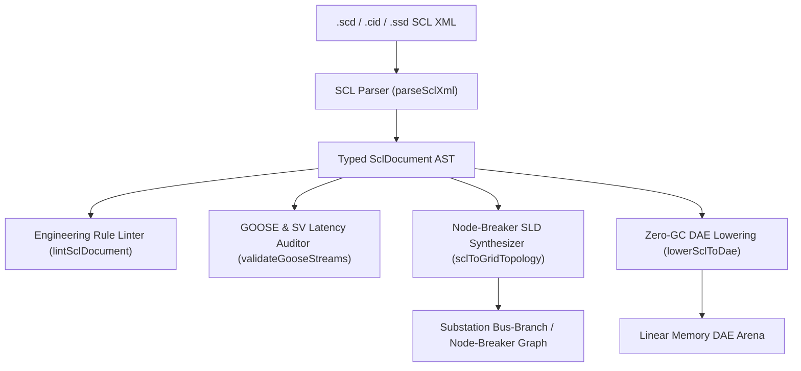

# IEC 61850 Substation Configuration Language (`.scd`, `.cid`, `.ssd`)

The `@modelscript/scl` package (`languages/scl`) provides native support for **IEC 61850 Substation Configuration Language (SCL)** files. IEC 61850 is the international gold standard for electrical substation automation, digital control architectures, protective relay communications, and smart grid interoperability.

ModelScript parses SCL XML files across Edition 1 and Edition 2 revisions (`.scd`, `.cid`, `.ssd`, `.sed`, `.icd`), audits real-time Ethernet GOOSE and Sampled Values (SV) publisher-subscriber communication latency against IEC 61850-5 Type 1A fast-trip performance classes ($\le 4\text{ ms}$), synthesizes node-breaker Single-Line Diagram (SLD) grid topologies, and lowers automation logic to WebAssembly DAE arenas.

---

## Supported SCL XML Schema Elements

| SCL Section             | Schema Tag            | Description                                                                                                                                       |
| :---------------------- | :-------------------- | :------------------------------------------------------------------------------------------------------------------------------------------------ |
| **Header**              | `<Header>`            | Substation configuration ID, version, revision, tooling vendor metadata.                                                                          |
| **Substation**          | `<Substation>`        | Primary physical equipment: `<VoltageLevel>`, `<Bay>`, `<ConductingEquipment>` (circuit breakers `CBR`, disconnectors `DIS`, transformers `PTR`). |
| **Communication**       | `<Communication>`     | Subnetwork addressing: `<SubNetwork>`, `<ConnectedAP>`, GSE (GOOSE), and SMV (Sampled Values) multicast MAC/IP and APPID allocations.             |
| **IED**                 | `<IED>`               | Intelligent Electronic Device definitions: Access points, Logical Devices (`LDevice`), Logical Nodes (`LN0`, `XCBR`, `CSWI`, `PTOC`, `PDIS`).     |
| **Data Type Templates** | `<DataTypeTemplates>` | Standard and custom LNodeType, DOType, DAType, and EnumType structures.                                                                           |

---

## Architecture & Compilation Pipeline



---

## Pre-Flight Diagnostics (`SCL1001`–`SCL4001`)

The `@modelscript/scl` linter verifies schema compliance and automation engineering rules:

| Code      |  Severity   | Description                                                              |
| :-------- | :---------: | :----------------------------------------------------------------------- |
| `SCL1001` |  **Error**  | XML syntax error or missing mandatory `<Header>` element.                |
| `SCL2001` |  **Error**  | Duplicate IED name, VoltageLevel, or Bay identifier in substation scope. |
| `SCL3001` |  **Error**  | GSEControl or SampledValueControl references non-existent Dataset.       |
| `SCL3002` | **Warning** | GOOSE trip signal exceeds Type 1A 4ms latency boundary requirement.      |
| `SCL4001` | **Warning** | Conducting equipment terminal references unknown ConnectivityNode.       |

---

## Command-Line Interface (`msx scl`)

```bash
# Print substation voltage levels, bays, configured IEDs, and subnetworks
msx scl summary substation.scd

# Audit GOOSE communication streams and check Type 1A trip latency compliance
msx scl validate-goose substation.scd

# Lint SCL engineering rules and data binding references
msx scl lint substation.scd

# Export synthesized node-breaker Single-Line Diagram topology to JSON
msx scl to-sld substation.scd -o topology.json

# Lower substation logical node interlocks to WebAssembly DAE arena
msx scl to-dae substation.scd
```

---

## MCP Agent Tool Integration

- **`scl_validate_goose`**: Inspects GOOSE publisher/subscriber bindings, validates dataset FCDA references against ExtRef subscribers, and reports Type 1A/1B communication health directly to AI agents.
