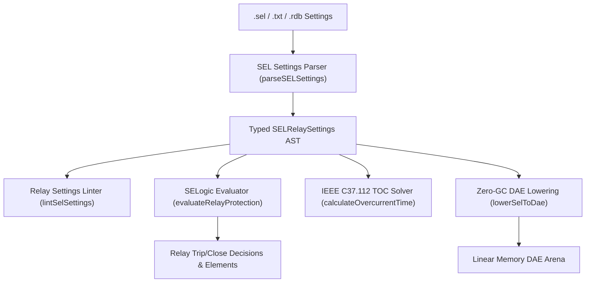

# SEL Relay Protection Settings (`.rdb`, `.rcf`, `.sel`, `.txt`)

The `@modelscript/sel` package (`languages/sel`) provides native support for **Schweitzer Engineering Laboratories (SEL)** protective relay settings across the SEL-300, SEL-400, SEL-700, and modern Axion series (`.rdb`, `.rcf`, `.sel`, `.txt`). SEL relays are the dominant numerical protection platform across North American and global utility substations, generation plants, and industrial switchgear.

ModelScript parses SEL ASCII and JSON settings decks, compiles **SELogic boolean control equations** (including nested parentheses, AND/OR/NOT operators, and recursive cross-variable dependencies), solves **IEEE Standard C37.112** inverse-time overcurrent curves (U1–U5, C1–C5), and lowers protection state machines into zero-GC WebAssembly DAE linear arenas.

---

## Supported Protection Elements & SELogic

| Protection Element                      | Setting Tags              | Description                                                                                 |
| :-------------------------------------- | :------------------------ | :------------------------------------------------------------------------------------------ |
| **Instantaneous Overcurrent (50P/50G)** | `50P1P, 50P2P, 50G1P`     | High-speed instantaneous trip pickups for phase and ground faults.                          |
| **Time-Overcurrent (51P/51G)**          | `51P1P, 51P1C, 51P1TD`    | Inverse-time curve family selection (U1–U5, C1–C5), pickup current, and time dial settings. |
| **Distance Protection (21P/21G)**       | `Z1P, Z2P, Z3P, Z1D, Z2D` | Phase and ground distance reaches in secondary ohms and timer delay cycles.                 |
| **Undervoltage / Overvoltage (27/59)**  | `27P, 59P`                | Bus undervoltage and line overvoltage threshold triggers.                                   |
| **Frequency Elements (81U/81O)**        | `81U, 81O`                | Underfrequency load shedding and overfrequency generation tripping thresholds.              |
| **SELogic Control Equations**           | `TRIP, CLOSE, SV1, SV2`   | Boolean logic expressions combining relay words (e.g. `TRIP = 50P1 OR 51P1T OR Z1P`).       |

---

## Architecture & Compilation Pipeline



---

## Pre-Flight Diagnostics (`SEL1001`–`SEL4001`)

The `@modelscript/sel` linter audits relay configuration consistency:

| Code      |  Severity   | Description                                                                       |
| :-------- | :---------: | :-------------------------------------------------------------------------------- |
| `SEL1001` |  **Error**  | Relay model identifier or active settings group is missing.                       |
| `SEL2001` |  **Error**  | SELogic expression syntax error (mismatched parentheses or invalid operator).     |
| `SEL3001` | **Warning** | Relay word referenced in SELogic equation is undefined.                           |
| `SEL4001` |  **Error**  | Instrument transformer ratio (CT or PT) is non-positive ($CTR \le 0, PTR \le 0$). |

---

## Command-Line Interface (`msx sel`)

```bash
# Print summary of relay model, active group, CT/PT ratios, and protection elements
msx sel summary sel421_line_protection.txt

# Run pre-flight lint diagnostics for SELogic syntax and transformer ratios
msx sel lint sel421_line_protection.txt

# Evaluate relay protection trip decisions given measured phase current
msx sel evaluate-protection sel421_line_protection.txt --current=1250.0

# Export settings to canonical SEL ASCII format
msx sel to-ascii sel421_line_protection.txt -o exported.sel

# Lower relay trip logic and TOC curves to WebAssembly DAE arena
msx sel to-dae sel421_line_protection.txt
```

---

## MCP Agent Tool Integration

- **`sel_evaluate_protection`**: Evaluates SEL relay 50P/51P/Z1P elements, calculates inverse-time overcurrent trip durations under IEEE C37.112 curves, and iteratively resolves SELogic boolean equations for agent-driven protection analysis.
