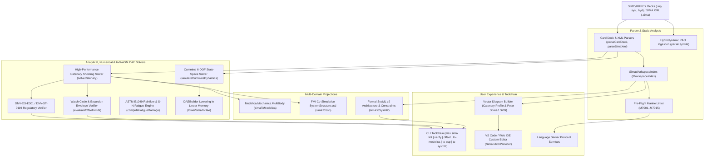

# SINTEF Ocean SIMO / RIFLEX Modeling (`.inp`, `.sima`, `.sys`, `.hyd`)

The `@modelscript/sima` package (`languages/sima`) provides native ingestion, analysis, verification, DAE simulation, and multi-domain projections for **SINTEF Ocean / MARINTEK SIMO** (Simulation of Marine Operations) and **RIFLEX** (Riser and Slender Marine Structural Dynamics) offshore engineering models and modern **SIMA** project archives.

---

## Supported File Specifications

| Extension           | Format                          | Key Structural Features                                                                                                               |
| :------------------ | :------------------------------ | :------------------------------------------------------------------------------------------------------------------------------------ |
| **`.inp` / `.sys`** | SIMO & RIFLEX Card Decks        | Classical keyword cards: `SYS`, `BODY`, `MASS`, `FAIRLEAD`, `LINE`, `SEGM`, `CRS`, `WAVE`, `WIND`, `CURR`, `DYNMOD`                   |
| **`.sima`**         | Modern SIMA XML Archive         | Hierarchical task manifests (`<simo:SimoTask>`, `<riflex:RiflexTask>`, `<sima:SlenderSystem>`, `<sima:Vessel>`, `<sima:MooringLine>`) |
| **`.hyd` / `.out`** | Hydrodynamic Transfer Functions | 1st-order Force RAO tables, frequency-dependent added mass $A(\omega)$, potential damping $B(\omega)$, and restoring matrices         |

---

## Architecture & Compilation Pipeline



---

## Pre-Flight Marine Linter Rules

<LintRules lang="sima" />

---

## Regulatory Verification & In-WASM Solvers

### 1. DNV-OS-E301 & DNV-ST-0119 Compliance

Evaluates line tension safety factors against Minimum Breaking Load (MBL):
$$S_F = \frac{T_{\text{MBL}}}{T_{\text{max}}} \ge 1.67 \quad (\text{Intact Condition})$$
$$S_F = \frac{T_{\text{MBL}}}{T_{\text{max}}} \ge 1.25 \quad (\text{Damaged / Single Line Broken})$$

### 2. Watch Circle & Touchdown Zone Verification

Computes vessel 6-DOF horizontal mean offset ellipse under coupled wind, wave drift, and current loads against allowable excursion limits (typically $\le 8\%$ water depth for intact, $\le 12\%$ for damaged). Checks fairlead declination angles ($\le 75^\circ$) and ensures anchor uplift angle is exactly $0^\circ$ for drag-embedment anchors.

### 3. ASTM E1049 Rainflow Fatigue & Palmgren-Miner Cumulative Damage

Extracts stress/tension reversal cycles using the ASTM E1049-85 four-point rainflow algorithm and computes cumulative fatigue damage using Palmgren-Miner's rule ($D = \text{DFF} \cdot \sum \frac{n_i}{N_i}$) against DNV-OS-E301 S-N curves for studless chain, stud link, spiral strand wire, and polyester ropes.

### 4. Cummins 6-DOF Dynamics with Rational State-Space Radiation

Replaces the integro-differential retardation convolution integral with an $O(p)$ rational linear state-space system ($\dot{z} = A_r z + B_r \dot{x}$, $\mu = C_r z + D_r \dot{x}$), converting the frequency-dependent memory terms into continuous 1st-order ODEs lowered directly into `@modelscript/runtime`'s `DAEBuilder` in linear WebAssembly memory.

---

## Headless CLI Operations (`msx sima`)

```bash
# Lint a SIMO / RIFLEX card deck or .sima XML archive
msx sima lint cases/OC4_Semi.inp

# Evaluate DNV-OS-E301 line tension safety factors against MBL
msx sima verify cases/OC4_Semi.inp --consequence-class=2

# Inspect floater watch circle, horizontal excursion, and touchdown clearances
msx sima offset cases/OC4_Semi.inp

# Inspect model summary (vessels, fairleads, lines, waves, wind)
msx sima summary cases/OC4_Semi.inp

# Synthesize acausal Modelica 6-DOF physical floater model
msx sima to-modelica cases/OC4_Semi.inp --out=OC4_Platform.mo

# Export multi-FMU SystemStructure.ssd co-simulation manifest
msx sima to-ssp cases/OC4_Semi.inp --out=SystemStructure.ssd

# Export formal SysML v2 architectural parts, ports, and DNV requirements
msx sima to-sysml2 cases/OC4_Semi.inp --out=OC4_Semi.sysml
```
