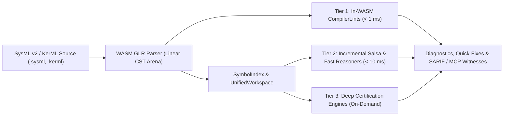

# SysML v2 Lints & Formal Verification

`@modelscript/sysml2` pairs native WebAssembly GLR parsing with a **3-tier static analysis and formal verification pipeline** spanning 76 diagnostic rules (`S1001`–`S7006`). Routine syntax, metamodel, type, dimensional, and fast mathematical checks run continuously as you type, while heavyweight safety certification engines run on demand from the CLI, Morsel Web IDE, VS Code, or Model Context Protocol (MCP) agents.

---

## 3-Tier Verification Architecture



| Tier                                                        | Execution Mode                            | Target Latency | Diagnostic Codes                           | Underlying Engines                                                                                                                                                                                                                    |
| :---------------------------------------------------------- | :---------------------------------------- | :------------- | :----------------------------------------- | :------------------------------------------------------------------------------------------------------------------------------------------------------------------------------------------------------------------------------------ |
| **Tier 1 — Native In-WASM `CompilerLint`s**                 | Live in LSP & on-demand                   | `< 1 ms`       | `S1003`–`S1005`, `S4014`, `S4016`, `S4020` | AssemblyScript rules compiled directly into `sysml2/dist/parser.wasm` scanning the zero-copy `CodeGraph` CST arena                                                                                                                    |
| **Tier 2 — Incremental Salsa SOTA & Fast Formal Reasoners** | Live in LSP & `msx lint`                  | `< 10 ms`      | `S2xxx`–`S5xxx`, `S6001`–`S6042`           | Memoized Salsa `QueryEngine`, `RealSimplexSolver`, `CraigInterpolator`, `DpllTSolver`, Petri-net CFA, Pantelides structural index check, 3D AABB clash detector, and TGG correspondence validator                                     |
| **Tier 3 — On-Demand Deep Certification Engines**           | `msx lint --formal`, Morsel, VS Code, MCP | `10–500 ms`    | `S7001`–`S7006`                            | `PdrEngine` (`IC3Engine`), `SafetyTheoryOracle` (ISO 26262 MOCUS/ASIL), `UqTheoryOracle` (analytical CDF), `ToleranceStackOracle` (GD&T), `RelationalVerifier` (2-safety/Lipschitz), `HybridFlowpipeSolver` & `SosBarrierSynthesizer` |

---

## Toolchain Usage

### 1. Command-Line Interface (`msx lint`)

Run Tier 1 + Tier 2 checks (including cross-language TGG correspondence when companion `.mo` files are included) with `msx lint`, and opt into Tier 3 certification engines (`S7001`–`S7006`) with `--formal`:

```bash
# Run Tier 1 + Tier 2 lints on a SysML v2 package or directory
msx lint ./architecture/FlightControl.sysml

# Run Tier 1 + Tier 2 + Tier 3 deep formal certification (S7001–S7006)
msx lint --formal ./architecture/FlightControl.sysml

# Validate cross-language @twin correspondence & parameter drift across SysML v2 + Modelica
msx lint ./architecture/PumpSpec.sysml ./physics/DriftedPump.mo

# Export machine-readable JSON or GitHub Code Scanning SARIF reports
msx lint --formal ./architecture --format sarif --out reports/sysml-formal.sarif
```

### 2. Morsel Web IDE

In the Morsel Web IDE toolbar for `.sysml` and `.kerml` models, use the split **Verify Formal** button and mode selector dropdown:

- **Live SOTA & Reasoner Lints (`S1xxx`–`S6xxx`):** Runs automatically on keystroke debounce via the browser WebWorker LSP.
- **Verify Formal (`S7001`–`S7006`):** Triggers `modelscript/runFormalLints` (`includeFormal: true`), streaming counterexample traces, Minimal Cut Sets, and flowpipe breach witnesses directly into the editor gutter and Problems drawer.
- **WASM Compiler Lints (`S1003`–`S1005`, `S4014`, `S4016`, `S4020`):** Runs arena-native `facade.getDiagnostics(rootPtr)` directly inside `parser.wasm`.

### 3. VS Code Extension (`@modelscript/ide-client`)

Open the Command Palette (`Ctrl+Shift+P` / `Cmd+Shift+P`) on any `.sysml`, `.sysml2`, or `.kerml` file:

- **`ModelScript: Run Formal Verification Lints (IC3/PDR, FTA, UQ, Flowpipe)`** (`modelscript.runFormalLints`) — Runs Tier 3 engines over the active editor, publishes results to the `modelscript-on-demand` diagnostic collection, and focuses the **Problems** panel when violations are detected.
- **`ModelScript: Run WASM Compiler Lints`** (`modelscript.runCompilerLints`) — Runs Tier 1 zero-copy WASM CST lints on the active document.

#### Interactive Quick-Fix `CodeAction`s (`Ctrl+.` / `Cmd+.`)

| Code    | Diagnostic Rule                 | Quick-Fix Action                                    | Edit Performed                                                                                 |
| :------ | :------------------------------ | :-------------------------------------------------- | :--------------------------------------------------------------------------------------------- |
| `S2010` | `top-level-import-not-private`  | **Make top-level import 'private'**                 | Inserts `private ` before top-level `import` (or replaces `public`/`protected` with `private`) |
| `S2011` | `inherited-member-shadowing`    | **Add ':>>' ('redefines') to shadowed member**      | Inserts `:>> ` before the shadowed feature identifier (e.g., `attribute :>> mass : Real;`)     |
| `S4021` | `send-to-port-without-via`      | **Replace 'to' with 'via' for port send**           | Rewrites `send Signal() to portOut;` to `send Signal() via portOut;`                           |
| `S6002` | `requirement-decomposition-gap` | **Insert synthesized Craig interpolant constraint** | Inserts synthesized `require constraint { ... }` before the requirement body's closing `}`     |

### 4. MCP Server (`sysml2_verify_formal`)

AI engineering agents connected to `@modelscript/mcp` can invoke `sysml2_verify_formal` to certify generated or workspace SysML v2 architectures in a sandboxed worker:

```json
{
  "name": "sysml2_verify_formal",
  "arguments": {
    "filePath": "architecture/BrakeSystem.sysml",
    "includeStandardLints": true,
    "maxStates": 128,
    "timeHorizon": 10.0
  }
}
```

The tool returns `{ passed, formalDiagnostics, standardDiagnostics, counts }`, where each entry in `formalDiagnostics` includes `code` (`"S7001"`–`"S7006"`), `rule`, `severity`, `engine` (`"IC3/PDR"`, `"SafetyTheoryOracle"`, `"UqTheoryOracle"`, `"ToleranceStackOracle"`, `"RelationalVerifier"`, or `"Flowpipe/SOS"`), `message`, and structured `witness` payloads.

---

## Polyglot Typing & Cross-Domain Correspondence

### Polyglot-Aware Usage/Definition Typing (`S3010`)

Rule `S3010` (`usage-definition-kind-mismatch`) enforces OMG SysML v2 metaclass conformance between usages and their declared definitions (for example, preventing a `part` usage from being typed by an `action def` or `requirement def`), while natively permitting **valid cross-language polyglot counterparts** resolved through `UnifiedWorkspace`:

- A SysML v2 `part` usage may be typed by a Modelica `model` or `block`, an OpenSCAD module, or a STEP `PRODUCT`.
- A SysML v2 `port` usage may be typed by a Modelica `connector`.
- A SysML v2 `attribute` usage may be typed by a Modelica `type` or `record`.

### Bidirectional TGG Conformance (`S4080`–`S4083`)

When a SysML v2 `part def` is linked to an implementation model via `@twin { target = "Modelica::ClassName"; }`, `SysML(implements = "...")`, or zero-annotation Triple Graph Grammar (TGG) name alignment, both the LSP server and `msx lint` validate structural correspondence across languages:

- **`S4080`** (`tgg-conformance-missing-port`): Counterpart model is missing a port declared on the SysML v2 definition.
- **`S4081`** (`tgg-conformance-param-mismatch`): Shared parameter or port has incompatible types across domains (e.g., `Boolean` vs `String`).
- **`S4082`** (`tgg-conformance-missing-component`): Counterpart model is missing an expected sub-component instance.
- **`S4083`** (`tgg-conformance-unresolved-target`): Explicit `@twin` or `implements` target could not be resolved in the target domain.

---

## Formal Verification Metadata Annotations

Tier 2 spatial checks and Tier 3 certification engines recognize lightweight SysML v2 prefix hashtags (`#Meta`) and `@Meta { ... }` annotations:

| Annotation                    | Target Construct                       | Rule    | Key Fields & Semantics                                                                                                                                     |
| :---------------------------- | :------------------------------------- | :------ | :--------------------------------------------------------------------------------------------------------------------------------------------------------- |
| `#unsafe` / `@Unsafe`         | `state` usage                          | `S7001` | Marks a forbidden safety hazard state tested for reachability via hierarchical IC3/PDR (`WasmRtcStateMachine` + `PdrEngine`).                              |
| `@FailureMode`                | `part` / `attribute` / `port`          | `S7002` | Declares a primary fault event (`fit`, `failureRate`, `diagnosticCoverage`, `safetyMechanism`) for Fault Tree synthesis.                                   |
| `@Hazard` / `@ASIL`           | `requirement` / `part` / `constraint`  | `S7002` | Specifies `asil` (`"ASIL_A"`–`"ASIL_D"`) and `targetPmhf` (FIT) to check Minimal Cut Sets (SPOFs) and ISO 26262 SPFM/PMHF budgets.                         |
| `@Normal` / `@Uniform`        | `attribute` usage                      | `S7003` | Attaches a Gaussian (`mean`, `stdDev`) or Uniform (`min`, `max`) uncertainty distribution, propagated linearly across derived attributes.                  |
| `@MaxFailureProbability`      | `requirement` / `constraint`           | `S7003` | Specifies maximum tail violation probability `alpha` (or inline `prob(x > L) <= alpha`) verified analytically via `UqTheoryOracle`.                        |
| `@Tolerance` / `@GDT`         | `attribute` / `part` usage             | `S7004` | Defines bilateral (`nominal`, `tolerance`) or asymmetric (`plus`, `minus`, `method = "worst_case" \| "rss" \| "six_sigma"`, `cpk`) dimensional tolerances. |
| `#NonInterference`            | `action def` / `calc def` / `part def` | `S7005` | Verifies 2-safety non-interference ensuring `#Untrusted` (`#Low`) inputs cannot influence `#HighIntegrity` (`#High`) outputs.                              |
| `@Lipschitz` / `@NoiseRobust` | `calc def` / `action def`              | `S7005` | Verifies bounded sensitivity gain (`maxGain`, `min`, `max`) or bounded output perturbation (`delta`, `epsilon`) across trace pairs.                        |
| `@SpatialBox`                 | `part` usage / `part def`              | `S6042` | Specifies 3D axis-aligned bounding boxes (`x`, `y`, `z`, `dx`, `dy`, `dz` or `minX..maxZ`) to detect sibling part clashes and parent envelope protrusions. |

```sysml
package BrakeCertificationExample {
  private import ScalarValues::*;

  state def BrakeSupervisor {
    entry; then nominal;
    state nominal;
    #unsafe state unintendedLockup;
    transition faultPath first nominal if brakePressure < 0.0 then unintendedLockup;
  }

  part def HydraulicActuator {
    attribute responseMs : Real = 18.0 {
      @Normal { mean = 18.0; stdDev = 1.5; }
    }
    attribute pistonClearance : Real = 0.25 {
      @Tolerance { nominal = 0.25; plus = 0.05; minus = 0.05; }
    }
  }

  requirement def BrakeLatencyChanceReq {
    @MaxFailureProbability { alpha = 0.001; }
    require constraint { responseMs <= 25.0 }
  }
}
```

---

## Complete Diagnostic Rule Catalog (`S1xxx`–`S7xxx`)

### `S1xxx` — Syntax, Parsing & Naming Conventions

| Code    | Rule                |     Tier      | Severity  | Description                                                                                                                  |
| :------ | :------------------ | :-----------: | :-------- | :--------------------------------------------------------------------------------------------------------------------------- |
| `S1001` | `parse-error`       |    Parser     | `error`   | Syntax error detected by the native WebAssembly GLR parser.                                                                  |
| `S1002` | `parse-missing`     |    Parser     | `error`   | Expected punctuation or keyword token missing.                                                                               |
| `S1003` | `definition-naming` | Tier 1 (WASM) | `warning` | Definition names (`part def`, `action def`, etc.) should start with an uppercase letter (`PascalCase`).                      |
| `S1004` | `usage-naming`      | Tier 1 (WASM) | `warning` | Usage names (`part`, `attribute`, `port`, etc., excluding enum variants) should start with a lowercase letter (`camelCase`). |
| `S1005` | `package-naming`    | Tier 1 (WASM) | `warning` | Package and library package names should start with an uppercase letter (`PascalCase`).                                      |

### `S2xxx` — Scoping, Visibility & Specialization Hygiene

| Code    | Rule                                    |  Tier  | Severity  | Description                                                                                                                        |
| :------ | :-------------------------------------- | :----: | :-------- | :--------------------------------------------------------------------------------------------------------------------------------- |
| `S2001` | `duplicate-member`                      | Tier 2 | `warning` | Duplicate member name declared within the same namespace or definition body.                                                       |
| `S2002` | `symbol-not-found`                      | Tier 2 | `error`   | Referenced feature, classifier, or symbol could not be resolved in lexical or inherited scope.                                     |
| `S2003` | `allocation-target-unresolved`          | Tier 2 | `error`   | Target element in an `allocate` usage could not be resolved.                                                                       |
| `S2004` | `allocation-source-unresolved`          | Tier 2 | `error`   | Source element in an `allocate` usage could not be resolved.                                                                       |
| `S2005` | `unresolved-import`                     | Tier 2 | `error`   | Imported package or member path could not be resolved in the workspace or bundled KerML/SysML stdlib.                              |
| `S2006` | `unresolved-transition-state`           | Tier 2 | `error`   | Source or target state in a `transition` could not be resolved in the enclosing state machine.                                     |
| `S2007` | `unresolved-redefinition-or-subsetting` | Tier 2 | `error`   | Target feature of `:>>` (`redefines`), `:>` (`subsets`), `::>` (`references`), `=>` (`crosses`), or `alias` could not be resolved. |
| `S2009` | `visibility-access-violation`           | Tier 2 | `error`   | Attempted access to a `private` or `protected` member outside its permitted ownership/specialization scope.                        |
| `S2010` | `top-level-import-not-private`          | Tier 2 | `warning` | Top-level `import` outside a package should be declared `private` to prevent namespace pollution (Quick-Fix available).            |
| `S2011` | `inherited-member-shadowing`            | Tier 2 | `warning` | Member shadows an inherited feature with the same name without explicit `:>>` (`redefines`) (Quick-Fix available).                 |
| `S2012` | `unused-import-or-private-member`       | Tier 2 | `info`    | Private member or import is never referenced within its scope.                                                                     |

### `S3xxx` — Type System, Dimensional Analysis & Conformance

| Code    | Rule                                 |  Tier  | Severity  | Description                                                                                                    |
| :------ | :----------------------------------- | :----: | :-------- | :------------------------------------------------------------------------------------------------------------- |
| `S3001` | `type-mismatch`                      | Tier 2 | `error`   | Assigned or bound expression type is incompatible with the feature's declared type.                            |
| `S3002` | `incompatible-port-connection`       | Tier 2 | `error`   | Connected ports have incompatible port definitions or item flow types.                                         |
| `S3003` | `dimensional-mismatch`               | Tier 2 | `error`   | Physical unit/quantity dimension mismatch in feature binding or expression (ISQ dimensional analysis).         |
| `S3004` | `invalid-multiplicity-bounds`        | Tier 2 | `error`   | Multiplicity lower bound exceeds upper bound (e.g., `[4..2]`).                                                 |
| `S3005` | `target-not-requirement`             | Tier 2 | `error`   | Target of a `satisfy` relationship is not a `requirement def` or `requirement` usage.                          |
| `S3006` | `verify-target-not-a-requirement`    | Tier 2 | `error`   | Target of a `verify` relationship is not a `requirement def` or `requirement` usage.                           |
| `S3007` | `dimensional-connection-mismatch`    | Tier 2 | `error`   | Connected features carry incompatible physical SI dimensions.                                                  |
| `S3008` | `port-conjugation-mismatch`          | Tier 2 | `error`   | Same-type ports are connected without conjugate (`~PortType`) pairing where required.                          |
| `S3009` | `binding-connector-type-mismatch`    | Tier 2 | `error`   | `bind` connector links features with incompatible types.                                                       |
| `S3010` | `usage-definition-kind-mismatch`     | Tier 2 | `error`   | Usage kind does not match its typing definition metaclass (polyglot-aware across Modelica, STEP, OpenSCAD).    |
| `S3011` | `disjoint-classifier-specialization` | Tier 2 | `error`   | Classifier specializes a metaclass-disjoint or `#disjoint` classifier.                                         |
| `S3012` | `redefinition-type-not-conforming`   | Tier 2 | `error`   | Redefined/subsetted feature type does not conform to (specialize) the base feature's type.                     |
| `S3013` | `subsetting-multiplicity-widening`   | Tier 2 | `warning` | Specializing feature widens multiplicity bounds beyond the base feature's `[lower..upper]`.                    |
| `S3014` | `redefinition-modifier-conformance`  | Tier 2 | `error`   | Specialization violates `constant`, `end`, direction (`in`/`out`/`inout`), or uniqueness conformance.          |
| `S3015` | `invocation-signature-mismatch`      | Tier 2 | `error`   | Calculation or action invocation has wrong argument arity, unknown named parameter, or argument type mismatch. |
| `S3016` | `trigger-expression-type-mismatch`   | Tier 2 | `error`   | Transition guard, `filter` condition, or `after` duration trigger has an invalid expression type.              |
| `S3017` | `multiplicity-bound-not-natural`     | Tier 2 | `error`   | Multiplicity bound does not evaluate to a non-negative integer (`Natural`) or `*`.                             |
| `S3018` | `invalid-cast-or-type-test`          | Tier 2 | `warning` | `as` cast or `istype`/`hastype` test involves mutually disjoint types.                                         |

### `S4xxx` — Metamodel Semantics, INCOSE Quality & TGG Correspondence

| Code    | Rule                                |    Tier    | Severity  | Description                                                                                                                    |
| :------ | :---------------------------------- | :--------: | :-------- | :----------------------------------------------------------------------------------------------------------------------------- |
| `S4001` | `circular-specialization`           |   Tier 2   | `error`   | Classifier or feature transitively specializes (`:>` / `:>>`) itself.                                                          |
| `S4002` | `circular-satisfaction`             |   Tier 2   | `error`   | Requirement transitively satisfies itself.                                                                                     |
| `S4003` | `empty-definition`                  |   Tier 2   | `info`    | Definition declares no owned members or inherited specializations.                                                             |
| `S4004` | `abstract-requirement-violation`    |   Tier 2   | `error`   | Concrete requirement cannot be specialized into an `abstract` requirement.                                                     |
| `S4005` | `ontological-inconsistency`         |   Tier 2   | `error`   | OWL 2 DL tableau reasoner detected an unsatisfiable concept or disjointness contradiction.                                     |
| `S4006` | `missing-subject`                   |   Tier 2   | `info`    | Requirement has neither a declared `subject` nor an incoming `satisfy` link.                                                   |
| `S4007` | `empty-package`                     |   Tier 2   | `info`    | Package contains no owned declarations or imports.                                                                             |
| `S4008` | `requirement-without-constraint`    |   Tier 2   | `info`    | Requirement has neither `assume`/`require` constraints nor `doc` text.                                                         |
| `S4009` | `empty-verification-case`           |   Tier 2   | `info`    | Verification case contains no `verify` objectives or test sub-actions.                                                         |
| `S4010` | `missing-verification-objective`    |   Tier 2   | `warning` | Verification case lacks an `objective` block or `verify` statement.                                                            |
| `S4011` | `unverified-requirement`            |   Tier 2   | `warning` | Requirement is not verified by any `verification` case in the package.                                                         |
| `S4012` | `calc-return-missing`               |   Tier 2   | `warning` | `calc` body defines statements without a `return` parameter or result expression.                                              |
| `S4013` | `expose-target-invalid`             |   Tier 2   | `error`   | `expose` clause inside a `view` targets an unresolvable namespace or element.                                                  |
| `S4014` | `variation-variant-misuse`          | Tier 1 & 2 | `error`   | `variant` declared outside a `variation`/`enum`, or a `variation` specializes another `variation`.                             |
| `S4015` | `abstract-or-composite-misuse`      |   Tier 2   | `error`   | Invalid composite part inside `attribute def`/`port def`, conflicting modifiers on `end`, or mutation of a `constant` feature. |
| `S4016` | `parallel-state-invalid-transition` | Tier 1 & 2 | `error`   | `parallel` state directly owns transitions or successions between its orthogonal regions.                                      |
| `S4017` | `unsatisfied-critical-requirement`  |   Tier 2   | `warning` | Safety-critical requirement has no incoming `satisfy` or `verify` relationship.                                                |
| `S4018` | `circular-port-delegation`          |   Tier 2   | `error`   | Port delegation connection chain forms a cycle.                                                                                |
| `S4019` | `incompatible-flow-dimensions`      |   Tier 2   | `error`   | `flow` connection links endpoints with incompatible physical dimensions.                                                       |
| `S4020` | `duplicate-singleton-member`        | Tier 1 & 2 | `error`   | More than one singleton `entry`, `do`, `exit`, `subject`, `objective`, or `return` member in the same body.                    |
| `S4021` | `send-to-port-without-via`          |   Tier 2   | `warning` | `send` action targets a port using `to <port>` instead of `via <port>` (Quick-Fix available).                                  |
| `S4022` | `interface-end-not-port`            |   Tier 2   | `error`   | `end` feature inside an `interface` definition or usage is not a port.                                                         |
| `S4023` | `binding-connector-not-binary`      |   Tier 2   | `error`   | `bind` connector does not connect exactly two features.                                                                        |
| `S4024` | `incose-requirement-quality`        |   Tier 2   | `info`    | Requirement `doc` text contains ambiguous terms (`TBD`, `TBC`, `approximately`, `as appropriate`, `etc.`) per INCOSE GtWR.     |
| `S4025` | `individual-or-portion-misuse`      |   Tier 2   | `error`   | Invalid `individual`, `snapshot`, or `timeslice` portion ownership or specialization.                                          |
| `S4026` | `metadata-annotation-invalid`       |   Tier 2   | `error`   | Metadata annotation references a non-metadata definition or supplies invalid attribute fields.                                 |
| `S4080` | `tgg-conformance-missing-port`      |   Tier 2   | `warning` | Cross-language `@twin` counterpart is missing an expected port.                                                                |
| `S4081` | `tgg-conformance-param-mismatch`    |   Tier 2   | `warning` | Cross-language `@twin` counterpart parameter or port has an incompatible type.                                                 |
| `S4082` | `tgg-conformance-missing-component` |   Tier 2   | `warning` | Cross-language `@twin` counterpart is missing an expected sub-component.                                                       |
| `S4083` | `tgg-conformance-unresolved-target` |   Tier 2   | `error`   | Explicit `@twin` or `implements` target could not be resolved in the target language workspace.                                |

### `S5xxx` — Behavior, Activities, State Machines & Standards Compliance

| Code    | Rule                                 |  Tier  | Severity  | Description                                                                                                                            |
| :------ | :----------------------------------- | :----: | :-------- | :------------------------------------------------------------------------------------------------------------------------------------- |
| `S5001` | `constraint-violated`                | Tier 2 | `error`   | `assert constraint` evaluates statically to `false`.                                                                                   |
| `S5002` | `requirement-failed`                 | Tier 2 | `error`   | Requirement `require constraint` evaluates to `false` under bound feature values.                                                      |
| `S5003` | `broken-interface-contract`          | Tier 2 | `error`   | Connected interface endpoints violate directional or protocol contract preconditions.                                                  |
| `S5004` | `activity-cfa-unreachable`           | Tier 2 | `warning` | Action node in succession control-flow graph is unreachable from initial flow.                                                         |
| `S5005` | `activity-soundness-violation`       | Tier 2 | `error`   | 1-safe Petri-net workflow soundness violation (deadlock at `join` after `decide`, or lack of synchronization at `merge` after `fork`). |
| `S5006` | `definite-assignment-violation`      | Tier 2 | `error`   | Feature or `out` parameter may be read before definite assignment along an action flow path.                                           |
| `S5007` | `statemachine-nondeterministic`      | Tier 2 | `error`   | Outgoing transitions on the same event have jointly satisfiable guards.                                                                |
| `S5008` | `statemachine-deadlock`              | Tier 2 | `error`   | Non-final state has an uncovered guard gap causing a trap/deadlock under valid inputs.                                                 |
| `S5009` | `satisfying-violated-requirement`    | Tier 2 | `error`   | Part declared to `satisfy` a requirement violates one or more of its `require` constraints.                                            |
| `S5010` | `conflicting-requirements`           | Tier 2 | `error`   | Multiple requirements satisfied by the same subject are mutually unsatisfiable (Simplex/SMT witness).                                  |
| `S5011` | `interprocedural-contract-violation` | Tier 2 | `error`   | Call site violates callee `action`/`calc` precondition contract.                                                                       |
| `S5012` | `loop-non-terminating`               | Tier 2 | `warning` | `while` or cyclic succession loop lacks a decreasing ranking variant or reachable exit guard.                                          |
| `S5013` | `decision-table-non-exhaustive`      | Tier 2 | `warning` | Guarded `decide` branches leave a portion of the input domain uncovered.                                                               |
| `S5014` | `decision-table-nondeterministic`    | Tier 2 | `error`   | Guarded `decide` branches have overlapping conditions.                                                                                 |
| `S5015` | `decision-table-dead-branch`         | Tier 2 | `warning` | Decision branch guard is subsumed or unsatisfiable.                                                                                    |
| `S5016` | `activity-safety-violation`          | Tier 2 | `error`   | Activity succession trace violates an asserted safety invariant.                                                                       |
| `S5017` | `dead-state-transition`              | Tier 2 | `warning` | State transition guard condition is tautologically `false`.                                                                            |
| `S5018` | `non-deterministic-transitions`      | Tier 2 | `warning` | State has overlapping, unprioritized outgoing transition guards.                                                                       |
| `S5019` | `state-transition-unreachable`       | Tier 2 | `warning` | State transition originates from an unreachable state.                                                                                 |
| `S5020` | `standard-compliance-violation`      | Tier 2 | `error`   | Subject violates a mandatory engineering standard requirement clause.                                                                  |
| `S5021` | `standard-compliance-warning`        | Tier 2 | `warning` | Subject triggers an advisory engineering standard requirement clause.                                                                  |
| `S5022` | `requirement-not-applicable`         | Tier 2 | `warning` | Requirement `assume` precondition evaluates to `false` for the bound subject.                                                          |
| `S5023` | `standard-table-lookup-missing`      | Tier 2 | `warning` | Standard table or empirical lookup calculator could not be evaluated for the given inputs.                                             |

### `S6xxx` — Live Fast Formal Reasoner Lints (`< 10 ms`)

| Code    | Rule                                   |  Tier  | Severity  | Description                                                                                                                                                       |
| :------ | :------------------------------------- | :----: | :-------- | :---------------------------------------------------------------------------------------------------------------------------------------------------------------- |
| `S6001` | `contract-refinement-violation`        | Tier 2 | `error`   | Behavioral Liskov substitution failure: specializing requirement/part strengthens `assume` preconditions or weakens `require` guarantees (`RealSimplexSolver`).   |
| `S6002` | `requirement-decomposition-gap`        | Tier 2 | `warning` | Child sub-requirements do not mathematically entail parent `require` constraint; synthesizes a Craig interpolant hint (`CraigInterpolator`, Quick-Fix available). |
| `S6003` | `vacuous-requirement-assumption`       | Tier 2 | `warning` | Requirement is vacuously satisfied because its `assume` constraints are contradictory (`RealSimplexSolver` / `DpllTSolver`).                                      |
| `S6004` | `opaque-interface-incompatibility`     | Tier 2 | `error`   | Connected ports have contradictory assume/guarantee interface contracts.                                                                                          |
| `S6011` | `zeno-chattering-transition-cycle`     | Tier 2 | `warning` | Zero-dwell 2-cycle between states with jointly satisfiable guards, no event/delay trigger, and no guard-variable mutation.                                        |
| `S6012` | `parallel-region-write-race`           | Tier 2 | `error`   | Orthogonal regions of a `parallel` state concurrently write to the same shared variable.                                                                          |
| `S6020` | `calc-domain-or-div-zero`              | Tier 2 | `error`   | Interval abstract interpretation detected division by zero, `sqrt` of negative domain, or `log` of non-positive domain in `calc`/`constraint`.                    |
| `S6021` | `sequence-index-out-of-bounds`         | Tier 2 | `error`   | 1-based KerML sequence index (`#(...)` or `[i]`) falls outside statically known multiplicity bounds `[1..N]`.                                                     |
| `S6022` | `physical-domain-impossibility`        | Tier 2 | `error`   | Physical quantity violates fundamental domain bounds (e.g., negative thermodynamic temperature `K < 0`, negative mass, efficiency outside `[0, 1]`).              |
| `S6030` | `over-or-under-constrained-part`       | Tier 2 | `warning` | Parametric equation/unknown count imbalance detected across scalar constraints on a `part def`.                                                                   |
| `S6031` | `high-index-parametric-constraint`     | Tier 2 | `warning` | Structural Pantelides check detected a high-index (`> 1`) differential-algebraic constraint system.                                                               |
| `S6032` | `flow-network-driver-conflict`         | Tier 2 | `error`   | Multiple conflicting `out` flow ports drive the same target `in` port without an arbitrating merge/bus.                                                           |
| `S6033` | `cyber-physical-nyquist-violation`     | Tier 2 | `warning` | Discrete controller sampling rate violates the Nyquist/control-bandwidth threshold relative to continuous plant dynamics.                                         |
| `S6041` | `multiplicity-budget-rollup-violation` | Tier 2 | `error`   | Sum of child part minimum multiplicities multiplied by per-unit attribute values exceeds the parent assembly budget limit.                                        |
| `S6042` | `spatial-envelope-clash-or-protrusion` | Tier 2 | `warning` | `@SpatialBox` 3D AABB interference between sibling parts or protrusion outside the parent assembly envelope.                                                      |

### `S7xxx` — On-Demand Deep Certification Lints (`--formal`)

| Code    | Rule                                       | Engine                 | Severity  | Description                                                                                                                                                                                                      |
| :------ | :----------------------------------------- | :--------------------- | :-------- | :--------------------------------------------------------------------------------------------------------------------------------------------------------------------------------------------------------------- |
| `S7001` | `hierarchical-pdr-unsafe-state`            | `IC3/PDR`              | `error`   | Hierarchical `WasmRtcStateMachine` + `PdrEngine` proved a `#unsafe` state is reachable and synthesized a counterexample trace.                                                                                   |
| `S7002` | `asil-single-point-of-failure`             | `SafetyTheoryOracle`   | `error`   | MOCUS Minimal Cut Set analysis detected an uncovered Single Point of Failure (SPOF) or ISO 26262 PMHF/SPFM budget violation on a `@Hazard` / `@ASIL` goal.                                                       |
| `S7003` | `probabilistic-requirement-violated`       | `UqTheoryOracle`       | `error`   | Analytical Normal/Uniform CDF tail probability exceeds `@MaxFailureProbability` (`alpha`) or inline `prob(...) <= alpha` chance constraint.                                                                      |
| `S7004` | `mechanical-tolerance-stack-interference`  | `ToleranceStackOracle` | `warning` | Worst-Case, RSS, or Six-Sigma GD&T `@Tolerance` stack-up violates assembly clearance bounds.                                                                                                                     |
| `S7005` | `relational-hyperproperty-violation`       | `RelationalVerifier`   | `error`   | 2-Safety `#NonInterference` information-flow leak, `@Lipschitz` gain bound breach, or `@NoiseRobust` deviation violation across execution pairs.                                                                 |
| `S7006` | `continuous-flowpipe-or-barrier-violation` | `Flowpipe/SOS`         | `error`   | Arena-lowered `der(...)` DAE singularity (`DaeIntervalEvaluator`), missing stabilizing quadratic SOS barrier (`SosBarrierSynthesizer`), or Taylor-model continuous reachability breach (`HybridFlowpipeSolver`). |

---

## Related Documentation

- [SysML v2 & KerML Language Guide](./sysml2)
- [Polyglot Compiler Linter Rules Reference](/reference/linter-rules#sysml2)
- [CHC & IC3 Verification Algorithms](/algorithms/verification-chc)
- [Triple Graph Grammars & Digital Thread](/architecture/tgg)

---

## Verification, Maturity & Benchmarks

<LanguageBenchmarks lang="sysml2-lints" />
