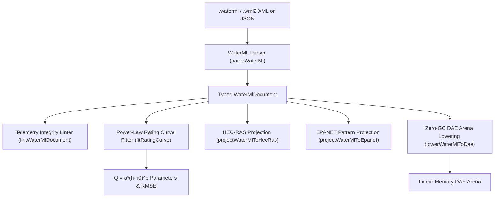

# OGC WaterML 2.0 Hydrologic Telemetry (`.waterml`, `.wml2`, `.xml`)

The `@modelscript/waterml` package (`languages/waterml`) provides native support for the **Open Geospatial Consortium (OGC) WaterML 2.0 / TimeseriesML (OGC 12-031r4 / WMO 1083)** international standard. WaterML 2.0 is the official standard for exchanging water observations, river gauging station telemetry, streamflow timeseries, and water quality observations across agencies such as the USGS (National Water Information System / NWIS), BOM Australia, and Environment Canada.

ModelScript ingests XML/JSON WaterML timeseries, validates sensor metadata and timestamp monotonicity (`WML1001`–`WML3001`), fits non-linear power-law stage-discharge rating curves ($Q = a(h - h_0)^b$), and projects streamflow observations directly into **HEC-RAS unsteady flow (`.u01`)** and **EPANET demand pattern (`[PATTERNS]`)** boundary decks.

---

## Supported WaterML 2.0 Structures

| Structure              | XML Schema Element        | Description                                                                                                                         |
| :--------------------- | :------------------------ | :---------------------------------------------------------------------------------------------------------------------------------- |
| **Observation Series** | `<MeasurementTimeseries>` | Monotonically timestamped hydrologic observations with measurement units, default interpolation, and monitoring point metadata.     |
| **Data Points**        | `<MeasurementTVP>`        | Time-Value Pairs (`<time>`, `<value>`) with observation quality codes and sensor metadata.                                          |
| **Monitoring Point**   | `<MonitoringPoint>`       | Station ID, geographic coordinates (latitude, longitude, elevation), river reach name, datum metadata.                              |
| **Observed Property**  | `<observedProperty>`      | Streamflow discharge (`m³/s` or `cfs`), stage / gauge height (`m` or `ft`), reservoir storage, water temperature, dissolved oxygen. |

---

## Architecture & Compilation Pipeline



---

## Pre-Flight Diagnostics (`WML1001`–`WML3001`)

The `@modelscript/waterml` linter verifies data quality and monotonicity:

| Code      |  Severity   | Description                                                                    |
| :-------- | :---------: | :----------------------------------------------------------------------------- |
| `WML1001` |  **Error**  | XML syntax error or missing mandatory `<MeasurementTimeseries>` container.     |
| `WML2001` |  **Error**  | Non-monotonic or duplicate observation timestamps detected.                    |
| `WML2002` | **Warning** | Missing physical measurement unit or observed property declaration.            |
| `WML3001` | **Warning** | Physical observation out of bounds (negative discharge or extreme stage jump). |

---

## Command-Line Interface (`msx waterml`)

```bash
# Print summary of timeseries, observation counts, monitoring stations, and units
msx waterml summary usgs_gauge_01646500.xml

# Lint timeseries for timestamp monotonicity and missing units
msx waterml lint usgs_gauge_01646500.xml

# Fit non-linear stage-discharge power-law rating curve Q = a*(h-h0)^b
msx waterml fit-rating usgs_gauge_01646500.xml

# Project streamflow observations to HEC-RAS unsteady flow hydrograph (.u01)
msx waterml to-hec-ras usgs_gauge_01646500.xml -o river_inflow.u01

# Project flow timeseries to EPANET diurnal demand pattern (.inp)
msx waterml to-epanet usgs_gauge_01646500.xml -o network_pattern.inp

# Lower telemetry timeseries into WebAssembly DAE arena
msx waterml to-dae usgs_gauge_01646500.xml
```

---

## MCP Agent Tool Integration

- **`waterml_fit_rating_curve`**: Solves non-linear power-law rating curves from observed hydrologic stage and discharge pairs, reporting equation coefficients ($a, b, h_0$), residual tracking, and RMSE convergence to AI agents.
