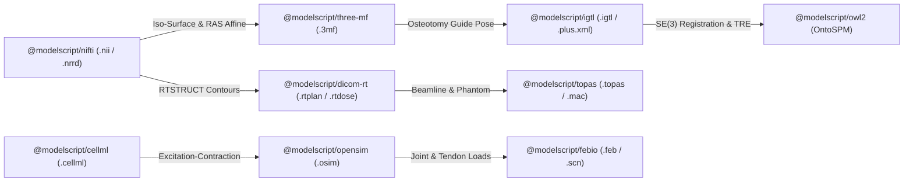

# Radiology, Radiation Oncology & Computer-Assisted Surgery Reference

ModelScript provides first-class polyglot compilation, static safety verification (`M9101`–`M9910`), numerical simulation, and cross-domain projections for **Radiology, Radiation Oncology, Biomechanics, and Computer-Assisted Surgery (CAS)**. All nine clinical engineering packages lower directly into the linear-memory `DAEBuilder` arena and interoperate with Modelica 3.x, SysML v2, OpenSCAD, ISO 10303-21 STEP, CalculiX- and Abaqus-compatible `.inp`, SBML, and ROS/Gazebo URDF.

---

## 1. Domain Package Matrix

| Package                         | Clinical Domain                                                         | File Extensions                                | Diagnostic Range | Primary Projections                                             |
| :------------------------------ | :---------------------------------------------------------------------- | :--------------------------------------------- | :--------------- | :-------------------------------------------------------------- |
| `@modelscript/opensim`          | Musculoskeletal Biomechanics & Surgical Rehabilitation                  | `.osim`                                        | `M9101`–`M9110`  | Modelica 3.x (`.mo`), ROS/Gazebo URDF (`.urdf`), DAE Arena      |
| `@modelscript/dicom-rt`         | Clinical Radiotherapy (RTSTRUCT, RTPLAN, RTDOSE)                        | `.rtplan`, `.rtstruct`, `.rtdose`, `.dicom-rt` | `M9201`–`M9210`  | OpenSCAD 3D CSG (`.scad`), SysML v2 (`.sysml`), DAE Arena       |
| `@modelscript/cellml`           | Physiological & Electrophysiology Modeling (CellML 1.0/1.1/2.0)         | `.cellml`                                      | `M9301`–`M9310`  | Modelica 3.x (`.mo`), SBML Level 3 (`.sbml`), DAE Arena         |
| `@modelscript/febio`            | Soft-Tissue Hyperelastic/Biphasic FEA & SOFA Surgical Scenes            | `.feb`, `.scn`                                 | `M9401`–`M9410`  | CalculiX- / Abaqus-Compatible (`.inp`), Modelica 3.x, DAE Arena |
| `@modelscript/nifti`            | Volumetric Medical Imaging & Segmentation (NIfTI-1/2 & NRRD)            | `.nii`, `.nrrd`, `.nhdr`                       | `M9501`–`M9510`  | OpenSCAD (`.scad`), ISO 10303-21 STEP (`.stp`), DAE Arena       |
| `@modelscript/topas`            | Monte Carlo Proton/Hadrontherapy & Radiotherapy Physics                 | `.topas`, `.mac`                               | `M9601`–`M9610`  | OpenSCAD (`.scad`), Modelica 3.x (`.mo`), DAE Arena             |
| `@modelscript/three-mf`         | Patient-Specific Surgical Guides & 3D-Printed Implants (ISO/ASTM 52915) | `.3mf`                                         | `M9701`–`M9710`  | ISO 10303-21 STEP (`.stp`), OpenSCAD (`.scad`), DAE Arena       |
| `@modelscript/igtl`             | OpenIGTLink & PLUS Toolkit Surgical Navigation & Tracking               | `.igtl`, `.plus.xml`                           | `M9801`–`M9810`  | ROS URDF (`.urdf`), Modelica 3.x (`.mo`), DAE Arena             |
| `@modelscript/owl2` (`ontospm`) | OntoSPM / LapOntoSPM Surgical Process & Safety Ontology                 | `.ofn`, `.owl`, `.ontospm`                     | `M9901`–`M9910`  | SysML v2 (`.sysml`), OWL 2 Functional Syntax (`.ofn`)           |



---

## 2. `@modelscript/opensim` — Musculoskeletal Biomechanics (`.osim`)

Parses OpenSim 3.x and 4.x XML (`<OpenSimDocument>`, `<Model>`, `<BodySet>`, `<JointSet>`, `<ForceSet>`, `<MarkerSet>`, `<WrapObjectSet>`, `<ConstraintSet>`), simulates Hill-type muscle-tendon equilibrium and multibody joint dynamics, and projects to Modelica 3.x and URDF.

### Mathematical Foundations

1. **Neural Excitation-Contraction Activation Dynamics (Thelen 2003 / Millard 2012)**:
   $$\frac{da}{dt} = \frac{u - a}{\tau(a, u)}, \quad \tau(a, u) = \begin{cases} \tau_{\text{act}} (0.5 + 1.5 a) & u > a \\ \dfrac{\tau_{\text{deact}}}{0.5 + 1.5 a} & u \le a \end{cases}$$

2. **Active & Passive Force-Length and Force-Velocity Equilibrium**:
   $$f_L(\tilde{l}^M) = \exp\!\left(-\frac{(\tilde{l}^M - 1)^2}{\gamma}\right), \quad f_{PE}(\tilde{l}^M) = \frac{\exp(k_{PE}(\tilde{l}^M - 1)/\epsilon_0^M) - 1}{\exp(k_{PE}) - 1}$$
   $$F^T = F_0^M \left(a \, f_L(\tilde{l}^M) \, f_V(\tilde{v}^M) + f_{PE}(\tilde{l}^M)\right) \cos\alpha$$

### Diagnostic Rules (`M9101`–`M9110`)

| Code    | Rule ID                                   | Severity  | Description                                                                                                            |
| :------ | :---------------------------------------- | :-------- | :--------------------------------------------------------------------------------------------------------------------- |
| `M9101` | `opensim-unresolved-body-frame`           | `error`   | Joint, marker, wrap object, or muscle path point references an undefined body frame.                                   |
| `M9102` | `opensim-non-positive-body-mass`          | `error`   | Body specifies $\text{mass} \le 0$ or non-positive principal moments of inertia ($I_{xx}, I_{yy}, I_{zz} \le 0$).      |
| `M9103` | `opensim-kinematic-tree-cycle`            | `error`   | Kinematic joint graph contains a directed cycle or multiple parent joints without a `<ConstraintSet>` loop constraint. |
| `M9104` | `opensim-invalid-coordinate-range`        | `error`   | Coordinate `rangeMin >= rangeMax` or `defaultValue` lies outside `[rangeMin, rangeMax]`.                               |
| `M9105` | `opensim-invalid-muscle-parameters`       | `error`   | Muscle `maxIsometricForce <= 0`, `optimalFiberLength <= 0`, or `tendonSlackLength <= 0`.                               |
| `M9106` | `opensim-excessive-pennation-angle`       | `error`   | Muscle `pennationAngleAtOptimal` is outside $[0, \pi/2)$ radians.                                                      |
| `M9107` | `opensim-insufficient-muscle-path-points` | `error`   | Muscle has fewer than 2 path points or all path points attach to the exact same body frame.                            |
| `M9108` | `opensim-unresolved-wrap-object`          | `error`   | Muscle `<PathWrap>` references an undefined `<WrapObject>` identifier.                                                 |
| `M9109` | `opensim-invalid-time-constants`          | `warning` | Muscle $\tau_{\text{act}} \le 0$, $\tau_{\text{deact}} \le 0$, or $\tau_{\text{act}} > \tau_{\text{deact}}$.           |
| `M9110` | `opensim-duplicate-component-name`        | `error`   | Duplicate body, joint, coordinate, or muscle name declared in the model.                                               |

---

## 3. `@modelscript/dicom-rt` — Clinical Radiotherapy (`.rtplan`, `.rtstruct`, `.rtdose`)

Models DICOM-RT treatment plans, anatomical ROI contour stacks, linac Multi-Leaf Collimator (MLC) control points, and cumulative Dose-Volume Histograms (DVHs).

### Mathematical Foundations

1. **Linear-Quadratic (LQ) Biologically Effective Dose (BED) & EQD2**:
   $$\text{BED} = n d \left(1 + \frac{d}{\alpha/\beta}\right), \quad \text{EQD2} = \frac{\text{BED}}{1 + \dfrac{2}{\alpha/\beta}}$$
   where $n$ is the number of fractions, $d = D / n$ is the dose per fraction in Gy, and $\alpha/\beta$ is the tissue fractionation sensitivity ($\alpha/\beta = 10\text{ Gy}$ for tumors, $\alpha/\beta = 3\text{ Gy}$ for late-responding normal tissues).

2. **ICRU Report 83 Homogeneity Index (HI) & Paddick Conformity Index (CI)**:
   $$\text{HI} = \frac{D_{2\%} - D_{98\%}}{D_{50\%}}, \quad \text{CI}_{\text{RTOG}} = \frac{V_{\text{PIV}}}{V_{\text{PTV}}}, \quad \text{CI}_{\text{Paddick}} = \frac{(V_{\text{PTV}} \cap V_{\text{PIV}})^2}{V_{\text{PTV}} \cdot V_{\text{PIV}}}$$

### Diagnostic Rules (`M9201`–`M9210`)

| Code    | Rule ID                                  | Severity  | Description                                                                                                                                                |
| :------ | :--------------------------------------- | :-------- | :--------------------------------------------------------------------------------------------------------------------------------------------------------- |
| `M9201` | `dicom-rt-missing-target-volume`         | `error`   | Plan contains no clinical target volume ROI (`PTV`, `CTV`, or `GTV`).                                                                                      |
| `M9202` | `dicom-rt-mlc-leaf-overlap`              | `error`   | Opposite MLC leaf pair violates minimum physical gap ($\text{bankB} - \text{bankA} < 0.5\text{ mm}$).                                                      |
| `M9203` | `dicom-rt-mlc-speed-exceeded`            | `error`   | MLC leaf speed between consecutive control points exceeds physical motor limit ($25.0\text{ mm/s}$).                                                       |
| `M9204` | `dicom-rt-gantry-couch-collision`        | `error`   | Non-coplanar couch angle ($\lvert \theta_{\text{couch}} \rvert > 15^\circ$) combined with lateral/posterior gantry angle enters the collision hazard zone. |
| `M9205` | `dicom-rt-oar-dose-constraint-violated`  | `error`   | Organ-at-Risk (`ORGAN`) DVH exceeds clinical QUANTEC `maxDoseLimitGy` or `meanDoseLimitGy`.                                                                |
| `M9206` | `dicom-rt-non-monotonic-cum-meterset`    | `error`   | Control point `cumulativeMetersetWeight` sequence is not monotonically non-decreasing from `0.0` to `1.0`.                                                 |
| `M9207` | `dicom-rt-unclosed-roi-contour`          | `error`   | `CLOSED_PLANAR` contour slice contains fewer than 3 vertices.                                                                                              |
| `M9208` | `dicom-rt-unresolved-frame-of-reference` | `error`   | `RTSTRUCT` or `RTDOSE` `FrameOfReferenceUID` does not match the `RTPLAN` `FrameOfReferenceUID`.                                                            |
| `M9209` | `dicom-rt-invalid-beam-meterset`         | `error`   | `TREATMENT` beam specifies `metersetMu <= 0` or `energyMeV <= 0`.                                                                                          |
| `M9210` | `dicom-rt-ptv-underdosage`               | `warning` | Target PTV $D_{95\%}$ is less than $95\%$ of `prescribedDoseGy`.                                                                                           |

---

## 4. `@modelscript/cellml` — Cellular Electrophysiology & Systems Physiology (`.cellml`)

Supports CellML 1.0, 1.1, and 2.0 component networks, 7-dimensional SI unit verification, Content MathML 2.0 ODEs (`Hodgkin-Huxley`, `Noble`, `Ten Tusscher` cardiac electrophysiology, microvascular hemodynamics), and projections to Modelica 3.x and SBML Level 3.

### Mathematical Foundations

$$\mathbf{d}(u) = \begin{bmatrix} d_{\text{A}} & d_{\text{K}} & d_{\text{kg}} & d_{\text{m}} & d_{\text{mol}} & d_{\text{s}} & d_{\text{cd}} \end{bmatrix}^T \in \mathbb{R}^7, \quad C_m \frac{dV_m}{dt} = -\sum_{k} g_k m_k^{p_k} h_k^{q_k} (V_m - E_k) + I_{\text{stim}}(t)$$

### Diagnostic Rules (`M9301`–`M9310`)

| Code    | Rule ID                                  | Severity  | Description                                                                                             |
| :------ | :--------------------------------------- | :-------- | :------------------------------------------------------------------------------------------------------ |
| `M9301` | `cellml-missing-model-name`              | `error`   | `<model>` element is missing a non-empty `name` attribute.                                              |
| `M9302` | `cellml-unresolved-units`                | `error`   | Variable or `<unit>` references an undeclared or non-standard CellML unit name.                         |
| `M9303` | `cellml-interface-direction-conflict`    | `error`   | `<map_variables>` connects variables with incompatible interface directions (e.g. both `in` or `none`). |
| `M9304` | `cellml-unit-dimensional-mismatch`       | `warning` | Mapped variables in `<map_variables>` have incompatible 7-element SI base unit dimension vectors.       |
| `M9305` | `cellml-uninitialized-state-variable`    | `warning` | Differential state variable ($\text{ODE}$) lacks an `initial_value` attribute.                          |
| `M9306` | `cellml-encapsulation-hierarchy-cycle`   | `error`   | Circular component reference detected in `<encapsulation>` hierarchy.                                   |
| `M9307` | `cellml-unresolved-connection-member`    | `error`   | `<connection>` references an undeclared component or variable name.                                     |
| `M9308` | `cellml-overconstrained-variable`        | `error`   | Variable with an `in` interface or prior assignment is assigned by an equation or ODE.                  |
| `M9309` | `cellml-undefined-math-ci`               | `error`   | Content MathML `<ci>` references an identifier not declared in the enclosing `<component>`.             |
| `M9310` | `cellml-duplicate-variable-or-component` | `error`   | Duplicate `<component>` or `<variable>` name declared within the same scope.                            |

---

## 5. `@modelscript/febio` — Soft-Tissue Biomechanics & SOFA Surgical Simulation (`.feb`, `.scn`)

Parses FEBio 2.5–4.0 (`.feb`) continuum biomechanics models and SOFA Framework (`.scn`) real-time surgical simulation scene graphs. Evaluates Neo-Hookean, Mooney-Rivlin, Ogden, and Holzapfel-Gasser-Ogden (HGO) anisotropic arterial wall strain energy functions, plus biphasic poroelasticity.

### Mathematical Foundations

$$\Psi_{\text{MR}}(\bar{I}_1, \bar{I}_2, J) = c_1 (\bar{I}_1 - 3) + c_2 (\bar{I}_2 - 3) + \frac{K}{2} (\ln J)^2, \quad \mathbf{q} = -\mathbf{k} \nabla p$$

### Diagnostic Rules (`M9401`–`M9410`)

| Code    | Rule ID                                | Severity  | Description                                                                                                            |
| :------ | :------------------------------------- | :-------- | :--------------------------------------------------------------------------------------------------------------------- |
| `M9401` | `febio-invalid-material-constant`      | `error`   | Non-physical material constant ($E \le 0$, $\nu \notin (-1, 0.5)$, $\rho \le 0$, or $c_1 + c_2 \le 0$).                |
| `M9402` | `febio-inverted-element-jacobian`      | `error`   | Tetrahedral (`tet4`) or hexahedral (`hex8`) element has non-positive Jacobian determinant ($\det(\mathbf{J}) \le 0$).  |
| `M9403` | `febio-unresolved-node-or-set`         | `error`   | Element connectivity, boundary condition, or load references an undefined node ID, `<NodeSet>`, or `<Surface>`.        |
| `M9404` | `febio-unconstrained-rigid-body`       | `warning` | Model defines no fixed or prescribed displacement boundary conditions to constrain rigid-body motion.                  |
| `M9405` | `febio-invalid-biphasic-permeability`  | `error`   | Biphasic/poroelastic tissue material specifies permeability $k \le 0$ or solid volume fraction $\phi^s \notin (0, 1)$. |
| `M9406` | `febio-invalid-time-stepper`           | `error`   | `<Control>` specifies `time_steps <= 0` or `step_size <= 0`.                                                           |
| `M9407` | `febio-unresolved-material-id`         | `error`   | `<SolidDomain>` or element block references an undeclared material ID.                                                 |
| `M9408` | `febio-contact-penalty-invalid`        | `error`   | Contact interface specifies a non-positive penalty factor or empty primary/secondary surface.                          |
| `M9409` | `febio-sofa-missing-mechanical-object` | `error`   | SOFA `<Node>` contains a force field without a `<MechanicalObject>` state container.                                   |
| `M9410` | `febio-duplicate-entity-id`            | `error`   | Duplicate node, element, or material identifier.                                                                       |

---

## 6. `@modelscript/nifti` — Volumetric Medical Imaging (`.nii`, `.nrrd`, `.nhdr`)

Parses NIfTI-1/NIfTI-2 headers and NRRD volumetric descriptors, validates `qform` quaternion and `sform` $4 \times 4$ RAS affine transformations, extracts segmented anatomical iso-surfaces, and projects to OpenSCAD and ISO 10303-21 STEP.

### Mathematical Foundations

$$\begin{bmatrix} x_{\text{RAS}} \\ y_{\text{RAS}} \\ z_{\text{RAS}} \\ 1 \end{bmatrix} = \begin{bmatrix} \mathbf{R}(\mathbf{q}) \, \text{diag}(\Delta x, \Delta y, q_{\text{fac}} \Delta z) & \mathbf{q}_{\text{offset}} \\ \mathbf{0}^T & 1 \end{bmatrix} \begin{bmatrix} i \\ j \\ k \\ 1 \end{bmatrix}, \quad a = \sqrt{\max(0, 1 - (b^2 + c^2 + d^2))}$$

### Diagnostic Rules (`M9501`–`M9510`)

| Code    | Rule ID                                 | Severity  | Description                                                                                                                                                 |
| :------ | :-------------------------------------- | :-------- | :---------------------------------------------------------------------------------------------------------------------------------------------------------- |
| `M9501` | `nifti-invalid-dimensions`              | `error`   | Volume dimension `dim[0]` is outside `[1, 7]` or spatial dimensions $n_x, n_y, n_z \le 0$.                                                                  |
| `M9502` | `nifti-non-positive-voxel-spacing`      | `error`   | Voxel spacing `pixdim[1..3]` or NRRD `space directions` norm is $\le 0\text{ mm}$.                                                                          |
| `M9503` | `nifti-singular-affine-transform`       | `error`   | $4 \times 4$ `sform` affine transformation matrix is singular ($\lvert \det(\mathbf{A}) \rvert < 10^{-9}$).                                                 |
| `M9504` | `nifti-invalid-quaternion-norm`         | `error`   | Quaternion parameters satisfy $b^2 + c^2 + d^2 > 1.0$.                                                                                                      |
| `M9505` | `nifti-qform-sform-handedness-mismatch` | `error`   | Active `qform` and `sform` transforms have opposite coordinate handedness ($\text{sign}(q_{\text{fac}}) \ne \text{sign}(\det(\mathbf{A}_{\text{sform}}))$). |
| `M9506` | `nifti-zero-intensity-scale-slope`      | `error`   | `scl_slope` is explicitly `0` while intensity scaling is active.                                                                                            |
| `M9507` | `nifti-unsupported-datatype`            | `error`   | Unrecognized or unsupported NIfTI/NRRD voxel datatype code.                                                                                                 |
| `M9508` | `nifti-voxel-data-size-mismatch`        | `error`   | Voxel payload count does not match $n_x \times n_y \times n_z \times n_t$.                                                                                  |
| `M9509` | `nifti-empty-segmentation-mask`         | `warning` | Segmentation labelmap contains zero foreground voxels across all anatomical labels.                                                                         |
| `M9510` | `nifti-anisotropic-slice-gap-warning`   | `warning` | Slice thickness $\Delta z$ exceeds in-plane resolution $\min(\Delta x, \Delta y)$ by more than $5\times$.                                                   |

---

## 7. `@modelscript/topas` — Monte Carlo Proton & Hadrontherapy (`.topas`, `.mac`)

Parses TOPAS (`Ge/`, `So/`, `Sc/`, `Ph/`, `Ma/`, `Tf/`) parameter files and GATE (`.mac`) macros, verifies hierarchical CSG beamline geometry containment, and computes analytical Bortfeld (1997) proton/carbon-ion Bragg peak depth-dose profiles.

### Mathematical Foundations

$$R_0 = \alpha E_0^p \quad (\alpha \approx 0.0022\text{ cm}\cdot\text{MeV}^{-p},\; p \approx 1.77), \quad -\frac{dE}{dz} \propto \frac{z^2}{\beta^2} \left[\ln\!\left(\frac{2 m_e c^2 \beta^2}{I (1 - \beta^2)}\right) - \beta^2\right]$$

### Diagnostic Rules (`M9601`–`M9610`)

| Code    | Rule ID                                 | Severity  | Description                                                                                                  |
| :------ | :-------------------------------------- | :-------- | :----------------------------------------------------------------------------------------------------------- |
| `M9601` | `topas-type-prefix-mismatch`            | `error`   | Parameter value does not match its declared TOPAS type prefix (`d:`, `i:`, `b:`, `s:`, `dv:`, `iv:`, `sv:`). |
| `M9602` | `topas-unresolved-parent-component`     | `error`   | Geometry component `Parent` references an undeclared parent volume.                                          |
| `M9603` | `topas-non-positive-geometry-dimension` | `error`   | Box/Cylinder/Sphere dimension (`HLX`, `HLY`, `HLZ`, `RMax`, `HL`) is $\le 0$, or `RMin >= RMax`.             |
| `M9604` | `topas-child-exceeds-parent-bounds`     | `error`   | Child geometry translation plus half-lengths protrude outside the parent volume bounding box.                |
| `M9605` | `topas-undefined-material`              | `error`   | Component `Material` references an unknown material not in Geant4/NIST or custom `Ma/<Name>` definitions.    |
| `M9606` | `topas-invalid-beam-energy`             | `error`   | Particle source `BeamEnergy <= 0` MeV or negative energy spread.                                             |
| `M9607` | `topas-circular-include-file`           | `error`   | Circular or self-referential `includeFile` chain detected.                                                   |
| `M9608` | `topas-scorer-missing-component`        | `error`   | Scorer `Sc/<Name>/Component` or `Quantity` is missing or references an undeclared geometry volume.           |
| `M9609` | `topas-vector-length-mismatch`          | `error`   | Vector parameter (`dv:`, `iv:`, `sv:`) element count does not match its declared length token.               |
| `M9610` | `topas-duplicate-parameter-assignment`  | `warning` | Identical parameter path is assigned multiple times in the same file without an override qualifier.          |

---

## 8. `@modelscript/three-mf` — Patient-Specific 3D-Printed Surgical Guides & Implants (`.3mf`)

Parses ISO/ASTM 52915 3MF models (`<model>`, `<resources>`, `<mesh>`, `<vertices>`, `<triangles>`, `<build>`, and `<surgical_guide>` osteotomy/drill sleeve annotations), verifies 2-manifold watertightness and signed volume, and projects to ISO 10303-21 STEP and OpenSCAD.

### Mathematical Foundations

$$\chi = V - E + F = 2 - 2g, \quad V_{\text{signed}} = \frac{1}{6} \sum_{k=1}^{F} \mathbf{v}_{k,1} \cdot (\mathbf{v}_{k,2} \times \mathbf{v}_{k,3}) > 0$$

### Diagnostic Rules (`M9701`–`M9710`)

| Code    | Rule ID                                   | Severity | Description                                                                                                                                      |
| :------ | :---------------------------------------- | :------- | :----------------------------------------------------------------------------------------------------------------------------------------------- |
| `M9701` | `three-mf-non-manifold-edge`              | `error`  | Mesh is not a closed 2-manifold (contains open boundary edges or edges shared by $\ne 2$ triangles).                                             |
| `M9702` | `three-mf-degenerate-triangle`            | `error`  | Triangle has duplicate vertex indices or zero surface area ($\|\mathbf{e}_1 \times \mathbf{e}_2\| < 10^{-12}$).                                  |
| `M9703` | `three-mf-negative-mesh-volume`           | `error`  | Mesh has inverted outward face normals resulting in non-positive signed volume ($V \le 0$).                                                      |
| `M9704` | `three-mf-unresolved-build-object`        | `error`  | `<build><item objectid="..."/>` references an undefined `<object>` ID.                                                                           |
| `M9705` | `three-mf-wall-thickness-violation`       | `error`  | Surgical guide or cannula wall thickness is below the $0.8\text{ mm}$ additive manufacturing safety threshold.                                   |
| `M9706` | `three-mf-invalid-osteotomy-guide-axis`   | `error`  | Osteotomy cutting plane normal or drill sleeve axis vector has zero length.                                                                      |
| `M9707` | `three-mf-missing-biocompatible-material` | `error`  | Medical implant or surgical guide lacks an approved ISO 10993 / USP Class VI biocompatible material (`Ti-6Al-4V`, `PEEK`, `BioMed Amber`, etc.). |
| `M9708` | `three-mf-singular-item-transform`        | `error`  | `<item transform="..."/>` $4 \times 3$ affine transformation matrix has $\det(\mathbf{M}) \le 0$.                                                |
| `M9709` | `three-mf-out-of-bounds-vertex-index`     | `error`  | Triangle vertex index $v_i < 0$ or $v_i \ge N_{\text{vertices}}$.                                                                                |
| `M9710` | `three-mf-duplicate-object-id`            | `error`  | Duplicate `<object id="..."/>` declared in `<resources>`.                                                                                        |

---

## 9. `@modelscript/igtl` — OpenIGTLink & PLUS Surgical Navigation (`.igtl`, `.plus.xml`)

Parses PLUS Toolkit (`<PlusConfiguration>`, `<DeviceSet>`, `<CoordinateDefinitions>`, `<PlusOpenIGTLinkServer>`, `<PivotCalibration>`, `<FiducialRegistration>`) and OpenIGTLink transform streams. Solves $SE(3)$ coordinate frame chains, least-squares stylus pivot calibration, and Fitzpatrick (1998) Target Registration Error ($\text{TRE}$).

### Mathematical Foundations

1. **Least-Squares Stylus Pivot Calibration**:
   $$\begin{bmatrix} \mathbf{R}_1 & -\mathbf{I}_3 \\ \vdots & \vdots \\ \mathbf{R}_M & -\mathbf{I}_3 \end{bmatrix} \begin{bmatrix} \mathbf{p}_{\text{tip}} \\ \mathbf{p}_{\text{pivot}} \end{bmatrix} = \begin{bmatrix} -\mathbf{t}_1 \\ \vdots \\ -\mathbf{t}_M \end{bmatrix}$$

2. **Fitzpatrick (1998) Target Registration Error (TRE)**:
   $$\langle \text{TRE}^2(\mathbf{r}) \rangle = \frac{\langle \text{FLE}^2 \rangle}{N} \left(1 + \frac{1}{3} \sum_{k=1}^{3} \frac{d_k^2}{f_k^2}\right), \quad \langle \text{FRE}^2 \rangle = \left(1 - \frac{2}{N}\right) \langle \text{FLE}^2 \rangle$$

### Diagnostic Rules (`M9801`–`M9810`)

| Code    | Rule ID                                 | Severity  | Description                                                                                                                                        |
| :------ | :-------------------------------------- | :-------- | :------------------------------------------------------------------------------------------------------------------------------------------------- |
| `M9801` | `igtl-non-orthogonal-rotation`          | `error`   | Upper-left $3 \times 3$ rotation block $\mathbf{R}$ violates $\|\mathbf{R}^T \mathbf{R} - \mathbf{I}_3\|_F > 10^{-3}$ or $\det(\mathbf{R}) \le 0$. |
| `M9802` | `igtl-invalid-homogeneous-bottom-row`   | `error`   | Bottom row of $4 \times 4$ homogeneous matrix is not `[0, 0, 0, 1]`.                                                                               |
| `M9803` | `igtl-disconnected-coordinate-frame`    | `error`   | Coordinate frame graph is disconnected or lacks a path for a requested `<Transform Name="...To..."/>`.                                             |
| `M9804` | `igtl-cyclic-transform-chain`           | `error`   | `<CoordinateDefinitions>` contains a directed cycle in frame definitions.                                                                          |
| `M9805` | `igtl-excessive-registration-error`     | `warning` | Calibration or fiducial registration RMS error ($\text{FRE}$ / $\text{TRE}$) exceeds $2.0\text{ mm}$.                                              |
| `M9806` | `igtl-invalid-acquisition-rate`         | `error`   | Tracker or ultrasound device `AcquisitionRate <= 0` Hz.                                                                                            |
| `M9807` | `igtl-unresolved-device-or-channel`     | `error`   | `<Device>` or `<PlusOpenIGTLinkServer>` references an undeclared device or channel ID.                                                             |
| `M9808` | `igtl-self-transform-identity-mismatch` | `error`   | Transform with `From == To` is not the $4 \times 4$ identity matrix.                                                                               |
| `M9809` | `igtl-invalid-server-port`              | `error`   | OpenIGTLink server `ListeningPort` is outside the valid TCP range `[1024, 65535]`.                                                                 |
| `M9810` | `igtl-duplicate-transform-edge`         | `error`   | Duplicate `<Transform>` declared for the same `(From, To)` coordinate frame pair.                                                                  |

---

## 10. `@modelscript/owl2` (`ontospm`) — OntoSPM Surgical Process Ontology

Models surgical workflows (`Procedure` $\to$ `Phase` $\to$ `Step` $\to$ `Action` + `Instrument` + `AnatomicalStructure`), enforces **Critical View of Safety (CVS)** verification before irreversible tissue division, and detects monopolar thermal spread hazards near critical neurovascular structures.

### Diagnostic Rules (`M9901`–`M9910`)

| Code    | Rule ID                                          | Severity  | Description                                                                                                                                                                                        |
| :------ | :----------------------------------------------- | :-------- | :------------------------------------------------------------------------------------------------------------------------------------------------------------------------------------------------- |
| `M9901` | `ontospm-missing-critical-safety-view`           | `error`   | Irreversible action (`Clipping`, `Cutting`, `Transection`, `Resection`) on a critical neurovascular or biliary structure executes without a verified `SafetyCheckpoint` (Critical View of Safety). |
| `M9902` | `ontospm-instrument-action-incompatibility`      | `error`   | Surgical step pairs an instrument category with an incompatible surgical action verb (e.g. `ClipApplier` performing `Suturing`).                                                                   |
| `M9903` | `ontospm-phase-transition-cycle`                 | `error`   | Surgical phase transition graph contains a directed cycle.                                                                                                                                         |
| `M9904` | `ontospm-unresolved-anatomical-target`           | `error`   | Surgical step references an undeclared anatomical structure ID.                                                                                                                                    |
| `M9905` | `ontospm-unresolved-instrument-reference`        | `error`   | Surgical step references an undeclared surgical instrument ID.                                                                                                                                     |
| `M9906` | `ontospm-missing-hemostasis-or-closure`          | `warning` | Invasive surgical procedure lacks a terminal `Hemostasis` or `Closure` phase.                                                                                                                      |
| `M9907` | `ontospm-bipolar-monopolar-energized-near-nerve` | `error`   | Monopolar electrosurgical instrument is energized within $5.0\text{ mm}$ of a critical nerve or artery.                                                                                            |
| `M9908` | `ontospm-non-positive-step-duration`             | `error`   | Surgical step specifies an expected duration $\le 0\text{ s}$.                                                                                                                                     |
| `M9909` | `ontospm-unreachable-surgical-phase`             | `warning` | Surgical phase is unreachable from the initial preparation/exposure phase.                                                                                                                         |
| `M9910` | `ontospm-duplicate-entity-iri`                   | `error`   | Duplicate OntoSPM entity identifier declared in the surgical procedure.                                                                                                                            |

---

## 11. Command-Line Interface (`msx`) Usage

```bash
# 1. OpenSim Musculoskeletal Biomechanics
npx msx opensim validate Arm26.osim
npx msx opensim simulate Arm26.osim
npx msx opensim to-modelica Arm26.osim > Arm26.mo
npx msx opensim to-urdf Arm26.osim > Arm26.urdf

# 2. DICOM-RT Radiation Oncology & Dosimetry
npx msx dicom-rt validate ProstateVMAT.rtplan
npx msx dicom-rt dosimetry ProstateVMAT.rtplan
npx msx dicom-rt to-scad ProstateVMAT.rtplan > ProstateVMAT.scad
npx msx dicom-rt to-sysml ProstateVMAT.rtplan > ProstateVMAT.sysml

# 3. CellML Electrophysiology & Microvascular Perfusion
npx msx cellml validate HodgkinHuxley.cellml
npx msx cellml simulate HodgkinHuxley.cellml
npx msx cellml to-modelica HodgkinHuxley.cellml > HodgkinHuxley.mo
npx msx cellml to-sbml HodgkinHuxley.cellml > HodgkinHuxley.sbml

# 4. FEBio & SOFA Soft-Tissue Biomechanics
npx msx febio validate LiverHyperelastic.feb
npx msx febio solve LiverHyperelastic.feb
npx msx febio to-inp LiverHyperelastic.feb > LiverHyperelastic.inp

# 5. NIfTI & NRRD Volumetric Medical Imaging
npx msx nifti validate BrainAtlas.nii
npx msx nifti mesh BrainAtlas.nii
npx msx nifti to-step BrainAtlas.nii > BrainAtlas.stp

# 6. TOPAS & GATE Hadrontherapy Monte Carlo
npx msx topas validate ProtonNozzle.topas
npx msx topas bragg-peak ProtonNozzle.topas
npx msx topas to-scad ProtonNozzle.topas > ProtonNozzle.scad

# 7. 3MF Medical Surgical Guides & Implants
npx msx three-mf validate MandibleOsteotomyGuide.3mf
npx msx three-mf topology MandibleOsteotomyGuide.3mf
npx msx three-mf to-step MandibleOsteotomyGuide.3mf > MandibleOsteotomyGuide.stp

# 8. OpenIGTLink & PLUS Surgical Navigation
npx msx igtl validate LaparoscopicTracker.plus.xml
npx msx igtl calibrate LaparoscopicTracker.plus.xml
npx msx igtl to-urdf LaparoscopicTracker.plus.xml > SurgicalTracker.urdf
```

---

## 12. IDE Custom Editors & MCP Agent Tools

### Visual Custom Editor Providers (`@modelscript/ide-client`)

- **`OpenSimEditorProvider` (`modelscript.opensimEditor`)**: Interactive musculoskeletal kinematic chain diagram, Hill-type muscle force-length/force-velocity curves, RK4 tendon force trajectories, and one-click export to Modelica 3.x (`.mo`) and ROS URDF (`.urdf`).
- **`DicomRtEditorProvider` (`modelscript.dicomRtEditor`)**: Cumulative Dose-Volume Histogram (DVH) plotter, ICRU 83 HI / Paddick CI / LQ BED / EQD2 dashboard, Beam's Eye View (BEV) Multi-Leaf Collimator (MLC) aperture SVG, and one-click export to OpenSCAD (`.scad`) and SysML v2 (`.sysml`).
- **`IgtlEditorProvider` (`modelscript.igtlEditor`)**: $SE(3)$ coordinate frame chain topology viewer, rotation matrix orthogonality auditor, least-squares stylus pivot calibration & Fitzpatrick $\text{TRE}$ panel, and one-click export to ROS URDF (`.urdf`) and Modelica 3.x (`.mo`).

### Model Context Protocol (`@modelscript/mcp`) Tools

| MCP Tool Name             | Input Schema                         | Capabilities                                                                                                                                              |
| :------------------------ | :----------------------------------- | :-------------------------------------------------------------------------------------------------------------------------------------------------------- |
| `opensim_analyze`         | `{ opensimContent, duration?, dt? }` | Parses `.osim` models, runs `M9101`–`M9110` lints, lowers to `DAEBuilder`, and integrates Hill-type muscle & coordinate trajectories.                     |
| `dicom_rt_verify_dvh`     | `{ dicomRtContent }`                 | Evaluates RTPLAN/RTSTRUCT/RTDOSE documents, checks `M9201`–`M9210` QUANTEC & MLC safety rules, and computes DVH, BED, EQD2, HI, and CI.                   |
| `cellml_simulate`         | `{ cellmlContent, duration?, dt? }`  | Verifies 7-dimensional SI unit consistency (`M9301`–`M9310`), lowers to `DAEBuilder`, and integrates cellular electrophysiology ODEs.                     |
| `igtl_verify_calibration` | `{ igtlContent }`                    | Audits $SE(3)$ transforms (`M9801`–`M9810`), solves shortest transform chains, stylus pivot calibration RMS error, and Fitzpatrick $\text{TRE}$.          |
| `three_mf_verify_guide`   | `{ threeMfContent }`                 | Verifies 3MF surgical guides & implants (`M9701`–`M9710`) for 2-manifold watertightness, Euler characteristic $\chi$, wall thickness, and osteotomy axes. |
