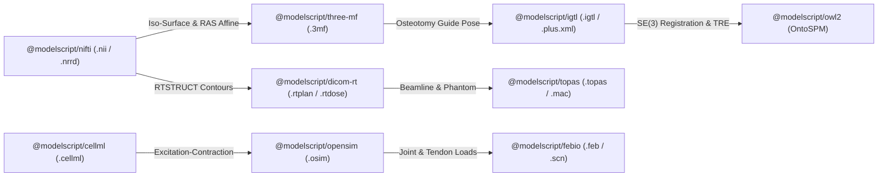

# Radiology, Radiation Oncology & Computer-Assisted Surgery Reference

ModelScript provides first-class polyglot compilation, static safety verification (`M9101`–`M9910`), numerical simulation, and cross-domain projections for **Radiology, Radiation Oncology, Biomechanics, and Computer-Assisted Surgery (CAS)**. All nine clinical engineering packages lower directly into the linear-memory `DAEBuilder` arena and interoperate with Modelica 3.x, SysML v2, OpenSCAD, ISO 10303-21 STEP, CalculiX- and Abaqus-compatible `.inp`, SBML, and ROS/Gazebo URDF.

---

## 1. Domain Package Matrix

| Package                         | Clinical Domain                                                         | File Extensions                                | Diagnostic Range | Primary Projections                                             |
| :------------------------------ | :---------------------------------------------------------------------- | :--------------------------------------------- | :--------------- | :-------------------------------------------------------------- |
| `@modelscript/opensim`          | Musculoskeletal Biomechanics & Surgical Rehabilitation                  | `.osim`                                        | `M9101`–`M9110`  | Modelica 3.x (`.mo`), ROS/Gazebo URDF (`.urdf`), DAE Arena      |
| `@modelscript/dicom-rt`         | Clinical Radiotherapy (RTSTRUCT, RTPLAN, RTDOSE)                        | `.rtplan`, `.rtstruct`, `.rtdose`, `.dicom-rt` | `M9201`–`M9210`  | OpenSCAD 3D CSG (`.scad`), SysML v2 (`.sysml`), DAE Arena       |
| `@modelscript/cellml`           | Physiological & Electrophysiology Modeling (CellML 1.0/1.1/2.0)         | `.cellml`                                      | `M9301`–`M9310`  | Modelica 3.x (`.mo`), SBML Level 3 (`.sbml`), DAE Arena         |
| `@modelscript/febio`            | Soft-Tissue Hyperelastic/Biphasic FEA & SOFA Surgical Scenes            | `.feb`, `.scn`                                 | `M9401`–`M9410`  | CalculiX- / Abaqus-Compatible (`.inp`), Modelica 3.x, DAE Arena |
| `@modelscript/nifti`            | Volumetric Medical Imaging & Segmentation (NIfTI-1/2 & NRRD)            | `.nii`, `.nrrd`, `.nhdr`                       | `M9501`–`M9510`  | OpenSCAD (`.scad`), ISO 10303-21 STEP (`.stp`), DAE Arena       |
| `@modelscript/topas`            | Monte Carlo Proton/Hadrontherapy & Radiotherapy Physics                 | `.topas`, `.mac`                               | `M9601`–`M9610`  | OpenSCAD (`.scad`), Modelica 3.x (`.mo`), DAE Arena             |
| `@modelscript/three-mf`         | Patient-Specific Surgical Guides & 3D-Printed Implants (ISO/ASTM 52915) | `.3mf`                                         | `M9701`–`M9710`  | ISO 10303-21 STEP (`.stp`), OpenSCAD (`.scad`), DAE Arena       |
| `@modelscript/igtl`             | OpenIGTLink & PLUS Toolkit Surgical Navigation & Tracking               | `.igtl`, `.plus.xml`                           | `M9801`–`M9810`  | ROS URDF (`.urdf`), Modelica 3.x (`.mo`), DAE Arena             |
| `@modelscript/owl2` (`ontospm`) | OntoSPM / LapOntoSPM Surgical Process & Safety Ontology                 | `.ofn`, `.owl`, `.ontospm`                     | `M9901`–`M9910`  | SysML v2 (`.sysml`), OWL 2 Functional Syntax (`.ofn`)           |



---

## 2. `@modelscript/opensim` — Musculoskeletal Biomechanics (`.osim`)

Parses OpenSim 3.x and 4.x XML (`<OpenSimDocument>`, `<Model>`, `<BodySet>`, `<JointSet>`, `<ForceSet>`, `<MarkerSet>`, `<WrapObjectSet>`, `<ConstraintSet>`), simulates Hill-type muscle-tendon equilibrium and multibody joint dynamics, and projects to Modelica 3.x and URDF.

### Mathematical Foundations

OpenSim models couple **neural excitation-to-activation dynamics**, **Hill-type muscle-tendon force generation**, and **articulated rigid-body skeletal dynamics**:

1. **Neural Excitation-Contraction Activation Dynamics (Thelen 2003 / Millard 2012)**

   Models the biochemical delay (calcium ion release and reuptake in the sarcoplasmic reticulum) between a normalized neural excitation signal $u(t)$ and the resulting muscle activation level $a(t)$. Activation rises rapidly with time constant $\tau_{\text{act}}$ and decays more slowly with $\tau_{\text{deact}}$:

   $$\frac{da}{dt} = \frac{u - a}{\tau(a, u)}, \qquad \tau(a, u) = \begin{cases} \tau_{\text{act}} (0.5 + 1.5 a) & u > a \\ \dfrac{\tau_{\text{deact}}}{0.5 + 1.5 a} & u \le a \end{cases}$$

2. **Active & Passive Force-Length, Force-Velocity, and Tendon Equilibrium**

   Total force transmitted along the tendon $F^T$ equals the active contractile force (scaled by activation $a$, the Gaussian active force-length curve $f_L$, and the hyperbolic force-velocity curve $f_V$) plus the exponential passive elastic restoring force $f_{PE}$ when the muscle fiber is stretched beyond its optimal length, projected onto the tendon line of action via the pennation angle $\alpha$:

   $$f_L(\tilde{l}^M) = \exp\!\left(-\frac{(\tilde{l}^M - 1)^2}{\gamma}\right), \qquad f_{PE}(\tilde{l}^M) = \frac{\exp\!\left(k_{PE}(\tilde{l}^M - 1)/\epsilon_0^M\right) - 1}{\exp(k_{PE}) - 1}$$

   $$F^T = F_0^M \left(a \, f_L(\tilde{l}^M) \, f_V(\tilde{v}^M) + f_{PE}(\tilde{l}^M)\right) \cos\alpha = F_0^M \, f_{SE}(\tilde{l}^T)$$

3. **Articulated Multibody Equations of Motion**

   Muscle-tendon forces $\mathbf{F}^T$ act across anatomical joints through the configuration-dependent moment-arm matrix $\mathbf{R}(\mathbf{q})$ to accelerate the skeletal segments:

   $$\mathbf{M}(\mathbf{q})\ddot{\mathbf{q}} + \mathbf{C}(\mathbf{q}, \dot{\mathbf{q}})\dot{\mathbf{q}} + \mathbf{G}(\mathbf{q}) = \mathbf{R}(\mathbf{q}) \, \mathbf{F}^T + \boldsymbol{\tau}_{\text{ext}}$$

| Symbol                                                   | Meaning                                                                                                 | Units / Domain                                                                                 |
| :------------------------------------------------------- | :------------------------------------------------------------------------------------------------------ | :--------------------------------------------------------------------------------------------- |
| $u, a$                                                   | Neural excitation and muscle activation level                                                           | Dimensionless, $u \in [0, 1]$, $a \in [a_{\min}, 1]$                                           |
| $\tau_{\text{act}}, \tau_{\text{deact}}$                 | Activation and deactivation time constants (typically $\approx 10\text{ ms}$, $40\text{ ms}$)           | $\text{s}$ ($\tau_{\text{act}}, \tau_{\text{deact}} > 0$)                                      |
| $l^M, l_0^M, \tilde{l}^M$                                | Muscle fiber length, optimal fiber length, and normalized fiber length ($\tilde{l}^M = l^M / l_0^M$)    | $\text{m}$, $\text{m}$, dimensionless                                                          |
| $\tilde{v}^M$                                            | Normalized fiber contraction velocity ($\dot{l}^M / v_{\max}^M$)                                        | Dimensionless                                                                                  |
| $\gamma$                                                 | Active force-length curve width shape factor                                                            | Dimensionless ($\gamma > 0$)                                                                   |
| $k_{PE}, \epsilon_0^M$                                   | Passive exponential shape factor and passive strain at maximum isometric force                          | Dimensionless                                                                                  |
| $f_L, f_V, f_{PE}, f_{SE}$                               | Normalized active force-length, force-velocity, parallel passive, and series tendon elastic multipliers | Dimensionless                                                                                  |
| $F_0^M, F^T$                                             | Maximum isometric muscle force and transmitted tendon force                                             | $\text{N}$ ($F_0^M > 0$)                                                                       |
| $\alpha$                                                 | Muscle fiber pennation angle relative to the tendon                                                     | $\text{rad}$, $\alpha \in [0, \pi/2)$                                                          |
| $\mathbf{q}, \dot{\mathbf{q}}, \ddot{\mathbf{q}}$        | Generalized joint coordinates, velocities, and accelerations                                            | $\text{rad}$ or $\text{m}$, $\text{rad/s}$ or $\text{m/s}$, $\text{rad/s}^2$ or $\text{m/s}^2$ |
| $\mathbf{M}, \mathbf{C}, \mathbf{G}$                     | Generalized mass/inertia matrix, Coriolis/centrifugal matrix, and gravitational torque vector           | SI consistent                                                                                  |
| $\mathbf{R}(\mathbf{q}), \boldsymbol{\tau}_{\text{ext}}$ | Muscle moment-arm matrix and external/contact joint torques                                             | $\text{m}$ or dimensionless, $\text{N}\cdot\text{m}$ or $\text{N}$                             |

**ModelScript Usage & Diagnostics:** `@modelscript/opensim` enforces positive body mass and inertia (`M9102`), positive muscle parameters (`M9105`), valid pennation angles $\alpha \in [0, \pi/2)$ (`M9106`), and physical time-constant ordering $\tau_{\text{act}} \le \tau_{\text{deact}}$ (`M9109`), while `lowerOpenSimToDae` and `opensim_analyze` lower and integrate these ODEs in `DAEBuilder`.

### Diagnostic Rules (`M9101`–`M9110`)

| Code    | Rule ID                                   | Severity  | Description                                                                                                            |
| :------ | :---------------------------------------- | :-------- | :--------------------------------------------------------------------------------------------------------------------- |
| `M9101` | `opensim-unresolved-body-frame`           | `error`   | Joint, marker, wrap object, or muscle path point references an undefined body frame.                                   |
| `M9102` | `opensim-non-positive-body-mass`          | `error`   | Body specifies $\text{mass} \le 0$ or non-positive principal moments of inertia ($I_{xx}, I_{yy}, I_{zz} \le 0$).      |
| `M9103` | `opensim-kinematic-tree-cycle`            | `error`   | Kinematic joint graph contains a directed cycle or multiple parent joints without a `<ConstraintSet>` loop constraint. |
| `M9104` | `opensim-invalid-coordinate-range`        | `error`   | Coordinate `rangeMin >= rangeMax` or `defaultValue` lies outside `[rangeMin, rangeMax]`.                               |
| `M9105` | `opensim-invalid-muscle-parameters`       | `error`   | Muscle `maxIsometricForce <= 0`, `optimalFiberLength <= 0`, or `tendonSlackLength <= 0`.                               |
| `M9106` | `opensim-excessive-pennation-angle`       | `error`   | Muscle `pennationAngleAtOptimal` is outside $[0, \pi/2)$ radians.                                                      |
| `M9107` | `opensim-insufficient-muscle-path-points` | `error`   | Muscle has fewer than 2 path points or all path points attach to the exact same body frame.                            |
| `M9108` | `opensim-unresolved-wrap-object`          | `error`   | Muscle `<PathWrap>` references an undefined `<WrapObject>` identifier.                                                 |
| `M9109` | `opensim-invalid-time-constants`          | `warning` | Muscle $\tau_{\text{act}} \le 0$, $\tau_{\text{deact}} \le 0$, or $\tau_{\text{act}} > \tau_{\text{deact}}$.           |
| `M9110` | `opensim-duplicate-component-name`        | `error`   | Duplicate body, joint, coordinate, or muscle name declared in the model.                                               |

---

## 3. `@modelscript/dicom-rt` — Clinical Radiotherapy (`.rtplan`, `.rtstruct`, `.rtdose`)

Models DICOM-RT treatment plans, anatomical ROI contour stacks, linac Multi-Leaf Collimator (MLC) control points, and cumulative Dose-Volume Histograms (DVHs).

### Mathematical Foundations

Clinical radiotherapy plan evaluation combines **radiobiological fractionation equivalence** with **geometric dose-volume quality metrics**:

1. **Linear-Quadratic (LQ) Biologically Effective Dose (BED) & EQD2**

   Because DNA double-strand break repair differs between acute-responding tumors and late-responding normal tissues, two regimens with the same physical total dose $D = n d$ can have very different biological effects. $\text{BED}$ expresses the theoretical total dose required if delivered in infinitely small fractions, while $\text{EQD2}$ converts any fractionation schedule into the equivalent total dose delivered in standard $2\text{ Gy}$ fractions:

   $$\text{BED} = n d \left(1 + \frac{d}{\alpha/\beta}\right), \qquad \text{EQD2} = \frac{\text{BED}}{1 + \dfrac{2}{\alpha/\beta}}$$

2. **ICRU Report 83 Homogeneity Index (HI) & Paddick Conformity Index (CI)**

   $\text{HI}$ measures dose uniformity inside the Planning Target Volume (PTV), where $\text{HI} = 0$ represents a perfectly uniform dose. $\text{CI}_{\text{RTOG}}$ compares the prescription isodose volume to the target volume, whereas $\text{CI}_{\text{Paddick}} \in [0, 1]$ penalizes both target under-coverage and normal-tissue over-irradiation (with $\text{CI}_{\text{Paddick}} = 1$ ideal):

   $$\text{HI} = \frac{D_{2\%} - D_{98\%}}{D_{50\%}}, \qquad \text{CI}_{\text{RTOG}} = \frac{V_{\text{PIV}}}{V_{\text{PTV}}}, \qquad \text{CI}_{\text{Paddick}} = \frac{(V_{\text{PTV}} \cap V_{\text{PIV}})^2}{V_{\text{PTV}} \cdot V_{\text{PIV}}}$$

| Symbol                               | Meaning                                                                                                                                               | Units / Domain                          |
| :----------------------------------- | :---------------------------------------------------------------------------------------------------------------------------------------------------- | :-------------------------------------- |
| $n$                                  | Number of treatment fractions                                                                                                                         | Dimensionless ($n \in \mathbb{Z}_{>0}$) |
| $d, D$                               | Dose per fraction ($d = D/n$) and total physical prescribed dose                                                                                      | $\text{Gy}$                             |
| $\alpha/\beta$                       | Linear-quadratic tissue fractionation sensitivity ratio ($\approx 10\text{ Gy}$ for tumors, $\approx 3\text{ Gy}$ for late-responding normal tissues) | $\text{Gy}$                             |
| $\text{BED}, \text{EQD2}$            | Biologically Effective Dose and Equivalent Dose in $2\text{ Gy}$ fractions                                                                            | $\text{Gy}$                             |
| $D_{2\%}, D_{98\%}, D_{50\%}$        | Near-maximum (2% volume), near-minimum (98% volume), and median absorbed dose to the PTV                                                              | $\text{Gy}$                             |
| $V_{\text{PTV}}$                     | Volume of the Planning Target Volume                                                                                                                  | $\text{cm}^3$                           |
| $V_{\text{PIV}}$                     | Prescription Isodose Volume (total tissue volume receiving $\ge$ the prescribed dose)                                                                 | $\text{cm}^3$                           |
| $V_{\text{PTV}} \cap V_{\text{PIV}}$ | Target volume covered by the prescription isodose surface                                                                                             | $\text{cm}^3$                           |

**ModelScript Usage & Diagnostics:** `msx dicom-rt dosimetry` and `dicom_rt_verify_dvh` compute cumulative DVHs, $\text{BED}$, $\text{EQD2}$, $\text{HI}$, and $\text{CI}$ while enforcing QUANTEC OAR dose limits (`M9205`), PTV $D_{95\%}$ coverage (`M9210`), and linac MLC physical constraints (`M9202`–`M9204`).

### Diagnostic Rules (`M9201`–`M9210`)

| Code    | Rule ID                                  | Severity  | Description                                                                                                                                                |
| :------ | :--------------------------------------- | :-------- | :--------------------------------------------------------------------------------------------------------------------------------------------------------- |
| `M9201` | `dicom-rt-missing-target-volume`         | `error`   | Plan contains no clinical target volume ROI (`PTV`, `CTV`, or `GTV`).                                                                                      |
| `M9202` | `dicom-rt-mlc-leaf-overlap`              | `error`   | Opposite MLC leaf pair violates minimum physical gap ($\text{bankB} - \text{bankA} < 0.5\text{ mm}$).                                                      |
| `M9203` | `dicom-rt-mlc-speed-exceeded`            | `error`   | MLC leaf speed between consecutive control points exceeds physical motor limit ($25.0\text{ mm/s}$).                                                       |
| `M9204` | `dicom-rt-gantry-couch-collision`        | `error`   | Non-coplanar couch angle ($\lvert \theta_{\text{couch}} \rvert > 15^\circ$) combined with lateral/posterior gantry angle enters the collision hazard zone. |
| `M9205` | `dicom-rt-oar-dose-constraint-violated`  | `error`   | Organ-at-Risk (`ORGAN`) DVH exceeds clinical QUANTEC `maxDoseLimitGy` or `meanDoseLimitGy`.                                                                |
| `M9206` | `dicom-rt-non-monotonic-cum-meterset`    | `error`   | Control point `cumulativeMetersetWeight` sequence is not monotonically non-decreasing from `0.0` to `1.0`.                                                 |
| `M9207` | `dicom-rt-unclosed-roi-contour`          | `error`   | `CLOSED_PLANAR` contour slice contains fewer than 3 vertices.                                                                                              |
| `M9208` | `dicom-rt-unresolved-frame-of-reference` | `error`   | `RTSTRUCT` or `RTDOSE` `FrameOfReferenceUID` does not match the `RTPLAN` `FrameOfReferenceUID`.                                                            |
| `M9209` | `dicom-rt-invalid-beam-meterset`         | `error`   | `TREATMENT` beam specifies `metersetMu <= 0` or `energyMeV <= 0`.                                                                                          |
| `M9210` | `dicom-rt-ptv-underdosage`               | `warning` | Target PTV $D_{95\%}$ is less than $95\%$ of `prescribedDoseGy`.                                                                                           |

---

## 4. `@modelscript/cellml` — Cellular Electrophysiology & Systems Physiology (`.cellml`)

Supports CellML 1.0, 1.1, and 2.0 component networks, 7-dimensional SI unit verification, Content MathML 2.0 ODEs (`Hodgkin-Huxley`, `Noble`, `Ten Tusscher` cardiac electrophysiology, microvascular hemodynamics), and projections to Modelica 3.x and SBML Level 3.

### Mathematical Foundations

CellML combines **static dimensional analysis** across component interfaces with **conductance-based cellular electrophysiology ODEs**:

1. **7-Dimensional SI Base Unit Vector**

   Every CellML unit definition $u$ is mapped to an exponent vector over the seven SI base dimensions (length, mass, time, electric current, thermodynamic temperature, amount of substance, and luminous intensity). Multiplying units adds their dimension vectors, and connecting two variables requires $\mathbf{d}(u_1) = \mathbf{d}(u_2)$:

   $$\mathbf{d}(u) = \begin{bmatrix} d_{\text{m}} & d_{\text{kg}} & d_{\text{s}} & d_{\text{A}} & d_{\text{K}} & d_{\text{mol}} & d_{\text{cd}} \end{bmatrix}^T \in \mathbb{R}^7$$

2. **Hodgkin-Huxley / Cardiac Action Potential Membrane ODE**

   Models the cell membrane as a parallel RC circuit: the rate of change of transmembrane voltage $V_m$ equals the negative sum of voltage-gated ionic currents (each governed by activation/inactivation gating variables $m_k, h_k \in [0, 1]$ and Nernst reversal potential $E_k$) plus any external stimulus current $I_{\text{stim}}(t)$:

   $$C_m \frac{dV_m}{dt} = -\sum_{k} g_k \, m_k^{p_k} h_k^{q_k} (V_m - E_k) + I_{\text{stim}}(t)$$

| Symbol               | Meaning                                                                                                                          | Units / Domain                            |
| :------------------- | :------------------------------------------------------------------------------------------------------------------------------- | :---------------------------------------- |
| $\mathbf{d}(u)$      | 7-element SI base-unit exponent vector for unit $u$ ($\text{m}, \text{kg}, \text{s}, \text{A}, \text{K}, \text{mol}, \text{cd}$) | $\mathbb{R}^7$ (typically $\mathbb{Z}^7$) |
| $C_m$                | Specific membrane capacitance                                                                                                    | $\mu\text{F}/\text{cm}^2$                 |
| $V_m$                | Transmembrane electrical potential                                                                                               | $\text{mV}$                               |
| $g_k$                | Maximum specific conductance of ion channel $k$ ($\text{Na}^+, \text{K}^+, \text{Ca}^{2+}$, etc.)                                | $\text{mS}/\text{cm}^2$                   |
| $m_k, h_k$           | Activation and inactivation gating probabilities for channel $k$                                                                 | Dimensionless, $[0, 1]$                   |
| $p_k, q_k$           | Integer gating exponents for channel $k$ (e.g. $p=3, q=1$ for $I_{\text{Na}}$)                                                   | Dimensionless ($\mathbb{Z}_{\ge 0}$)      |
| $E_k$                | Nernst equilibrium (reversal) potential for ion species $k$                                                                      | $\text{mV}$                               |
| $I_{\text{stim}}(t)$ | Applied external pacing or stimulus current density                                                                              | $\mu\text{A}/\text{cm}^2$                 |

**ModelScript Usage & Diagnostics:** `@modelscript/cellml` verifies unit existence (`M9302`), dimensional vector equality across `<map_variables>` (`M9304`), and state initialization (`M9305`), while `cellml_simulate` lowers Content MathML 2.0 ODEs into `DAEBuilder`.

### Diagnostic Rules (`M9301`–`M9310`)

| Code    | Rule ID                                  | Severity  | Description                                                                                             |
| :------ | :--------------------------------------- | :-------- | :------------------------------------------------------------------------------------------------------ |
| `M9301` | `cellml-missing-model-name`              | `error`   | `<model>` element is missing a non-empty `name` attribute.                                              |
| `M9302` | `cellml-unresolved-units`                | `error`   | Variable or `<unit>` references an undeclared or non-standard CellML unit name.                         |
| `M9303` | `cellml-interface-direction-conflict`    | `error`   | `<map_variables>` connects variables with incompatible interface directions (e.g. both `in` or `none`). |
| `M9304` | `cellml-unit-dimensional-mismatch`       | `warning` | Mapped variables in `<map_variables>` have incompatible 7-element SI base unit dimension vectors.       |
| `M9305` | `cellml-uninitialized-state-variable`    | `warning` | Differential state variable ($\text{ODE}$) lacks an `initial_value` attribute.                          |
| `M9306` | `cellml-encapsulation-hierarchy-cycle`   | `error`   | Circular component reference detected in `<encapsulation>` hierarchy.                                   |
| `M9307` | `cellml-unresolved-connection-member`    | `error`   | `<connection>` references an undeclared component or variable name.                                     |
| `M9308` | `cellml-overconstrained-variable`        | `error`   | Variable with an `in` interface or prior assignment is assigned by an equation or ODE.                  |
| `M9309` | `cellml-undefined-math-ci`               | `error`   | Content MathML `<ci>` references an identifier not declared in the enclosing `<component>`.             |
| `M9310` | `cellml-duplicate-variable-or-component` | `error`   | Duplicate `<component>` or `<variable>` name declared within the same scope.                            |

---

## 5. `@modelscript/febio` — Soft-Tissue Biomechanics & SOFA Surgical Simulation (`.feb`, `.scn`)

Parses FEBio 2.5–4.0 (`.feb`) continuum biomechanics models and SOFA Framework (`.scn`) real-time surgical simulation scene graphs. Evaluates Neo-Hookean, Mooney-Rivlin, Ogden, and Holzapfel-Gasser-Ogden (HGO) anisotropic arterial wall strain energy functions, plus biphasic poroelasticity.

### Mathematical Foundations

Soft biological tissues undergo large, nearly incompressible deformations and contain interstitial fluid. FEBio models these behaviors using **uncoupled hyperelastic strain-energy functions** and **biphasic poroelasticity**:

1. **Compressible Mooney-Rivlin Hyperelastic Strain Energy**

   Decomposes elastic energy storage into an isochoric (shape-changing) response governed by the first and second deviatoric strain invariants ($\bar{I}_1, \bar{I}_2$) and a volumetric (volume-changing) penalty governed by the bulk modulus $K$ and volume ratio $J$:

   $$\Psi_{\text{MR}}(\bar{I}_1, \bar{I}_2, J) = c_1 (\bar{I}_1 - 3) + c_2 (\bar{I}_2 - 3) + \frac{K}{2} (\ln J)^2$$

2. **Darcy's Law for Biphasic Interstitial Fluid Flow**

   In hydrated tissues (e.g., articular cartilage, liver parenchyma, intervertebral discs), interstitial fluid flux $\mathbf{q}$ flows down the pore fluid pressure gradient $\nabla p$ proportional to the hydraulic permeability tensor $\mathbf{k}$:

   $$\mathbf{q} = -\mathbf{k} \nabla p$$

3. **Element Orientation & Mesh Invertibility**

   Every tetrahedral (`tet4`) or hexahedral (`hex8`) finite element must preserve positive orientation from reference to spatial coordinates so that volume integrals remain physically valid:

   $$\det(\mathbf{J}) > 0$$

| Symbol                 | Meaning                                                                                                                   | Units / Domain                         |
| :--------------------- | :------------------------------------------------------------------------------------------------------------------------ | :------------------------------------- |
| $\Psi_{\text{MR}}$     | Helmholtz hyperelastic strain-energy density per unit reference volume                                                    | $\text{Pa}$ ($\text{J/m}^3$)           |
| $\bar{I}_1, \bar{I}_2$ | First and second deviatoric invariants of the right Cauchy-Green deformation tensor ($\bar{I}_1 = \bar{I}_2 = 3$ at rest) | Dimensionless                          |
| $J$                    | Local volume ratio ($J = \det(\mathbf{F})$, where $\mathbf{F}$ is the deformation gradient)                               | Dimensionless ($J > 0$)                |
| $c_1, c_2$             | Mooney-Rivlin material stiffness constants ($c_1 + c_2 > 0$ for positive shear modulus)                                   | $\text{Pa}$                            |
| $K$                    | Elastic bulk modulus controlling compressibility                                                                          | $\text{Pa}$ ($K > 0$)                  |
| $\mathbf{q}$           | Relative interstitial fluid volumetric flux vector (Darcy velocity)                                                       | $\text{m/s}$                           |
| $\mathbf{k}$           | Hydraulic permeability tensor                                                                                             | $\text{m}^4 / (\text{N}\cdot\text{s})$ |
| $p$                    | Interstitial fluid pore pressure                                                                                          | $\text{Pa}$                            |
| $\mathbf{J}$           | Element isoparametric Jacobian matrix mapping reference to physical coordinates                                           | $\text{m}$ (or $\text{mm}$)            |

**ModelScript Usage & Diagnostics:** `@modelscript/febio` checks material stability ($c_1 + c_2 > 0$, `M9401`), element Jacobian positivity (`M9402`), and biphasic permeability and solid volume fraction bounds (`M9405`) prior to `msx febio solve` or CalculiX/Abaqus `.inp` export.

### Diagnostic Rules (`M9401`–`M9410`)

| Code    | Rule ID                                | Severity  | Description                                                                                                            |
| :------ | :------------------------------------- | :-------- | :--------------------------------------------------------------------------------------------------------------------- |
| `M9401` | `febio-invalid-material-constant`      | `error`   | Non-physical material constant ($E \le 0$, $\nu \notin (-1, 0.5)$, $\rho \le 0$, or $c_1 + c_2 \le 0$).                |
| `M9402` | `febio-inverted-element-jacobian`      | `error`   | Tetrahedral (`tet4`) or hexahedral (`hex8`) element has non-positive Jacobian determinant ($\det(\mathbf{J}) \le 0$).  |
| `M9403` | `febio-unresolved-node-or-set`         | `error`   | Element connectivity, boundary condition, or load references an undefined node ID, `<NodeSet>`, or `<Surface>`.        |
| `M9404` | `febio-unconstrained-rigid-body`       | `warning` | Model defines no fixed or prescribed displacement boundary conditions to constrain rigid-body motion.                  |
| `M9405` | `febio-invalid-biphasic-permeability`  | `error`   | Biphasic/poroelastic tissue material specifies permeability $k \le 0$ or solid volume fraction $\phi^s \notin (0, 1)$. |
| `M9406` | `febio-invalid-time-stepper`           | `error`   | `<Control>` specifies `time_steps <= 0` or `step_size <= 0`.                                                           |
| `M9407` | `febio-unresolved-material-id`         | `error`   | `<SolidDomain>` or element block references an undeclared material ID.                                                 |
| `M9408` | `febio-contact-penalty-invalid`        | `error`   | Contact interface specifies a non-positive penalty factor or empty primary/secondary surface.                          |
| `M9409` | `febio-sofa-missing-mechanical-object` | `error`   | SOFA `<Node>` contains a force field without a `<MechanicalObject>` state container.                                   |
| `M9410` | `febio-duplicate-entity-id`            | `error`   | Duplicate node, element, or material identifier.                                                                       |

---

## 6. `@modelscript/nifti` — Volumetric Medical Imaging (`.nii`, `.nrrd`, `.nhdr`)

Parses NIfTI-1/NIfTI-2 headers and NRRD volumetric descriptors, validates `qform` quaternion and `sform` $4 \times 4$ RAS affine transformations, extracts segmented anatomical iso-surfaces, and projects to OpenSCAD and ISO 10303-21 STEP.

### Mathematical Foundations

Medical imaging volumes store intensities on an integer voxel grid $(i, j, k)$ that must be mapped into physical **RAS** (**R**ight, **A**nterior, **S**uperior) patient coordinates in millimeters for surgical navigation and 3D CAD reconstruction:

1. **NIfTI `qform` Rigid-Body + Scaling Affine Transform**

   Scales each voxel index by its physical spacing ($\Delta x, \Delta y, \Delta z$), applies the slice-direction handedness factor $q_{\text{fac}}$, rotates the axes into RAS space via the unit quaternion rotation matrix $\mathbf{R}(\mathbf{q})$, and translates by the scanner origin offset $\mathbf{q}_{\text{offset}}$:

   $$\begin{bmatrix} x_{\text{RAS}} \\ y_{\text{RAS}} \\ z_{\text{RAS}} \\ 1 \end{bmatrix} = \begin{bmatrix} \mathbf{R}(\mathbf{q}) \, \text{diag}(\Delta x, \Delta y, q_{\text{fac}} \Delta z) & \mathbf{q}_{\text{offset}} \\ \mathbf{0}^T & 1 \end{bmatrix} \begin{bmatrix} i \\ j \\ k \\ 1 \end{bmatrix}$$

2. **Unit Quaternion Scalar Component Recovery**

   NIfTI headers store only the three imaginary quaternion components $(b, c, d)$ (`quatern_b`, `quatern_c`, `quatern_d`) and reconstruct the non-negative real scalar component $a$ assuming unit norm $a^2 + b^2 + c^2 + d^2 = 1$:

   $$a = \sqrt{\max\!\left(0,\; 1 - (b^2 + c^2 + d^2)\right)}$$

| Symbol                                           | Meaning                                                                  | Units / Domain                                   |
| :----------------------------------------------- | :----------------------------------------------------------------------- | :----------------------------------------------- |
| $i, j, k$                                        | Discrete 0-based voxel grid indices along the volume axes                | Dimensionless ($\mathbb{Z}_{\ge 0}$)             |
| $x_{\text{RAS}}, y_{\text{RAS}}, z_{\text{RAS}}$ | Physical patient coordinates (+X Right, +Y Anterior, +Z Superior)        | $\text{mm}$                                      |
| $\Delta x, \Delta y, \Delta z$                   | Physical voxel spacings (`pixdim[1..3]`)                                 | $\text{mm}$ ($\Delta x, \Delta y, \Delta z > 0$) |
| $q_{\text{fac}}$                                 | Slice-axis handedness sign (`pixdim[0]`, $+1$ or $-1$)                   | Dimensionless, $\{-1, +1\}$                      |
| $\mathbf{q} = (a, b, c, d)$                      | Unit orientation quaternion ($a \ge 0$, $b^2 + c^2 + d^2 \le 1$)         | Dimensionless                                    |
| $\mathbf{R}(\mathbf{q})$                         | $3 \times 3$ proper orthogonal rotation matrix derived from $\mathbf{q}$ | Dimensionless ($SO(3)$)                          |
| $\mathbf{q}_{\text{offset}}$                     | $3 \times 1$ physical origin translation vector (`qoffset_x/y/z`)        | $\text{mm}$                                      |

**ModelScript Usage & Diagnostics:** `@modelscript/nifti` validates positive voxel spacing (`M9502`), non-singular `sform` matrices (`M9503`), valid quaternion norms $b^2 + c^2 + d^2 \le 1$ (`M9504`), `qform`/`sform` handedness agreement (`M9505`), and slice anisotropy (`M9510`) before iso-surface meshing (`msx nifti mesh`) and STEP export.

### Diagnostic Rules (`M9501`–`M9510`)

| Code    | Rule ID                                 | Severity  | Description                                                                                                                                                 |
| :------ | :-------------------------------------- | :-------- | :---------------------------------------------------------------------------------------------------------------------------------------------------------- |
| `M9501` | `nifti-invalid-dimensions`              | `error`   | Volume dimension `dim[0]` is outside `[1, 7]` or spatial dimensions $n_x, n_y, n_z \le 0$.                                                                  |
| `M9502` | `nifti-non-positive-voxel-spacing`      | `error`   | Voxel spacing `pixdim[1..3]` or NRRD `space directions` norm is $\le 0\text{ mm}$.                                                                          |
| `M9503` | `nifti-singular-affine-transform`       | `error`   | $4 \times 4$ `sform` affine transformation matrix is singular ($\lvert \det(\mathbf{A}) \rvert < 10^{-9}$).                                                 |
| `M9504` | `nifti-invalid-quaternion-norm`         | `error`   | Quaternion parameters satisfy $b^2 + c^2 + d^2 > 1.0$.                                                                                                      |
| `M9505` | `nifti-qform-sform-handedness-mismatch` | `error`   | Active `qform` and `sform` transforms have opposite coordinate handedness ($\text{sign}(q_{\text{fac}}) \ne \text{sign}(\det(\mathbf{A}_{\text{sform}}))$). |
| `M9506` | `nifti-zero-intensity-scale-slope`      | `error`   | `scl_slope` is explicitly `0` while intensity scaling is active.                                                                                            |
| `M9507` | `nifti-unsupported-datatype`            | `error`   | Unrecognized or unsupported NIfTI/NRRD voxel datatype code.                                                                                                 |
| `M9508` | `nifti-voxel-data-size-mismatch`        | `error`   | Voxel payload count does not match $n_x \times n_y \times n_z \times n_t$.                                                                                  |
| `M9509` | `nifti-empty-segmentation-mask`         | `warning` | Segmentation labelmap contains zero foreground voxels across all anatomical labels.                                                                         |
| `M9510` | `nifti-anisotropic-slice-gap-warning`   | `warning` | Slice thickness $\Delta z$ exceeds in-plane resolution $\min(\Delta x, \Delta y)$ by more than $5\times$.                                                   |

---

## 7. `@modelscript/topas` — Monte Carlo Proton & Hadrontherapy (`.topas`, `.mac`)

Parses TOPAS (`Ge/`, `So/`, `Sc/`, `Ph/`, `Ma/`, `Tf/`) parameter files and GATE (`.mac`) macros, verifies hierarchical CSG beamline geometry containment, and computes analytical Bortfeld (1997) proton/carbon-ion Bragg peak depth-dose profiles.

### Mathematical Foundations

Unlike photons, heavy charged particles (protons and carbon ions) deposit most of their energy in a sharp, localized **Bragg peak** just before coming to rest, sparing healthy tissue beyond the tumor:

1. **Bragg-Kleeman Range-Energy Relation**

   Relates the initial beam kinetic energy $E_0$ to the continuous-slowing-down-approximation (CSDA) penetration depth $R_0$ in water-equivalent tissue using empirical power-law constants ($\alpha, p$):

   $$R_0 = \alpha \, E_0^p \qquad (\alpha \approx 0.0022\text{ cm}\cdot\text{MeV}^{-p},\; p \approx 1.77\text{ for protons in water})$$

2. **Bethe-Bloch Linear Stopping Power**

   Describes the mean rate of energy loss per unit path length ($-\frac{dE}{dz}$) due to inelastic Coulomb collisions with atomic electrons. Because stopping power scales inversely with $\beta^2$, energy deposition spikes sharply as the ion decelerates ($\beta \to 0$) near depth $R_0$:

   $$-\frac{dE}{dz} \propto \frac{z^2}{\beta^2} \left[\ln\!\left(\frac{2 m_e c^2 \beta^2}{I (1 - \beta^2)}\right) - \beta^2\right]$$

| Symbol           | Meaning                                                                                       | Units / Domain                                 |
| :--------------- | :-------------------------------------------------------------------------------------------- | :--------------------------------------------- |
| $R_0$            | Mean CSDA range (Bragg peak depth) in the target medium                                       | $\text{cm}$                                    |
| $E_0$            | Initial incident beam kinetic energy                                                          | $\text{MeV}$ ($E_0 > 0$)                       |
| $\alpha, p$      | Empirical Bragg-Kleeman range-energy fit constants                                            | $\text{cm}\cdot\text{MeV}^{-p}$, dimensionless |
| $-\frac{dE}{dz}$ | Linear stopping power (energy loss per unit depth)                                            | $\text{MeV}/\text{cm}$                         |
| $z$              | Atomic charge number of the projectile ion ($z = 1$ for protons, $z = 6$ for $^{12}\text{C}$) | Dimensionless ($\mathbb{Z}_{>0}$)              |
| $\beta$          | Relativistic particle speed ($\beta = v / c$, where $c$ is the speed of light)                | Dimensionless, $(0, 1)$                        |
| $m_e c^2$        | Electron rest-mass energy ($\approx 0.511\text{ MeV}$)                                        | $\text{MeV}$                                   |
| $I$              | Mean excitation potential of the absorbing medium ($\approx 75\text{ eV}$ for liquid water)   | $\text{eV}$ (converted to $\text{MeV}$ in log) |

**ModelScript Usage & Diagnostics:** `@modelscript/topas` enforces positive beam energy and non-negative energy spread (`M9606`) as well as CSG beamline containment (`M9603`–`M9604`), while `msx topas bragg-peak` evaluates Bortfeld (1997) analytical depth-dose profiles from these parameters.

### Diagnostic Rules (`M9601`–`M9610`)

| Code    | Rule ID                                 | Severity  | Description                                                                                                  |
| :------ | :-------------------------------------- | :-------- | :----------------------------------------------------------------------------------------------------------- |
| `M9601` | `topas-type-prefix-mismatch`            | `error`   | Parameter value does not match its declared TOPAS type prefix (`d:`, `i:`, `b:`, `s:`, `dv:`, `iv:`, `sv:`). |
| `M9602` | `topas-unresolved-parent-component`     | `error`   | Geometry component `Parent` references an undeclared parent volume.                                          |
| `M9603` | `topas-non-positive-geometry-dimension` | `error`   | Box/Cylinder/Sphere dimension (`HLX`, `HLY`, `HLZ`, `RMax`, `HL`) is $\le 0$, or `RMin >= RMax`.             |
| `M9604` | `topas-child-exceeds-parent-bounds`     | `error`   | Child geometry translation plus half-lengths protrude outside the parent volume bounding box.                |
| `M9605` | `topas-undefined-material`              | `error`   | Component `Material` references an unknown material not in Geant4/NIST or custom `Ma/<Name>` definitions.    |
| `M9606` | `topas-invalid-beam-energy`             | `error`   | Particle source `BeamEnergy <= 0` MeV or negative energy spread.                                             |
| `M9607` | `topas-circular-include-file`           | `error`   | Circular or self-referential `includeFile` chain detected.                                                   |
| `M9608` | `topas-scorer-missing-component`        | `error`   | Scorer `Sc/<Name>/Component` or `Quantity` is missing or references an undeclared geometry volume.           |
| `M9609` | `topas-vector-length-mismatch`          | `error`   | Vector parameter (`dv:`, `iv:`, `sv:`) element count does not match its declared length token.               |
| `M9610` | `topas-duplicate-parameter-assignment`  | `warning` | Identical parameter path is assigned multiple times in the same file without an override qualifier.          |

---

## 8. `@modelscript/three-mf` — Patient-Specific 3D-Printed Surgical Guides & Implants (`.3mf`)

Parses ISO/ASTM 52915 3MF models (`<model>`, `<resources>`, `<mesh>`, `<vertices>`, `<triangles>`, `<build>`, and `<surgical_guide>` osteotomy/drill sleeve annotations), verifies 2-manifold watertightness and signed volume, and projects to ISO 10303-21 STEP and OpenSCAD.

### Mathematical Foundations

3D-printed surgical guides and patient-specific implants must be **watertight 2-manifolds** with **outward-facing surface normals** so that additive manufacturing slicers and STEP kernels can distinguish solid material from empty space:

1. **Euler-Poincaré Characteristic for Closed 2-Manifold Meshes**

   For a closed triangle mesh with no boundary edges or non-manifold junctions (every edge shared by exactly 2 triangles), the Euler characteristic $\chi$ relates vertex, edge, and face counts to the number of disconnected shells $S$ and topological genus $g$ (handles/through-holes, e.g., drill-guide cannulas):

   $$\chi = V - E + F = 2(S - g)$$

2. **Divergence-Theorem Signed Mesh Volume**

   By the discrete divergence theorem, summing the signed volumes of tetrahedra formed between each oriented triangle $(\mathbf{v}_{k,1}, \mathbf{v}_{k,2}, \mathbf{v}_{k,3})$ and the origin yields the enclosed volume. A positive result ($V_{\text{signed}} > 0$) confirms consistent outward-pointing right-hand-rule face normals, whereas $V_{\text{signed}} \le 0$ indicates inverted normals or a degenerate self-intersecting shell:

   $$V_{\text{signed}} = \frac{1}{6} \sum_{k=1}^{F} \mathbf{v}_{k,1} \cdot (\mathbf{v}_{k,2} \times \mathbf{v}_{k,3}) > 0$$

| Symbol                                                 | Meaning                                                                                                         | Units / Domain                          |
| :----------------------------------------------------- | :-------------------------------------------------------------------------------------------------------------- | :-------------------------------------- |
| $\chi$                                                 | Euler-Poincaré topological invariant                                                                            | Dimensionless ($\mathbb{Z}$)            |
| $V, E, F$                                              | Total number of mesh vertices, unique edges, and triangular faces                                               | Dimensionless ($\mathbb{Z}_{\ge 0}$)    |
| $S$                                                    | Number of disconnected closed surface shells ($S = 1$ for a single solid guide)                                 | Dimensionless ($\mathbb{Z}_{\ge 1}$)    |
| $g$                                                    | Topological genus (number of through-holes / handles, e.g., $g = 0$ for a sphere, $g = 1$ for a single cannula) | Dimensionless ($\mathbb{Z}_{\ge 0}$)    |
| $\mathbf{v}_{k,1}, \mathbf{v}_{k,2}, \mathbf{v}_{k,3}$ | Ordered 3D position vectors of the three vertices of triangle $k$                                               | $\text{mm}$ ($\mathbb{R}^3$)            |
| $V_{\text{signed}}$                                    | Enclosed signed volume of the triangle mesh                                                                     | $\text{mm}^3$ ($V_{\text{signed}} > 0$) |

**ModelScript Usage & Diagnostics:** `@modelscript/three-mf` (`msx three-mf topology` and `three_mf_verify_guide`) checks 2-manifold edge incidence (`M9701`), non-degenerate triangle area (`M9702`), positive signed volume (`M9703`), and minimum $0.8\text{ mm}$ surgical guide wall thickness (`M9705`).

### Diagnostic Rules (`M9701`–`M9710`)

| Code    | Rule ID                                   | Severity | Description                                                                                                                                      |
| :------ | :---------------------------------------- | :------- | :----------------------------------------------------------------------------------------------------------------------------------------------- |
| `M9701` | `three-mf-non-manifold-edge`              | `error`  | Mesh is not a closed 2-manifold (contains open boundary edges or edges shared by $\ne 2$ triangles).                                             |
| `M9702` | `three-mf-degenerate-triangle`            | `error`  | Triangle has duplicate vertex indices or zero surface area ($\|\mathbf{e}_1 \times \mathbf{e}_2\| < 10^{-12}$).                                  |
| `M9703` | `three-mf-negative-mesh-volume`           | `error`  | Mesh has inverted outward face normals resulting in non-positive signed volume ($V \le 0$).                                                      |
| `M9704` | `three-mf-unresolved-build-object`        | `error`  | `<build><item objectid="..."/>` references an undefined `<object>` ID.                                                                           |
| `M9705` | `three-mf-wall-thickness-violation`       | `error`  | Surgical guide or cannula wall thickness is below the $0.8\text{ mm}$ additive manufacturing safety threshold.                                   |
| `M9706` | `three-mf-invalid-osteotomy-guide-axis`   | `error`  | Osteotomy cutting plane normal or drill sleeve axis vector has zero length.                                                                      |
| `M9707` | `three-mf-missing-biocompatible-material` | `error`  | Medical implant or surgical guide lacks an approved ISO 10993 / USP Class VI biocompatible material (`Ti-6Al-4V`, `PEEK`, `BioMed Amber`, etc.). |
| `M9708` | `three-mf-singular-item-transform`        | `error`  | `<item transform="..."/>` $4 \times 3$ affine transformation matrix has $\det(\mathbf{M}) \le 0$.                                                |
| `M9709` | `three-mf-out-of-bounds-vertex-index`     | `error`  | Triangle vertex index $v_i < 0$ or $v_i \ge N_{\text{vertices}}$.                                                                                |
| `M9710` | `three-mf-duplicate-object-id`            | `error`  | Duplicate `<object id="..."/>` declared in `<resources>`.                                                                                        |

---

## 9. `@modelscript/igtl` — OpenIGTLink & PLUS Surgical Navigation (`.igtl`, `.plus.xml`)

Parses PLUS Toolkit (`<PlusConfiguration>`, `<DeviceSet>`, `<CoordinateDefinitions>`, `<PlusOpenIGTLinkServer>`, `<PivotCalibration>`, `<FiducialRegistration>`) and OpenIGTLink transform streams. Solves $SE(3)$ coordinate frame chains, least-squares stylus pivot calibration, and Fitzpatrick (1998) Target Registration Error ($\text{TRE}$).

### Mathematical Foundations

Image-guided surgery relies on **$SE(3)$ rigid-body coordinate chains**, **instrument tip calibration**, and **statistical registration accuracy bounds**:

1. **Least-Squares Stylus Pivot Calibration**

   When a tracked pointer stylus is pivoted in a fixed spherical divot across $M$ poses $(\mathbf{R}_i, \mathbf{t}_i)$, the physical pivot point $\mathbf{p}_{\text{pivot}}$ remains stationary in tracker coordinates while the stylus tip $\mathbf{p}_{\text{tip}}$ remains fixed in the stylus's local sensor frame ($\mathbf{R}_i \mathbf{p}_{\text{tip}} + \mathbf{t}_i = \mathbf{p}_{\text{pivot}}$). Stacking all $M$ poses yields an overdetermined linear least-squares system solved via pseudoinverse or SVD:

   $$\begin{bmatrix} \mathbf{R}_1 & -\mathbf{I}_3 \\ \vdots & \vdots \\ \mathbf{R}_M & -\mathbf{I}_3 \end{bmatrix} \begin{bmatrix} \mathbf{p}_{\text{tip}} \\ \mathbf{p}_{\text{pivot}} \end{bmatrix} = \begin{bmatrix} -\mathbf{t}_1 \\ \vdots \\ -\mathbf{t}_M \end{bmatrix}$$

2. **Fitzpatrick (1998) Target Registration Error (TRE) & Fiducial Registration Error (FRE)**

   Because fiducial markers cannot be localized with infinite precision, isotropic Fiducial Localization Error ($\text{FLE}$) propagates into residual marker mismatch ($\text{FRE}$) and clinical targeting error at an anatomical target $\mathbf{r}$ ($\text{TRE}$). Placing fiducials widely around the target (maximizing principal radii $f_k$ while keeping the target-to-centroid distance $d_k$ small) minimizes $\text{TRE}$:

   $$\langle \text{TRE}^2(\mathbf{r}) \rangle = \frac{\langle \text{FLE}^2 \rangle}{N} \left(1 + \frac{1}{3} \sum_{k=1}^{3} \frac{d_k^2}{f_k^2}\right), \qquad \langle \text{FRE}^2 \rangle = \left(1 - \frac{2}{N}\right) \langle \text{FLE}^2 \rangle$$

| Symbol                       | Meaning                                                                                                              | Units / Domain                                        |
| :--------------------------- | :------------------------------------------------------------------------------------------------------------------- | :---------------------------------------------------- |
| $\mathbf{R}_i, \mathbf{t}_i$ | $3 \times 3$ rotation matrix and $3 \times 1$ translation vector of the tracked stylus at pose $i \in \{1,\dots,M\}$ | Dimensionless ($SO(3)$), $\text{mm}$ ($\mathbb{R}^3$) |
| $\mathbf{I}_3$               | $3 \times 3$ identity matrix                                                                                         | Dimensionless                                         |
| $\mathbf{p}_{\text{tip}}$    | Unknown stylus tip offset in the stylus local sensor frame                                                           | $\text{mm}$ ($\mathbb{R}^3$)                          |
| $\mathbf{p}_{\text{pivot}}$  | Unknown stationary divot pivot position in the tracker reference frame                                               | $\text{mm}$ ($\mathbb{R}^3$)                          |
| $M$                          | Number of recorded pivot poses ($M \ge 2$, typically $M \ge 30$)                                                     | Dimensionless ($\mathbb{Z}_{\ge 2}$)                  |
| $\text{FLE}$                 | Fiducial Localization Error (RMS uncertainty in locating each fiducial marker)                                       | $\text{mm}$                                           |
| $\text{FRE}$                 | Fiducial Registration Error (RMS residual alignment error across the $N$ fiducials)                                  | $\text{mm}$                                           |
| $\text{TRE}(\mathbf{r})$     | Target Registration Error at surgical target point $\mathbf{r}$                                                      | $\text{mm}$                                           |
| $N$                          | Number of non-collinear registration fiducials ($N \ge 3$)                                                           | Dimensionless ($\mathbb{Z}_{\ge 3}$)                  |
| $d_k$                        | Distance from target $\mathbf{r}$ to the $k$-th principal axis of the fiducial configuration                         | $\text{mm}$                                           |
| $f_k$                        | RMS distance of the $N$ fiducials from their $k$-th principal axis                                                   | $\text{mm}$ ($f_k > 0$)                               |

**ModelScript Usage & Diagnostics:** `@modelscript/igtl` (`msx igtl calibrate`, `igtl_verify_calibration`, and `IgtlEditorProvider`) audits rotation orthogonality (`M9801`), homogeneous matrix structure (`M9802`), transform graph connectivity (`M9803`–`M9804`), and flags RMS $\text{FRE}$/$\text{TRE}$ exceeding $2.0\text{ mm}$ (`M9805`).

### Diagnostic Rules (`M9801`–`M9810`)

| Code    | Rule ID                                 | Severity  | Description                                                                                                                                        |
| :------ | :-------------------------------------- | :-------- | :------------------------------------------------------------------------------------------------------------------------------------------------- |
| `M9801` | `igtl-non-orthogonal-rotation`          | `error`   | Upper-left $3 \times 3$ rotation block $\mathbf{R}$ violates $\|\mathbf{R}^T \mathbf{R} - \mathbf{I}_3\|_F > 10^{-3}$ or $\det(\mathbf{R}) \le 0$. |
| `M9802` | `igtl-invalid-homogeneous-bottom-row`   | `error`   | Bottom row of $4 \times 4$ homogeneous matrix is not `[0, 0, 0, 1]`.                                                                               |
| `M9803` | `igtl-disconnected-coordinate-frame`    | `error`   | Coordinate frame graph is disconnected or lacks a path for a requested `<Transform Name="...To..."/>`.                                             |
| `M9804` | `igtl-cyclic-transform-chain`           | `error`   | `<CoordinateDefinitions>` contains a directed cycle in frame definitions.                                                                          |
| `M9805` | `igtl-excessive-registration-error`     | `warning` | Calibration or fiducial registration RMS error ($\text{FRE}$ / $\text{TRE}$) exceeds $2.0\text{ mm}$.                                              |
| `M9806` | `igtl-invalid-acquisition-rate`         | `error`   | Tracker or ultrasound device `AcquisitionRate <= 0` Hz.                                                                                            |
| `M9807` | `igtl-unresolved-device-or-channel`     | `error`   | `<Device>` or `<PlusOpenIGTLinkServer>` references an undeclared device or channel ID.                                                             |
| `M9808` | `igtl-self-transform-identity-mismatch` | `error`   | Transform with `From == To` is not the $4 \times 4$ identity matrix.                                                                               |
| `M9809` | `igtl-invalid-server-port`              | `error`   | OpenIGTLink server `ListeningPort` is outside the valid TCP range `[1024, 65535]`.                                                                 |
| `M9810` | `igtl-duplicate-transform-edge`         | `error`   | Duplicate `<Transform>` declared for the same `(From, To)` coordinate frame pair.                                                                  |

---

## 10. `@modelscript/owl2` (`ontospm`) — OntoSPM Surgical Process Ontology

Models surgical workflows (`Procedure` $\to$ `Phase` $\to$ `Step` $\to$ `Action` + `Instrument` + `AnatomicalStructure`), enforces **Critical View of Safety (CVS)** verification before irreversible tissue division, and detects monopolar thermal spread hazards near critical neurovascular structures.

### Mathematical Foundations

OntoSPM surgical safety verification combines **directed graph acyclicity/reachability** with **spatial proximity constraints**:

1. **Workflow Phase Graph Acyclicity & Reachability**

   A surgical procedure's phase transition graph $G_{\text{phase}} = (V_P, E_P)$ must form a directed acyclic graph (DAG) rooted at the initial preparation/exposure phase $p_0 \in V_P$, ensuring every phase $p \in V_P$ is reachable without cyclic loops:

   $$p_0 \xrightarrow{*} p \quad \forall p \in V_P, \qquad \nexists\, p \in V_P \text{ such that } p \xrightarrow{+} p$$

2. **Monopolar Electrosurgical Thermal-Spread Safety Radius**

   Energized monopolar instruments can cause lateral thermal injury to adjacent nerves and arteries. For any active monopolar tip position $\mathbf{p}_{\text{tip}}$ and critical neurovascular structure $\mathbf{p}_{\text{crit}}$, the Euclidean separation must satisfy the safety clearance $d_{\min} = 5.0\text{ mm}$:

   $$\|\mathbf{p}_{\text{tip}} - \mathbf{p}_{\text{crit}}\|_2 \ge d_{\min} = 5.0\text{ mm}$$

| Symbol                                              | Meaning                                                                         | Units / Domain               |
| :-------------------------------------------------- | :------------------------------------------------------------------------------ | :--------------------------- |
| $G_{\text{phase}} = (V_P, E_P)$                     | Directed graph of surgical phases $V_P$ and transition edges $E_P$              | Discrete graph               |
| $p_0, p$                                            | Initial preparation/exposure phase and arbitrary surgical phase                 | $p_0, p \in V_P$             |
| $\mathbf{p}_{\text{tip}}, \mathbf{p}_{\text{crit}}$ | 3D positions of the energized monopolar electrode tip and critical nerve/artery | $\text{mm}$ ($\mathbb{R}^3$) |
| $d_{\min}$                                          | Minimum safe thermal-spread clearance radius ($5.0\text{ mm}$)                  | $\text{mm}$                  |

**ModelScript Usage & Diagnostics:** `@modelscript/owl2` (`ontospm`) enforces phase acyclicity (`M9903`), phase reachability (`M9909`), Critical View of Safety checkpoint ordering (`M9901`), and the $5.0\text{ mm}$ monopolar proximity guard (`M9907`).

### Diagnostic Rules (`M9901`–`M9910`)

| Code    | Rule ID                                          | Severity  | Description                                                                                                                                                                                        |
| :------ | :----------------------------------------------- | :-------- | :------------------------------------------------------------------------------------------------------------------------------------------------------------------------------------------------- |
| `M9901` | `ontospm-missing-critical-safety-view`           | `error`   | Irreversible action (`Clipping`, `Cutting`, `Transection`, `Resection`) on a critical neurovascular or biliary structure executes without a verified `SafetyCheckpoint` (Critical View of Safety). |
| `M9902` | `ontospm-instrument-action-incompatibility`      | `error`   | Surgical step pairs an instrument category with an incompatible surgical action verb (e.g. `ClipApplier` performing `Suturing`).                                                                   |
| `M9903` | `ontospm-phase-transition-cycle`                 | `error`   | Surgical phase transition graph contains a directed cycle.                                                                                                                                         |
| `M9904` | `ontospm-unresolved-anatomical-target`           | `error`   | Surgical step references an undeclared anatomical structure ID.                                                                                                                                    |
| `M9905` | `ontospm-unresolved-instrument-reference`        | `error`   | Surgical step references an undeclared surgical instrument ID.                                                                                                                                     |
| `M9906` | `ontospm-missing-hemostasis-or-closure`          | `warning` | Invasive surgical procedure lacks a terminal `Hemostasis` or `Closure` phase.                                                                                                                      |
| `M9907` | `ontospm-bipolar-monopolar-energized-near-nerve` | `error`   | Monopolar electrosurgical instrument is energized within $5.0\text{ mm}$ of a critical nerve or artery.                                                                                            |
| `M9908` | `ontospm-non-positive-step-duration`             | `error`   | Surgical step specifies an expected duration $\le 0\text{ s}$.                                                                                                                                     |
| `M9909` | `ontospm-unreachable-surgical-phase`             | `warning` | Surgical phase is unreachable from the initial preparation/exposure phase.                                                                                                                         |
| `M9910` | `ontospm-duplicate-entity-iri`                   | `error`   | Duplicate OntoSPM entity identifier declared in the surgical procedure.                                                                                                                            |

---

## 11. Command-Line Interface (`msx`) Usage

```bash
# 1. OpenSim Musculoskeletal Biomechanics
npx msx opensim validate Arm26.osim
npx msx opensim simulate Arm26.osim
npx msx opensim to-modelica Arm26.osim > Arm26.mo
npx msx opensim to-urdf Arm26.osim > Arm26.urdf

# 2. DICOM-RT Radiation Oncology & Dosimetry
npx msx dicom-rt validate ProstateVMAT.rtplan
npx msx dicom-rt dosimetry ProstateVMAT.rtplan
npx msx dicom-rt to-scad ProstateVMAT.rtplan > ProstateVMAT.scad
npx msx dicom-rt to-sysml ProstateVMAT.rtplan > ProstateVMAT.sysml

# 3. CellML Electrophysiology & Microvascular Perfusion
npx msx cellml validate HodgkinHuxley.cellml
npx msx cellml simulate HodgkinHuxley.cellml
npx msx cellml to-modelica HodgkinHuxley.cellml > HodgkinHuxley.mo
npx msx cellml to-sbml HodgkinHuxley.cellml > HodgkinHuxley.sbml

# 4. FEBio & SOFA Soft-Tissue Biomechanics
npx msx febio validate LiverHyperelastic.feb
npx msx febio solve LiverHyperelastic.feb
npx msx febio to-inp LiverHyperelastic.feb > LiverHyperelastic.inp

# 5. NIfTI & NRRD Volumetric Medical Imaging
npx msx nifti validate BrainAtlas.nii
npx msx nifti mesh BrainAtlas.nii
npx msx nifti to-step BrainAtlas.nii > BrainAtlas.stp

# 6. TOPAS & GATE Hadrontherapy Monte Carlo
npx msx topas validate ProtonNozzle.topas
npx msx topas bragg-peak ProtonNozzle.topas
npx msx topas to-scad ProtonNozzle.topas > ProtonNozzle.scad

# 7. 3MF Medical Surgical Guides & Implants
npx msx three-mf validate MandibleOsteotomyGuide.3mf
npx msx three-mf topology MandibleOsteotomyGuide.3mf
npx msx three-mf to-step MandibleOsteotomyGuide.3mf > MandibleOsteotomyGuide.stp

# 8. OpenIGTLink & PLUS Surgical Navigation
npx msx igtl validate LaparoscopicTracker.plus.xml
npx msx igtl calibrate LaparoscopicTracker.plus.xml
npx msx igtl to-urdf LaparoscopicTracker.plus.xml > SurgicalTracker.urdf
```

---

## 12. IDE Custom Editors & MCP Agent Tools

### Visual Custom Editor Providers (`@modelscript/ide-client`)

- **`OpenSimEditorProvider` (`modelscript.opensimEditor`)**: Interactive musculoskeletal kinematic chain diagram, Hill-type muscle force-length/force-velocity curves, RK4 tendon force trajectories, and one-click export to Modelica 3.x (`.mo`) and ROS URDF (`.urdf`).
- **`DicomRtEditorProvider` (`modelscript.dicomRtEditor`)**: Cumulative Dose-Volume Histogram (DVH) plotter, ICRU 83 HI / Paddick CI / LQ BED / EQD2 dashboard, Beam's Eye View (BEV) Multi-Leaf Collimator (MLC) aperture SVG, and one-click export to OpenSCAD (`.scad`) and SysML v2 (`.sysml`).
- **`IgtlEditorProvider` (`modelscript.igtlEditor`)**: $SE(3)$ coordinate frame chain topology viewer, rotation matrix orthogonality auditor, least-squares stylus pivot calibration & Fitzpatrick $\text{TRE}$ panel, and one-click export to ROS URDF (`.urdf`) and Modelica 3.x (`.mo`).

### Model Context Protocol (`@modelscript/mcp`) Tools

| MCP Tool Name             | Input Schema                         | Capabilities                                                                                                                                              |
| :------------------------ | :----------------------------------- | :-------------------------------------------------------------------------------------------------------------------------------------------------------- |
| `opensim_analyze`         | `{ opensimContent, duration?, dt? }` | Parses `.osim` models, runs `M9101`–`M9110` lints, lowers to `DAEBuilder`, and integrates Hill-type muscle & coordinate trajectories.                     |
| `dicom_rt_verify_dvh`     | `{ dicomRtContent }`                 | Evaluates RTPLAN/RTSTRUCT/RTDOSE documents, checks `M9201`–`M9210` QUANTEC & MLC safety rules, and computes DVH, BED, EQD2, HI, and CI.                   |
| `cellml_simulate`         | `{ cellmlContent, duration?, dt? }`  | Verifies 7-dimensional SI unit consistency (`M9301`–`M9310`), lowers to `DAEBuilder`, and integrates cellular electrophysiology ODEs.                     |
| `igtl_verify_calibration` | `{ igtlContent }`                    | Audits $SE(3)$ transforms (`M9801`–`M9810`), solves shortest transform chains, stylus pivot calibration RMS error, and Fitzpatrick $\text{TRE}$.          |
| `three_mf_verify_guide`   | `{ threeMfContent }`                 | Verifies 3MF surgical guides & implants (`M9701`–`M9710`) for 2-manifold watertightness, Euler characteristic $\chi$, wall thickness, and osteotomy axes. |
