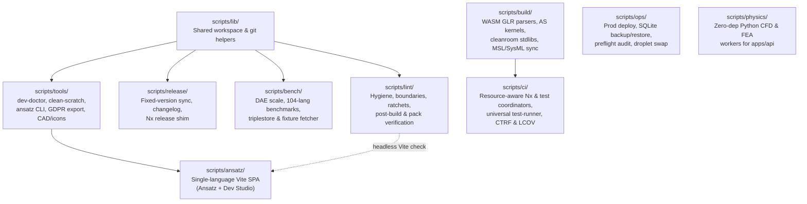

# `scripts` — ModelScript Monorepo Automation & Tooling

This directory houses all build, CI/test orchestration, repository hygiene, benchmarking, release, production operations, physics worker, and developer-experience scripts for the ModelScript monorepo.

## Architectural Map

Every subdirectory under `scripts/` owns a distinct lifecycle responsibility:

## Subdirectory Index

| Subdirectory                  | Purpose                                                                                                                                                      | Key Entry Points                                                                                                                                | Documentation                                   |
| ----------------------------- | ------------------------------------------------------------------------------------------------------------------------------------------------------------ | ----------------------------------------------------------------------------------------------------------------------------------------------- | ----------------------------------------------- |
| [`bench/`](./bench/)          | DAE linear-scaling, 104-language conformance/throughput, polyglot SysML2+Modelica, WASM triplestore benchmarks, and fixture ingestion                        | `npm run bench:dae-scale`, `npm run bench:languages`, `npm run bench:polyglot`, `npm run bench:triplestore`, `npm run fetch:benchmarks`         | [`bench/README.md`](./bench/README.md)          |
| [`build/`](./build/)          | Unified WASM GLR parser builder (`106` languages), AssemblyScript kernel & cleanroom stdlib builders, `asc` test cache, and MSL/stdlib archive sync          | Per-language `build` / `build:parser` / `build:wasm`, `sync-stdlibs.ts`, `download-msl.cjs`                                                     | [`build/README.md`](./build/README.md)          |
| [`ci/`](./ci/)                | Memory/CPU-aware Nx & test coordinators, LPT CI sharding, universal `test-runner.js` (`125` packages), CTRF & LCOV consolidators, local CI, CodeQL           | `npm run build`, `npm test`, `npm run ci:quick`, `npm run ci:act`, `npm run codeql`, `npm run test:consolidate`, `npm run coverage:consolidate` | [`ci/README.md`](./ci/README.md)                |
| [`lib/`](./lib/)              | Shared workspace discovery (`pnpm-workspace.yaml`), `REPO_ROOT`, `git ls-files`, and canonical exclusion regexes                                             | Imported by `scripts/lint/*`, `scripts/release/*`, `scripts/bench/*`, `scripts/tools/*`                                                         | [`lib/README.md`](./lib/README.md)              |
| [`lint/`](./lint/)            | Repository hygiene (`repo-doctor`), lockfile/cycle/header/filename/manifest/type-ratchet gates, `dist` & `npm pack` verifiers, language maturity & UI audits | `npm run lint:repo`, `npm run verify:dist`, `npm run verify:pack`, `npm run audit:languages`, `npm run verify:language-ui`                      | [`lint/README.md`](./lint/README.md)            |
| [`ops/`](./ops/)              | Production Docker Compose rollout with health checks & automatic rollback, atomic SQLite backup/restore, security preflight, VPS swap setup                  | `npm run preflight:prod`, `deploy.sh`, `backup.sh`, `restore.sh`, `setup-droplet-swap.sh`                                                       | [`ops/README.md`](./ops/README.md)              |
| [`physics/`](./physics/)      | Pure-Python (stdlib-only) analytical CFD and FEA workers dispatched by `apps/api` (`POST /api/v1/physics/run`)                                               | `run_cfd.py`, `run_fea.py`                                                                                                                      | [`physics/README.md`](./physics/README.md)      |
| [`ansatz/`](./ansatz-editor/) | Browser Vite/React SPA root for isolated single-language grammar, WASM CST, LSP, and UI panel development                                                    | Served by `npm run ansatz -- <lang>` (`scripts/tools/language-ansatz.ts`)                                                                       | [`ansatz/README.md`](./ansatz-editor/README.md) |
| [`release/`](./release/)      | Fixed-version monorepo sync (`X.Y.Z`), hybrid CI changelog/tagging orchestrator, and Nx 22 / `minimatch` v11 preload shim                                    | `npm run lint:versions`, `npm run sync:versions`, `npm run release:dry-run`, `npm run release`                                                  | [`release/README.md`](./release/README.md)      |
| [`tools/`](./tools/)          | Contributor onboarding diagnostics, scratch cleanup, single-language ansatz CLI, GDPR batch archive export, STEP & icon generators                           | `npm run doctor:dev`, `npm run clean:scratch`, `npm run ansatz`, `export-user-data.ts`                                                          | [`tools/README.md`](./tools/README.md)          |

## Common Developer Workflows

| Goal                                                              | Command                                             | Underlying Script(s)                                                                     |
| ----------------------------------------------------------------- | --------------------------------------------------- | ---------------------------------------------------------------------------------------- |
| Check local dev environment on first clone                        | `npm run doctor:dev`                                | `scripts/tools/dev-doctor.ts`                                                            |
| Develop a single language's grammar, LSP, or UI panels            | `npm run ansatz -- <lang>`                          | `scripts/tools/language-ansatz.ts` + `scripts/ansatz/`                                   |
| Run fast pre-PR checks (lint + affected tests)                    | `npm run ci:quick`                                  | `scripts/ci/ci-local.sh` -> `repo-doctor.ts`, `nx-coordinator.js`, `test-coordinator.js` |
| Auto-fix manifests, SPDX headers, Dockerfile copies, and versions | `npx tsx scripts/lint/repo-doctor.ts --fix`         | `scripts/lint/repo-doctor.ts`                                                            |
| Verify built `dist/` exports and publishable tarballs             | `npm run verify:dist && npm run verify:pack`        | `scripts/lint/verify-dist-integrity.ts`, `scripts/lint/verify-pack-install.ts`           |
| Sync standard library archives (MSL, SysML v2, OpenIPSL)          | `npx tsx scripts/build/sync-stdlibs.ts --pack=core` | `scripts/build/sync-stdlibs.ts`                                                          |
| Run local CodeQL security scan                                    | `npm run codeql` (or `npm run codeql:docker`)       | `scripts/ci/codeql-scan.sh` + `scripts/ci/summarize-sarif.cjs`                           |
| Clean untracked scratch scripts and logs                          | `npm run clean:scratch`                             | `scripts/tools/clean-scratch.ts`                                                         |
| Preview the next release version and changelog notes              | `npm run release:dry-run`                           | `scripts/release/ci-release-version.ts`                                                  |

## Conventions & Notes

1. **Workspace discovery:** New scripts that iterate over monorepo packages or tracked files should import `getWorkspacePackages`, `getWorkspaceDirs`, `getTrackedFiles`, and `shouldExcludeRepoPath` from [`scripts/lib/workspaces.ts`](./lib/workspaces.ts) instead of scanning directories manually.
2. **Linting scripts themselves:** All files in `scripts/` are linted by `npm run lint:scripts` (`eslint scripts eslint.config.ts --no-warn-ignored`) and checked for SPDX license headers (`AGPL-3.0-or-later`) by `scripts/lint/normalize-headers.ts`.
3. **Gitignored caches & archives in `scripts/`:**
   - `scripts/*.zip` (e.g., `ModelicaStandardLibrary_v4.1.0.zip`, `SysML-v2-Release-2026-03.zip`, `OpenIPSL_v3.1.0.zip`) are gitignored standard library archives populated on demand by [`scripts/build/sync-stdlibs.ts`](./build/sync-stdlibs.ts) or [`scripts/build/download-msl.cjs`](./build/download-msl.cjs).
   - `scripts/msl/` is a gitignored extraction directory created by `scripts/build/download-msl.cjs --extract`. Do not commit files inside `scripts/msl/`.
4. **Self-tests for script infrastructure:**
   - `node scripts/ci/test-coordinator.test.mjs` — tests resource allocation and LPT shard bin-packing.
   - `npx tsx scripts/lint/repo-hygiene.test.mjs` — tests `scripts/lint/*` and `scripts/lib/workspaces.ts`.
