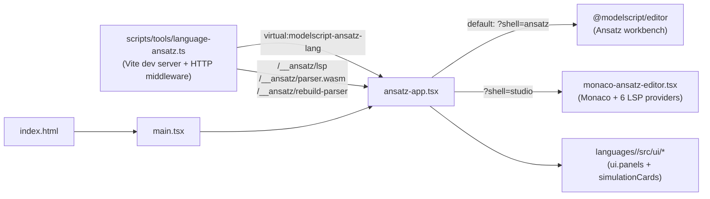

# `scripts/ansatz` — Single-Language Vite Ansatz SPA

This directory is the browser Single-Page Application (SPA) root served by [`scripts/tools/language-ansatz.ts`](../tools/language-ansatz.ts) (`npm run ansatz -- <lang>`). It lets language authors develop and test a single language's grammar, WASM CST, `@modelscript/lsp/core` providers, stencils, toolbar buttons, and React UI panels in isolation without building or loading all 104+ languages in `apps/web`.

It is also used as the Vite root by [`scripts/lint/verify-language-ui-panels.ts`](../lint/verify-language-ui-panels.ts) to compile-check language UI panels headlessly.

## Architecture Overview



## File Reference

| File                                                     | Role                                                                                                                                                                                                                                                                                                                                                        |
| -------------------------------------------------------- | ----------------------------------------------------------------------------------------------------------------------------------------------------------------------------------------------------------------------------------------------------------------------------------------------------------------------------------------------------------- |
| [`index.html`](./index.html)                             | Minimal HTML5 shell mounting `/main.tsx` onto `#root`.                                                                                                                                                                                                                                                                                                      |
| [`tsconfig.json`](./tsconfig.json)                       | Browser/Vite TypeScript configuration (`DOM` libs, `jsx: "react-jsx"`, source path aliases for `@modelscript/editor`, `@modelscript/design-tokens`, `@modelscript/react`). Excluded from root `tsconfig.json` to keep DOM types isolated from Node scripts.                                                                                                 |
| [`env.d.ts`](./env.d.ts)                                 | Ambient declarations for `*.css` imports and the Vite virtual module `virtual:modelscript-ansatz-lang` (`ANSATZ_LANG`, panels, simulation cards, stencils, samples, tree views, toolbar buttons).                                                                                                                                                           |
| [`main.tsx`](./main.tsx)                                 | React 19 entry point loading `@modelscript/design-tokens` CSS, `apps/web/src/index.css`, and `ansatz-styles.css`, then rendering `<AnsatzApp />`.                                                                                                                                                                                                           |
| [`ansatz-app.tsx`](./ansatz-app.tsx)                     | Main React workbench hosting the active language in either **Ansatz mode** (default, full `@modelscript/editor` workbench with Primer theme and HTTP LSP transport) or **Dev Studio mode** (`?shell=studio`, split editor + live WASM CST inspector + diagnostics + `LanguagePanelHost` event log + `Rebuild WASM` button + mock simulation result editor). |
| [`monaco-ansatz-editor.tsx`](./monaco-ansatz-editor.tsx) | Monaco Editor wrapper used in Dev Studio mode. Dynamically builds a Monarch syntax highlighter (including XML and INI/section dialects) and wires 6 LSP providers (`SemanticTokens`, `Hover`, `Completion`, `DocumentSymbol`, `FoldingRange`, `InlayHints`) over `/__ansatz/lsp`.                                                                           |
| [`ansatz-styles.css`](./ansatz-styles.css)               | Layout and theme tokens (`[data-theme="dark"                                                                                                                                                                                                                                                                                                                | "light"]`and`[data-tokens="vscode"]`) for Dev Studio mode. |

## Usage & Query Parameters

Start the ansatz via `scripts/tools/language-ansatz.ts`:

```bash
# From repo root
npm run ansatz -- modelica

# Or from inside any languages/<slug>/ directory
npm run ansatz
```

Supported URL query parameters in `ansatz-app.tsx`:

- `?shell=ansatz|studio` — Switch between the full Ansatz workbench (`ansatz`, default) and the lightweight Dev Studio (`studio`).
- `?mode=workbench|inspector|artifact` — Host surface mode in Dev Studio.
- `?theme=dark|light` — Color theme.
- `?tokens=web|vscode` — Switch between Web CSS tokens and VS Code CSS tokens in Dev Studio.
- `?panel=<id>` — Pre-select a specific language UI panel.
