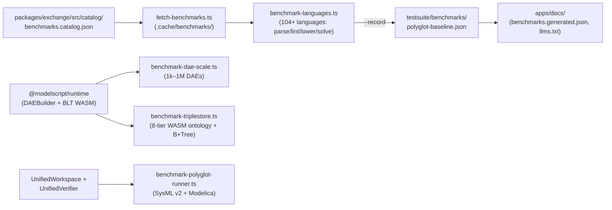

# `scripts/bench` — Benchmarks & Fixture Ingestion

This directory contains ModelScript's performance, scalability, and polyglot parity benchmark harnesses, along with the on-demand third-party benchmark fixture downloader.

## Architecture Role

## Quick Reference

| File                                                                       | npm Script(s)                                             | When to Use                                                                                                                             |
| -------------------------------------------------------------------------- | --------------------------------------------------------- | --------------------------------------------------------------------------------------------------------------------------------------- |
| [`benchmark-dae-scale.ts`](./benchmark-dae-scale.ts)                       | `bench:dae-scale`                                         | Verify $O(E)$ linear scaling of DAE constant folding, alias elimination, Pantelides, and WASM BLT up to 100k (or 1M) equations.         |
| [`benchmark-languages.ts`](./benchmark-languages.ts)                       | `bench:languages`, `bench:languages:record`               | Measure parse/lint/lower/solve performance and parity across all language packages; refresh `polyglot-baseline.json` and docs metrics.  |
| [`benchmark-polyglot-runner.ts`](./benchmark-polyglot-runner.ts)           | `bench:polyglot`                                          | Benchmark end-to-end cross-domain SysML v2 + Modelica indexing, DAE flattening, and `UnifiedVerifier` incremental re-verification.      |
| [`benchmark-polyglot-incremental.ts`](./benchmark-polyglot-incremental.ts) | `npx tsx scripts/bench/benchmark-polyglot-incremental.ts` | Earlier standalone SysML v2 + Modelica edit-latency micro-benchmark (largely superseded by `benchmark-polyglot-runner.ts`).             |
| [`benchmark-triplestore.ts`](./benchmark-triplestore.ts)                   | `bench:triplestore`                                       | 8-tier WASM triplestore, RoaringBitmap, EL++ reasoner, and paged B+Tree scalability suite (with Jena/SQLite/N3/Comunica comparisons).   |
| [`fetch-benchmarks.ts`](./fetch-benchmarks.ts)                             | `fetch:benchmarks`                                        | Download, verify, and extract external engineering benchmark suites into `.cache/benchmarks/` (or generate synthetic offline fixtures). |

---

## Script Reference

### [`benchmark-dae-scale.ts`](./benchmark-dae-scale.ts)

- **Purpose:** Stress-tests the pre-simulation DAE arena pipeline in `@modelscript/runtime` (`DAEBuilder` + BLT WASM) from `N = 1,000` to `100,000` (or `1,000,000`) coupled equations to catch $O(N^2)$ fixed-point regressions.
- **When to use:** Run `npm run bench:dae-scale` after modifying `DAEBuilder`, `foldArenaConstants`, `eliminateArenaAliases`, `pantelidesIndexReductionArena`, or `performBltTransformationArena`.
- **How it works:**
  - Constructs a synthetic arena with a deep parameter dependency cascade (`min(N, 100)` parameters), `N` coupled DAEs (`der(x_i) = p_last * y_i`, `y_i = x_i + 1.0`), and `min(N, 1000)` alias equations.
  - Initializes BLT WASM (`initBltWasm()`) and times all four passes sequentially.
  - Enforces hard latency budgets: `10k < 250 ms`, `100k < 2,500 ms`, and (with `--million`) `1M < 35,000 ms`.
- **CLI flags:** `--million` or `--1m` (expands scales from `[1k, 10k, 50k, 100k]` up to `1,000,000`).
- **Outputs & exit codes:** Prints a per-stage latency table to stdout (no filesystem side effects). Exits `0` if budgets pass, `1` if a budget assertion fails.
- **Callers:** Root `package.json` (`bench:dae-scale`).

---

### [`benchmark-languages.ts`](./benchmark-languages.ts)

- **Purpose:** Unified polyglot capability, throughput, and reference-parity benchmark runner across all language packages in `languages/*`.
- **When to use:** Run `npm run bench:languages -- --lang=<slug>` while developing or optimizing a language package; run `npm run bench:languages:record` to update `testsuite/benchmarks/polyglot-baseline.json` and regenerate VitePress benchmark docs.
- **How it works:**
  - **Parse:** Loads sample code from `apps/docs/docs/.vitepress/theme/data/language-examples.generated.json`, runs 2 warmups + `N` timed iterations against `dist/parser.wasm` (via `createWasmParser`) or JS fallback exports.
  - **Lint & Lower:** Dynamically imports `dist/src/index.js`, discovers `lint*` and lowering/compiler exports (`*ToDae`, `*ToModelica`, `compile*ToStep`, `Context.flattenArena`, etc.), and times each stage.
  - **Solve:** Loads `languages/<slug>/tests/*-benchmark-runner.ts` (`LanguageBenchmarkAdapter`) and runs numerical reference-parity cases.
  - **Scorecard:** Combines `auditLanguage(slug)` (from `scripts/lint/audit-language-maturity.ts`) and `@modelscript/exchange/catalog` metadata with git/hardware provenance.
- **CLI flags:**
  - `--lang=<slug1,slug2>`: Filter to specific languages.
  - `--record`: Merge/write `testsuite/benchmarks/polyglot-baseline.json` and regenerate `@modelscript/docs` benchmark & `llms.txt` data.
  - `--json=<path>`: Write full JSON report to a custom path.
  - `--ctrf=<path>`: Write CTRF JSON test report.
  - `--iterations=<n>`: Timed iterations per stage (default `10`).
  - `--tolerance=<num>`: Override adapter tolerance.
- **Exit codes:** `0` if all checked languages pass all cases; `1` if any case fails.
- **Callers:** Root `package.json` (`bench:languages`, `bench:languages:record`); baseline consumed by `apps/docs/scripts/gen-benchmark-data.ts`.

---

### [`benchmark-polyglot-runner.ts`](./benchmark-polyglot-runner.ts)

- **Purpose:** End-to-end cross-domain benchmark exercising coupled SysML v2 (`BatterySystem_<n>`) and Modelica (`BatteryDynamics_<n>`) models across `UnifiedWorkspace`, `Context.flattenArena()`, and `UnifiedVerifier`.
- **When to use:** Run `npm run bench:polyglot` when modifying cross-domain indexing (`UnifiedWorkspace`), Modelica/SysML v2 incremental flattening, or `UnifiedVerifier` contract/decision/region verification.
- **How it works:** Runs scales `[10, 50, 100]` cells and times four stages:
  1. Cold start: parse & unified indexing, DAE arena flattening, and full `UnifiedVerifier.verify()` (decisions, region decomposition, contracts).
  2. Incremental SysML v2 requirement threshold edit (`max_safe_temp`) and re-verification.
  3. Incremental Modelica parameter edit (`R`) and DAE re-flattening.
  4. Incremental decision-table analysis delta.
- **CLI flags:** None (programmatic export `runGenericPolyglotBenchmark({ scale, threshold })` accepts custom scale/threshold).
- **Callers:** Root `package.json` (`bench:polyglot`).

---

### [`benchmark-polyglot-incremental.ts`](./benchmark-polyglot-incremental.ts)

- **Purpose:** Earlier standalone micro-benchmark timing cold start and four SysML v2 / Modelica edit scenarios at `N = 10` cells against a `< 300 ms` target.
- **When to use:** Largely superseded by [`benchmark-polyglot-runner.ts`](./benchmark-polyglot-runner.ts). Run directly via `npx tsx scripts/bench/benchmark-polyglot-incremental.ts` only for quick, isolated parser/flattener edit timing without `UnifiedVerifier`.
- **Callers:** Not wired into `package.json` or CI.

---

### [`benchmark-triplestore.ts`](./benchmark-triplestore.ts)

- **Purpose:** 8-tier scalability and head-to-head comparison suite for ModelScript's WASM semantic triplestore, ontology reasoner, and paged B+Tree storage engine in `@modelscript/runtime`.
- **When to use:** Run `npm run bench:triplestore` (or `-- --quick`) when optimizing `packages/runtime/src/wasm/ontology_module/`, `wasm_ontology.ts`, or `paged_store.ts`.
- **How it works:**
  - **Tiers 1–6 (Internal):** 64-bit FNV-1a IRI hashing & entity interning, HDT front-coded dictionary compression, zero-GC columnar ingestion, SPO/POS/RoaringBitmap query scaling, reasoning (interval index, $O(1)$ subsumption, `path+`, 3-pattern BGP joins, EL++ saturation, DRed retraction), and 4KB paged B+Tree with Clock buffer pool.
  - **Tiers 7–8 (External Comparisons):** Compares against Apache Jena TDB2 (in-mem & disk, optionally downloading `jena-fuseki-server-5.2.0.jar` into `.cache/jena/` and compiling `JenaTdb2Benchmark.java` if `javac`/`java` are available), SQLite3 (`better-sqlite3`), `N3.Store`, and Comunica SPARQL 1.1.
- **CLI flags:**
  - `--quick`: Smaller scale sets (`[1k, 5k, 25k]` triples, `[200, 1k, 2.5k]` reasoning).
  - `--scales=<n1,n2,...>`: Custom triple counts.
  - `--json=<relpath>`: Write JSON report relative to repo root.
- **Side effects:** May create `.cache/jena/` and compile `JenaTdb2Benchmark.class` (also reused by `packages/runtime/tests/triplestore-scalability.test.ts`).
- **Callers:** Root `package.json` (`bench:triplestore`).

---

### [`fetch-benchmarks.ts`](./fetch-benchmarks.ts)

- **Purpose:** On-demand ingestion and integrity verification for external third-party engineering benchmark suites declared in `packages/exchange/src/catalog/benchmarks.catalog.json` (51 catalog entries).
- **When to use:** Run `npm run fetch:benchmarks` before running `npm run test:benchmarks` locally, or pass `--synthetic` in offline/air-gapped environments. Runs automatically in GitHub Actions' `polyglot_benchmarks` job.
- **How it works:**
  - Downloads upstream archives (with fallback/mirror URLs), optionally verifies SHA-256 checksums, unpacks into `.cache/benchmarks/<language>/<id>/`, normalizes entry filenames (e.g., OpenSim, OpenDSS), and writes `.cache/benchmarks/manifest.json`.
  - When `--synthetic` is set (or on network failure in non-strict mode), generates deterministic reference fixtures for 20+ languages.
- **CLI flags:**
  - `--all` (default), `--lang=<slug1,slug2>`, `--tier=<beta-to-stable|preview-to-beta|stable-hardening>`, `--domain=<domain>`.
  - `--outDir=<path>` (default `.cache/benchmarks/`).
  - `--verify` (enforce SHA-256 checks), `--force` (bypass cache), `--synthetic` (offline fixtures), `--ci` (fail non-zero if any suite fails).
- **Exit codes:** `0` on success; `1` if zero suites match or if any suite fails under `--ci` / `--verify`.
- **Callers:** Root `package.json` (`fetch:benchmarks`) and `.github/workflows/ci.yml` (`polyglot_benchmarks` job).
