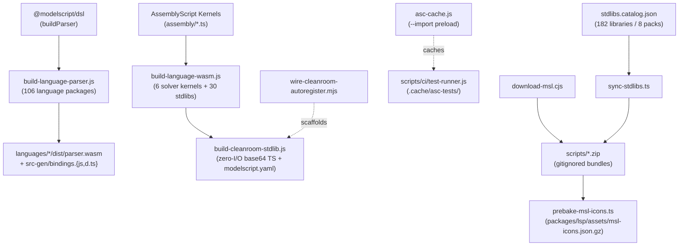

# `scripts/build` — Parser, WASM Kernel & Standard Library Builders

This directory contains ModelScript's unified build pipelines for compiling native WebAssembly GLR parsers (`parser.wasm`), AssemblyScript simulation/solver kernels, cleanroom embedded standard libraries, and fetching/packaging upstream standard library archives (MSL, SysML v2, OpenIPSL, etc.).

## Architecture Overview

## Quick Reference

| File | Typical Invocation | When to Use |
| --- | --- | --- |
| [`build-language-parser.js`](./build-language-parser.js) | `node ../../scripts/build/build-language-parser.js` (per-language `build` / `build:parser`) | Compile any language's `src/language.ts` grammar into `dist/parser.wasm` and typed JS/TS bindings. |
| [`build-language-wasm.js`](./build-language-wasm.js) | Imported by `languages/*/scripts/build-wasm.js` & `build-cleanroom-stdlib.js` | Content-hashed AssemblyScript compilation for domain physics/solver WASM kernels. |
| [`build-cleanroom-stdlib.js`](./build-cleanroom-stdlib.js) | Imported by 30 `languages/*/scripts/build-stdlib.js` scripts | Package cleanroom `symbols.json`, `diagrams.json`, and `runtime.wasm` into zero-I/O embedded TS modules. |
| [`asc-cache.js`](./asc-cache.js) | `--import scripts/build/asc-cache.js` (auto-injected by `test-runner.js`) | Transparently cache dynamically compiled AssemblyScript test parsers in `.cache/asc-tests/`. |
| [`sync-stdlibs.ts`](./sync-stdlibs.ts) | `npx tsx scripts/build/sync-stdlibs.ts --pack=core` | Download, repack, and verify standard library `.zip` bundles from `stdlibs.catalog.json` for IDE/web/CI builds. |
| [`download-msl.cjs`](./download-msl.cjs) | `node scripts/build/download-msl.cjs --version=4.1.0 --extract` | Fetch and extract Modelica Standard Library (`ModelicaStandardLibrary_v4.1.0.zip`) for tests, MSL verification, and IDE bundles. |
| [`download-sysml2.cjs`](./download-sysml2.cjs) | `node scripts/build/download-sysml2.cjs` | Standalone helper to fetch and trim SysML v2 `2026-03` library zip (superseded by `sync-stdlibs.ts --pack=core`). |
| [`prebake-msl-icons.ts`](./prebake-msl-icons.ts) | `npx tsx scripts/build/prebake-msl-icons.ts` | Regenerate `packages/lsp/assets/msl-icons.json.gz` from an MSL `lsp-bundle.zip` with viewBox padding. |
| [`wire-cleanroom-autoregister.mjs`](./wire-cleanroom-autoregister.mjs) | `node scripts/build/wire-cleanroom-autoregister.mjs` | Maintenance scaffolding script to wire cleanroom stdlib auto-registration into `languages/*/src/language.ts`. |

---

## Script Reference

### [`build-language-parser.js`](./build-language-parser.js)

- **Purpose:** Unified GLR parser generator and WebAssembly compiler powering all 106 language packages (`104` invoke it directly in `package.json`; `languages/modelica/build.js` and `languages/sysml2/build.js` import `runLanguageParserBuild()`).
- **When to use:** Invoked automatically by `npm run build` / `npm run build:parser` inside any language workspace or via `nx build`. Pass `--force` to bypass the cache or `--release` for full `-Os` optimization.
- **How it works:**
  - Hashes `src/language.ts`, optimization profile, `extraAscFlags`, `@modelscript/dsl` compiler & runtime templates, and `extraWatchFiles`. On a cache hit in `.cache/parser.hash`, restores missing `dist/parser.wasm` and `bindings.{js,d.ts}` without recompiling.
  - On a miss, runs `buildParser()` from `@modelscript/dsl` via `tsx` (auto-adding `--max-old-space-size=8192`) to emit `as-gen/` and `src-gen/bindings.{js,d.ts}` + `dist/src-gen/bindings.{js,d.ts}`.
  - Compiles `as-gen/parser.ts` to `dist/parser.wasm` with `asc` (`--exportRuntime --enable threads --enable simd --runtime stub`), then runs native `wasm-opt` if available on `PATH` (falling back to `asc` optimization flags).
- **CLI flags & environment variables:**
  - `--force` (bypass cache), `--release` (force `-Os` / full optimization), `--dev` (disable optimization).
  - `CI=true` / `GITHUB_ACTIONS=true`: forces `"full"` optimization.
  - `MS_WASM_OPT`: `0|none`, `1|fast` (local default), `2|o2`, `3|s|full`.
  - `MS_WASM_OPT_BIN` (explicit `wasm-opt` binary path), `MS_WASM_OPT_DISABLE_NATIVE=1`.
- **Wiring:** Listed in `nx.json#namedInputs.sharedGlobals` so edits invalidate Nx build caches across all languages.

---

### [`build-language-wasm.js`](./build-language-wasm.js)

- **Purpose:** Content-hashed AssemblyScript compiler (`runLanguageWasmBuild(options)`) for domain simulation/solver WASM kernels and cleanroom stdlib runtimes.
- **When to use:** Imported by `build-cleanroom-stdlib.js` (30 languages) and by 6 domain solver build scripts (`gensys`, `pscad`, `psse`, `relap5`, `sima`, `simpack`). Runs automatically during `npm run build` / `npm run build:wasm`.
- **How it works:**
  - Computes a SHA-256 hash over `asconfig.json`, `entryFile`, `<dir>/assembly/**`, and shared `packages/runtime/assembly/physics/**`.
  - On cache hit (`.cache/<name>.hash`), restores `outWasmFile` and syncs the optional base64 TypeScript wrapper without invoking `asc`.
  - On miss, runs `asc <entryFile> --config asconfig.json --outFile <outWasmFile>` and optionally emits an isomorphic base64 TS module (`Buffer.from` in Node, `atob` in browsers/Workers).
- **CLI flags:** Reads `--force` from `process.argv` to bypass caching.
- **Wiring:** Listed in `nx.json#namedInputs.sharedGlobals`.

---

### [`build-cleanroom-stdlib.js`](./build-cleanroom-stdlib.js)

- **Purpose:** Library module (`buildCleanroomStdLib(options)`) that packages a language's cleanroom standard library into both a distributable library package (`assets/<lang>-std-lib/`) and a zero-I/O embedded TypeScript data module (`src/catalog/<lang>-std-lib-data.ts`).
- **When to use:** Imported by `languages/<lang>/scripts/build-stdlib.js` across 30 cleanroom-stdlib languages (`adams`, `ampl`, `aspen`, `atp`, `cyme`, `easy5`, `eclipse`, `fea`, `gensys`, `gproms`, `gtsuite`, `lps`, `magicdraw`, `mlxtran`, `nmtran`, `olga`, `oneliner`, `plscadd`, `powerfactory`, `powerworld`, `pslf`, `relap5`, `rocets`, `rtds`, `sel`, `sima`, `simpack`, `simulink`, `spice`, `tough`).
- **How it works:** Copies `symbols.json` and `diagrams.json` into `dist/`, idempotently writes `modelscript.yaml`, compiles `runtime.wasm` via `runLanguageWasmBuild()`, and emits `<constPrefix>_PKG_JSON`, `<constPrefix>_SYMBOLS`, `<constPrefix>_DIAGRAMS`, `<constPrefix>_WASM_BASE64`, and `<wasmGetterName>()` using `decodeBase64Wasm()` from `@modelscript/runtime`.

---

### [`asc-cache.js`](./asc-cache.js)

- **Purpose:** Transparent Node `--import` preload hook that caches compiled AssemblyScript test parsers in `.cache/asc-tests/<sha256>.wasm`.
- **When to use:** Injected automatically by `scripts/ci/test-runner.js` on every `tsx --test` run. No manual invocation needed.
- **How it works:** Patches both ESM and CJS `fs.writeFileSync`, `fs.readFileSync`, and `child_process.execFileSync`. Hashes `.ts`/`.json` sources in scratch parser directories (`scratch_build`, `scratch_`, `as-gen`), short-circuiting `asc` invocations on cache hit and persisting newly compiled `.wasm` binaries on cache miss.
- **CI caching:** `.cache/asc-tests` is persisted across GitHub Actions runs in `.github/actions/setup-workspace/action.yml` and `.github/workflows/ci.yml`.

---

### [`sync-stdlibs.ts`](./sync-stdlibs.ts)

- **Purpose:** Polyglot standard library synchronizer driven by `packages/exchange/src/catalog/stdlibs.catalog.json` (182 entries across 8 domain packs: `core`, `power-energy`, `mobility-auto`, `fluids-process`, `cad-structures`, `life-sciences`, `mobility-systems`, `electrical-power`).
- **When to use:** Run `npx tsx scripts/build/sync-stdlibs.ts --pack=core` before building Web IDE, VS Code extension, or Docker images so bundled archives (`ModelicaStandardLibrary_v4.1.0.zip`, `SysML-v2-Release-2026-03.zip`, `OpenIPSL_v3.1.0.zip`, etc.) are present in `scripts/`.
- **How it works:** Packs local sources or downloads upstream archives via `curl` (with mirrors and retries), applies special repack rules (`sysml-library-only`, `openipsl-only`), and validates SHA-256 checksums.
- **CLI flags:** `--pack=<packId|all>` (default `"core"`), `--lang=<slug>`, `--outDir=<path>` (default `scripts/`), `--verify`, `--force`.
- **Callers:** `.github/workflows/ci.yml` (`build` and `docker_build`), `.github/workflows/nightly.yml` (`community_library_conformance`), and `.github/workflows/release.yml`.

---

### [`download-msl.cjs`](./download-msl.cjs)

- **Purpose:** Downloads and optionally extracts the official Modelica Standard Library release zip into `scripts/ModelicaStandardLibrary_v<version>.zip`.
- **When to use:** Run before running Modelica/MSL verification suites (`npm run test:msl`) or when `npm run doctor:dev` reports a missing MSL installation.
- **How it works:** Reuses an existing archive or local OpenModelica library (`~/.openmodelica/libraries/Modelica <version>+maint.om`) if available; otherwise downloads from GitHub releases and, with `--extract`, unpacks into `--outDir` (default `scripts/msl`) with a `Modelica` symlink.
- **CLI flags:** `--version=<semver>` (default `"4.1.0"`), `--extract` / `-x`, `--outDir=<path>` (default `scripts/msl`).
- **Callers:** `.github/workflows/ci.yml`, `.github/workflows/nightly.yml`, `.github/workflows/release.yml`, `scripts/ci/ci-local.sh`, and `packages/lsp/tests/ansatz-load-example-model.test.ts`.

---

### [`download-sysml2.cjs`](./download-sysml2.cjs)

- **Purpose:** Standalone legacy helper that downloads SysML v2 Release `2026-03`, strips non-library files (~63 MB → ~50 KB), and writes `scripts/SysML-v2-Release-2026-03.zip`.
- **When to use:** Prefer [`sync-stdlibs.ts`](./sync-stdlibs.ts) (`--pack=core` or `--lang=sysml2`), which implements the same `sysml-library-only` repack flow with catalog verification.

---

### [`prebake-msl-icons.ts`](./prebake-msl-icons.ts)

- **Purpose:** Pre-bakes MSL 4.1.0 SVG component icons from `data/libraries/Modelica/4.1.0/lsp-bundle.zip` into gzip-compressed `packages/lsp/assets/msl-icons.json.gz` (and `packages/lsp/dist/msl-icons.json.gz` if `dist/` exists), adding 2.5% viewBox padding to icons with negative coordinates to prevent SVG clipping.
- **When to use:** Maintainer-only script run when regenerating the committed MSL icon bundle consumed by `@modelscript/lsp`, `languages/modelica`, and `apps/web`.
- **Note:** Currently resolves `repoRoot` as `resolve(__dirname, "..")` (`scripts/`) rather than `resolve(__dirname, "../..")` after being moved into `scripts/build/`; verify/update that path before running.

---

### [`wire-cleanroom-autoregister.mjs`](./wire-cleanroom-autoregister.mjs)

- **Purpose:** Idempotent scaffolding script that injects `import { register*StdLib } from "./catalog/library-package-adapter.js"` and its registration call into `languages/<lang>/src/language.ts` across the 30 cleanroom-stdlib languages.
- **When to use:** Developer maintenance script when onboarding or bulk-updating cleanroom stdlib auto-registration.
- **Note:** Currently resolves `ROOT` as `new URL("..", import.meta.url)` (`scripts/`) rather than `"../.."` after being moved into `scripts/build/`; verify/update that path before running.
